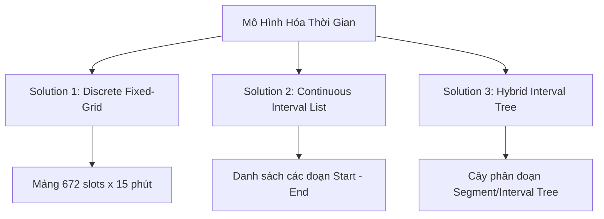
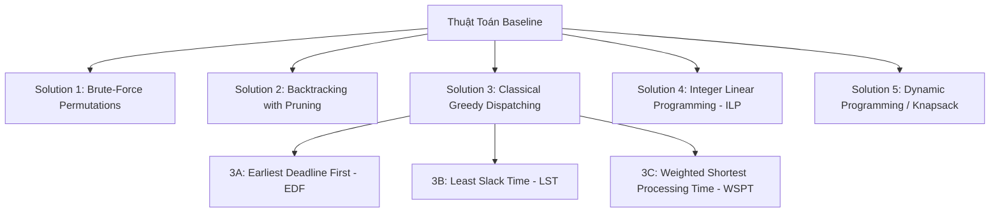
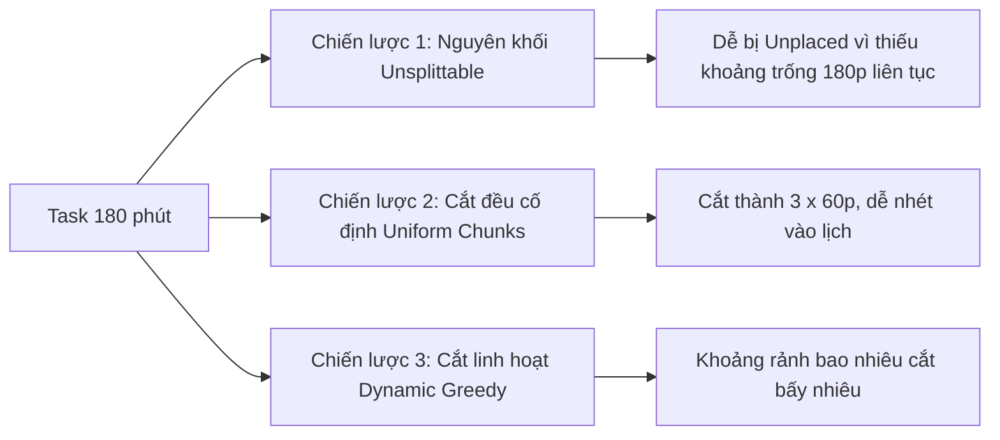
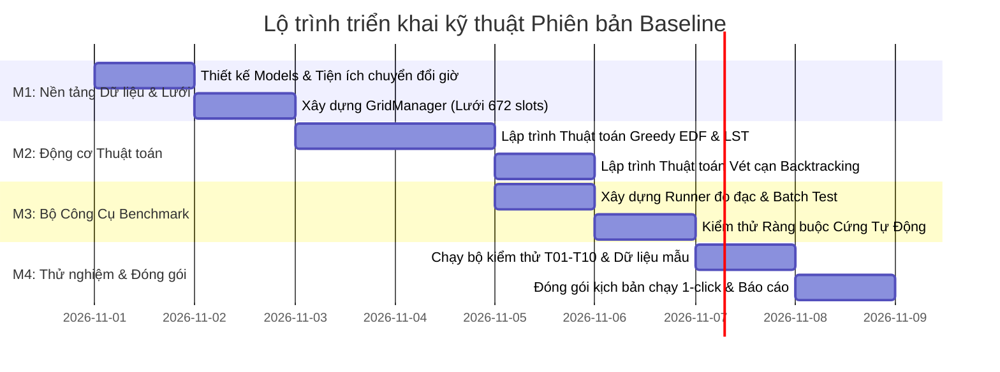

# KẾ HOẠCH NGHIÊN CỨU & TRIỂN KHAI PHIÊN BẢN BASELINE (V0)
## Hệ Thống Xếp Lịch Tự Động SmartSchedule — Personal Productivity Assistant
**Môn học:** CSC10014 — Tư Duy Tính Toán (Computational Thinking - 2026)  
**Đơn vị:** Khoa Công nghệ Thông tin, Trường Đại học Khoa học Tự nhiên, ĐHQG-HCM (FIT-HCMUS)  
**Nhóm thực hiện:** Nhóm 03 — The Seven Dwarfs  
**Định dạng tài liệu:** Kế hoạch Kỹ thuật Thuật toán & Động cơ Cốt lõi (Core Engine & Algorithmic Plan)  
**Phạm vi tài liệu:** TẬP TRUNG 100% VÀO THUẬT TOÁN, DỮ LIỆU VÀ ĐÁNH GIÁ ĐỐI CHỨNG (KHÔNG CHỨA UI/UX)

---

## 1. NGUYÊN TẮC THIẾT KẾ & ĐỊNH HƯỚNG BASELINE

### 1.1. Bản Chất của Baseline trong Nghiên Cứu Khoa Học & Tư Duy Tính Toán
Trong nghiên cứu thuật toán và kỹ thuật hệ thống, **Baseline (Hệ thống mốc chuẩn)** là điều kiện tiên quyết để đánh giá một giải pháp mới. Báo cáo đề xuất (Proposal Report) mới chỉ là bản thiết kế ý tưởng ban đầu; trong quá trình hiện thực hóa hành động (Action Phase), nhóm cần tiếp cận đa chiều, xem xét nhiều giải pháp thuật toán khác nhau để chọn ra giải pháp đối chứng tốt nhất.

**Các yêu cầu nền tảng của phiên bản Baseline:**
1. **Tính độc lập & Tất định (Pure Determinism):** Tuyệt đối không chứa yếu tố ngẫu nhiên (non-deterministic). Cùng một tập dữ liệu đầu vào và các ràng buộc, hệ thống phải luôn cho ra đúng một kết quả duy nhất.
2. **Không AI / Học máy (Zero AI / Zero ML):** 
   - Loại bỏ hoàn toàn mô hình ngôn ngữ lớn (LLM Natural Language Parser - Module M1).
   - Dữ liệu đầu vào hoàn toàn thông qua các tệp tin cấu trúc chuẩn (`JSON`, `CSV`, `YAML`) hoặc tham số dòng lệnh CLI.
3. **Không Tâm lý học hành vi (Zero Behavioral Psychology):**
   - **Không áp dụng hệ số đệm thời gian (No Planning Fallacy Buffers):** Giữ nguyên thời lượng ước tính thô $T_{\text{planned}} = T_{\text{estimate}}$, không nhân $\times 1.2$ hay $\times 1.35$.
   - **Không phân loại nhận thức (No Cognitive Load):** Công việc không bị phân thành Deep / Medium / Shallow để gán quy tắc thời gian.
   - **Không khớp nhịp sinh học (No Circadian Rhythm Matching):** Không gán mức năng lượng 1–3 cho các khung giờ; mọi giờ trống khả dụng đều có trọng số bình đẳng.
   - **Không tự động chèn khoảng nghỉ (No 15-minute Rest Breaks):** Các công việc có thể xếp liên tiếp nhau nếu đủ thời gian.
   - **Không phạt chuyển ngữ cảnh (No Context-Switching Penalty):** Không áp dụng thuật toán gom cụm (batching) hay tính điểm lân cận (neighbour score).
   - **Không xử lý vùng chết (No Dead-Zone Active Rest):** Các khoảng trống nhỏ (< 30 phút) vẫn được coi là thời gian rảnh hợp lệ (FREE).
4. **Trọng tâm bài toán:** Giải quyết bài toán **Tối ưu hóa Thỏa mãn Ràng buộc Cổ điển (Classical Constraint Satisfaction & Scheduling Problem - CSP)** với các ràng buộc cứng không thể thương lượng:
   - $H_1$: Không chồng lấn với lịch cố định (Lớp học, ca làm, họp, ăn uống).
   - $H_2$: Giờ ngủ được khóa cứng và bảo vệ tuyệt đối (Tối thiểu 6–7 tiếng/đêm).
   - $H_3$: Công việc chỉ được đặt vào các khoảng thời gian trống xác thực (FREE slots).
   - $H_4$: Công việc phải hoàn thành trước thời hạn chót (Deadline) nếu khả thi.
   - $H_5$: Tôn trọng thứ tự phụ thuộc công việc ($A \to B$: $B$ chỉ bắt đầu sau khi $A$ kết thúc).

---

## 2. NGHIÊN CỨU & ĐÁNH GIÁ CÁC GIẢI PHÁP BIỂU DIỄN THỜI GIAN (TIME REPRESENTATION)

Để máy tính có thể tính toán thời gian, ta cần trừu tượng hóa (Abstraction) dòng thời gian thực thành cấu trúc dữ liệu. Có 3 giải pháp kiến trúc chính:



### Giải pháp 1: Lưới Rời Rạc Cố Định (Discrete Fixed-Size Time Grid - 15 phút / 672 slots)
* **Cơ chế:** Chia tuần học (7 ngày $\times$ 24 giờ) thành mảng 1 chiều gồm $672$ ô (slots), mỗi ô đại diện cho 15 phút:
  $$\text{Slot Index} = \text{day} \times 96 + \text{hour} \times 4 + \lfloor \text{minute} / 15 \rfloor$$
  Mỗi slot lưu một mã trạng thái nhị phân hoặc enum: `FREE`, `OCCUPIED`, `SLEEP`, `BLOCK:task_id`.
* **Ưu điểm:**
  - Cực kỳ trực quan, dễ lập trình và ánh xạ 1-1 với ma trận tính toán tuần.
  - Phù hợp với kỹ thuật mảng băm ($O(1)$ lookup thời gian trống).
  - Tự nhiên phù hợp với các phương pháp chia khối làm việc (Pomodoro 25p làm tròn lên 30p, Deep Work 60p, 90p).
* **Nhược điểm:**
  - Hao phí bộ nhớ và phép tính dư thừa khi khoảng thời gian trống kéo dài cả ngày nhưng vẫn phải duyệt qua từng slot 15 phút.
  - Xảy ra sai số làm tròn (Quantization Error / Internal Fragmentation): một task 20 phút buộc phải chiếm trọn 30 phút (lãng phí 10 phút) hoặc 15 phút (bị thiếu 5 phút).
* **Độ phức tạp:** Không gian $O(S)$ với $S = 672$ (cố định). Thời gian kiểm tra khoảng trống độ dài $K$: $O(K)$.

### Giải pháp 2: Danh Sách Khoảng Thời Gian Liên Tục (Continuous Interval List / Event Points)
* **Cơ chế:** Biểu diễn lịch như một tập hợp các đoạn thời gian $[t_{\text{start}}, t_{\text{end}})$. Giờ giấc được tính bằng phút thực tính từ đầu tuần ($t \in [0, 10080]$ phút). Các khoảng rảnh được sinh ra bằng phép bù tập hợp:
  $$\text{FreeIntervals} = [0, 10080) \setminus \bigcup (\text{FixedEvents} \cup \text{SleepWindows})$$
* **Ưu điểm:**
  - Không có sai số làm tròn; lưu trữ chính xác đến từng phút.
  - Bộ nhớ cực kỳ tối ưu: Một ngày rảnh rỗi chỉ tốn đúng 1 đối tượng `Interval(0, 1440)` thay vì 96 phần tử mảng.
  - Dễ dàng tích hợp với các bài toán hình học tính toán (Interval Algebra của Allen).
* **Nhược điểm:**
  - Thao tác chèn/xóa công việc đòi hỏi phép cắt và hợp đoạn phức tạp (Interval Slicing & Merging).
  - Khó chuyển đổi sang ma trận rời rạc nếu không có bước Rasterization.
* **Độ phức tạp:** Không gian $O(M)$ với $M$ là số lượng sự kiện cố định ($M \ll 672$). Thời gian tìm kiếm: $O(M \log M)$ (khi sắp xếp).

### Giải pháp 3: Cấu Trúc Cây Phân Đoạn / Cây Khoảng Cách (Interval Tree / Segment Tree)
* **Cơ chế:** Sử dụng cây nhị phân tìm kiếm cân bằng lưu trữ các khoảng thời gian bận/rảnh.
* **Ưu điểm:**
  - Tốc độ truy vấn va chạm (Query Overlap): $O(\log M + K)$ cực nhanh.
  - Khả năng mở rộng tốt cho hệ thống lớn phục vụ hàng ngàn task hoặc lịch trình nhiều tháng.
* **Nhược điểm:**
  - Cực kỳ cồng kềnh, phức tạp hóa không cần thiết cho một bài toán tuần sinh viên ($S=672$).
  - Khó bảo trì và dễ phát sinh lỗi logic biên (Edge cases) trong bài toán lập lịch học đường.

---

> **Quyết định kỹ thuật:** Dựa trên phân tích ưu và nhược điểm của 3 giải pháp trên, phiên bản Baseline chọn **Giải pháp 1 (Lưới 15 phút - 672 slots)** làm nền tảng chính để đảm bảo tính trực quan trong cấu trúc dữ liệu, ăn khớp trực tiếp với ma trận thời gian và giảm thiểu tối đa lỗi tiềm ẩn khi cài đặt.

---

## 3. NGHIÊN CỨU & ĐÁNH GIÁ CÁC GIẢI PHÁP THUẬT TOÁN XẾP LỊCH BASELINE

Nhóm nghiên cứu và thiết kế **5 giải pháp thuật toán khác nhau** thuộc các trường phái tính toán kinh điển (Combinatorial, Heuristic, Exact Math Programming) để so sánh đối chứng.



---

### 3.1. Giải pháp 1: Vét Cạn Hoán Vị Tuyệt Đối (Pure Brute-Force Permutation)
* **Ý tưởng:** Thử mọi khả năng sắp xếp có thể có trên đời. Sinh toàn bộ $N!$ hoán vị thứ tự của $N$ công việc. Với mỗi hoán vị, thử xếp tuần tự từng task vào mọi vị trí slot trống khả dĩ trên lưới 672 slot.
* **Cơ chế thực thi:**
  1. Sinh tập hoán vị $\mathcal{P} = \text{permutations}(T_1, T_2, \dots, T_N)$.
  2. Với mỗi thứ tự $P \in \mathcal{P}$:
     - Duyệt từng task, thử đặt tại mọi vị trí $s \in [0, 672 - \text{duration}]$.
     - Kiểm tra nếu vi phạm $H_1 \dots H_5$, bỏ qua; nếu hợp lệ, tiến tới task tiếp theo.
  3. Ghi nhận phương án đầu tiên xếp được toàn bộ các task, hoặc phương án có tổng độ trễ nhỏ nhất.
* **Ưu điểm:**
  - Tuyệt đối khách quan; nếu một lời giải hợp lệ tồn tại, thuật toán này chắc chắn tìm ra (Tính toàn vẹn - Completeness $100\%$).
  - Là thước đo chuẩn mực (Ground Truth) để thẩm định mọi thuật toán khác trên tập dữ liệu siêu nhỏ.
* **Nhược điểm:**
  - **Bùng nổ tổ hợp khủng khiếp (Combinatorial Explosion):** Với $N = 10$ task, số hoán vị là $10! \approx 3.6 \times 10^6$. Với mỗi hoán vị, số vị trí đặt là $S^N \approx 672^{10} \approx 10^{28}$. Máy tính sẽ bị tràn bộ nhớ hoặc treo vĩnh viễn.
* **Giới hạn khả thi:** Chỉ chạy được khi $N \le 5$ và số slot trống nhỏ.

---

### 3.2. Giải pháp 2: Quay Lui Có Tỉa Nhánh Cận (Backtracking with Branch-and-Bound)
* **Ý tưởng:** Vét cạn có định hướng thông minh. Xây dựng cây không gian trạng thái; tại mỗi nút quyết định (đặt task $i$ vào slot $s$), kiểm tra các điều kiện cắt tỉa ngay lập tức trước khi đi sâu tiếp.
* **Cơ chế tỉa nhánh (Pruning Conditions):**
  1. **Tỉa theo Ràng buộc Cứng:** Nếu đặt task $i$ tại slot $s$ mà đè lên `OCCUPIED` hoặc `SLEEP` $\implies$ Cắt nhánh ngay.
  2. **Tỉa theo Deadline:** Nếu $s + \text{duration}_i > \text{deadline}_i \implies$ Cắt nhánh ngay.
  3. **Tỉa theo Dung lượng Tổng (Capacity Bounding):** Tại bước thứ $k$, nếu:
     $$\sum_{j=k}^{N} \text{duration}_j > \text{Tổng số slot FREE còn lại từ slot } s \text{ đến cuối tuần}$$
     thì lập tức quay lui vì chắc chắn không đủ thời gian để xếp nốt các task còn lại.
* **Ưu điểm:**
  - Vẫn bảo đảm tìm được lời giải tối ưu (Exact Optimal Solution) mà thời gian chạy giảm hàng triệu lần so với Brute-force thuần túy.
  - Phù hợp làm công cụ kiểm thử chuẩn (Ground-Truth Validator) cho các bài toán cỡ nhỏ và vừa ($N \le 12$).
* **Nhược điểm:**
  - Trong trường hợp xấu nhất (Worst-case) khi bài toán vô nghiệm (Infeasible), thuật toán vẫn phải vét cạn toàn bộ không gian nhánh trước khi kết luận thất bại $\implies$ Gây hiện tượng trễ cao (High Latency Spike).
* **Độ phức tạp:** Thời gian trung bình $O(b^d)$ (với $b$ là hệ số nhánh sau tỉa, $d = N$). Bộ nhớ $O(N)$ (ngăn xếp đệ quy).

---

### 3.3. Giải pháp 3: Thuật Toán Tham Lam Cổ Điển Theo Luật Phân Phối (Greedy Dispatching Rules)
Đây là họ thuật toán thực tế nhất cho hệ thống Baseline. Thuật toán hoạt động theo nguyên tắc: Sắp xếp danh sách công việc theo một tiêu chí xác định (Sorting Rule), sau đó duyệt tuần tự từng task và đặt vào vị trí trống đầu tiên thỏa mãn (First-Fit Placement).

#### Biến thể 3A: Earliest Deadline First (EDF) + First-Fit (Chuẩn V0 trong Báo cáo §9.3)
* **Cơ chế:**
  - Khóa slot giờ học và giờ ngủ.
  - Sắp xếp task tăng dần theo `deadline`: Task nào đến hạn trước thì được quyền chọn chỗ trước.
  - Đặt task vào dải slot trống `FREE` đầu tiên tìm thấy trước deadline.
* **Ưu điểm:**
  - Nổi tiếng trong lý thuyết lập lịch thời gian thực (Real-time Systems - Jackson's Rule).
  - Tối thiểu hóa độ trễ tối đa ($L_{\max}$) trên hệ thống 1 máy khi không có gián đoạn.
  - Tốc độ siêu nhanh: $O(N \log N + N \times S)$, chạy dưới $5$ ms cho $N = 50$ task.
* **Nhược điểm:**
  - Hoàn toàn phớt lờ độ dài công việc: Một task ngắn hạn chót thứ 3 có thể chiếm mất vị trí đẹp của một task dài 10 tiếng hạn chót thứ 4, dẫn đến task dài bị thiếu chỗ liên tục.
  - Hiện tượng phân mảnh thời gian (Schedule Fragmentation): Tạo ra nhiều khoảng trống vụn vặt 15–30 phút không dùng được.

#### Biến thể 3B: Least Slack Time (LST / Minimum Laxity First) + Best-Fit
* **Cơ chế:**
  - Tính độ trôi tự do (Slack time / Laxity):
    $$\text{Slack}(t) = \text{Deadline}_t - \text{CurrentTime} - \text{Duration}_t$$
  - Task nào có độ trôi ít nhất (nguy cơ trễ hạn cao nhất) được ưu tiên xếp trước.
  - Khi đặt, sử dụng nguyên lý **Best-Fit**: Chọn khoảng trống rảnh có kích thước sát nhất với thời lượng task để tránh làm vỡ các khoảng trống lớn.
* **Ưu điểm:**
  - Thông minh hơn EDF: Cân nhắc đồng thời cả thời hạn chót lẫn độ dài của công việc.
  - Giảm thiểu phân mảnh slot trống hiệu quả hơn First-Fit.
* **Nhược điểm:**
  - Slack time thay đổi động theo thời gian hiện tại, đòi hỏi cập nhật liên tục nếu bài toán mở rộng sang nhiều tuần.
  - Phức tạp hơn EDF một chút trong khâu cài đặt.

#### Biến thể 3C: Weighted Shortest Processing Time (WSPT / Smith's Rule)
* **Cơ chế:**
  - Sắp xếp theo tỷ số: $\text{Ratio} = \frac{\text{Priority}}{\text{Duration}}$.
  - Ưu tiên các việc ngắn nhưng quan trọng để hoàn thành sớm (Quick Wins).
* **Ưu điểm:**
  - Tối đa hóa số lượng task hoàn thành trên một đơn vị thời gian.
* **Nhược điểm:**
  - Rất dễ làm trễ các đồ án lớn dài hạn: Các task lớn 5–10 tiếng có tỷ số thấp sẽ bị đẩy lùi về sát hạn chót và dễ bị rớt lịch.

---

### 3.4. Giải pháp 4: Quy Hoạch Tuyến Tính Nguyên (Integer Linear Programming - ILP / SMT Solver)
* **Cơ chế:** Biến bài toán thành mô hình toán học giải tích chặt chẽ bằng cách sử dụng bộ giải mã nguồn mở (như Google OR-Tools CP-SAT, PuLP, hoặc Z3 SMT):
  - **Biến quyết định nhị phân:** 
    $$x_{i,s} \in \{0, 1\} = 1 \text{ nếu task } i \text{ bắt đầu tại slot } s, \text{ ngược lại } 0$$
  - **Ràng buộc cứng không chồng lấn (Non-overlapping constraint):**
    $$\forall s \in [0, 671], \quad \sum_{i} \sum_{k = \max(0, s - d_i + 1)}^{s} x_{i,k} + \text{Occupied}_s \le 1$$
  - **Ràng buộc thời hạn chót (Deadline constraint):**
    $$x_{i,s} = 0 \quad \forall s > \text{deadline}_i - d_i$$
  - **Hàm mục tiêu (Objective Function):** 
    $$\max \sum_{i} \text{Priority}_i \cdot \sum_s x_{i,s} \quad \text{hoặc} \quad \min \sum_i \text{CompletionTime}_i$$
* **Ưu điểm:**
  - Cho nghiệm tối ưu toàn cục chính xác tuyệt đối mà không cần bất kỳ giả định heuristic nào.
  - Chứng minh được bài toán **vô nghiệm (Infeasible)** một cách toán học chặt chẽ.
* **Nhược điểm:**
  - Cần cài đặt thư viện ngoài (Google OR-Tools), có thể gây khó khăn khi chấm bài hoặc chạy thử trên các máy không có trình biên dịch C++.
  - Khó giải thích logic bằng các quy tắc đời thường.

---

### 3.5. Quyết Định Kiến Trúc Thuật Toán Cho Baseline
Từ phân tích chi tiết về cơ chế và ưu nhược điểm của các giải pháp trên:
1. **Thuật toán mặc định (Default Engine):** **Giải pháp 3A (Greedy EDF + First-Fit)** — Đây là Baseline B chuẩn đã cam kết trong Báo cáo đề xuất (§9.3), dùng để chạy benchmark chính và đối chứng nghiệm.
2. **Thuật toán so sánh nội bộ (Comparison Engine):** **Giải pháp 3B (Greedy LST + Best-Fit)** — Dùng để kiểm chứng đối sánh hiệu quả giảm phân mảnh slot so với EDF.
3. **Bộ thẩm định chuẩn (Ground-Truth Validator):** **Giải pháp 2 (Backtracking với Pruning)** — Dùng trong bộ kiểm thử Unit Test cho các kịch bản $N \le 8$ để kiểm tra xem thuật toán tham lam có bỏ lỡ nghiệm khả thi nào không.

---

## 4. NGHIÊN CỨU & ĐÁNH GIÁ CÁC CHIẾN LƯỢC PHÂN MẢNH TASK (TASK SPLITTING & CHUNKING)



### Chiến lược 1: Nguyên Khối Không Tách Rời (Strict Non-Preemptive / Atomic)
* **Quy tắc:** Mỗi task là một khối nguyên vẹn, bắt buộc phải tìm được một đoạn `FREE` liên tục đúng bằng `duration_min`. Nếu không có khoảng trống nào đủ dài $\implies$ Đưa vào danh sách `UNPLACED`.
* **Ưu điểm:** Cực kỳ đơn giản; không làm phân mảnh công việc.
* **Nhược điểm:** Tính khả thi cực thấp khi lịch học dày đặc: Đồ án lớn không thể xếp được vì khoảng trống lớn nhất trong tuần nhỏ hơn thời lượng task.

### Chiến lược 2: Phân Tách Đồng Đều Cố Định (Uniform Fixed-Size Chunking)
* **Quy tắc:** Nếu task có cờ `is_splittable = True` và thời lượng lớn hơn ngưỡng tối đa (ví dụ 90 phút), tự động chia thành các phần bằng nhau, mỗi phần từ 45 đến 90 phút (bội số 15 phút).
* **Ưu điểm:** Khối thời gian dự đoán được, cân bằng giữa thời gian tập trung và việc vừa vặn với các khoảng trống.
* **Nhược điểm:** Vẫn có thể bị rớt nếu khoảng trống thực tế trong ngày chỉ có 60 phút nhưng task lại chia thành 75 phút.

### Chiến lược 3: Phân Tách Tham Lam Linh Hoạt (Opportunistic Dynamic Splitting)
* **Quy tắc:** Lấp đầy khoảng trống hiện có. Khi quét gặp một khoảng trống rảnh có độ dài $G \ge \text{min\_chunk}$ (ví dụ $\ge 45$ phút), cắt ngay một phần có độ dài $\min(G, \text{remaining\_duration})$ nhét vào đó, phần còn lại tiếp tục tìm chỗ khác.
* **Ưu điểm:** Tận dụng triệt để 100% dung lượng các khoảng trống; tỷ lệ hoàn thành task cao nhất.
* **Nhược điểm:** Task có thể bị xé vụn thành nhiều mảnh kỳ quặc (ví dụ 45p, 60p, 105p).

> **Quyết định cho Baseline:** Mặc định hỗ trợ **Chiến lược 1 (Nguyên khối)** cho các task thông thường và **Chiến lược 2 (Chia đều cố định 45–90 phút)** nếu cấu hình `is_splittable = True` trong dữ liệu task.

---

## 5. NGHIÊN CỨU & ĐÁNH GIÁ CƠ CHẾ XỬ LÝ SỰ CỐ & DỜI LỊCH (DISRUPTION & RESCHEDULING)

Khi phát sinh một sự kiện đột xuất (ví dụ: Cuộc hẹn khẩn cấp 2 tiếng) hoặc một task làm lố giờ (Task Overrun):

### Giải pháp 1: Tái Tạo Toàn Bộ Lịch (Full Regeneration / Global Rebuild)
* **Cơ chế:** Xóa toàn bộ các block công việc chưa diễn ra từ thời điểm hiện tại (`now`) đến cuối tuần, đánh dấu sự kiện đột xuất vào lưới, và chạy lại thuật toán xếp lịch từ đầu cho tất cả các task chưa hoàn thành.
* **Ưu điểm:** Rất dễ lập trình. Đảm bảo tìm được phương án xếp tốt nhất trên toàn cục.
* **Nhược điểm:** **Phá vỡ độ ổn định của lịch trình (Schedule Instability):** Làm xáo trộn cả những task không liên quan, dẫn đến độ ổn định lịch trình bị suy giảm (chỉ số ổn định thực tế sẽ được đo đạc theo công thức tại §9.5).

### Giải pháp 2: Đẩy Dây Chuyền / Tịnh Tiến Thời Gian (Ripple-Shift / Push Delay)
* **Cơ chế:** Khi có sự kiện đè lên Task $A$, đẩy Task $A$ lùi lại ngay sau sự kiện đó. Nếu Task $A$ lại đè lên Task $B$, đẩy tiếp Task $B$ lùi lại phía sau.
* **Ưu điểm:** Giữ nguyên được thứ tự thực hiện các công việc ban đầu.
* **Nhược điểm:** Cực kỳ dễ gây vi phạm giờ học cố định tiếp theo hoặc đẩy các task bị dời vượt qua hạn chót (Deadline Violation).

### Giải pháp 3: Vá Lỗi Cục Bộ Tham Lam (Greedy Local Insertion)
* **Cơ chế:** 
  1. Đóng băng $100\%$ các task không bị sự kiện mới đè lên.
  2. Chỉ nhấc đúng các block công việc bị chồng lấn ra khỏi lưới.
  3. Quét tìm khoảng trống rảnh `FREE` gần nhất tính từ thời điểm hiện tại trở đi mà thỏa mãn hạn chót để đặt các block bị ảnh hưởng vào.
* **Ưu điểm:** Hướng tới mục tiêu bảo toàn độ ổn định lịch trình tối đa (mục tiêu đề tài $\ge 90\%$ theo §2.7, §9.4).
* **Nhược điểm:** Đôi khi không tìm được chỗ mới do các task khác đã khóa cứng không gian rảnh.

> **Định hướng Baseline:** Phiên bản Baseline V0 cung cấp **Giải pháp 1 (Full Regeneration)** làm phương án thuần túy (thuật toán trâu), đồng thời xây dựng hàm đối chứng chuyển sang **Giải pháp 3 (Local Insertion)** để làm bài thí nghiệm đo lường chỉ số ổn định (Stability Metric) trong kịch bản T04!

---

## 6. THIẾT KẾ ĐẦU VÀO & ĐẦU RA CHI TIẾT (INPUT / OUTPUT SCHEMAS)

### 6.1. Chi Tiết Dữ Liệu Đầu Vào (Input Schemas)

#### A. Hồ Sơ Thời Gian Cố Định & Giấc Ngủ (`commitments.json`)
```json
{
  "student_id": "STUDENT_SAMPLE_01",
  "planning_week_start": "2026-11-02T00:00:00",
  "sleep_schedule": {
    "daily_start_time": "23:30",
    "daily_end_time": "06:30",
    "is_hard_lock": true
  },
  "fixed_events": [
    {
      "event_id": "CLASS_MON",
      "title": "Học Lý thuyết Đồ thị",
      "day_of_week": "Monday",
      "start_time": "13:00",
      "end_time": "17:00",
      "category": "ACADEMIC_CLASS"
    },
    {
      "event_id": "MEAL_LUNCH",
      "title": "Ăn trưa & nghỉ trưa",
      "day_of_week": "ALL",
      "start_time": "12:00",
      "end_time": "12:45",
      "category": "MEAL"
    }
  ]
}
```

#### B. Danh Sách Công Việc Cần Xếp Lịch (`tasks.json`)
```json
[
  {
    "task_id": "MATH-1",
    "title": "Ôn tập Quiz Toán giữa kỳ",
    "duration_min": 120,
    "deadline_day": "Wednesday",
    "deadline_time": "13:00",
    "priority": 5,
    "is_splittable": true,
    "min_chunk_min": 45,
    "depends_on": []
  },
  {
    "task_id": "PRJ-3",
    "title": "Kiểm thử đồ án lập trình",
    "duration_min": 120,
    "deadline_day": "Sunday",
    "deadline_time": "23:59",
    "priority": 5,
    "is_splittable": true,
    "min_chunk_min": 45,
    "depends_on": ["PRJ-1", "PRJ-2"]
  }
]
```

---

### 6.2. Chi Tiết Dữ Liệu Đầu Ra (Output Schemas)

#### A. Lịch Trình Tuần Hoàn Chỉnh (`schedule_output.json`)
```json
{
  "status": "SUCCESS",
  "solver_used": "GREEDY_EDF_FIRST_FIT",
  "execution_time_ms": "<float: giá trị đo đạc bằng time.perf_counter()>",
  "summary": {
    "total_tasks_requested": 9,
    "tasks_placed": 9,
    "tasks_unplaced": 0,
    "hard_constraint_violations": 0,
    "free_slots_remaining": "<int: số slot còn trống thực tế>"
  },
  "blocks": [
    {
      "task_id": "MATH-1",
      "title": "Ôn tập Quiz Toán giữa kỳ",
      "day": "Monday",
      "start_time": "07:30",
      "end_time": "09:00",
      "start_slot": 30,
      "end_slot": 36,
      "chunk_index": 1,
      "total_chunks": 2
    }
  ]
}
```

#### B. Báo Cáo Không Thể Xếp & Cảnh Báo Quá Tải (`overload_report.json`)
Phân biệt minh bạch 2 trường hợp lỗi toán học theo đúng chuẩn mục §6.5 của báo cáo:
1. **Lỗi Thiếu Hụt Dung Lượng (Capacity Shortage - "Not enough time"):** Tổng thời lượng các task có hạn chót trước $D$ lớn hơn tổng thời gian trống khả dụng trước $D$. Đây là bằng chứng toán học chứng minh bài toán **vô nghiệm**.
2. **Lỗi Phân Mảnh Chỗ Trống (Fragmentation Failure - "No schedule found"):** Tổng thời gian trống vẫn lớn hơn thời lượng task, nhưng không có khoảng trống nào liên tục đủ dài để chứa task nguyên khối.

```json
{
  "error_type": "CAPACITY_SHORTAGE",
  "message": "Không đủ thời gian trước hạn chót Thứ Ba 23:59",
  "deadline": "Tuesday 23:59",
  "total_free_minutes_available": 1365,
  "total_planned_work_minutes": 1470,
  "shortage_minutes": 105,
  "suggested_actions": [
    "Dời hạn chót của task có độ ưu tiên thấp",
    "Cho phép chia nhỏ task (Bật cờ is_splittable)"
  ]
}
```

---

## 7. KIẾN TRÚC HỆ THỐNG MÃ NGUỒN & CẤU TRÚC DỰ ÁN (HEADLESS CORE)

Hệ thống Baseline được thiết kế theo cấu trúc module hóa phân tầng (Layered Architecture), tập trung hoàn toàn vào tầng tính toán và kiểm thử tự động độc lập:

```
+-------------------------------------------------------------------------+
|                  TẦNG THỰC THI & KIỂM THỬ (EXECUTION & CLI LAYER)       |
|         main.py (CLI Runner)  /  benchmark_runner.py (Batch Test)        |
+-------------------------------------------------------------------------+
                                    │
                                    ▼
+-------------------------------------------------------------------------+
|                    TẦNG ĐIỀU PHỐI (ORCHESTRATION LAYER)                 |
|              controller.py: Quản lý luồng xử lý và đo đạc               |
+-------------------------------------------------------------------------+
                                    │
                  ┌─────────────────┴─────────────────┐
                  ▼                                   ▼
+-----------------------------------+ +-----------------------------------+
|     TẦNG QUẢN LÝ LƯỚI & RÀNG BUỘC | |     TẦNG THUẬT TOÁN ĐA GIẢI PHÁP  |
|       (GRID & CONSTRAINT LAYER)   | |      (SCHEDULING STRATEGY LAYER)  |
| grid_manager.py:                  | | solvers/                          |
| - Mảng 672 slots (15 phút)        | |  ├── base_solver.py (Interface)   |
| - Khóa SLEEP / OCCUPIED           | |  ├── greedy_edf.py (Baseline B)   |
| - Kiểm tra va chạm ràng buộc cứng | |  ├── greedy_lst.py (Biến thể)     |
|                                   | |  └── backtracking.py (Vét cạn)    |
+-----------------------------------+ +-----------------------------------+
                                    │
                                    ▼
+-------------------------------------------------------------------------+
|                     TẦNG MÔ HÌNH DỮ LIỆU & TIỆN ÍCH                     |
|           models.py (Data Classes)  /  utils.py (Chuyển đổi giờ)        |
+-------------------------------------------------------------------------+
```

### Cấu Trúc File Chi Tiết
```text
group03-smartschedule-baseline/
│
├── README.md                          # Hướng dẫn chạy thử nghiệm và kiểm thử
├── requirements.txt                   # Danh sách thư viện: pydantic, pytest
├── run_tests.bat                      # Script chạy toàn bộ test tự động trên Windows
│
├── data/                              # Dữ liệu phục vụ kiểm thử
│   ├── sample_week_commitments.json   # Lịch thời khóa biểu và giấc ngủ mẫu
│   ├── sample_week_tasks.json         # Danh sách 9 task bài tập mẫu
│   └── test_scenarios/                # Bộ dữ liệu 10 kịch bản T01 - T10
│       ├── t01_normal_feasible.json
│       ├── t02_overlapping_deadlines.json
│       ├── t03_large_unsplittable.json
│       ├── t04_event_disruption.json
│       └── t06_overload_capacity.json
│
├── src/                               # Toàn bộ mã nguồn động cơ Baseline (Headless Core)
│   ├── __init__.py
│   ├── models.py                      # Pydantic Schemas (Task, Event, ScheduleBlock)
│   ├── utils.py                       # Chuyển đổi timestamp <-> slot index (0..671)
│   ├── grid_manager.py                # Quản trị lưới 672 slots, khóa giờ ngủ, check va chạm
│   ├── metrics.py                     # Đo đạc Hard Violations, Deadline Rate, Latency
│   │
│   └── solvers/                       # Thư viện thuật toán theo mẫu Strategy Pattern
│       ├── __init__.py
│       ├── base_solver.py             # Lớp trừu tượng BaseScheduler
│       ├── greedy_edf.py              # Thuật toán chính: Earliest Deadline First
│       ├── greedy_lst.py              # Thuật toán biến thể: Least Slack Time
│       ├── backtracking.py            # Thuật toán vét cạn có tỉa nhánh
│       └── local_repair.py            # Thuật toán vá lỗi cục bộ khi có sự cố
│
├── tests/                             # Bộ kiểm thử tự động PyTest
│   ├── test_time_grid.py              # Kiểm tra khởi tạo 672 slots và khóa giờ
│   ├── test_constraints.py           # Kiểm tra đảm bảo 0 vi phạm giờ học / ngủ
│   ├── test_edf_solver.py             # Kiểm tra logic thuật toán EDF
│   └── test_scenarios_t01_t10.py      # Chạy kiểm thử tự động toàn bộ 10 kịch bản
│
├── benchmark_runner.py                # Chạy đo đạc thời gian, bộ nhớ, chỉ số T01-T10
└── main.py                            # Điểm thực thi dòng lệnh (CLI Headless Runner)
```

---

## 8. KẾ HOẠCH KIỂM THỬ ĐỐI CHỨNG VÀ BỘ CHỈ SỐ ĐO LƯỜNG (BENCHMARK & METRICS)

### 8.1. Bộ Chỉ Số Đánh Giá Đo Lường Khoa Học (Quantitative Metrics)
1. **Số Lỗi Vi Phạm Ràng Buộc Cứng (Hard Constraint Violations - $C_{\text{hard}}$):**
   $$C_{\text{hard}} = \text{Số slot BLOCK đè lên OCCUPIED} + \text{Số slot BLOCK đè lên SLEEP}$$
   *Mục tiêu chuẩn mực:* Bắt buộc $C_{\text{hard}} = 0$ trên mọi kết quả sinh ra.
2. **Tỷ Lệ Thỏa Mãn Hạn Chót (Deadline Satisfaction Rate - $R_{\text{deadline}}$):**
   $$R_{\text{deadline}} = \frac{\text{Số task được xếp hoàn thành trước hoặc đúng deadline}}{\text{Tổng số task có deadline}} \times 100\%$$
3. **Thời Gian Tính Toán (Execution Latency - $T_{\text{exec}}$):**
   Thời gian chạy thuật toán tính bằng mili-giây (ms), đo lường bằng module `time.perf_counter()`.
   *Mục tiêu thiết kế:* Dưới 2 giây cho tuần 50 task (theo mục tiêu đề ra tại §9.4 của Báo cáo).
4. **Độ Ổn Định Khi Gặp Sự Cố (Schedule Stability - $S_{\text{stability}}$):**
   Đo lường khi có một cuộc hẹn mới chèn vào lịch đã xếp:
   $$S_{\text{stability}} = \frac{\text{Số block không liên quan giữ nguyên vị trí}}{\text{Tổng số block không bị sự kiện mới đè trực tiếp}} \times 100\%$$

---

### 8.2. Phân Tích Hành Vi Của Thuật Toán Baseline Trên 10 Kịch Bản Kiểm Thử (T01 – T10)

| Mã Test | Tên Kịch Bản | Hành Vi Của Baseline Greedy EDF | Hành Vi Của Thuật Toán Vét Cạn (Backtracking) | Điểm Yếu Baseline Bộc Lộ So Với Hệ Thống Đề Xuất |
| :---: | :--- | :--- | :--- | :--- |
| **T01** | 5 task bình thường, thời gian rảnh dồi dào | Xếp được $100\%$ các task; thời gian giải thực tế sẽ được đo đạc. | Tìm ra nghiệm tối ưu ngay lập tức. | Không tối ưu nhịp sinh học (có thể xếp việc nặng vào khung giờ mệt mỏi nếu giờ đó rảnh sớm). |
| **T02** | Nhiều task có deadline trùng nhau | Xếp theo thứ tự: Deadline $\to$ Priority. Task ưu tiên thấp hơn bị đẩy lùi. | Thử các hoán vị để tìm cách xếp trọn vẹn nhất. | Không có cơ chế kích hoạt "Sprint Mode" để cứu vãn các task bị dồn ứ. |
| **T03** | Task lớn (180p) nhưng tuần chỉ có khoảng trống ngắn | Bị đưa vào `UNPLACED` nếu `is_splittable = False`. Nếu bật split, chia đều 90+90p và xếp được. | Trả về thất bại nếu không cho phép chia nhỏ. | Thuật toán cơ bản không biết tự động gợi ý cách phân nhỏ task một cách thông minh theo ngữ cảnh. |
| **T04** | Sự kiện đột xuất 2 tiếng chèn vào lịch | **Xếp lại toàn bộ từ đầu (Full Rebuild):** Làm xáo trộn cả những task không liên quan; độ ổn định thực tế sẽ được đo đạc. | Tương tự, tính lại toàn bộ cây trạng thái. | Bộc lộ rõ nhược điểm thiếu cơ chế sửa chữa cục bộ (Local Repair). |
| **T05** | Task thực tế làm lâu hơn dự tính (+30%) | Không có đệm thời gian (Buffer) nên task sau bị đè giờ hoặc dời lịch dây chuyền. | Bị vỡ kế hoạch thực tế. | Chứng minh giá trị thực tế của Quy luật Tâm lý học 1: Hệ số đệm thời gian ($\times 1.2 / \times 1.35$). |
| **T06** | Tổng khối lượng việc > Tổng thời gian rảnh | Xếp đến khi hết slot rảnh, các task sau cùng bị đưa vào `UNPLACED`. | Báo Infeasible sau khi duyệt hết nhánh. | Không tính toán được lượng thời gian thiếu hụt cụ thể để cảnh báo sớm cho sinh viên. |
| **T07** | Nhập thiếu thông tin (ví dụ quên deadline) | Bị chặn ngay tại tầng tiền xử lý dữ liệu (Input Validation) hoặc tự gán deadline cuối tuần. | Lỗi đầu vào nếu không có giá trị mặc định. | Không có trợ lý thông minh để hội thoại hỏi lại phần dữ liệu bị khuyết. |
| **T08** | Task không rõ mức độ quan trọng | Xếp theo thứ tự danh sách nhập vào (FIFO). | Không ảnh hưởng do chỉ xét tính khả thi. | Thiếu khả năng suy luận ngữ cảnh công việc từ nội dung văn bản. |
| **T09** | 2 sinh viên: 1 người cú đêm, 1 người dậy sớm | **Cả 2 nhận được lịch trình giống hệt nhau** nếu lịch học giống nhau. | Cho kết quả giống hệt nhau. | Hoàn toàn thất bại trong việc cá nhân hóa theo nhịp năng lượng (Circadian Rhythm). |
| **T10** | Task có hạn chót ở tuần tiếp theo | Xếp vào cuối tuần hiện tại nếu còn dư slot rảnh. | Tương tự. | Chưa có cơ chế quản lý đa tuần linh hoạt. |

---

## 9. LỘ TRÌNH THỰC HIỆN CHI TIẾT (IMPLEMENTATION ROADMAP)

Lộ trình kỹ thuật được thiết kế tinh gọn qua **4 cột mốc kỹ thuật (Milestones)**, tập trung hoàn toàn vào việc xây dựng động cơ tính toán và bộ công cụ đo lường thực nghiệm:



### Chi Tiết Từng Cột Mốc Kỹ Thuật:

#### Cột mốc 1 (M1): Tầng Nền Tảng Dữ Liệu & Lưới Thời Gian
* **Nhiệm vụ:**
  - Khởi tạo môi trường ảo Python 3.10+, cài đặt thư viện (`pydantic`, `pytest`).
  - Viết `src/models.py`: Định nghĩa các cấu trúc `Task`, `FixedEvent`, `ScheduleBlock`, `SlotState`.
  - Viết `src/utils.py`: Hàm quy đổi 2 chiều: `(day, time_str) <-> slot_index (0..671)`.
  - Viết `src/grid_manager.py`: Quản trị mảng 672 phần tử; các hàm `lock_sleep()`, `lock_fixed_events()`, `check_availability()`.
* **Tiêu chuẩn nghiệm thu (Definition of Done):**
  - Chạy `pytest tests/test_time_grid.py` vượt qua $100\%$ các bài test. Nạp lịch mẫu ra đúng chính xác $344$ slots `FREE`, $196$ slots `SLEEP`, $132$ slots `OCCUPIED`.

#### Cột mốc 2 (M2): Tầng Động Cơ Thuật Toán (Core Solvers)
* **Nhiệm vụ:**
  - Viết `src/solvers/base_solver.py`: Interface chuẩn cho mọi thuật toán xếp lịch.
  - Viết `src/solvers/greedy_edf.py`: Thuật toán tham lam Earliest Deadline First kết hợp First-Fit.
  - Viết `src/solvers/greedy_lst.py`: Thuật toán Least Slack Time kết hợp Best-Fit.
  - Viết `src/solvers/backtracking.py`: Thuật toán vét cạn có tỉa nhánh để làm ground-truth validator.
  - Viết `src/metrics.py`: Hàm tính toán các chỉ số $C_{\text{hard}}$, $R_{\text{deadline}}$, $T_{\text{exec}}$, $S_{\text{stability}}$.
* **Tiêu chuẩn nghiệm thu (Definition of Done):**
  - Chạy thử nghiệm trên bộ dữ liệu mẫu chuẩn: Thuật toán EDF xếp thành công toàn bộ 9 task (tổng thời lượng gốc 855 phút), đảm bảo mục tiêu thời gian dưới 2 giây theo §9.4, với $0$ lỗi vi phạm ràng buộc cứng.

#### Cột mốc 3 (M3): Bộ Công Cụ Benchmark & Đo Đạc Tự Động (Benchmark Automation)
* **Nhiệm vụ:**
  - Viết `benchmark_runner.py`: Tự động nạp kịch bản, chạy nhiều thuật toán liên tiếp, đo đạc thời gian chạy (micro-seconds), tỷ lệ hoàn thành và tính toán mức độ phân mảnh slot.
  - Viết `main.py`: Điểm vào CLI cho phép gọi lệnh chạy xếp lịch cho bất kỳ tệp `tasks.json` nào từ dòng lệnh và xuất ra `schedule_output.json`.
  - Viết các bài test xác thực tự động trong `tests/test_constraints.py` để bảo đảm không có block nào đè lên `SLEEP` hay `OCCUPIED`.
* **Tiêu chuẩn nghiệm thu (Definition of Done):**
  - Chạy `python benchmark_runner.py` xuất ra bảng số liệu Markdown và file log JSON đầy đủ chỉ số định lượng mà không cần bất kỳ giao diện đồ họa nào.

#### Cột mốc 4 (M4): Thử Nghiệm Định Lượng Toàn Diện & Đóng Gói Baseline Data Freeze
* **Nhiệm vụ:**
  - Xây dựng file dữ liệu JSON cho 10 kịch bản kiểm thử T01 – T10 trong thư mục `data/test_scenarios/`.
  - Chạy script đo đạc tự động so sánh giữa 3 thuật toán (EDF vs LST vs Backtracking) trên cả 10 kịch bản.
  - Viết file `run_tests.bat` để chạy kiểm thử 1-click trên môi trường Windows.
  - Soạn thảo tài liệu kỹ thuật chi tiết trong `README.md`.
* **Tiêu chuẩn nghiệm thu (Definition of Done):**
  - Đóng băng toàn bộ số liệu đo đạc của Baseline (Baseline Freeze) sẵn sàng làm mốc đối chuẩn cho các giai đoạn phát triển tiếp theo.

---

