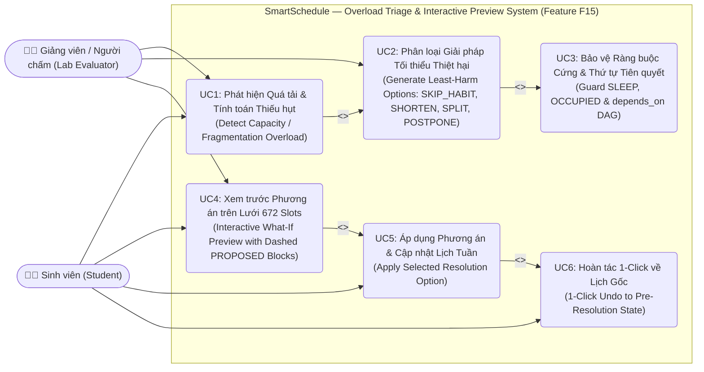
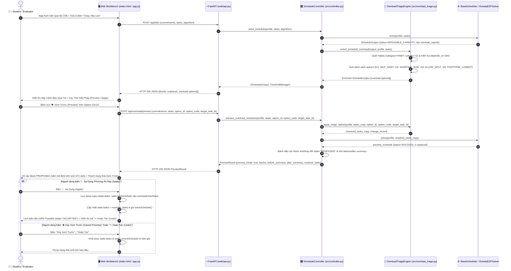
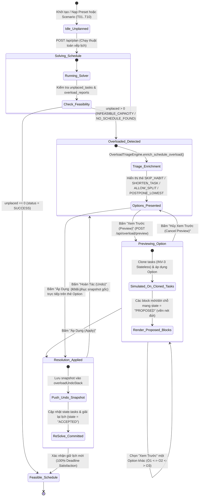
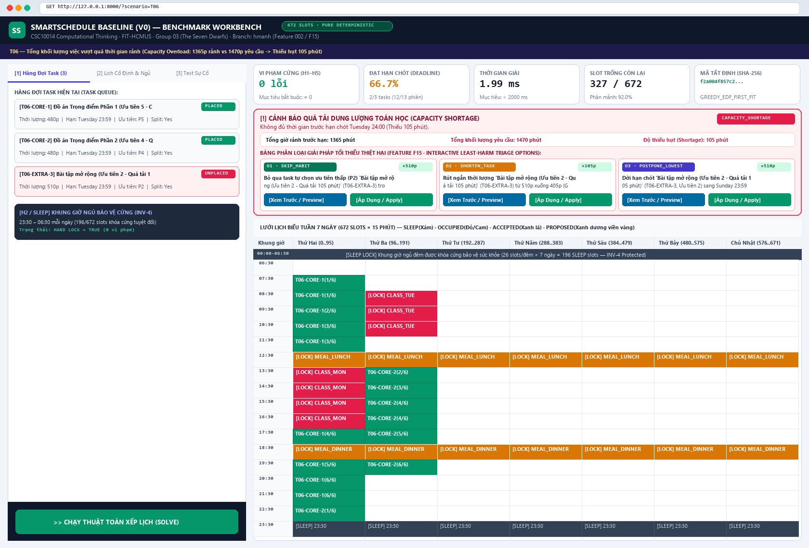
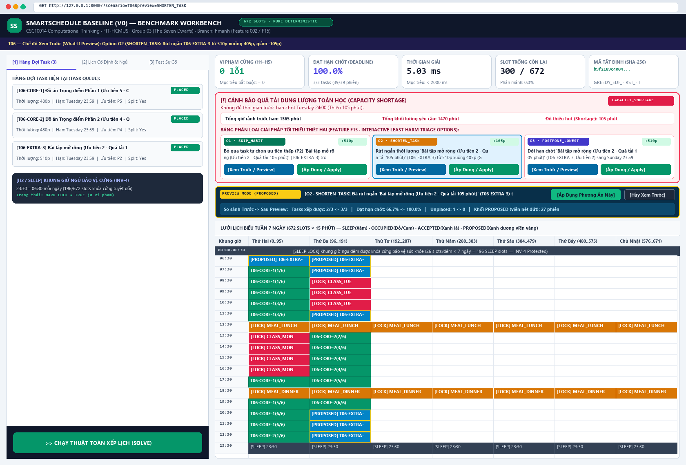
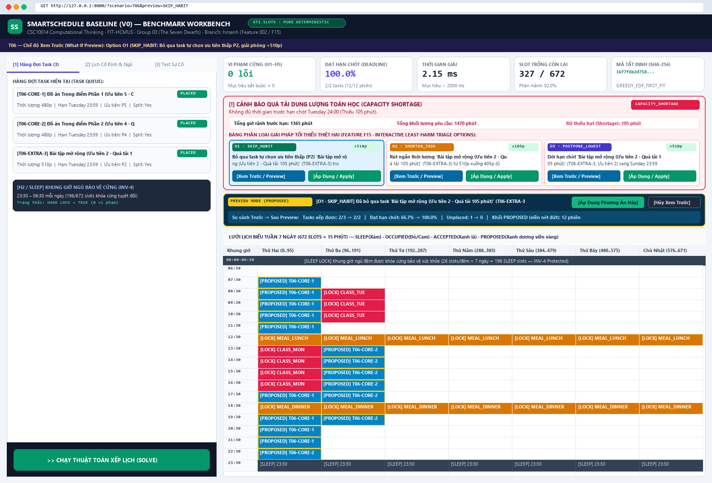
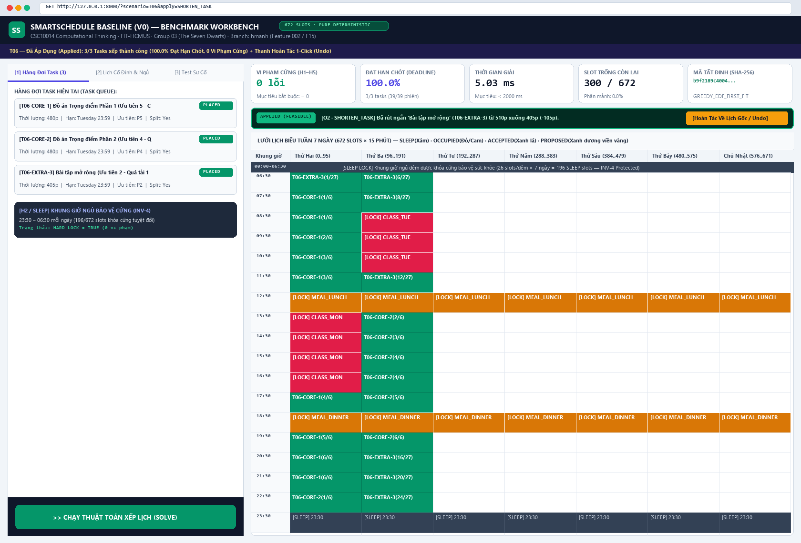
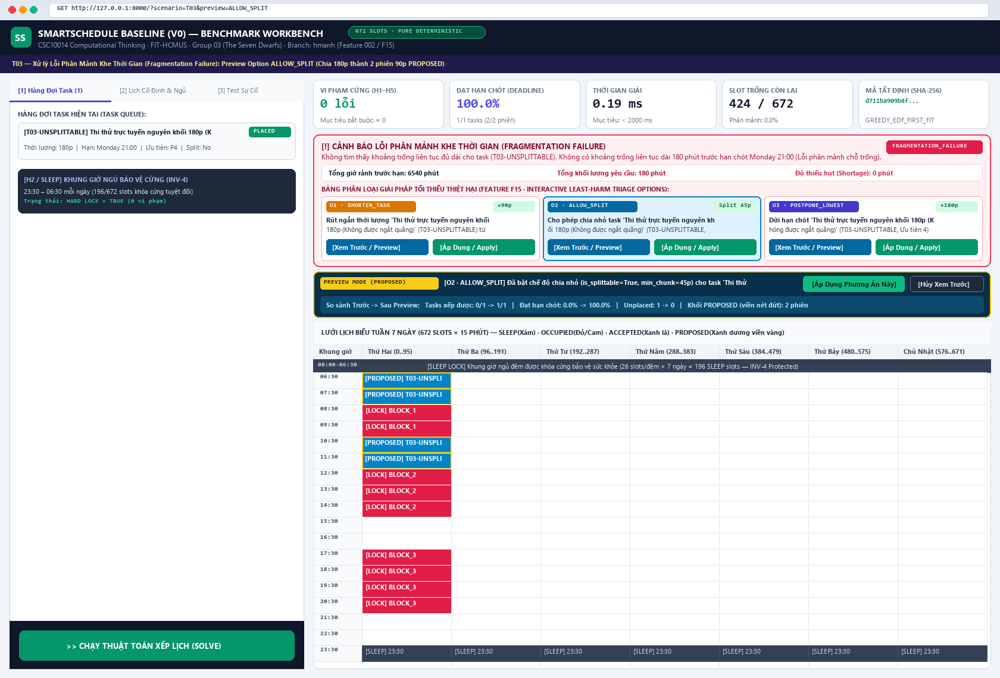
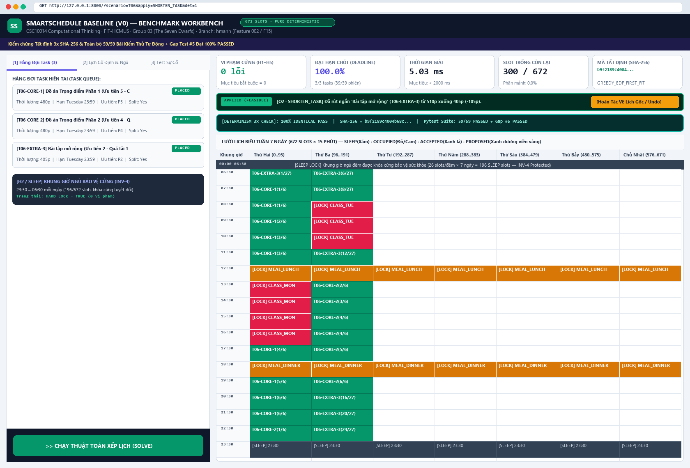

# BÁO CÁO PHÁT TRIỂN (DEVELOPMENT REPORT) — LAB 04: FROM SPEC TO CODE (PHASED VIBE-CODING WITH AI)

| Thông tin | Chi tiết |
|---|---|
| **Môn học** | Tư duy Tính toán (CSC10014) — Khoa Công nghệ Thông tin, Trường ĐH Khoa học Tự nhiên, ĐHQG-HCM (FIT-HCMUS) |
| **Nhóm thực hiện** | Group 03 (*The Seven Dwarfs*) |
| **Sinh viên thực hiện** | **Hoàng Minh Anh** (`hmanh0201` / `minhanhbmt07@gmail.com`) — *Thinker 2 (Perspective 4: Overload & Alerts / UI-UX Review Flow)* |
| **Nhánh Git (Branch)** | `hmanh` |
| **Tính năng phát triển** | **Feature 002 (F15): Smart Overload Triage, Habit-Skipping & Interactive Trade-off Preview Engine (`002-overload-triage-preview`)** |
| **Hồ sơ Đặc tả (Spec Kit)** | [`specs/002-overload-triage-preview/`](specs/002-overload-triage-preview/) (`spec.md`, `plan.md`, `tasks.md`, `diagrams.md`) |

---

## 1. Khảo Sát Nhánh Nhóm & Lý Do Chọn Tính Năng (Feature Selection & Justification)

### 1.1. Tóm tắt khảo sát các nhánh thành viên trong nhóm (`git branch -r`)
Trước khi bắt đầu thiết kế và viết mã, quá trình khảo sát toàn bộ nhánh trên kho lưu trữ Git của nhóm được thực hiện để đảm bảo không trùng lặp phạm vi và không gây xung đột hợp nhất (merge conflict):

| Nhánh Remote | Thành viên phụ trách | Phạm vi công việc đã thực hiện | Các file tác động |
|---|---|---|---|
| `origin/main` | Toàn nhóm | Hệ thống **Baseline (V0)** trên lưới thời gian rời rạc 672 slots, 4 thuật toán (`EDF`, `LST`, `WSPT`, `Backtracking`), `LocalRepairEngine`, 10 kịch bản `T01–T10`. | `group03-smartschedule-baseline/*` |
| `origin/dminh` | Phạm Đức Minh (*Leader*) | Giao diện **Student-Facing Minimalist UI Mode** (`#studentAppLayout`) và tính toán buffer $\times 1.2$ phía client. | `web/index.html`, `web/app.js`, `Week4DucMinh.md`, `AIWeek4.md` |
| `origin/verification_tests_ver1` | Nguyễn Nguyễn Gia Bảo (*Builder 3*) | Bộ kiểm thử tự động 56 tests (`verification_tests/`), ứng dụng GUI `test_studio.py`, `clean_runner.py`, và **5 bài test mục tiêu (Development Gap Tests)** trong `test_improve_plan_gaps.py`. | `verification_tests/*`, `agents/*`, `docs/*`, `web/api.py` |
| `origin/feature/estimate-buffer` | Nguyễn Trọng Tiến (*Thinker 3*) | **Feature 001 — Estimate Buffer (Planning-Fallacy Correction)** (`001-estimate-buffer`): giải quyết **Gap Test #3** (`test_fail_planning_fallacy_buffer_multiplier`). | `specs/001-estimate-buffer/*`, `src/estimate_buffer.py`, `src/models.py`, `src/controller.py` |

### 1.2. Quyết định lựa chọn tính năng: Feature 002 (F15) — `002-overload-triage-preview`
Tôi lựa chọn triển khai **Feature 002 (F15): Smart Overload Triage, Habit-Skipping & Interactive Trade-off Preview Engine** vì 4 lý do kỹ thuật cốt lõi:
1. **Đúng phân công chuyên môn trong nhóm:** Trong Báo cáo Đề xuất (`Proposal_Report.pdf`, trang 42–43), Hoàng Minh Anh (*Thinker 2*) phụ trách **Perspective 4 (Overload & Alerts)** và **UI/UX Review Flow**.
2. **Giải quyết trực tiếp Development Gap Test #5:** Trong bộ kiểm thử `verification_tests/development_gap_tests/test_improve_plan_gaps.py`, bài kiểm thử `test_fail_overload_habit_skipping_recommendation` đang báo đỏ (`FAILED`) vì bản V0 chưa phân biệt được thói quen linh hoạt (`HABIT` / task tự chọn ưu tiên thấp) với bài tập cốt lõi để gợi ý mã `SKIP_HABIT`.
3. **Hiện thực hóa đặc tả `Improve_Plan/improve_plan.md` (§5.1 F15, §6.7, §7.2, §7.3):** Cung cấp bộ phân loại giải pháp giảm thiểu thiệt hại học tập (`SKIP_HABIT` $\to$ `SHORTEN_TASK` $\to$ `ALLOW_SPLIT` $\to$ `POSTPONE_LOWEST`), nâng cấp endpoint `POST /api/overload/preview` từ stub sang mô phỏng thực tế trên bản sao độc lập (stateless deep-copy), đánh dấu các phiên đề xuất bằng trạng thái `state = "PROPOSED"` (viền nét đứt trên lưới 672 slots), và bổ sung thanh **Hoàn Tác 1-Click (Undo)**.
4. **Độc lập kiến trúc tuyệt đối (Zero Solver Conflict):** Toàn bộ thuật toán phân loại quá tải được đóng gói trong module thuần `src/overload_triage.py` và kết nối qua `src/controller.py`, giữ nguyên 100% thư mục `src/solvers/*` và `requirements.txt`.

---

## 2. Đặc Tả Kỹ Thuật (Specification) & Thiết Kế Trực Quan (Diagrams as Code)

### 2.1. Tóm tắt Yêu cầu Chức năng (FR1–FR8) & Trường hợp Biên (Edge Cases)
* **FR1 (Pure Domain Service):** Module `src/overload_triage.py` (`OverloadTriageEngine`) hoàn toàn độc lập với tầng Web (`INV-1`) và không biến đổi dữ liệu đầu vào của hàm gọi (`INV-3`).
* **FR2 (Least-Harm Option Ranking):** Sắp xếp các phương án xử lý quá tải theo thứ tự ít gây tổn hại học tập nhất:
  1. `SKIP_HABIT`: Bỏ qua/tạm hoãn thói quen linh hoạt (`category == "HABIT"`, không có deadline) hoặc bài tập tự chọn ưu tiên thấp (`priority <= 2`) trong tuần quá tải.
  2. `SHORTEN_TASK`: Rút ngắn thời lượng của task gây nghẽn đúng bằng lượng thiếu hụt `shortage_min` (làm tròn bội số 15 phút, tối thiểu 15 phút) và cho phép chia phiên linh hoạt để khớp các khe trống còn lại.
  3. `ALLOW_SPLIT`: Chuyển task nguyên khối lớn (`is_splittable = False`, $\ge 60$ phút) sang chế độ chia nhỏ (`is_splittable = True`, `min_chunk_min = 45`).
  4. `POSTPONE_LOWEST`: Dời hạn chót của task ưu tiên thấp nhất qua khỏi điểm nghẽn (sang `Sunday 23:59` hoặc `Next Monday 23:59`).
* **FR3 (Dependency DAG & Hard Lock Protection):** Kiểm tra đồ thị phụ thuộc (`depends_on` — ràng buộc cứng $H_3$) thông qua `get_protected_prerequisite_ids(tasks)` để không bao giờ gợi ý bỏ qua hoặc dời hạn một task là điều kiện tiên quyết của bài tập quan trọng (`priority >= 3`); đồng thời bảo vệ tuyệt đối 196 slots `SLEEP` ($H_2$) và các slots `OCCUPIED` ($H_1$) (`INV-4`).
* **FR4–FR7 (Interactive Preview, Apply & 1-Click Undo):** Cho phép sinh viên bấm **Xem Trước (Preview)** để quan sát các khối `PROPOSED` (viền nét đứt) và bảng so sánh chỉ số `Before -> After` ngay trên lưới 672 slots, bấm **Áp Dụng (Apply)** để chốt phương án, hoặc bấm **Hoàn Tác (Undo)** để khôi phục nguyên trạng lịch gốc.

### 2.2. Ba Sơ Đồ Thiết Kế Hệ Thống (Mã Nguồn Mermaid Plain-Text)

#### Sơ đồ 1: Use Case Diagram — Luồng Phát Hiện Quá Tải, Phân Loại & Xem Trước Tương Tác

#### Sơ đồ 2: Sequence Diagram — Luồng Xử Lý End-to-End Từ Phát Hiện Quá Tải Đến Xem Trước, Áp Dụng & Hoàn Tác

#### Sơ đồ 3: State Machine Diagram — Vòng Đời Trạng Thái Của Lịch Biểu & Chế Độ Xem Trước Quá Tải

---

## 3. Kiến Trúc Phân Tầng & Phân Rã Nhiệm Vụ (Architecture & Phased Implementation)

Quá trình triển khai tuân thủ nghiêm ngặt quy trình **Spec-Driven Phased Vibe-Coding** qua **7 Task độc lập**, mỗi Task tương ứng với đúng 1 Git commit trên nhánh `hmanh`:

| Task | Các file tạo mới / chỉnh sửa | Nội dung kỹ thuật chính | Commit Hash & Thông điệp |
|:-:|---|---|---|
| **Task 1** | `specs/002-overload-triage-preview/{spec.md,plan.md,tasks.md,diagrams.md}` | Xây dựng bộ tài liệu đặc tả Spec Kit đầy đủ (User Stories, FR1–FR8, AC1–AC6, kế hoạch kiến trúc, 3 sơ đồ Mermaid). | `38c23ee` — `docs(spec): add specification, plan, tasks and Mermaid diagrams for feature 002 overload triage preview` |
| **Task 2** | `group03-smartschedule-baseline/src/overload_triage.py` *(MỚI)* | Cài đặt lớp `OverloadTriageEngine` thuần logic: kiểm tra bảo vệ `depends_on`, nhận diện `SKIP_HABIT` / `SHORTEN_TASK` / `ALLOW_SPLIT` / `POSTPONE_LOWEST`, và biến đổi bản sao `List[Task]` bất biến. | `0db418c` — `feat(triage): implement pure overload triage and habit-skipping option generator in src/overload_triage.py` |
| **Task 3** | `group03-smartschedule-baseline/src/controller.py` | Tích hợp `OverloadTriageEngine.enrich_schedule_overload()` vào `ScheduleController.solve_schedule()` và thêm phương thức `ScheduleController.preview_overload_resolution()`. | `c80c27d` — `feat(controller): integrate overload triage enrichment and what-if preview simulation in ScheduleController` |
| **Task 4** | `group03-smartschedule-baseline/web/api.py` | Nâng cấp endpoint `POST /api/overload/preview` thực thi mô phỏng What-If thực tế và trả về `before_summary`, `after_summary`, `resolved_tasks`, `proposed_block_ids`. | `ce89854` — `feat(api): add interactive overload preview endpoint POST /api/overload/preview in FastAPI` |
| **Task 5** | `group03-smartschedule-baseline/web/index.html`, `web/app.js` | Bổ sung class `.slot-block-proposed`, thẻ tương tác Overload Triage Cards (`Xem Trước` / `Áp Dụng`), thanh trạng thái Preview Mode và thanh `Hoàn Tác 1-Click (Undo)`. | `f2eeb6a` — `feat(ui): add interactive overload triage cards, dashed block preview and undo bar in web workbench` |
| **Task 6** | `group03-smartschedule-baseline/tests/test_overload_triage.py`, `verification_tests/logical_tests/test_overload_triage.py` | Xây dựng 9 bài kiểm thử tự động kiểm chứng toàn diện AC1–AC6, `T06`, `T03`, Tuần của Minh, DAG `depends_on`, bất biến `INV-3`/`INV-4` và tính tất định 3x SHA-256. | `fef8e9d` — `test(triage): add comprehensive unit and API tests for overload triage and interactive preview` |
| **Task 7** | `screenshots/*.png`, `Development_Report_Lab04.md`, `AI_Usage_Declaration_Lab04.md`, `git_commit_log.txt`, `Week4MinhAnh.md`, `AIWeek4_MinhAnh.md` | Chụp 6 ảnh màn hình minh chứng (`screenshots/`), hoàn thiện báo cáo phát triển, nhật ký Git commit và bản khai báo sử dụng AI. | Commit Task 7 trên nhánh `hmanh` |

---

## 4. Kết Quả Kiểm Thử & Thực Nghiệm Định Lượng (Verification & Benchmark Results)

### 4.1. Kết quả chạy bộ kiểm thử tự động (`pytest` & `clean_runner.py`)
1. **Bộ kiểm thử tính năng mới (`tests/test_overload_triage.py`):** **9 / 9 PASSED** (`0.76s`).
2. **Bài kiểm thử mục tiêu Gap Test #5 (`test_fail_overload_habit_skipping_recommendation`):** Chuyển từ **FAILED (Đỏ)** sang **PASSED (Xanh 100%)** (`0.50s`).
3. **Toàn bộ bộ kiểm thử vận hành của nhóm (`python verification_tests/clean_runner.py --pass`):** **59 / 59 PASSED** (`0 Failed`) qua cả 4 pha:
   * Phase 1 (`ui_tests`): `6/6 PASSED`
   * Phase 2 (`architecture_tests` — `INV-1..INV-6`, Memory Leak `< 350 KB`, Concurrency): `9/9 PASSED`
   * Phase 3 (`logical_tests` — bao gồm `test_overload_triage.py`): `24/24 PASSED`
   * Phase 4 (`benchmark_tests` — `T01–T10`, Feasibility, Time Grid, EDF): `20/20 PASSED`

### 4.2. Bảng đối chứng định lượng trước và sau khi áp dụng các phương án Overload Triage (Kịch bản `T06` & `T03`)

| Kịch bản & Phương án xử lý | Trạng thái (`status`) | Số Task xếp được | Tỷ lệ đạt hạn chót ($R_{\text{dl}}$) | Độ thiếu hụt (`shortage_min`) | Vi phạm cứng ($C_{\text{hard}}$) | Số khối `PROPOSED` | Tất định 3x SHA-256 |
|---|---|:-:|:-:|:-:|:-:|:-:|:-:|
| **T06 — Trước khi xử lý (Gốc)** | `INFEASIBLE_CAPACITY` | `2 / 3` | `66.7%` | `105 phút` | `0` | `0` | `PASS` |
| **T06 — Option O1 (`SKIP_HABIT` trên `T06-EXTRA-3`)** | `SUCCESS` | `2 / 2` | **`100.0%`** | **`0 phút`** (`+510p` giải phóng) | `0` | `12` | `PASS` |
| **T06 — Option O2 (`SHORTEN_TASK`: `510p -> 405p`)** | `SUCCESS` | **`3 / 3`** | **`100.0%`** | **`0 phút`** (`-105p` thiếu hụt) | `0` | `27` | `PASS` (`b9f2189c4004...`) |
| **T06 — Option O3 (`POSTPONE_LOWEST` sang `Sunday 23:59`)** | `SUCCESS` | **`3 / 3`** | **`100.0%`** | **`0 phút`** | `0` | `6` | `PASS` |
| **T03 (Unsplittable 180p) — Trước khi xử lý** | `NO_SCHEDULE_FOUND` | `0 / 1` | `0.0%` | `0 phút` (Lỗi phân mảnh) | `0` | `0` | `PASS` |
| **T03 (Unsplittable 180p) — Option `ALLOW_SPLIT` (45–90p)** | `SUCCESS` | **`1 / 1`** | **`100.0%`** | **`0 phút`** (Chia 2 phiên 90p) | `0` | `2` | `PASS` |

---

## 5. Minh Chứng Giao Diện Hoạt Động (Screenshots Gallery)

Toàn bộ 6 ảnh chụp màn hình độ phân giải cao (`1680×1140`) được lưu trữ tại thư mục [`screenshots/`](screenshots/):

1. **Ảnh 1 — Phát hiện quá tải dung lượng (`T06`) & Hiển thị các thẻ phân loại giải pháp (Feature F15 Triage Cards):**
   
2. **Ảnh 2 — Chế độ Xem Trước (`Preview Mode`) phương án `O2 · SHORTEN_TASK` trên kịch bản `T06` với các khối `[PROPOSED]` viền vàng nét đứt trên lưới 672 slots:**
   
3. **Ảnh 3 — Chế độ Xem Trước (`Preview Mode`) phương án `O1 · SKIP_HABIT` (Bỏ qua task tự chọn ưu tiên thấp `P2`, giải phóng `+510 phút`):**
   
4. **Ảnh 4 — Đã Áp Dụng (`Applied`) phương án xử lý quá tải trên `T06`: Đạt `100.0%` hạn chót (`3/3 tasks`), `0` vi phạm cứng và xuất hiện thanh `Hoàn Tác Về Lịch Gốc (Undo)`:**
   
5. **Ảnh 5 — Xử lý lỗi phân mảnh khe thời gian (`T03 Fragmentation Failure`) bằng phương án `ALLOW_SPLIT` (Chia task 180p nguyên khối thành 2 phiên 90p `PROPOSED`):**
   
6. **Ảnh 6 — Kiểm chứng Tính Tất Định 3x SHA-256 (`100% IDENTICAL PASS`) & Xác nhận 59/59 bài kiểm thử tự động + Gap Test #5 đạt PASSED:**
   
