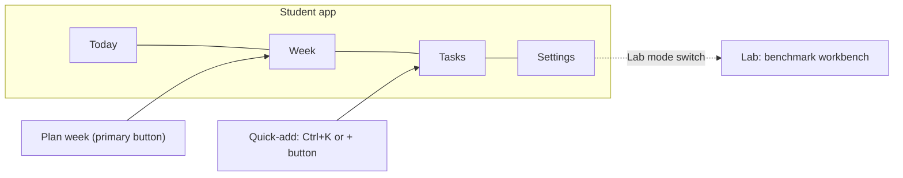
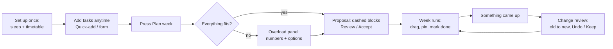
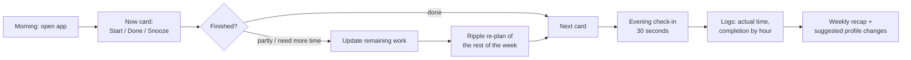
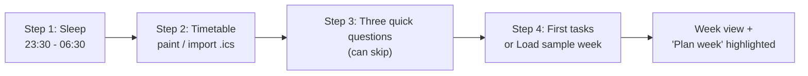
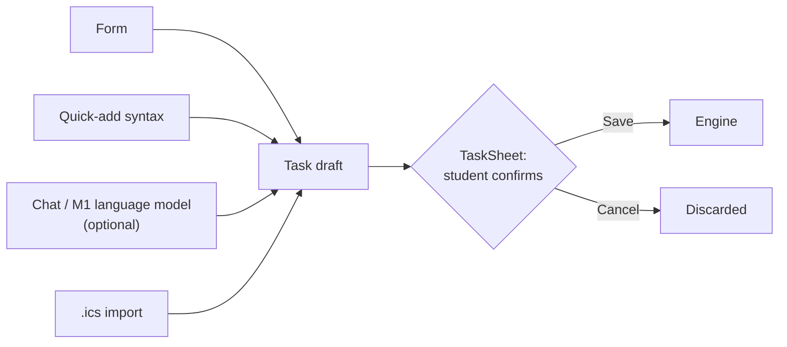

# SmartSchedule — Improvement Plan: UI/UX and User-Facing Features

**Course:** CSC10014 — Computational Thinking (2026) · FIT-HCMUS
**Team:** Group 03 — The Seven Dwarfs
**Document type:** Improvement plan. It builds on `Baseline_Plan/baseline_plan.md` and does not replace it.
**Status:** Draft for team review · 28 Oct 2026
**Short version for developers:** `Improve_Plan/improve_plan_summary.pdf`

---

## 0. Why this document exists

The proposal report and the four-pillar documents define **what the engine computes**. The baseline plan defines **how we build and benchmark the engine** (V0: EDF on the 672-slot grid), plus a technical workbench UI for testing it.

One thing is still missing: **how a student actually uses the app during a real week.** This plan covers that:

| § | Content |
| :-: | :--- |
| 1–2 | The gap, and the moments when a student needs the app |
| 3 | UI direction: modern, minimalist, clean, easy to use |
| 4 | **Two product solutions** (features + UI), a comparison and a recommendation |
| 5–6 | Feature specification and the key screens/flows of the recommended solution |
| 7–10 | UI ↔ engine data contract, tech stack, build plan, usability testing |
| 11 | Decisions the team must take before coding |

**Unchanged:** the engine design (Pillars 3–4), the 672-slot grid, scenarios T01–T10 and the metrics. The baseline workbench stays, behind a **Lab mode** switch (§5.3).

> **In one sentence:** the student sees a calm weekly planner, and the lecturer sees the algorithm in Lab mode. Both use the same engine.

---

## 1. Starting point and the gap

| Document | What it gives us | What is missing for real users |
| :--- | :--- | :--- |
| Proposal report | Problem boundary, 4 perspectives, 5-step recipe, evaluation plan | Screen-level design. R6 "end-to-end interface" is only *planned* (Appendix C). |
| Four pillars | Task model $T_i=\{d,p,e,D,C\}$, rules H/S, scored greedy + repair + ripple + learning | Where each input comes from in the UI: energy, estimation bias, grade weight, context |
| Baseline plan | V0 EDF engine, JSON I/O, 2-column benchmark workbench | The workbench uses engine terms (slots, KPIs, solver names). Students don't think in those terms. |

### 1.1 Three gaps the UI must close

1. **Input effort.** The engine needs about 8 fields per task, plus a timetable and a profile. If typing a week takes longer than writing it on paper, students quit in week 1. Pillar 2's cold-start test case points out that week 1 is when users decide whether to keep an app.
2. **Trust.** Students only follow an automatic plan if they understand it and it does not jump around. The UI needs explanations, previews, undo and pinning.
3. **Feedback data.** Pillar 2 (energy rhythm, estimation bias) and Pillar 4 Stage 5 (learning) need logs of what really happened. Nothing in the current design collects these logs.

---

## 2. Who uses it, and when

**Primary user:** one university student at FIT-HCMUS, planning one week at a time (proposal §2.2). We use the Lan example from the pillar documents in the screens below. Lectures are Mon/Wed/Fri 07:30–11:30, labs Tue/Thu 13:00–17:00, a part-time job Tue/Thu/Sat 18:00–22:00, a club meeting Wed 19:00–20:30, and sleep 23:30–06:30.

### 2.1 Seven moments the app must handle

| # | Moment | The student's question | What the app must do | Engine part |
| :-: | :--- | :--- | :--- | :--- |
| M1 | Semester start | "Do I have to type my timetable every week?" | Set it up once and reuse it every week | Fixed events (B1), master timetable (report §7.8.1) |
| M2 | A new assignment arrives | "Let me note this before I forget." | Capture it in about 10 seconds | Task model $T_i$ |
| M3 | Planning (Sun evening / Mon morning) | "When do I do all of this?" | One button gives a full-week **proposal** | Stages 0–3 / Steps 1–3 |
| M4 | During the day | "What should I do now?" | Show *now* and *next* | Read-only view of the schedule |
| M5 | Something came up | "Don't wreck my week." | Fix only what is hit and show what moved | Stage 4 ripple / Step 4 |
| M6 | Too much work | "Is this even possible?" | Show exact numbers and options, least harm first | OVERLOAD / Step 5 |
| M7 | End of day | "I didn't finish." | 30-second check-in, then re-plan the rest | Progress → buffers, Stage 5 |

The first version must handle M1, M2, M3, M5 and M6 well. M4 and M7 come in Phase 2 (§4.4).

---

## 3. UI direction — modern, minimalist, clean, easy to use

### 3.1 Seven design principles

| # | Principle | What it means on screen |
| :-: | :--- | :--- |
| P1 | **One screen, one job** | Each screen has one primary button (Plan week / Save task / Keep changes). Everything else is secondary or tucked away. |
| P2 | **Show the plan, hide the machinery** | The 672-slot grid lives in the code. The student sees a normal calendar with 30-minute rows, and sleep folds into one thin bar. Slots, solver names and KPIs only appear in Lab mode. |
| P3 | **Ask little, suggest safely, always confirm** | A task needs only 3 fields: title, duration and due date. Everything else gets a default, shown as an editable chip. Nothing reaches the schedule without the student saving it. |
| P4 | **Explain every automatic decision** | Every placed block has a **"Why here?"** popover built from reason codes the engine returns (§7.3). |
| P5 | **Never surprise** | Every automatic change appears first as a preview (dashed blocks, or a list of what moved) and can be undone. Pinned blocks never move. |
| P6 | **Be honest when it doesn't fit** | Overload opens a calm side panel with numbers and options. Nothing is dropped silently, and there's no wall of red. |
| P7 | **Colour carries meaning** | Colour shows the block type only. Red is reserved for conflicts and unplaced work. Every colour also has an icon or shape, so meaning never depends on colour alone. |

### 3.2 Visual language (design tokens)

A neutral base, **one accent colour**, generous white space, borders rather than shadows, and soft rounded corners. Dark mode comes from the same tokens.

```css
:root {
  /* base */
  --bg: #FAFAFA;        --surface: #FFFFFF;     --border: #E4E4E7;
  --text: #18181B;      --text-muted: #71717A;
  --accent: #4F46E5;    --accent-soft: #E0E7FF; --accent-ink: #3730A3;
  /* block types */
  --fixed-bg: #E4E4E7;  --fixed-ink: #3F3F46;   /* classes, shifts, meals */
  --sleep-bg: #F4F4F5;                          /* folded, striped */
  --habit-bg: #CCFBF1;  --habit-ink: #115E59;   /* gym, reading */
  /* states */
  --ok: #16A34A;  --warn: #D97706;  --danger: #DC2626;   /* danger = conflicts only */
  /* shape and rhythm */
  --radius-sm: 6px; --radius: 10px; --radius-lg: 16px;
  --space: 4px;   /* use 4, 8, 12, 16, 24, 32, 48 */
}
[data-theme="dark"] {
  --bg: #0B0B0F; --surface: #16161C; --border: #2A2A33;
  --text: #F4F4F5; --text-muted: #A1A1AA;
  --accent: #818CF8; --accent-soft: #1E1B4B; --accent-ink: #C7D2FE;
  --fixed-bg: #27272A; --fixed-ink: #D4D4D8; --sleep-bg: #111114;
  --habit-bg: #134E4A; --habit-ink: #99F6E4;
}
```

| Element | Choice | Reason |
| :--- | :--- | :--- |
| Font | **Inter** for UI, with tabular numbers for times. Alternative: **Be Vietnam Pro**. | Both are free (OFL) and render Vietnamese diacritics well |
| Type scale | 12 caption · 14 small · 16 body · 20 title · 24 heading · 32 display | Few sizes means a calmer page |
| Weights | 400 / 500 / 600 only | Hierarchy comes from size and space, not boldness |
| Spacing | 4-px base: 4, 8, 12, 16, 24, 32, 48 | Consistent rhythm |
| Corners | 6 px chips, 10 px blocks/cards, 16 px sheets | Soft and modern without looking playful |
| Elevation | Borders for structure; shadows only on overlays (popover, sheet, toast) | Flat and clean |
| Icons | **Lucide** (1.5-px stroke, open source) | One consistent icon family |
| Motion | 150–200 ms ease-out. After a re-plan, moved blocks **slide from the old place to the new one**. Respects `prefers-reduced-motion`. | Motion explains the change |

Contrast: white on `#4F46E5` is about 6.3:1, `#3730A3` on `#E0E7FF` about 8:1, `#3F3F46` on `#E4E4E7` about 8:1. All pass WCAG AA for normal text.

### 3.3 Block types: colour plus shape

This replaces the colour list in baseline §7.6. There, classes (rose `#E11D48`) and errors (red `#DC2626`) were both red, and the "purple" sleep colour `#334155` is actually slate grey.

| Block | Look | Icon | Notes |
| :--- | :--- | :--- | :--- |
| Fixed (class, lab, job, meal) | Grey fill `--fixed-bg`, dark text | lock | Cannot be dragged |
| Sleep | Folded into one striped bar, "Sleep 23:30–06:30 · protected" | moon | Expands on click; work is never placed there |
| Deep task | Solid accent, white text | ● | Hard-focus work |
| Medium task | Accent tint `--accent-soft`, dark accent text | ◐ | |
| Light (Shallow) task | White with a 1.5-px accent border | ○ | |
| Habit | Teal tint | ↻ | Gym, reading; soft rule |
| Break (15 min) | Thin dotted gap below a Deep block | — | Belongs to the block and moves with it |
| Proposed (not yet accepted) | Same colours with a **dashed** border, 85 % opacity | — | Becomes solid after "Accept" |
| Pinned | Small pin icon in the corner | pin | Re-plan and repair never move it |
| Done | Muted at 50 % opacity with a check | check | |
| At risk / unplaced | Amber (at risk) or red (unplaced) **badge**, not a red block | alert | Red only appears for real problems |

### 3.4 Layout and navigation



* **Desktop (≥ 1024 px):** a narrow left rail (Today · Week · Tasks · Settings, plus Lab when enabled), a top bar with **Quick-add** (`Ctrl+K`) and one primary button, **Plan week**. The Week view fills the page.
* **Mobile (< 768 px):** bottom tab bar (Today · Week · **＋** · Tasks · Me). The Week view becomes a 1-day or 3-day swipe view. Sheets slide up from the bottom.
* **Lab mode** is off by default and switched on in Settings. It adds the Lab tab, where the baseline workbench lives (§5.3).

### 3.5 Component inventory (build once, reuse everywhere)

| Component | Used in |
| :--- | :--- |
| `WeekGrid` (wraps the calendar library) | Week, Lab (read-only), onboarding (paint the timetable) |
| `Block` + `WhyPopover` | Week, Today |
| `QuickAddBar` (live parsing into chips) | Top bar, Tasks |
| `TaskSheet` (the single confirmation card) | Add/edit task, M1 chat result, ICS import review |
| `ChangeReview` (list of old → new moves, Undo / Keep) | Plan, repair, check-in re-plan |
| `OverloadPanel` (side sheet with options and Preview) | Plan, repair |
| `SummaryBar` ("5 tasks planned · all deadlines met") | Week, Lab |
| `Chip`, `Stepper` (±15 min), `Segmented` (Deep/Medium/Light), `Toast` with Undo | Everywhere |
| `EmptyState` (with "Load sample week") | Week, Tasks |

### 3.6 Microcopy: engine terms → student terms

| Engine output | What the student reads |
| :--- | :--- |
| `CAPACITY_SHORTAGE`, 105 min, Tue 23:59 | **Not enough time before Tue 23:59.** You are short by 1 h 45 min. |
| `NO_SCHEDULE_FOUND` (fragmentation) | **There is enough time in total, but no free gap is long enough** for "Report (3 h, can't be split)". |
| `UNPLACED: T4` | "DSA report" isn't planned yet. *See options* |
| `MOVED_BY_REPAIR` | Moved because of "Club emergency meeting". |
| `H2 violation` on a drag | You can't place it here: **Class at this time.** |
| Solver `GREEDY_EDF_FIRST_FIT` | (Lab mode only) |

Rules: plain words, numbers in hours and minutes (not slots), always say **what to do next**, never blame the student.

### 3.7 Accessibility and language

* WCAG AA contrast. Meaning never depends on colour alone (§3.3). Visible focus rings. Full keyboard use (arrow keys move a selected block 15 min; `P` pins; `Ctrl+Z` undoes).
* Touch targets ≥ 44 × 44 px. Layout works from **375 px** width.
* **Vietnamese / English toggle.** Our users are Vietnamese students. Dates follow the language ("Thứ 4, 04/11" or "Wed 4 Nov").
* Time zone fixed to `Asia/Ho_Chi_Minh` (UTC+7, no daylight saving).

---

## 4. Two solutions: how students will use the app

Both solutions use **the same engine and the same data**. They differ in *what the student sees first* and *how often they interact with it*.

### 4.1 Solution A — "Week Planner" (calendar-first, plan in batches)

**Idea:** the student's mental model is *"my week on one page."* They plan in a batch (Sunday evening or Monday morning) and adjust when something changes. This is the closest to the proposal's design and to the baseline engine.



**Features**

| ID | Feature | What the student does |
| :-: | :--- | :--- |
| A1 | Timetable setup | **Paint** classes on an empty week (drag across the grid, give a name, choose "every week"), or **import an .ics** file |
| A2 | Task inbox + Quick-add | Types `Essay body 60m t4 23:59 #deep`; chips appear live; `Enter` saves |
| A3 | Plan week (proposal mode) | One button. Blocks appear dashed; a summary bar shows "5 planned · all deadlines met"; **Accept all** or adjust first |
| A4 | Why here? | Clicks a block to see the reasons (deadline, energy fit, order, break) |
| A5 | Drag to move | Drags a block. Allowed zones are shaded during the drag, and blocked zones show the reason ("Class at this time", "After deadline", "Before 'DSA: code module'") |
| A6 | Pin | Pins a block, which then counts as fixed for later re-plans |
| A7 | Something came up | Adds a one-off event and sees exactly which blocks moved, with Undo |
| A8 | Overload panel | Sees the shortage in minutes and options, least harm first, with a **Preview** for each |
| A9 | Export | `.ics` for Google/Apple Calendar; image of the week to share |

**Main screen — Week (desktop)**

```
+--------------------------------------------------------------------------------------------+
| SmartSchedule   < Nov 2 - 8 >  Today     [ Add task...                Ctrl+K ] [Plan week] |
+--------+-----------------------------------------------------------------------------------+
| Today  |          MON 2      TUE 3      WED 4      THU 5      FRI 6      SAT 7      SUN 8  |
| Week * |  Sleep 23:30-06:30 . protected ......................................... [expand] |
| Tasks  |  07:30   [Lecture ]            [Lecture ]            [Lecture ]                   |
|        |  08:00   [        ] (DSA code) [        ]            [        ]                   |
|        |  09:15   [        ] (Calculus) [        ]            [        ]                   |
| ------ |  11:30                                                                            |
| Lab    |  12:15   (Club frm)                                                               |
| Setup  |  13:00              [Lab     ] (DSA rep.) [Lab     ]                              |
|        |  18:00              [Job     ]            [Job     ]            [Job     ]        |
|        |  19:00   (Essay   )            [Club    ]                                         |
+--------+-----------------------------------------------------------------------------------+
| Proposal: 5 tasks planned . all deadlines met . 0 conflicts         [Review]  [Accept all] |
+--------------------------------------------------------------------------------------------+
  [Fixed] = grey + lock      (Task) = dashed while proposed, solid after Accept
```

**Strengths:** shows the whole algorithm output at once, which is ideal for the demo and for grading the CT process. Maps 1:1 to the 672-slot grid and to T01–T10. Simple data flow (batch planning). Fits students who plan on a laptop.
**Weaknesses:** a week grid is crowded on a phone. There is no natural moment to collect actual durations, so the learning loop gets no data. "Plan once" drifts away from reality unless the student re-plans.

### 4.2 Solution B — "Today Coach" (agenda-first, daily check-in loop)

**Idea:** during the day the student's question is *"what should I do now?"* The app answers with **one card**. The week still exists but is secondary. Mobile-first. A short check-in at the end of each day keeps the plan honest and **produces the history data Pillar 2 needs.**



**Features**

| ID | Feature | What the student does |
| :-: | :--- | :--- |
| B1 | Now card | Sees the current/next block with **Start**, **Done**, **Snooze 15 min**, **Skip** |
| B2 | Progress update | **Done** / **Partly (slider %)** / **Need more time** (+15 / +30 / +60). Remaining work is re-planned (UC9, T05) |
| B3 | Running late | One tap shifts today's flexible blocks; pinned and fixed blocks stay |
| B4 | Guided add by type | Chooses **Assignment / Exam / Project / Habit / Errand**, and the type sets the defaults: Exam spreads sessions over D−7, D−5, D−3, D−1 (Pillar 2); Habit asks "how many times a week?"; Project offers "break into steps" |
| B5 | Evening check-in | Marks today's blocks (Done / Partly / Not done), optionally rates focus 1–5 |
| B6 | Gentle reminders | "Essay body starts in 10 min", "DSA report is at risk" (PWA notification, optional) |
| B7 | Weekly recap | Planned vs. actual; learned patterns shown as **suggestions**: "Writing took you ×1.4 longer, use that next week?" **[Apply]** |

**Main screens — Today and check-in (mobile)**

```
+------------------------------+     +------------------------------+
| Today, Tue 3 Nov        (Me) |     | How did today go?            |
|                              |     |                              |
| NOW                          |     | DSA: code module             |
| +--------------------------+ |     |  (Done)  (Partly)  (Not done)|
| | DSA: code module    Deep | |     |  took longer? +15 +30 +60    |
| | 08:00 - 09:00            | |     |                              |
| | [ Start ]      [ Done ]  | |     | Calculus past paper          |
| | Running late?   Skip     | |     |  (Done)  (Partly)  (Not done)|
| +--------------------------+ |     |                              |
| NEXT                         |     | Focus today (optional)       |
| 09:15  Calculus past paper   |     |   1   2   3   4   5          |
| 13:00  Lab           (fixed) |     |                              |
| 18:00  Job           (fixed) |     |       [ Save check-in ]      |
|                              |     |                              |
| 2 tasks due before Wed 23:59 |     | Remaining work is re-planned |
|------------------------------|     | and you will see what moved. |
| Today  Week  (+)  Tasks   Me |     +------------------------------+
+------------------------------+
```

**Strengths:** least daily effort. Produces the real data (actual durations, completion by hour) that Pillar 2 and Stage 5 depend on, which closes the learning loop. Natural on a phone. Has the user-study instruments (EMA) built in.
**Weaknesses:** hides the whole-week view that best shows the algorithm. Needs persistence, hosting and notifications, so more engineering. Harder to demo in 10 minutes. Depends on the student checking in daily.

### 4.3 Comparison

| Criterion | A — Week Planner | B — Today Coach |
| :--- | :-: | :-: |
| Shows the CT process / algorithm in a demo | **High** | Low–medium |
| Fits the existing baseline engine and T01–T10 | **High** | Medium |
| Daily use on a phone | Medium | **High** |
| Feeds Pillar 2 / Stage 5 with real data | Low | **High** |
| Build effort in 10 weeks | **Medium** | High (hosting, persistence, notifications) |
| Supports the planned 1-week peer study (§9.8) | Medium | **High** |
| Delivery risk | **Low** | Medium–high |

### 4.4 Recommendation — "A first, then B's loop"

**Build Solution A as the MVP. Then add two screens from Solution B (Today + evening check-in) as Phase 2.** Phase 2 only goes ahead if the team confirms the user study (decision D12, §11).

* **Phase 1 (MVP):** Solution A complete, plus Lab mode. This covers M1, M2, M3, M5 and M6, the scenarios T01–T04, T06–T10, and the full demo.
* **Phase 2:** **Today** is a filtered, read-only agenda over the same blocks, so it is cheap. The **check-in** is the cheapest way to get real data for Pillar 2 (estimation bias, energy) and for T05 / UC9. Both reuse the same API.
* Why not B first: B's strengths (daily use, learning data) only pay off after several weeks of use. The course grades the CT process and the demo, and A shows that best.

---

## 5. Feature specification (recommended solution)

### 5.1 Feature list

Priority: **Must** = MVP demo fails without it · **Should** = planned for MVP if time allows · **Could** = Phase 2.

| ID | Feature | Priority | Engine / pillar link | Tests |
| :-: | :--- | :-: | :--- | :-: |
| F01 | Onboarding: sleep window (hard lock) | Must | B1 hard constraint; sleep rule | all |
| F02 | Weekly timetable: recurring + one-off fixed events (form + paint on grid) | Must | B1 fixed events | T01 |
| F03 | Import timetable from `.ics` | Should | Master timetable (report §7.8.1) | edge case 1 |
| F04 | 3 onboarding questions (focus time, estimate habit, disturbed hours) | Should | Pillar 2 Part C (cold start) | T09 |
| F05 | Quick-add bar with fixed, AI-free syntax (§6.2) | Should | Deterministic stand-in for M1 | T07 |
| F06 | `TaskSheet`: title, duration, due, **counts for** (grade weight → p), focus (Deep/Medium/Light, suggested), more options (split, min session, after, type) | Must | Task model $T_i$ (Pillar 3) | T01–T03, T08 |
| F07 | Task types: Assignment / Exam prep / Project / Habit / Errand | Should | Pillar 2 deadline-type patterns | T02 (UC3) |
| F08 | Break a task into steps (checklist; the student writes the steps) | Should | Pillar 1 A1; human-in-the-loop split (report §7.8.2) | T03 |
| F09 | **Plan week** with proposal mode (dashed → Accept) | Must | Stages 0–3 / Steps 1–3 | T01, T02 |
| F10 | **Why here?** popover from engine reason codes | Must | Transparency principle (report §8.6) | all |
| F11 | Drag to move, with allowed zones shaded live | Should | H rules; Stage 5 log | T04 |
| F12 | **Pin** a block | Must | Treated as fixed by Stage 4 | T04 |
| F13 | **Something came up** → local repair → **Change review** (old → new) + Undo | Must | Stage 4 ripple / Step 4 | T04 |
| F14 | Progress: Done / Partly / Need more time | Should | UC9; remaining work → re-plan | T05 |
| F15 | **Overload panel**: "Not enough time" vs. "No schedule found"; options with Preview; sleep never offered | Must | OVERLOAD / Step 5; report §6.5 | T06, T02 |
| F16 | Deadlines after this week ("due next Mon 09:00") | Should | 2-week horizon (report §5.5) | T10 |
| F17 | Undo / redo (last 20 actions) | Should | P5 "never surprise" | — |
| F18 | Export `.ics`, JSON, CSV; backup/restore JSON | Should | Baseline §7.6 item 9 | — |
| F19 | Lab mode (§5.3) | Must | Baseline workbench | T01–T10 |
| F20 | Vietnamese / English | Should | Target users | — |
| F21 | Natural-language add (M1) → fills the **same TaskSheet** for confirmation | Should* | M1 (report §7.1, R4) | T07 |
| F22 | Today + Now card | Could | Read-only agenda | — |
| F23 | Evening check-in (actual time, done %) | Could | Pillar 2 Part B data | T05 |
| F24 | Weekly recap + learned patterns as **suggestions** [Apply] | Could | Stage 5, kept human-in-the-loop | T09 |
| F25 | Dark mode | Could | Tokens §3.2 | — |

\* F21 is "Must" if the course requires an AI component (R4). It is still only an *input method*: it never writes to the schedule directly.

### 5.2 Not this semester (written down so nobody builds them by accident)

Native mobile app (use a responsive web app / PWA) · voice input · two-way Google Calendar sync (use `.ics` import/export) · shared or team calendars · reading syllabus PDFs (Stage 5 of the report) · automatic weight learning without confirmation · per-slot location context (home/campus/bus).

### 5.3 Lab mode: the baseline workbench, kept

Lab mode is where baseline §7.4 Option 1 (2-column dashboard) and Option 3 (side-by-side comparison) live. It is aimed at the team, the lecturer and the presentation.

```
+----------------------------------------------------------------------------------+
| LAB  Scenario [ T04 disruption v ]  [ EDF v ] vs [ Scored + repair v ]  [ Run ]  |
+---------------------------------------+------------------------------------------+
| EDF + first fit (Baseline B)          | Scored greedy + repair                   |
| [ slot map: 7 columns x 96 rows ]     | [ slot map: 7 columns x 96 rows ]        |
|                                       |                                          |
| Hard violations  .  Deadlines met     | Hard violations  .  Deadlines met        |
| Stability  .  Preference fit  .  ms   | Stability  .  Preference fit  .  ms      |
+---------------------------------------+------------------------------------------+
| Determinism check: run 3 times -> same result hash     Export: JSON  CSV  ICS    |
+----------------------------------------------------------------------------------+
```

* **Scenario loader:** T01–T10 and the sample weeks (one click).
* **Algorithm selector:** EDF (V0) · LST + best fit · scored greedy + repair (final) · backtracking (validator, N ≤ 8).
* **Slot map:** a compact CSS grid of 672 cells for exact slot states, where the student Week view shows normal calendar blocks.
* **Metrics:** hard violations, deadline rate, execution time, stability, preference fit, free slots. Values come from runs only; no placeholder numbers in slides.
* **Determinism check:** runs the same input 3 times and compares a hash of the output. This is direct evidence for the "deterministic" CT criterion.
* **Repair comparison:** "full rebuild" vs. "local repair" on the same event (T04).

### 5.4 Feature ↔ CT pillar traceability (useful for the presentation)

| Pillar | Where the student meets it in the UI |
| :--- | :--- |
| Decomposition | Break a task into steps (F08); task types (F07); the split into fixed events, tasks and profile follows branches A/B/C of Pillar 1 |
| Pattern recognition | Focus suggestion from the verb table (F06); 3 onboarding questions (F04); exam spacing (F07); recap suggestions (F24) |
| Abstraction | `TaskSheet` asks only for the fields that pass the "decision test" (F06); grade weight → p; the calendar hides the 672 slots |
| Algorithm design | Plan week (F09), Why here? (F10), Something came up (F13), Overload (F15), Lab mode (F19) |

The UI is the **"bridge between human and machine"** from the course: a messy intention goes in, a confirmed $T_i$ comes out, and the engine's decisions come back as plain sentences.

---

## 6. Key flows and screens

### 6.1 First-time setup (target: first plan in under 3 minutes)



1. **Sleep:** two time pickers (default 23:30–06:30). Note shown: "Protected. We never plan work here." If the window is under 7 h, show a gentle warning but don't block (decision D4).
2. **Timetable:** paint on a blank week, add rows in a short form, or import `.ics`. Each event has "every week" (default) or "this week only".
3. **Three questions** (Pillar 2 Part C), as chips: *When do you focus best?* Morning / Evening / Both · *Do assignments take longer than planned?* Rarely / Sometimes / Often · *When are you usually disturbed?* (pick hours). "Skip" uses the defaults.
4. **First tasks:** Quick-add, or **Load sample week** for demos and testers.

### 6.2 Add a task: one confirmation card for every input method

Every input path ends in the **same `TaskSheet`**, so the engine only ever receives confirmed, validated tasks. This puts report §7.7 (input validation, confirmation) into practice.



**Quick-add syntax** (deterministic regex, compatible with baseline §7.5 Option C):

| Token | Meaning | Examples |
| :--- | :--- | :--- |
| `90m`, `1h30`, `2h` | Duration estimate | `120m` |
| `mon`…`sun`, `t2`…`t7`, `cn`, `today`, `tmr`, `next mon`, `26/11` | Due day (Vietnamese `t4` = Wednesday) | `t4` |
| `13:00`, `23:59` after the day | Due time (default 23:59) | `t4 13:00` |
| `p1`…`p5` or `w30%` | Priority directly, or grade weight | `w25%` |
| `#deep`, `#med`, `#light` | Focus level | `#deep` |
| `~45` / `nosplit` | Splittable with min session 45 min / not splittable | `~45` |
| `after:PRJ-1` | Depends on another task | `after:PRJ-1` |
| everything else | Title | `On tap Quiz Toan` |

Example: `Calculus past paper 60m next mon 09:00 w30% #deep` becomes the chips `60 min` · `due Mon 9 Nov 09:00` · `counts 30 % → priority 5` · `Deep`. The parsed chips always appear **before** saving, so the parse is visible.

**TaskSheet**

```
+----------------------------------------------------+
| New task                                       [x] |
|                                                    |
|  Essay: write body                                 |
|  ------------------------------------------------  |
|  How long?    [ 60 min ]   -15  +15  +30  +60      |
|               planned 75 min (your writing buffer) |
|  Due          [ Wed 4 Nov ]  [ 23:59 ]   ( ) none  |
|  Counts for   ( ) not graded  ( ) <10%  (o) 10-19% |
|               ( ) 20-29%  ( ) 30%+   -> priority 3 |
|  Focus        (o) Deep  ( ) Medium  ( ) Light      |
|               suggested from "write" - change it   |
|  > More options                                    |
|      Can split   [x]  sessions of at least [45] min|
|      After task  [ choose...                  v ]  |
|      Type        [ Assignment v ]                  |
|                                                    |
|                        [ Cancel ]   [ Save  Enter ]|
+----------------------------------------------------+
```

* **Counts for** asks for a fact the student knows (grade weight) and maps it with the Pillar 3 rule: ≥ 30 % → 5, 20–29 % → 4, 10–19 % → 3, < 10 % → 2, not graded → 1. "More options → Priority" lets the student override it (shown as "set by you"). This settles the report-vs-pillar question about where priority comes from (decision D5).
* **Focus** is *suggested* from the verb table of Pillar 2 (English and Vietnamese verbs: *write/viết, code, solve/giải, review/ôn, read/đọc, submit/nộp, register/đăng ký…*) and is always editable. For an unknown verb, one question is asked once and remembered.
* **Planned duration** (estimate × buffer, rounded up to 15 min) is shown under the estimate, so the buffer isn't hidden.
* V0 (EDF) ignores focus, buffer and priority, but the UI still collects them. The UI doesn't change between engine versions; only the reasons in "Why here?" change.

### 6.3 Plan week (proposal mode)

1. The student presses **Plan week** (or `Ctrl+Enter`). The engine runs from `now` to the end of the week. Pinned and done blocks are fixed.
2. Blocks appear **dashed** and fade in. The summary bar shows the result: "5 tasks planned · all deadlines met", or "1 task doesn't fit · Review".
3. The student can drag, pin or edit before accepting. **Accept all** makes the blocks solid; **Discard** returns to the previous plan.
4. Planning again later only touches blocks that aren't pinned or done, and the change appears as a **Change review** (§6.6), not as a silent redraw.

### 6.4 "Why here?"

```
+-------------------------------------------------+
| Essay: write body                        Deep   |
| Mon 2 Nov, 19:00 - 20:15   (75 min planned)     |
|-------------------------------------------------|
| Why here?                                       |
|  [v] Finishes before the deadline (Wed 23:59)   |
|  [v] Hard-focus work in your high-focus hours   |
|      (19:00 - 21:00)                            |
|  [v] 15-min break booked right after            |
|  [i] Planned 1st of 5: closest deadline for     |
|      its priority                               |
|-------------------------------------------------|
| [ Pin ]  [ Move... ]  [ Mark done ]  [ Edit ]   |
+-------------------------------------------------+
```

The text comes from the engine's `reasons[]` codes (§7.3). The UI never invents reasons. With the V0 EDF engine the popover reads "Placed in the earliest free gap before the deadline (earliest-deadline-first rule)", which makes the difference between versions visible to the student.

### 6.5 Move, pin and undo

* **Drag:** snaps to 15 minutes. While dragging, allowed start times are shaded. The engine sends the allowed set it already computes in Stage 2 (line 8 of the Pillar 4 pseudocode), so the client doesn't need its own rule checker. A drop on a blocked place springs back and shows the reason ("Class at this time").
* **Pin:** the pin icon or `P` key. Pinned blocks are fixed for re-planning and repair, which gives control and stability at almost no cost.
* **Undo:** every action (plan, accept, move, pin, repair, delete) goes to a 20-step history. A toast "Moved DSA report · Undo" appears for 6 s.
* Every manual move is logged as `(task class, old start, new start)` for later learning (Stage 5). In this plan the learning only produces **suggestions** (F24).

### 6.6 "Something came up" (local repair)

1. **Lightning button** → a small form: title, start, duration chips (30 / 60 / 90 / 120 min).
2. The engine blocks the event and moves only the blocks it hits (plus tasks that depend on them), from `now` forward.
3. **Change review:**

```
+----------------------------------------------------+
| Added: Club emergency meeting   Wed 13:00 - 14:00  |
|----------------------------------------------------|
| 1 block moved                                      |
|   DSA: report section     Wed 13:00  ->  Wed 14:00 |
| 14 blocks unchanged                                |
|                                                    |
| > Rebuild the whole week instead (advanced)        |
|                                                    |
|              [ Undo ]            [ Keep changes ]  |
+----------------------------------------------------+
```

The "Rebuild the whole week" link uses the full-regeneration path from the baseline (Solution 1 in baseline §5), so the T04 comparison can be shown live.

### 6.7 Overload: honest numbers and options

```
+--------------------------------------------------------+
| Not enough time before Tue 23:59                       |
| Free time 22 h 45 min  .  work needed 24 h 30 min      |
| Short by 1 h 45 min                                    |
|--------------------------------------------------------|
| Options, least harm first                              |
|  1  Skip Tuesday gym            frees 60 min [Preview] |
|  2  Shorten "Club form" 30->15  frees 15 min [Preview] |
|  3  Leave "Lab quiz prep" unplanned and                |
|     ask for an extension                     [Choose]  |
|--------------------------------------------------------|
| Sleep and classes are protected and never offered.     |
+--------------------------------------------------------+
```

* Two different headlines (report §6.5): **"Not enough time"**, where the capacity check proves a shortage, and **"No schedule found"**, where there is enough total time but no gap fits. The second offers *Allow splitting*, *Pick a slot myself* (shows the top 3 candidate slots) or *Unpin a block*.
* **Preview** shows the change as dashed blocks before anything is applied.
* Unplaced tasks stay visible in the Tasks list with a red "not planned" badge, so nothing disappears quietly.

### 6.8 Phase 2: Today and evening check-in

These are the Solution B screens in §4.2. **Today** reads the same blocks as the Week view, filtered to today. The **check-in** sends `POST /api/progress` for each block, then triggers a ripple re-plan whose result appears in a Change review. The logged actual durations are the raw data for the Pillar 2 estimation bias (the median of actual ÷ estimate over the last 5 tasks of a class).

---

## 7. UI ↔ engine data contract

The baseline schemas (§6) use `deadline_day: "Wednesday"` with no date. That form cannot express "Calculus midterm next Monday 09:00" (T10). It also leaves the current time implicit, but the urgency and slack formulas depend on it. The contract below fixes both.

### 7.1 Conventions

* All times are **ISO 8601 with offset**, for example `2026-11-04T23:59:00+07:00`. The engine converts them to slot indexes: `slot = floor((t − week_start) / 15 min)`. A due time after the week maps to a slot ≥ 672 (2-week horizon, report §5.5).
* **`now` is always an explicit input.** The same input, including the same `now`, must give the same output. Tests fix `now`.
* IDs are strings created by the client (`T1`, `B7`, `EV3`).

### 7.2 Endpoints

| Method + path | Purpose | Main fields |
| :--- | :--- | :--- |
| `POST /api/plan` | Build a proposal | in: `now, week_start, algorithm, profile, fixed_events, tasks, pinned_blocks` · out: `status, blocks, unplaced, overload, metrics` |
| `POST /api/repair` | Local repair after a new event | in: `schedule, new_event, now, mode: LOCAL\|REBUILD` · out: `blocks, changes, stability` |
| `POST /api/validate-move` | Check a manual drop | in: `schedule, block_id, new_start` · out: `ok, violations[]` |
| `POST /api/progress` | Done / partly / need more time | in: `block_id, status, done_pct, extra_min` · out: re-plan result |
| `POST /api/overload/preview` | Preview one overload option | in: `schedule, option_id` · out: `blocks, changes` |
| `GET /api/scenarios`, `GET /api/scenarios/{id}` | Lab: T01–T10 and sample weeks | |
| `POST /api/export/ics` | Download the week as iCalendar | |

### 7.3 Example: `POST /api/plan`

Example values only; nothing here is a measured result.

```jsonc
// request
{
  "now": "2026-11-02T06:00:00+07:00",
  "week_start": "2026-11-02T00:00:00+07:00",
  "algorithm": "SCORED_GREEDY",            // EDF | LST_BEST_FIT | SCORED_GREEDY | BACKTRACK
  "profile": {
    "sleep": { "start": "23:30", "end": "06:30" },
    "focus_preference": "EVENING",          // MORNING | EVENING | BOTH | null (defaults)
    "estimate_habit": "SOMETIMES",          // RARELY | SOMETIMES | OFTEN
    "disturbed_hours": ["20:00-22:00"]
  },
  "fixed_events": [
    { "id": "LEC", "title": "Lecture", "days": ["MO", "WE", "FR"], "start": "07:30", "end": "11:30", "repeat": "WEEKLY" }
  ],
  "tasks": [
    { "id": "T1", "title": "Essay: write body", "type": "ASSIGNMENT",
      "estimate_min": 60, "due": "2026-11-04T23:59:00+07:00",
      "grade_weight": "10-19", "priority_override": null,
      "effort": "DEEP", "splittable": true, "min_part_min": 45, "after": [] }
  ],
  "pinned_blocks": []
}

// response
{
  "status": "OK",                           // OK | PARTIAL | NOT_ENOUGH_TIME | NO_SCHEDULE_FOUND
  "blocks": [
    { "block_id": "B1", "task_id": "T1", "part": 1, "parts": 1,
      "start": "2026-11-02T19:00:00+07:00", "end": "2026-11-02T20:15:00+07:00",
      "state": "PROPOSED",                  // PROPOSED | ACCEPTED | PINNED | DONE
      "reasons": [
        { "code": "BEFORE_DEADLINE", "due": "2026-11-04T23:59:00+07:00" },
        { "code": "ENERGY_MATCH", "window": "19:00-21:00" },
        { "code": "BREAK_AFTER", "minutes": 15 },
        { "code": "ORDER", "rank": 1, "of": 5 }
      ],
      "allowed_starts": ["2026-11-02T12:15:00+07:00", "..."] }
  ],
  "unplaced": [],
  "overload": null,
  "metrics": { "hard_violations": 0, "deadline_rate": 1.0, "exec_ms": 0.0, "free_slots": 0 }
}
```

**Reason codes** (the UI turns each one into a sentence; new codes must be added here first):

| Code | Sentence (EN) | Produced by |
| :--- | :--- | :--- |
| `BEFORE_DEADLINE` | Finishes before the deadline ({due}) | all |
| `EARLIEST_FREE_GAP` | Earliest free gap before the deadline | EDF (V0) |
| `BEST_FIT_GAP` | Smallest free gap that fits, keeping big gaps free | LST + best fit |
| `ENERGY_MATCH` / `ENERGY_PARTIAL` | Hard-focus work in your high-focus hours / closest match available | scored greedy |
| `AFTER_PREREQ` | Starts after "{task}" ends | all with `after` |
| `BREAK_AFTER` | {n}-min break booked after it | V2+ |
| `ORDER` | Planned {rank} of {of}: closest deadline for its priority | all |
| `MOVED_BY_REPAIR` | Moved because of "{event}" | repair |
| `PINNED_BY_USER` | You pinned this | UI |

**Overload object:**

```jsonc
{ "type": "NOT_ENOUGH_TIME",                // or NO_SCHEDULE_FOUND
  "deadline": "2026-11-03T23:59:00+07:00",
  "free_min": 1365, "needed_min": 1470, "shortage_min": 105,
  "tasks": ["T4", "T6"],
  "options": [
    { "id": "O1", "code": "SKIP_HABIT", "task": "GYM-TUE", "frees_min": 60 },
    { "id": "O2", "code": "SHORTEN_LOWEST", "task": "T5", "from_min": 30, "to_min": 15 },
    { "id": "O3", "code": "LEAVE_UNPLACED", "task": "T6" }
  ] }
```

### 7.4 Where data is stored

* **Phase 1:** in the browser (IndexedDB or `localStorage`), with **Backup / Restore JSON** in Settings. No accounts, no server database, and no personal data leaves the device except to our own engine API.
* **Phase 2 (user study only):** SQLite on the server, keyed by an **anonymous participant code** (no names, no emails). One short privacy note on the first screen, plus a delete-my-data button.

---

## 8. Tech stack for the UI

The baseline already chose **FastAPI + a static web front end without Node.js** (baseline §7.3, Option 3). This plan keeps that choice and adds two small libraries so we don't build a calendar from scratch.

| Layer | Choice | Why |
| :--- | :--- | :--- |
| Engine API | **FastAPI** + Pydantic (baseline `web/api.py`) | Already planned; the engine is Python |
| Week calendar | **FullCalendar v6** (MIT, via CDN): `timeGridWeek`, `slotDuration: '00:15'`, `snapDuration`, `slotMinTime`/`slotMaxTime` (hides sleep), drag/resize, `eventAllow` (live validity), background events (fixed blocks, allowed zones) | Saves weeks of work; 15-min rows map 1:1 to the 672-slot grid |
| Reactivity | **Alpine.js** (~15 kB, no build step) or plain JS modules | Enough for sheets, chips, toasts |
| Styles | One `tokens.css` (§3.2) + small hand-written CSS. Optional: Tailwind **standalone CLI** (no Node needed) | Tokens give dark mode and consistency for free; the Tailwind Play CDN is not meant for production |
| Icons / font | Lucide (CDN), Inter or Be Vietnam Pro (Google Fonts) | Free licences |
| Lab slot map | Plain CSS grid of 7 × 96 cells | Exact slot states for benchmarking |
| ICS import/export | Python `icalendar` package on the server | One parser, tested in pytest |
| Phase 2 | PWA manifest + service worker (add to home screen, optional notifications) | Phone use for the study without app stores |

**Alternative:** if two or more members already know React, use React + Vite + FullCalendar React + Tailwind. Use the same tokens and components either way. Don't mix both stacks.

**Suggested folders** (added to baseline §8):

```text
web/
├── index.html            # app shell: rail/tab bar, top bar
├── css/tokens.css        # design tokens (light + dark)
├── css/app.css
├── js/api.js             # the only file that calls the engine
├── js/state.js           # tasks, events, blocks, undo history
├── js/quickadd.js        # syntax parser (+ unit tests)
├── js/views/week.js      # FullCalendar wrapper
├── js/views/tasks.js
├── js/views/lab.js
├── js/components/        # task-sheet, why-popover, change-review, overload-panel, toast
└── i18n/{en,vi}.json     # all UI strings and reason sentences
```

---

## 9. Build plan aligned with the 10-week arc

The report's responsibility matrix (§10.2) puts "UI/MVP Prototype" in W6–W7, but the peer study is already in W8–W9. That leaves no time to test and fix the UI. **Start the UI in W1 on mock JSON, in parallel with the engine.** The data contract (§7) is the only dependency.

| Week | Engine track (unchanged) | UI track (new) | Done when |
| :-: | :--- | :--- | :--- |
| W1 | 672-slot grid, constraint checks | Freeze tokens + components; clickable wireframes (Week, TaskSheet, Why); **agree the JSON contract**; mock JSON files | Contract reviewed by both tracks |
| W2 | EDF placement (V0) | Week view on mock data; TaskSheet; quick-add parser with unit tests | Mock week renders at 375 px and desktop |
| W3 | V0 complete, T01–T03 | Connect `/api/plan`; proposal mode; Why here? (EDF reasons); Lab skeleton with scenario loader | T01 runs end-to-end from the UI |
| W4 | M1 prompt pipeline | Overload panel; pin; drag + validate-move; `.ics` export | T06 shows correct shortage text |
| W5 | M1 validation | **Usability test #1** (5 non-team classmates, §10); fix the top 5 issues; M1 result → TaskSheet | Test notes + fixes merged |
| W6 | M4 local repair | Something came up + Change review + Undo; scored-greedy reasons | T04 shown with LOCAL vs. REBUILD |
| W7 | Repair polish | Onboarding (3 questions, `.ics` import), progress update; **if D12 = yes:** Today + check-in, PWA | New user reaches a plan in < 3 min |
| W8 | Benchmarks T01–T10 | **Feature freeze** at the start of W8; study build deployed | Study build stable for 2 days |
| W9 | Evaluation | Lab compare view and screenshots for the report; bug fixes only | Figures come from real runs |
| W10 | Defense | Demo script (3 min student story + 2 min Lab) | Rehearsed twice |

---

## 10. Usability testing (small and cheap)

**Usability test #1 (W5):** 5 classmates from outside the team, 20 minutes each, think-aloud, one observer and one note-taker.

| # | Task given to the tester | Success means |
| :-: | :--- | :--- |
| 1 | "Set your sleep and your Monday classes." | Done without help in < 2 min |
| 2 | "Add: Calculus midterm next Monday 09:00, about 4 hours of review." | Due date lands in next week; split allowed |
| 3 | "Plan your week. Why is the essay on Monday evening?" | Tester finds and reads Why here? |
| 4 | "A meeting came up Wednesday 13:00–14:00. Fix your week." | Uses Something came up; can tell what moved |
| 5 | "You have too much work. What does the app suggest?" | Understands the shortage and picks an option |

**Measure:** task success, time on task, errors, and a SUS score at the end. Report §9.8 sets SUS ≥ 75 as the goal; treat it as a goal, not a result. Collect quotes. **Fix the top 5 problems before W6.** If the study goes ahead (D12), repeat a short version with the study build in W8.

---

## 11. Decisions needed before coding

The proposal report, the four-pillar documents and the baseline plan give different values for some rules. Code and UI copy need **one value each**. Recommended defaults:

| # | Decision | Options seen in our documents | Recommended default |
| :-: | :--- | :--- | :--- |
| D1 | Running example / sample data | "Minh's week" (report) and "Lan's week" (pillars) | Keep **both** as two named presets: Minh = calm week (numbers already checked), Lan = busy week (job, club, next-week deadline). Say so in every document |
| D2 | Break after Deep work | 15 min (report) or 10 min (pillars) | **15 min = 1 slot.** A 10-min break or buffer can't be represented on a 15-min grid |
| D3 | Is that break hard or soft? | Soft S2 (report) or hard H6 (pillars) | **Soft by default**, removed only in Sprint mode with the student's consent |
| D4 | Minimum sleep | ≥ 6 h (report) or ≥ 7 h (pillars) | The student's sleep window is the hard lock; warn below 7 h |
| D5 | Where priority comes from | Student High/Medium/Low (report) or grade weight (pillars) | Ask **"Counts for"** (grade weight → p) with an optional override |
| D6 | Urgency formula and how scores combine | `importance × exp(−slack/24)` (report) or `0.5·U + 0.3·P` with U = 1 − h/168 (pillars) | One formula for the product (scored greedy); keep the other as a Lab comparison |
| D7 | "Step" vs. "session" | 25–45-min micro-tasks (Pillar 1) or 45–90-min parts (report, baseline) | Two names: **step** = content, written by the student; **session** = time piece cut by the engine (min 45, max focus 90) |
| D8 | Slot context (laptop, place) as a hard rule | Kept (pillars) or not yet (report) | **Leave it out of V1**; we have no data source for per-slot location |
| D9 | Deadline format | Weekday name (baseline) | **ISO datetime** (§7.1) |
| D10 | `now` | Implicit | **Explicit input** (§7.1) |
| D11 | Learning loop | Automatic weight updates (pillars, Stage 5) | **Suggest → student confirms** (F24) |
| D12 | Run the 7-day peer study? | Planned in report §9.8 | Decide by **W3**, because it decides whether Phase 2 is built |
| D13 | Is an AI component required (R4)? | M1 planned for W4–W5 | If yes, M1 only fills the TaskSheet (F21) |

---

## Appendix A — What changes in `baseline_plan.md` §7

| Baseline §7 item | In this plan |
| :--- | :--- |
| §7.4 Option 1: 2-column technical dashboard | Kept as **Lab mode** (§5.3), not the student's home screen |
| §7.4 Option 2: grid-first with popups | Became **Solution A's Week view** with a side sheet instead of a modal |
| §7.4 Option 3: dual-algorithm comparison | Kept inside Lab mode |
| §7.4 Option 4: step-by-step wizard | Used only for **first-time setup** (§6.1) |
| §7.5 Option A forms / Option C quick-add chips | Both kept; both end in the same `TaskSheet` (§6.2) |
| §7.5 Option B spreadsheet entry | Optional bulk-edit table in the Tasks view (Could) |
| §7.6 colour list | Replaced by §3.3 (red only for conflicts; sleep folded) |
| §7.6 KPI cards | Lab mode only; the student sees one summary sentence |
| §6 input schema (`deadline_day`) | Replaced by ISO datetimes + explicit `now` (§7) |
