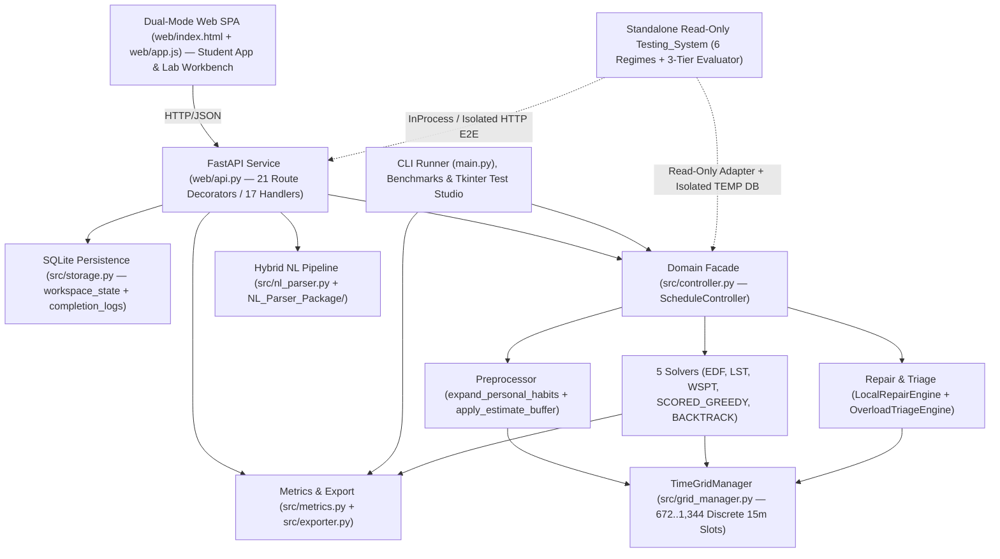

# SmartSchedule — MVP Pre-Presentation Documentation

> **Course:** CS252 — Computational Thinking 
> **Project:** **SmartSchedule** — Cognitive-Aware & Constraint-Guaranteed Student Study Scheduler  
> **Team:** Group 03 (*The Seven Dwarfs*) — FIT-HCMUS  
> **Milestone:** Deadline 1 — **MVP Pre-Presentation Report**

| Role | Full Name | Student ID | Email | Primary Responsibilities |
| :--- | :--- | :--- | :--- | :--- |
| **Leader** | Phạm Đức Minh | 25125028 | `pdminh2523@apcs.fitus.edu.vn` | Technical lead, domain coordination, benchmark & alpha grid calibration, overall architecture integration |
| **Thinker 1** | Trần Nguyên Khánh | 25125019 | `tnkhanh2527@apcs.fitus.edu.vn` | Scheduling problem modeling, cognitive & biological alignment heuristics, scoring formulation |
| **Thinker 2** | Hoàng Minh Anh | 25125001 | `hmanh2503@apcs.fitus.edu.vn` | Behavioral research synthesis, Planning Fallacy buffer analysis, overload triage rules |
| **Thinker 3** | Nguyễn Trọng Tiến | 25125037 | `nttien2530@apcs.fitus.edu.vn` | Natural language task specification (`NL_Parser_Package`), constraint formalization, diagnostic taxonomy (`E_*`/`W_*`) |
| **Builder 1** | Lê Tiến Bình | 25125007 | `ltbinh2520@apcs.fitus.edu.vn` | Core solvers (`EDF`, `LST`, `WSPT`, `SCORED_GREEDY`, `BACKTRACK`), `LocalRepairEngine`, scheduling engine backend |
| **Builder 2** | Lê Minh Nhật | 25125032 | `lmnhat2532@apcs.fitus.edu.vn` | FastAPI service (`web/api.py`), Dual-Mode Web UI (`STUDENT APP` & `LAB BENCHMARK`), SQLite persistence & calendar export |
| **Builder 3** | Nguyễn Nguyễn Gia Bảo | 25125006 | `nngbao2508@apcs.fitus.edu.vn` | Automated verification suite (`verification_tests/`), standalone 6-regime `Testing_System`, test reproducibility |

---

## 1. Project Analysis & Computational Thinking Application

*(All technical specifications, formulas, UI flows, and metrics in this document match the executed codebase and live presentation demo.)*

### 1.1. Problem Formulation

Student study schedules frequently break down not from an absolute shortage of weekly free hours, but because ad-hoc planning ignores **hard temporal dependencies**, **optimistic duration bias (Planning Fallacy)**, **cognitive fatigue**, and **circadian energy mismatch**. SmartSchedule formalizes personal weekly and bi-weekly scheduling as a deterministic, multi-tier constrained optimization problem over:

- **Discrete Time Horizon:** $H \in [7, 14]$ days (`horizon_days`), partitioned into $S = 96 \cdot H$ contiguous **15-minute slots** ($672$ slots for 1 week; $1,344$ slots for 2 weeks).
- **Student Commitments Profile:** Enforced sleep schedule (`SleepSchedule`, biological floor $\ge 6\text{h} = 24$ slots/night), fixed commitments (`FixedEvent`: lectures, labs, part-time shifts, meals, meetings—including overnight events crossing midnight), chronotype energy profile (`MORNING`, `AFTERNOON`, `EVENING`, `BALANCED`, or custom band levels $E_s \in \{1, 2, 3\}$), buffer configuration (`COGNITIVE_LOAD`, `HABIT`, or per-task `NONE`), and recurring `PersonalHabit` definitions.
- **Task Set $\{T_1, \dots, T_n\}$:** Each task specifies an estimated duration, optional deadline (`due` ISO-8601 or weekday/time, spanning into week 2), priority $P \in \{1..5\}$, cognitive load $L \in \{1, 2, 3\}$, splitting preferences (`is_splittable`, `work_rhythm`, `min_chunk_min`, `max_chunk_min`), release lower bound (`start_after`), prerequisite DAG edges (`depends_on`), and locked user sessions (`PINNED` / `DONE`).

**Core Objectives:**
1. Guarantee **zero hard-constraint violations** ($H_1$–$H_5$ plus horizon, release-time `start_after`, and `PINNED`/`DONE` integrity).
2. Maximize on-time priority value while aligning deep cognitive work with circadian peaks, enforcing recovery breaks, and maintaining sustainable daily pacing.
3. Preserve schedule continuity under sudden disruptions or duration overruns via minimal-perturbation local repair (`LocalRepairEngine`).
4. Provide explicit shortage attribution and non-destructive trade-off options whenever total demand exceeds available capacity.

### 1.2. Application of the 4 Computational Thinking (CT) Pillars

| CT Pillar | Concrete Application Across Analysis, Design & Development | Verified Codebase Modules |
| :--- | :--- | :--- |
| **1. Decomposition** | Split weekly planning across **4 hierarchical levels (`L0–L3`)**: (`L0`) Time-grid initialization & immutable constraint masking $\to$ (`L1`) Deterministic task preprocessing (`expand_personal_habits` $\to$ `apply_estimate_buffer` $\to$ balanced chunking) $\to$ (`L2`) Single/multi-solver placement & Tier-1 break relaxation $\to$ (`L3`) Post-solve local repair, interactive overload triage, and 3-tier productivity evaluation (`G1–G2`, `P1–P4`, `D1–D3`). Unstructured EN/VI prompts are likewise decomposed into a **6-stage Hybrid NL Pipeline** (`UI Constraints -> Gatekeeper & Translation -> Extraction -> E_*/W_* Verification -> UI Reconciliation -> Solver Adapter`). | `src/controller.py`, `src/grid_manager.py`, `src/solvers/base_solver.py`, `NL_Parser_Package/hybrid_parser.py`, `Testing_System/evaluator/` |
| **2. Pattern Recognition** | Synthesized **8 behavioral patterns (`P1–P8`)** from empirical scheduling and cognitive literature: Planning Fallacy underestimation (`P1`), deadline procrastination & exponential urgency (`P2`), circadian synchrony (`P3`), 90-minute ultradian fatigue & context-switching cost (`P4`), unusable $<30\text{m}$ micro-gaps (`P5`), biological sleep minimum $\ge 6\text{h}$ (`P6`), urgency $\times$ priority trade-offs (`P7`), and local rescheduling stability target $\ge 90\%$ (`P8`). | `src/config.py`, `src/estimate_buffer.py`, `src/models.py` (`CIRCADIAN_PROFILE_DEFAULTS`), `src/solvers/scored_greedy.py`, `src/metrics.py` |
| **3. Abstraction** | Abstracted continuous calendars into an integer-indexed `TimeGridManager` array using 5 canonical slot states (`FREE`, `SLEEP`, `OCCUPIED`, `BLOCK`, `REST`), decoupled from FastAPI/UI state through pure Pydantic v2 domain models (`src/models.py`). Abstracted ambiguous natural-language inputs into 14 structured error codes (`E_*`) and 34 diagnostic warnings (`W_*`). Isolated automated testing behind a read-only adapter feeding an external 3-tier productivity evaluator (`Gates -> 4 Pillars -> Lexicographic Verdict & ICEE`). | `src/models.py`, `src/grid_manager.py`, `verification_tests/architecture_tests/test_system_architecture.py`, `Testing_System/sut_adapter.py` |
| **4. Algorithmic Thinking** | Engineered 5 deterministic solvers (**Energy-Blind V0 baselines** `EDF`, `LST`, `WSPT` alongside **Energy-Aware** `SCORED_GREEDY` and depth/time-bounded `BACKTRACK` Branch-and-Bound), DFS 3-color DAG cycle/prerequisite isolation, minimum-part chunk splitting capping deep blocks at $\le 90\text{m}$, `LOCAL_INSERTION` / `RIPPLE_SHIFT` / `FULL_REBUILD` / `repair_overrun` algorithms, DAG-safe `OverloadTriageEngine`, and canonical SHA-256 plan fingerprinting. | `src/solvers/*.py`, `src/overload_triage.py`, `src/solvers/local_repair.py` |

### 1.3. Refinement from Initial Proposal to Implemented MVP

| Dimension | Initial Proposal (`Proposal_Report.pdf`) | Implemented MVP Codebase | Rationale |
| :--- | :--- | :--- | :--- |
| **Planning Horizon** | Fixed 7 days (`672` slots) | Dynamic `7`–`14` days (`672..1,344` slots) via `horizon_days` + Week 1 / Week 2 UI navigation | Handles cross-week deadlines (`T10`) and bi-weekly exam prep cleanly without Sunday truncation |
| **Grid Slot States** | `FREE`, `OCCUPIED`, `SLEEP`, `UNKNOWN` | `FREE`, `SLEEP`, `OCCUPIED:<id>`, `BLOCK:<id>`, `REST:DEAD_ZONE`, `REST:BREAK:<id>` | Removes ambiguous `UNKNOWN`; separates study blocks (`BLOCK`), recovery breaks (`REST:BREAK`), and `<30m` gaps (`REST:DEAD_ZONE`) |
| **`SCORED_GREEDY` Scoring** | `(priority / 5) * exp(-slack / 24)` | `priority * urgency + circadian_score + batch_score` (`priority` $\in \{1..5\}$) | Keeps $P \in \{1..5\}$ directly proportional so priority urgency dominates secondary intra-day tie-breakers |
| **Planning Fallacy Buffer** | Single habit multiplier | **Dual-mode:** `COGNITIVE_LOAD` (`1.20 / 1.35`, `RoundUp_15`; Student UI default) & `HABIT` (`1.00 / 1.10 / 1.25`, `nearest_15`; scenario default) + per-task `NONE` | Asymmetric `1.20/1.35` absorbs `97.1%` of `+25%` overruns without replanning while minimizing weekly slack waste (`Section 5.2D`) |
| **Behavioral Rules** | 5 initial patterns | **8 implemented patterns (`P1–P8`)** adding sleep floor $\ge 6\text{h}$, exponential urgency $\times$ importance, and local stability $\ge 90\%$ | Captures biological protection and disruption robustness directly in the solver |
| **Delivery Architecture** | Desktop mockup planned | Unified **FastAPI + HTML5/Tailwind SPA** (`🎓 Cá Nhân` Student App & `🔬 Lab Nghiên Cứu` Benchmark Lab) + SQLite | Delivers zero-install daily calendar UX and live A/B solver benchmarking on one engine |

---

## 2. Feature Specification (Live-Demo Verified)

All features below are implemented and executable in the live Web UI (`uvicorn web.api:app` / `run_app.bat`), CLI (`main.py`), or `Testing_System`.

### 2.1. Core Functional Features (`F1`–`F10`)

1. **`F1` — Multi-Solver Weekly & Bi-Weekly Scheduler (`672..1,344` Slots, $H_1$–$H_5$ Zero-Violation Guarantee)**
   - Enforces non-overlap with `FixedEvent` (`OCCUPIED`, including overnight wrapping such as `22:00–02:00`), protected `SleepSchedule` (`SLEEP` $\ge 6\text{h}$), contiguous non-overlapping chunks (`BLOCK`), hard deadlines (`end_slot <= deadline_slot`, including `slot 0` handling and `DEADLINE_IN_PAST` isolation), `start_after` release bounds, and `depends_on` topological precedence with DFS 3-color cycle/missing-prerequisite isolation (`CIRCULAR_DEPENDENCY`, `MISSING_PREREQUISITE`) and atomic task rollback if any chunk lacks space.
   - **Solvers:** `SCORED_GREEDY` (**Web UI & `/api/plan` default**), `EDF` (`GREEDY_EDF_FIRST_FIT`, **CLI default**), `LST` (`GREEDY_LST_BEST_FIT` dynamic remaining-free slack), `WSPT` (`GREEDY_WSPT_SMITH_RULE` `priority / planned_min`), and `BACKTRACK` (`BACKTRACKING_BRANCH_AND_BOUND`, `max_nodes=3000`, `1.75s` timeout, `12` multi-point candidate placements/task).

2. **`F2` — Circadian Energy Alignment, Recovery Breaks & Smart Chunking (`P3–P5`)**
   - Maps chronotypes (`MORNING`, `AFTERNOON`, `EVENING`, `BALANCED`) across 4 daily bands (`06–12`, `12–18`, `18–24`, `00–06`) to energy levels `1..3`. In `SCORED_GREEDY` and `BACKTRACK`, deep sessions (`cognitive_load == 3`) earn Peak preference bonuses, reserve an automatic 15-minute `REST:BREAK` slot immediately after sessions $\ge 90\text{m}$ or `load >= 3`, batch matching categories (`+0.35` adjacent bonus / `-0.25` context-switch penalty), and quarantine `< 30m` unusable intervals as `REST:DEAD_ZONE`.
   - **Work Rhythm Splitting:** Supports `WORK_RHYTHM_BOUNDS` (`LIGHT: 30–45m`, `BALANCED: 45–90m`, `FLOW: 60–120m`, `CUSTOM`) plus balanced integer division ensuring no chunk exceeds `max_chunk_min` (default `90m`), automatically enabling splitting when `duration_min > max_chunk_min` unless explicitly locked (`🔒 Làm liền 1 buổi`).
   - *Scientific Basis:* Grounded in Kleitman's ~90-minute ultradian Basic Rest-Activity Cycle (BRAC, 1963/1982), deliberate practice limits (Ericsson et al., 1993), meta-analytic findings showing micro-breaks $\le 10\text{m}$ fail to restore cognitive performance (`Albulescu et al., 2022` — quantized to `1` 15m slot), Attention Residue (`Leroy, 2009`), task-switching cost (`Rubinstein et al., 2001`), and late-chronotype *Social Jetlag* / synchrony effects (`Smarr & Schirmer, 2018`; `Schmidt et al., 2007`). Setting circadian preference as a *soft multi-tier weight* prevents tight deadlines from being dropped due to rigid peak locks.

3. **`F3` — Dual-Mode Planning Fallacy Buffer & M7 Completion Check-In (`P1`, `M7`)**
   - **Buffer Modes:** `COGNITIVE_LOAD` scales raw estimates via `RoundUp_15(est * α)` with `α_light = 1.20` (`load in {1, 2, None}`) and `α_heavy = 1.35` (`load == 3`), configurable in Settings; `HABIT` applies `RARELY=1.00`, `SOMETIMES=1.10`, `OFTEN=1.25` via `max(round_up_to_15(est), nearest_15(est * mult))`; per-task `buffer_mode="NONE"` disables padding cleanly.
   - **Empirical Check-In Feedback (`M7`):** Recording `actual_duration_min` via `POST /api/tasks/complete` (from either Today Hero Card or `"Why Here?"` modal) persists rows into SQLite `completion_logs` and returns `overrun_ratio`, `recommended_estimate_habit`, and `recommended_alpha` *(while triggering overrun repair if marked incomplete with overrun)*.
   - *Scientific Basis:* Addresses optimism bias and the *"inside view"* in student estimation (`Buehler, Griffin & Ross, 1994`, where students underestimated actual project days `33.9` vs. `55.5`) and incorporates protective scheduling buffers (`Mehta & Uzsoy, 1998` in `Vieira et al., 2003`). `RoundUp_15` ensures short tasks (`15–30m`) gain at least 1 buffer slot rather than rounding back to raw length.

4. **`F4` — PersonalHabit Manager (`PreferredWindow` & Even Day-Spreading)**
   - Expands recurring weekly habits (`name`, `frequency_per_week`, `duration_min`, `preferred_window` in `MORNING | AFTERNOON | EVENING | ANYTIME`, `cognitive_load`) via `expand_personal_habits`, distributing occurrences evenly across remaining days (`start_after`) and scoring preferred windows (`+8.0` exact window match, `+2.5` partial overlap) at low academic priority (`priority=1`) so habits yield automatically during crunch weeks.

5. **`F5` — Disruption Rescheduling (`LOCAL_INSERTION` / `RIPPLE_SHIFT` / `FULL_REBUILD`) & Overrun Repair (`P8`)**
   - Handles mid-week emergencies (`DisruptionEvent`, Scenario `T04`, Student `"⚡ Báo sự cố đột xuất"`) and duration overruns (`T05`, `POST /api/progress`). `LOCAL_INSERTION` locks `PINNED`/`DONE` and unaffected blocks, relocating only colliding blocks to nearest valid slots with progressive unfreezing and post-move `H5` topological checks (`target stability >= 90%`). Lab Tab 3 runs `COMPARE_BOTH` side-by-side (`100.00%` stability vs. `0.00%` Full Rebuild on `T04`).
   - *Scientific Basis:* Implements the Minimal Perturbation Problem (`Barták, Müller & Rudová`; `Zweben`) and plan-repair stability principles (`Fox et al., 2006`; `Myers et al., 2006`), minimizing plan nervousness so students maintain trust in their weekly plan.

6. **`F6` — Two-Tier Crunch Relaxation & Interactive Overload Triage (`OverloadTriageEngine`)**
   - **Tier 1 (`Cut breaks`):** If deadlines remain unplaced, solvers retry with `allow_breaks=False` (releasing non-mandatory breaks and `<30m` dead-zones) **only if** strictly more tasks are placed—**never** silently truncating user task durations *(Automation Level 4 principle: `Parasuraman, Sheridan & Wickens, 2000`; while hard sleep lock $\ge 6\text{h}$ protects against cumulative deprivation shown by `Van Dongen et al., 2003`)*.
   - **Tier 2 (`OverloadTriageEngine`):** Generates structured `OverloadReport` shortage diagnostics, `0–48h` Early Extension Alerts, and least-harm resolution options (`SKIP_HABIT`, `SHORTEN_TASK`, `ALLOW_SPLIT`, `POSTPONE_LOWEST`) protecting `depends_on` ancestors of `priority >= 3` tasks. `POST /api/overload/preview` renders `PROPOSED` visual diffs on the calendar before user confirmation (`Apply` or `↩️ Undo`).

7. **`F7` — Bilingual Hybrid Natural Language Task Parser (`NL_Parser_Package` + M1 Dual-Engine)**
   - Unified **6-stage Hybrid Pipeline** (`POST /api/tasks/natural-add`): enforces UI overrides (`splittable`/`single`, `work_rhythm`, urgency `1..4` $\to$ solver priority `5..1`), input gatekeeper (`<= 500` chars, typo cleanup, chatter/past-narrative & SQL/prompt-injection rejection `E_NONSENSE_INPUT`), offline EN/VI parsing & coarse window extraction (`sáng->11:00`, `trưa->12:00`, `chiều->17:00`, `tối->21:30`, ignoring clock timestamps like `19h30`), subtask splitting & DFS cycle check, `14 E_*` + `34 W_*` diagnostics, `[[filename]]` / `@[path]` citation linking (`.txt/.pdf/.html/.md`, $\le 20\text{ MB}$), and **auto-detection of fixed commitments** (`suggested_fixed_event` with `"🔒 Khóa vào Lịch Cố Định"`).
   - **Dual-Engine & Zero-Dependency Resilience:** Operates fully deterministic offline (`⚡ Offline Hybrid`, built-in `"rule"` translator, or optional `NLLB-200` / `MarianMT` via `requirements-nllb.txt`), and seamlessly switches to `GeminiNLParser` (`google-genai`) when `GEMINI_API_KEY` is configured in `.env`, reporting explicit `ai_status` telemetry (`Human-in-the-Loop` draft preview keeps downstream solver SHA-256 hashes strictly deterministic).

8. **`F8` — Dual-Mode Web UI (`🎓 Cá Nhân` Student App & `🔬 Lab Nghiên Cứu` Benchmark Workbench)**
   - **Student Mode (`STUDENT APP`, default):**
     - *Temporal Context Engine:* Exact `DD/MM/YYYY` headers, `PAST / HÔM NAY / Sắp tới` state styling, live `🔴 BÂY GIỜ` timeline divider, `▶ ĐANG DIỄN RA` Hero Focus Card with inline check-in, deadline countdown pills, historical preset `#temporalContextBanner` rebase (`🕒 Đưa lịch đang xem về tuần hiện tại`), collapsible night sleep (`00:00–06:30`), 7/14-day week slider, and interactive mini-month range calendar (`📆 Lịch`).
     - *Interactive Control & Explainability:* HTML5 drag-and-drop validated in real time against $H_1$–$H_5$ (`/api/validate-move` pins valid drops), block Pinning (`📌`) / Done (`✓`), 1-step Undo, `"Tại Sao Lại Xếp Giờ Này?"` XAI popover displaying structured `#REASON_CODE` badges and constraint rationale, Progressive Disclosure Add-Task modal (`STUDENT` hides technical lab controls inside `
`), and `localStorage` draft recovery.
   - **Lab Mode (`LAB BENCHMARK`):** Preset loader (`Minh`, `Lan`, `Empty`), `T01–T10` scenario selector, JSON import, 5-solver switcher, Quick Command bar, and 3 workspace tabs: (`1`) 6-KPI Grid & Fixed-Event Inspector, (`2`) **Algorithm A/B Studio** (Executive Verdict, 9-metric scorecard, Task-by-Task placement diff, parallel grids), and (`3`) **Resilience & Determinism Lab** (`T04` Repair comparison, `T05` Overrun simulator, 3x SHA-256 proof ledger across all 5 solvers).

9. **`F9` — Local Persistence, Multi-Format Export & Verification Tooling**
   - SQLite storage (`src/storage.py`: `workspace_state` + `completion_logs`) via `GET/PUT/DELETE /api/state` and `/api/tasks/completions`; RFC 5545 iCalendar (`.ics`, `Asia/Ho_Chi_Minh`), `.csv`, and `.json` exports (`src/exporter.py`); plus CLI runner (`main.py`), structured console runner (`clean_runner.py`), and desktop Verification Test Studio (`verification_tests/test_studio.py`).

10. **`F10` — Standalone Read-Only Productivity Testing Harness (`Testing_System/`)**
    - Independent 2-part testing system (`InputGenerator` across **6 Regimes** $\to$ SUT Execution via Direct Controller or Isolated HTTP E2E $\to$ `ScheduleEvaluator`) verifying feasibility (`G1–G2`), 4 Productivity Pillars (`P1–P4`), Lexicographic Solver Rankings (`D2`), and top-budgeted `ICEE` critiques (`D1`) without modifying baseline files.

---

## 3. System Design

### 3.1. Layered System Architecture

**Strict Dependency Rule:** Verified automatically by `test_system_architecture.py`, domain layers (`src/models.py`, `src/grid_manager.py`, `src/estimate_buffer.py`, `src/solvers/*`, `src/controller.py`) **never** import `web/`, `fastapi`, UI templates, or external database drivers.

### 3.2. Key Algorithms, Mathematical Formulations & Module Contracts

#### A. Scoring & Quality Formulas

1. **`SCORED_GREEDY` Priority–Urgency Score (`src/solvers/scored_greedy.py`):**
   $$\text{Score}(T) = P_T \cdot \text{Urgency}(T), \quad \text{Urgency}(T) = \begin{cases} 0.20 & \text{if } D_T = \varnothing \text{ (Habit)} \\ 1.50 + \min(0.50,\, 0.01 \cdot |s_h|) & \text{if } s_h \le 0 \\ \exp(-s_h / \gamma) & \text{if } s_h > 0 \end{cases}$$
   where $P_T \in \{1..5\}$ is priority, $s_h$ is slack hours remaining until deadline $D_T$, and $\gamma = 24.0\text{h}$.
   - *Mathematical & Behavioral Rationale:* Adapted from Temporal Motivation Theory (`Steel & König, 2006`), `exp(-s_h / 24.0)` grows smoothly (`72h -> 0.05`, `24h -> 0.368`, `0h -> 1.00`) to initiate high-value tasks well before the `<10h` cramming threshold (`Howell, 2006` in `Svartdal et al., 2018`). Capping overdue urgency at `1.50` avoids starving feasible coursework, while `0.20 * P` keeps flexible habits (`0.20`) active in loose periods without displacing deadlines (`P5 @ 24h ≈ 1.84`).

2. **Slot Placement Score (`src/solvers/base_solver.py`):**
   For a candidate chunk inside energy-aware solvers (`SCORED_GREEDY`, `BACKTRACK`), candidate start slot $s$ combines circadian energy match, `PersonalHabit` window bonus (`+8.0 / +2.5 / -5.0`), intra-day batching (`+0.35` same category vs. `-0.25` switch within `0..1` slots gap), and chronological tie-break (`-0.002 * s`):
   - *Design Bound:* For `Load = 3` tasks, `(avg_energy - 1.5) * 4.0` spans `[-2.0, +6.0]` (`8.0` range), whereas batching spans `[-0.25, +0.35]` (`0.60` range)—mathematically guaranteeing category grouping refines intra-day order without overriding biological Peak hours.

3. **Schedule Experience Rating (`src/metrics.py`, `[1.0..5.0]`, lower is calmer):**
   $$\text{Rating} = \text{clip}_{[1, 5]}\Big(1.0 + \underbrace{\min(2.2, \max(0, (\rho_{\text{busy}} - 0.15) \cdot 2.75))}_{\text{Density}} + \underbrace{\min(0.8, \max(0, (L_{\max} - 6) \cdot 0.2))}_{\text{Unbroken Streak } > 90\text{m}} + \underbrace{0.6 \cdot r_{\text{mismatch}}}_{\text{Heavy@Low-Energy}} + \underbrace{\min(1.0, 0.35\, U + 0.45\,\mathbb{I}_{\text{crunch}})}_{\text{Overload / Crunch}}\Big)$$
   where $\rho_{\text{busy}} = (\text{BLOCK} + \text{OCCUPIED}) / \text{awake\_slots}$, $L_{\max}$ is longest contiguous block run (slots), $r_{\text{mismatch}}$ is fraction of `load >= 3` slots placed at Energy Level `1`, and $U$ is unplaced task count *(reflecting non-linear fatigue under high utilization and circadian mismatch: `Gombolay, 2017`; `Schaerf, 1999`; `Smarr & Schirmer, 2018`)*.

4. **Alpha Grid Calibration Objective (`benchmark_alpha_grid.py`):**
   $$\text{Composite} = 0.35\,R_{\text{dl}} + 0.25\,R_{+25\%} + 0.20\,R_{+50\%} + 0.20\,R_{+25\%,\text{noRepair}} - 4.0\max(0, \overline{\text{Rating}} - 2.0) - 2.0\,\overline{\text{Frag}} - 100.0\,C_{\text{hard}}$$
   evaluates Planning Fallacy multipliers $\alpha \in [1.00, 1.60]$ by trading baseline completion against worst-case shock survival (`Daniels & Kouvelis` in `Vieira et al., 2003`) and cognitive fatigue.

#### B. Module Architecture Summary

| Module | Core Responsibility |
| :--- | :--- |
| `src/models.py`, `src/config.py` | Pure Pydantic v2 models (`CommitmentsProfile`, `Task`, `PersonalHabit`, `ScheduleBlock`, `OverloadReport`) & calibrated system constants |
| `src/grid_manager.py` | Discrete 15-minute grid (`672..1,344` slots), `explain_violation()`, automated `<30m` dead-zone classification, clone-safe rollback |
| `src/estimate_buffer.py`, `src/utils.py` | Integer slot/time arithmetic (`-05:00` to `+07:00`, midnight wraparound), dual-mode buffer scaling (`COGNITIVE_LOAD`, `HABIT`, `NONE`) |
| `src/solvers/` | Unified registry (`resolve_solver`) + 5 solvers + `LocalRepairEngine` (`LOCAL_INSERTION`, `RIPPLE_SHIFT`, `FULL_REBUILD`, `repair_overrun`) |
| `src/overload_triage.py` | Prerequisite-safe overload option generator (`SKIP_HABIT`, `SHORTEN_TASK`, `ALLOW_SPLIT`, `POSTPONE_LOWEST`) |
| `src/nl_parser.py`, `NL_Parser_Package/` | 6-stage Hybrid EN/VI parser, VI$\to$EN translator (`rule`/`nllb`/`opus_mt`), optional Gemini AI client, `14 E_*` / `34 W_*` checker |
| `src/metrics.py`, `src/exporter.py` | $H_1$–$H_5$ audit, `R_deadline`, `S_stability`, `FragIdx`, `Experience Rating`, SHA-256 determinism hash, `.ics` / `.csv` / `.json` export |
| `src/storage.py`, `web/api.py` | SQLite persistence (`workspace_state`, `completion_logs`) & FastAPI HTTP layer (`21` route decorators / `17` handlers across `/`, `/app.js`, `/api/*`) |

### 3.3. Key System Design Decisions

1. **15-Minute Discretization + Lexical Hierarchy vs. Scalar Weighted MIP:** Quantizing into 15-minute slots reduces a 2-week schedule to $\le 1,344$ cells, enabling sub-50ms greedy solves on standard weekly workloads (`1.03–47.79 ms`; `19–215 ms` on 41-task bi-weekly workloads) and `220–920 ms` bounded Branch-and-Bound with exact SHA-256 reproducibility. Evaluating hard feasibility first avoids deceptive trade-offs where soft bonuses mask hard violations (`Schaerf, 1999 §5.1`).
2. **Controlled Ablation (`EDF V0` Energy-Blind vs. `SCORED_GREEDY`):** Keeping `EDF`, `LST`, and `WSPT` strictly energy-blind provides an exact scientific baseline inside Lab Mode (`T09`, `Minh` A/B Compare), cleanly isolating the gains of circadian matching and category batching.
3. **Dual UI & Read-Only Testing Separation:** Student Mode hides grid/solver complexity behind Progressive Disclosure (`🎓 Cá Nhân`), while Lab Mode exposes full multi-solver telemetry (`🔬 Lab Nghiên Cứu`). Separately, `Testing_System` binds via a read-only adapter and temporary SQLite paths so evaluation never alters production code or user state.

### 3.4. Live Demo Flow (Report-to-Screen Alignment)

1. **Student App (`🎓 Cá Nhân`):** Open `📅 Lịch Tuần` (`SCORED_GREEDY` + `COGNITIVE_LOAD`), show temporal `DD/MM/YYYY` states & live clock divider (`🔴 BÂY GIỜ`), switch to `🎯 Hôm Nay` for Hero Focus Card & M7 inline check-in, parse a Vietnamese task prompt in `➕ Thêm Việc` (`"Ôn Toán rời rạc trước tối thứ 5, khoảng 2 tiếng"` showing `⚡ Offline Hybrid` + `W_*` chips), inspect `"Tại Sao Lại Xếp Giờ Này?"`, test live drag-and-drop rejection across a fixed class, and export `.ics`.
2. **Lab A/B Studio (`🔬 Lab Nghiên Cứu` $\to$ Tab 2):** Compare `EDF` vs. `SCORED_GREEDY` on `Minh` (or `T09`), demonstrating Deep Peak Match gain (`41.7% -> 100.0%`) and Context Switch reduction (`2 -> 0`).
3. **Disruption & Determinism (`🔬 Lab Nghiên Cứu` $\to$ Tab 3):** Load `T04`, click `⚖️ Chạy Đối Chứng: Local Repair vs Full Rebuild` (`100.00%` vs. `0.00%` stability), trigger `T05` overrun, and run `📊 Chạy Ledger Tất Cả 5 Solvers` (3x identical SHA-256 verification).
4. **CLI Verification:** Run `python -B benchmark_runner.py`, `verify_hybrid_200.py`, and `python -B -m Testing_System.cli --mode full --seeds 42`.

---

## 4. MVP Feature Selection (MoSCoW Prioritization)

This MoSCoW prioritization separates capabilities **verified and runnable in the MVP Demo** from features scheduled for the **Final Presentation (Week 10)** and items intentionally **out of scope (`Won't-Have`)**.

| Priority | Feature / Capability | Delivery Stage | Rationale |
| :--- | :--- | :--- | :--- |
| **Must-Have** | 15-min `TimeGridManager` (`672..1,344` slots), $H_1$–$H_5$ zero-violation engine, $\ge 6\text{h}$ sleep lock, DAG cycle isolation | **MVP (Implemented)** | Core mathematical correctness guarantee required before any optimization claim |
| **Must-Have** | 5 Solvers (`EDF`, `LST`, `WSPT`, `SCORED_GREEDY` default, `BACKTRACK`) & 3x SHA-256 determinism verification | **MVP (Implemented)** | Powers daily scheduling plus reproducible Energy-Blind vs. Energy-Aware ablation |
| **Must-Have** | Dual-Mode Planning Fallacy Buffer (`COGNITIVE_LOAD` `1.20/1.35`, `HABIT`, per-task `NONE`), `work_rhythm` splitting, `15m` recovery breaks | **MVP (Implemented)** | Empirically protects schedules against estimation overrun (`97.1%` `+25%` shock survival) and deep-work fatigue |
| **Must-Have** | `LocalRepairEngine` (`LOCAL_INSERTION` $\ge 90\%$ stability, `RIPPLE_SHIFT`, `FULL_REBUILD`, `repair_overrun`) + Tier-1 Crunch & `OverloadTriageEngine` | **MVP (Implemented)** | Ensures real-world disruptions and capacity shortages trigger safe, minimal-perturbation recovery |
| **Must-Have** | Dual-Mode Web UI (`🎓 Cá Nhân` & `🔬 Lab Nghiên Cứu`), SQLite state persistence, drag-drop `validate-move`, `.ics`/`.csv`/`.json` export | **MVP (Implemented)** | Delivers complete interactive student workflow, XAI inspection, and benchmark demo cockpit |
| **Should-Have** | 6-Stage Bilingual EN/VI Hybrid NL Parser (`OFFLINE_DETERMINISTIC` + optional `GEMINI_API_KEY`), Fixed-Event detection, `[[file]]` citation verification | **MVP (Implemented)** | Reduces task-entry friction while maintaining zero-network offline determinism |
| **Should-Have** | `PersonalHabit` window expansion, `"Why Here?"` popover, M7 task check-in telemetry, and standalone 6-Regime `Testing_System` | **MVP (Implemented)** | Connects user transparency, completion logging, and independent scientific validation |
| **Should-Have** | **Cross-Week Automated EWMA `α` Self-Calibration** updating profile multipliers dynamically from accumulated `completion_logs` | **Final Presentation (Week 10)** | MVP already captures `completion_logs` and single-task alpha suggestions; automatic cross-week weight adaptation builds safely atop multi-day history |
| **Should-Have** | **Stochastic `SimulatedStudent` Monte Carlo Evaluator (`1,000+` runs)** & **`N = 10–14` 1-Week Peer Field Study** (`SUS`, `NASA-TLX`, daily EMA) | **Final Presentation (Week 10)** | Validates long-horizon usability, subjective fatigue calibration, and empirical adoption across real FIT-HCMUS student weeks |
| **Could-Have** | Pre-bundled offline neural VI$\to$EN translation weights (`NLLB-200` / `MarianMT` via `requirements-nllb.txt`) | **Week 10 Stretch / Optional** | Built-in `"rule"` translator already achieves `200/200` on benchmark YAML cases in `7.52 ms/case` without heavy model downloads |
| **Could-Have** | Direct two-way Google Calendar OAuth sync & browser Voice Dictation | **Week 10 Stretch / Optional** | Standard `.ics` export already supports calendar import; 2-way OAuth adds credential scope without improving core algorithm verification |
| **Won't-Have** | **Stage 5 Syllabus/Rubric PDF Milestone Extraction**, Multi-Semester Goal Planner, Native Mobile App, Multi-User Auth / Team Calendars | **Out of Scope (`Won't-Have`)** | Expands scope into document-level NLP and multi-tenant SaaS infrastructure beyond single-student weekly scheduling in CSC10014 |

---

## 5. Testing Plans, Test Cases & Verified Results

All numbers below come directly from live execution against the current codebase using `PYTHONDONTWRITEBYTECODE=1` and isolated temporary SQLite databases.

### 5.1. Dual-Layer Verification Strategy

1. **Internal Engineering Verification (`verification_tests/`, `verify_hybrid_200.py`, `benchmark_runner.py`, `benchmark_alpha_grid.py`):** Validates structural invariants, concurrency/memory bounds, edge cases, multilingual NL grammar & adversarial checks, scenarios `T01–T10`, scalability SLAs, and Planning Fallacy `α` tuning.
2. **Independent Productivity Testing (`Testing_System/`):** Separates evaluation from solver design through a read-only closed pipeline (**`InputGenerator` across 6 Regimes $\to$ Project Direct/HTTP Run $\to$ 3-Tier `ScheduleEvaluator`**), auditing `G1–G2`, 4 Productivity Pillars (`P1–P4`), Lexicographic Rankings (`D2`), and `ICEE` critiques (`D1`) grounded in 8 full-text papers (`Schaerf 1999`, `Myers et al. 2006`, `Vieira et al. 2003`, `Fox et al. 2006`, `Albulescu et al. 2022`, `Smarr & Schirmer 2018`, `Svartdal et al. 2018`, `Gombolay 2017`).

### 5.2. Internal Test Suite & Benchmark Results (Measured Live)

#### A. Five-Layer Engineering Pytest Suite (`verification_tests/`)
- **Total Verified Result:** **`155 / 155 PASSED` in `14.43s`** (`pytest -p no:cacheprovider`):
  - `architecture_tests/` (**9 / 9 PASS**): Memory leak absence, peak memory bounds, thread-safe concurrent state isolation, `N=50` latency `< 2000ms`, foreign timezone offset (`-05:00`), strict pure-domain import boundaries.
  - `benchmark_tests/` (**20 / 20 PASS**): Exact `672`-slot accounting (`Minh`: `SLEEP=196, OCCUPIED=132`), sleep/class locking, DAG ordering, 3x determinism SHA-256 hashes, `T01–T10` assertions, FastAPI E2E checks.
  - `logical_tests/` (**115 / 115 PASS**): Cycle/missing-prereq isolation, dual-mode buffer formulas (`AC1–AC7`), `OverloadTriageEngine` options & DAG protection, Hybrid NL E2E + unseen prompt generalization (`rule` & `nllb` adapters), `horizon_days=14`, SQLite workspace/completion roundtrip, UI progressive-disclosure contracts, Tier-1 sprint crunch.
  - `ui_tests/` (**6 / 6 PASS**): `/api/plan` JSON §7.3 contract (`state`, `reasons[]`, `allowed_starts[]`), static SPA delivery, preset & scenario APIs, `/api/validate-move`, `.ics`/`.csv`/`.json` export formats.
  - `development_gap_tests/` (**5 / 5 PASS**): All 5 previously tracked Improve Plan target behaviors (circadian peak alignment, `15m` post-deep break, buffer scaling, `ENERGY_MATCH` reason codes, `SKIP_HABIT` triage option) now pass in full.

#### B. Hybrid NL Parser 200-Case Benchmark (`verify_hybrid_200.py` + `validate_cases.py`, `backend=rule`)
- **Dataset Integrity:** `200` YAML cases verified across `7` domains (`office: 58`, `study: 53`, `housework: 27`, `lifestyle: 25`, `exercise: 21`, `none: 14`, `mixed: 2`), `255` distinct edge-case tags, `14 E_*` error codes, `34 W_*` warning codes (`All checks passed`).
- **Observed Accuracy & Speed:** **`200 / 200 (100.0%) PASSED`** in **`1,503.1 ms` (`7.52 ms/case`)** — Category `A` (`10/10`), `B` (`120/120`), `C1` (`20/20`), `C2` (`30/30`), `C3` (`10/10`), and `D` (`10/10`).

#### C. Benchmark Scenarios `T01–T10`, Multi-Solver Comparison & Presets (`benchmark_runner.py` & `main.py`)

| Scenario / Benchmark | Tasks | $C_{\text{hard}}$ | $R_{\text{dl}}$ (%) | `FragIdx` | Latency (ms) | 3x SHA-256 | Observed Result / Behavior |
| :--- | :---: | :---: | :---: | :---: | :---: | :---: | :--- |
| **`T01` Normal Feasible (`EDF`)** | 5 | 0 | 100.0% | 0.000 | 3.46 | PASS | `SUCCESS` |
| **`T02` Overlapping Deadlines (`EDF`)** | 4 | 0 | 100.0% | 0.260 | 1.84 | PASS | `SUCCESS` |
| **`T03` Large Unsplittable `180m` (`EDF`)** | 2 | 0 | 50.0% | 0.000 | 1.30 | PASS | `CAPACITY_SHORTAGE (shortage=90m)` |
| **`T04` Disruption `Mon 07:30–09:30`** | 7 | 0 | 100.0% | 0.340 | 4.46 | PASS | `LOCAL_INSERTION`: **100.00% stability** (`2` moved, `2.21 ms`) vs. `FULL_REBUILD`: **0.00%** (`12` moved, `6.24 ms`) |
| **`T05` Duration Overrun (`90m -> 135m`)** | 3 | 0 | 100.0% | 0.240 | 1.32 | PASS | `SUCCESS` (`2` downstream shifted blocks, `C_hard=0`, `R_dl=100.0%`) |
| **`T06` Overload Capacity** | 3 | 0 | 66.7% | 0.310 | 6.01 | PASS | `CAPACITY_SHORTAGE (shortage=105m)`; Triage returns `['SKIP_HABIT', 'SHORTEN_TASK', 'POSTPONE_LOWEST']` |
| **`T07` Incomplete Metadata Defaults** | 3 | 0 | 100.0% | 0.000 | 1.42 | PASS | `SUCCESS` |
| **`T08` Tie-Breaking FIFO** | 3 | 0 | 100.0% | 0.000 | 1.18 | PASS | `SUCCESS` |
| **`T09` Circadian Ablation** | 2 | 0 | 100.0% | 0.000 | 1.03 | PASS | `EDF` keeps Deep Math `Mon 06:30–08:00` for both chronotypes; `SCORED_GREEDY` shifts to `Mon 18:00–19:30` for `EVENING` |
| **`T10` Cross-Week Horizon** | 2 | 0 | 100.0% | 0.000 | 2.18 | PASS | `SUCCESS` across Sunday boundary |

Additional measured solver, scalability, and preset runs:
- **Multi-Solver Latency on `T01` (`0` violations, `100.0% R_dl` for all 5):** `EDF` (`2.90 ms`), `WSPT` (`2.94 ms`), `LST` (`4.19 ms`), `SCORED_GREEDY` (`20.07 ms`), `BACKTRACK` (`220.06 ms`).
- **Scalability SLA (`EDF`):** `N=10`: `4.13 ms` ($\le 50\text{ ms}$); `N=25`: `9.14 ms` ($\le 50\text{ ms}$); `N=50`: `17.44 ms` ($\le 200\text{ ms}$), `C_hard=0`, `100%` placed.
- **Minh's Week Preset (`main.py` & `ScheduleController.compare_algorithms`):** `SCORED_GREEDY` solves all `9/9` tasks (`14/14` chunks, `47.79 ms` standalone / `47.10 ms` in compare, SHA-256 `55c47d51a1f753eb`). Against `EDF` (`5.99 ms`), `SCORED_GREEDY` raises **Deep Peak Match (`Load>=2`) from `41.7%` to `100.0%` (`+58.3%`)** and cuts **Context Switches from `2` to `0`** (repositioning `13/14` blocks, trading slightly tighter daily clustering `Exp=2.08 -> 2.48`).
- **Lan's Busy Week Preset (`main.py`):** `SCORED_GREEDY` (`11.13 ms`, `100.0%`, `5/5` blocks, `FragIdx=0.000`, SHA-256 `09cc63e666ac090f`) improves comfort over `EDF` (`Exp=1.61/5` *Comfortable* vs. `2.41/5` *Manageable*).

#### D. Planning Fallacy Calibration Grid (`benchmark_alpha_grid.py`, 7 Benchmark Weeks)
- **No Buffer (`1.00 / 1.00`):** `0.0%` `+25%` shock absorbed without repair, `Frag=0.20`, `Composite=79.61`.
- **Best Uniform (`1.40 / 1.40`):** `100.0%` `+25%` no-repair absorption, `Frag=0.05`, `Exp=1.80`, `avg_free_min=5374.0`, `Composite=99.90`.
- **Selected Asymmetric Default (`1.20` Light / `1.35` Heavy):** `100.0%` baseline `R_dl`, **`97.1%` `+25%` shock absorbed without repair**, `100.0%` post-repair survival under both `+25%` and `+50%` shocks, **lowest fragmentation (`Frag=0.04`)**, preserves `+82 min/week` more free time (`5456.0` vs. `5374.0` min), `Exp=1.96`, `Composite=99.34`.

### 5.3. Standalone 6-Regime Productivity Evaluation (`Testing_System/`)

- **Pytest Harness (`Testing_System/tests/`):** **`31 / 31 PASSED` in `13.99s`** (Architecture Invariants: `3`, Contrast Pairs self-tests: `6`, Deterministic Generator over 7d & 14d: `12`, Direct & Isolated HTTP E2E Pipeline Regimes: `10`).
- **CLI End-to-End Runs:** Both `python -B -m Testing_System.cli --mode full --seeds 41 42` (**14-day `seed=41`** + **7-day `seed=42`**) and `--mode http --seeds 42` finished with **`OVERALL SUITE RESULT: ALL PASS`**.

| Regime (`seed=42`, 7-Day) | Tightness $\rho$ | Lexicographic #1 (`D2`) | `D2` Verdict | $G_1$ | $P_{1.1}$ `Val%` | $+25\%$ Shock | Heavy Peak% | Rec $>10\text{m}$ | Forced Adv | Key Measured Cross-Solver / Repair Evidence |
| :--- | :---: | :--- | :--- | :---: | :---: | :---: | :---: | :---: | :---: | :--- |
| **1. Loose Feasible** | `0.3623` | `SCORED_GREEDY` | `FEASIBLE_BUT_LOW_PRODUCTIVITY` | 0 | 100.0% | 100.0% | **80.0%** | 100.0% | 0 | Outperforms Energy-Blind `EDF`/`WSPT` (`20.0%`) & `LST` (`0.0%`) on Heavy Peak; ICEE surfaces day load focus (`Corne=[1,3,2]`, `Std=187.3m`). *(14-day `seed=41`: `BACKTRACK` & `SCORED_GREEDY` hit `75.0%` vs `EDF 18.8%`)* |
| **2. Tight Deadline Cluster** | `0.7905` | `EDF` | `FEASIBLE_BUT_LOW_PRODUCTIVITY` | 0 | **100.0%** | 77.0% | 11.8% | 100.0% | 0 | Demonstrates multi-solver complementarity: under dense clusters, `EDF`/`LST`/`BACKTRACK` reach `100.0%` deadline completion, whereas priority/energy ordering in `SCORED_GREEDY` yields `97.0%` (`WSPT`: `87.4%`) |
| **3. Circadian SJL & Recovery** | `0.1032` | `BACKTRACK` / `SCORED_GREEDY` (`#2`) | `HIGH_PRODUCTIVITY` (`SCORED_GREEDY`) | 0 | 100.0% | 100.0% | **100.0%** | 100.0% | **0** | `SCORED_GREEDY` reaches zero Corne penalties (`[0,0,0]`, `SJL=75.0m`), whereas `EDF`/`WSPT`/`LST` force an `EVENING` chronotype into morning (`ForcedAdv=1`, `HPeak=50.0%`, `SJL=630.0m`) |
| **4. Procrastination & DAG** | `0.0798` | `SCORED_GREEDY` | `HIGH_PRODUCTIVITY` | 0 | 100.0% | 100.0% | **100.0%** | 100.0% | 0 | Both `SCORED_GREEDY` (`18.5 ms`) and `BACKTRACK` (`523.7 ms`) achieve `HIGH_PRODUCTIVITY` vs. `EDF`/`WSPT` at `HPeak=9.5%` |
| **5. Overload Infeasible** | `0.4962` (`ρ_dl=1.3152`) | `SCORED_GREEDY` | `OVERLOAD_TRIAGE` | 0 | **77.8%** | 74.1% | **100.0%** | 40.0% | 0 | All solvers detect genuine structural overload; `SCORED_GREEDY` preserves **77.8%** of deadline priority value vs. `EDF`/`BACKTRACK` (`63.0%`) & `LST` (`25.9%`) |
| **6. Disruption & Overrun** | `0.0740` | `SCORED_GREEDY` | `HIGH_PRODUCTIVITY` | 0 | 100.0% | 100.0% | **100.0%** | 100.0% | 0 | In **`Level C` Disruption** (`P4.2`), **`LOCAL_INSERTION` achieves `D=0, Orig=100.0%, Inv=0, Effort=LOW`** vs. **`FULL_REBUILD` `D=7, Orig=0.0%, Diff=100.0%, Δt=1075.0m, Inv=2, Effort=HIGH`** |

*(Metric notes: $G_1$ checks hard constraints + `PINNED` integrity; `Rec >10m` measures `load == 3` blocks followed by rest $>10\text{m}$ per `Albulescu et al., 2022`; `Forced Adv` & `SJL` follow `Smarr & Schirmer, 2018` circular phase median; `Corne=[>2 heavy/day, adjacent heavy, meal-boundary]` follows `Corne et al., 1993` lexicographic hierarchy in `Schaerf, 1999 §4.2`; $D(\pi_0,\pi_1)$, `Orig%`, and `Diff%` follow `Fox et al., 2006`, while `Δt`, `Inv`, and `Effort` follow `Cowling & Johansson`, `Wu et al.` in `Vieira et al., 2003`, and `Myers et al., 2006` Towel UI.)*
