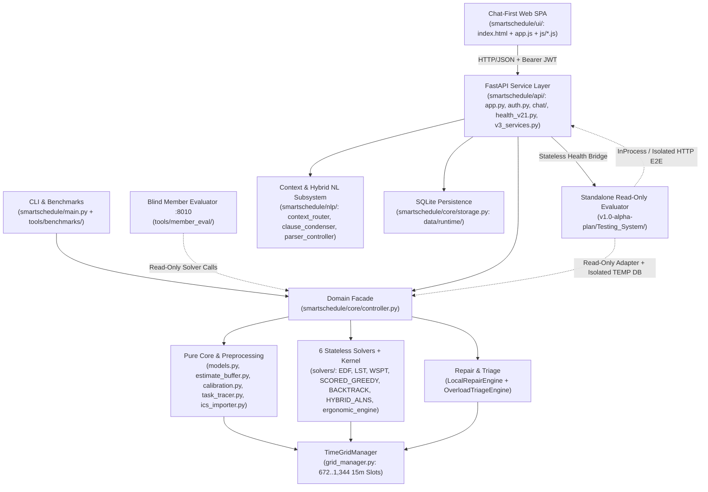

# SmartSchedule — MVP Post-Presentation Report

> **Course:** CS252 — Computational Thinking  
> **Project:** **SmartSchedule**  
> **Team:** Group 03

| Role | Full Name | Student ID | Email | Primary Responsibilities |
| :--- | :--- | :--- | :--- | :--- |
| **Leader** | Phạm Đức Minh | 25125028 | `pdminh2523@apcs.fitus.edu.vn` | Technical lead, domain coordination, benchmark & calibration design, system integration |
| **Thinker 1** | Trần Nguyên Khánh | 25125019 | `tnkhanh2527@apcs.fitus.edu.vn` | Scheduling formulation, cognitive & biological alignment heuristics, scoring design |
| **Thinker 2** | Hoàng Minh Anh | 25125001 | `hmanh2503@apcs.fitus.edu.vn` | Behavioral research synthesis, Planning Fallacy buffer analysis, overload triage rules |
| **Thinker 3** | Nguyễn Trọng Tiến | 25125037 | `nttien2530@apcs.fitus.edu.vn` | Natural language pipelines, constraint formalization, diagnostic taxonomy (`E_*` / `W_*`) |
| **Builder 1** | Lê Tiến Bình | 25125007 | `ltbinh2520@apcs.fitus.edu.vn` | Core scheduling solvers, `LocalRepairEngine`, scheduling engine backend |
| **Builder 2** | Lê Minh Nhật | 25125032 | `lmnhat2532@apcs.fitus.edu.vn` | FastAPI backend, web interface, SQLite persistence, calendar import/export |
| **Builder 3** | Nguyễn Nguyễn Gia Bảo | 25125006 | `nngbao2508@apcs.fitus.edu.vn` | Automated verification suites, standalone evaluation system, reproducibility |

---

## 1. Presentation Feedback & Summary of Revisions

### 1.1. Feedback Received During MVP Presentation

During the MVP demonstration and Q&A session on the pre-feedback calendar-workbench interface, instructor feedback focused on **user-interface complexity and cognitive friction during task entry**:

1. **Overcrowded Task Creation Forms:** The input drawer exposed excessive text boxes, dropdowns, and configuration controls simultaneously when adding or editing a task.
2. **Assumed Technical Domain Literacy:** The interface surfaced internal scheduler terminology (*cognitive load*, *work rhythm*, *buffer multipliers*, chunking limits, algorithmic reason codes) directly to end users, expecting general students to understand the meaning of every field and populate each box accurately.

### 1.2. Summary of Revisions Made Based on Feedback

To address the presentation feedback, the team redesigned the user interaction layer while keeping the constraint-guaranteed scheduling core intact:

1. **Dense Multi-Field Task Entry Forms $\to$ Spacious Chat-First Workspace:**
   * **Revision & Outcome:** Transitioned default entry from a calendar-and-form workbench to a spacious **Chat-First workspace** (`#viewChat`, "Trợ lý xếp lịch") with 2 intent cards (mode selection without boilerplate text injection) and a single post-reply action ("Kiểm tra lịch trình"), while removing clutter strips ("Chuyển nhanh tuần", "Chỉnh nhanh việc đã lưu") and redundant Settings toggles ("Nền năng lượng sinh học", "Tiện ích nhanh"). Users enter tasks in natural sentences rather than navigating multi-box forms.
   * **Modified Components:** `smartschedule/ui/index.html`, `smartschedule/ui/js/chat-assistant.js`, `smartschedule/api/chat/thinking_stage.py`.

2. **Expecting Manual Parameter Entry $\to$ 3-Tier Context NLP, Slot Filling & Task Tracing:**
   * **Revision & Outcome:** Added **3-tier Context NLP** (`clause_condenser.py` + `context_router.py`), **multi-turn clarification quick chips** (`NEEDS_CLARIFICATION`), **SHA-256 Task Tracing** (`task_tracer.py`), and remaining-work deadline re-estimation (`edge_cases.py`). Multi-day time spans and continuous-block phrasing condense into a single concise task (e.g., `"Làm bài tập Computational Thinking"`); incomplete prompts ask only for missing bounds; difficulty, splitting, or preferred-window adjustments resolve conversationally.
   * **Modified Components:** `smartschedule/nlp/clause_condenser.py`, `smartschedule/nlp/context_router.py`, `smartschedule/core/task_tracer.py`, `smartschedule/api/chat/handlers.py`, `smartschedule/api/chat/edge_cases.py`.

3. **Exposed Technical Jargon in User Mode $\to$ Progressive Disclosure & Vietnamese Humanization:**
   * **Revision & Outcome:** Separated standard **User Mode** from an explicit collapsible **`Developer Mode`** toggle. Moved the 3-step Thinking Stage (`💭`), hidden-parameter cards (`SHA-256`, `E1–E3`, `L1–L3`, Fallacy Buffer), solver switches, weights, and `v2.1` telemetry into Developer Mode; removed Focus Timer clutter from the Block Inspector modal; humanized cognitive loads (`USER_LOAD_LABELS`), weekdays (`humanizeWeekdaysVi`), and placement reasons (`_humanizeBlockReason`) into everyday Vietnamese ("Tập trung sâu", "Mức vừa", "Nhẹ nhàng") while keeping full developer inspectability.
   * **Modified Components:** `smartschedule/ui/js/utils.js`, `smartschedule/ui/js/modals.js`, `smartschedule/ui/js/input-drawer.js`, `smartschedule/ui/js/render-list.js`.

4. **Adjustment & Cleanup Friction $\to$ Collapsible Copilot, Custom Duration & Auto-Cleanup:**
   * **Revision & Outcome:** Paired the weekly calendar (`#viewCalendar`, aligned `"Hôm nay"` headers) with an in-place collapsible **"Trợ lý tinh chỉnh trực tiếp"** right copilot (strictly hiding the floating `"Mở trợ lý"` button when open), separated yellow density warnings from red deadlock alerts, added direct total-duration editing (`target_duration_min`), and implemented automatic completed-task cleanup (`_completeBlockAndFreeSchedule`) so users refine placements beside the calendar and clear finished tasks in one click.
   * **Modified Components:** `smartschedule/ui/app.js`, `smartschedule/ui/js/render-calendar.js`, `smartschedule/core/controller.py`, `smartschedule/api/app.py`.

---

## 2. Project Analysis & Computational Thinking Application

SmartSchedule implements a constraint-guaranteed scheduling core, conversational natural-language subsystem, web workspace, and evaluation harness across `smartschedule/`, `data/`, `tests/`, `tools/`, and `v1.0-alpha-plan/Testing_System/`.

### 2.1. Problem Formulation

University students rarely fail weekly study plans solely from a lack of raw hours; breakdowns arise from **hard temporal conflicts**, **Planning Fallacy underestimation**, **accumulated cognitive fatigue**, **circadian chronotype mismatch**, **fragile schedules** that collapse after unexpected disruptions, and **user-interface friction** when scheduling tools demand manual specification of technical parameters. SmartSchedule models weekly and bi-weekly student scheduling as a deterministic, multi-tier constrained optimization problem over:

* **Discrete Time Horizon:** $H \in [7, 14]$ days (`horizon_days`), quantized into $S = 96 \cdot H$ contiguous **15-minute slots** ($672$ slots for 1 week; $1,344$ slots for 2 weeks).
* **Commitments Profile (`CommitmentsProfile`):** Protected nightly `SleepSchedule` (biological floor $\ge 6\text{h} = 24$ slots/night), recurring `FixedEvent` commitments (lectures, labs, meals, shifts, including midnight wraparound), chronotype curve (`MORNING`, `AFTERNOON`, `EVENING`, `BALANCED` or custom band energy $E_s \in \{1, 2, 3\}$), Planning Fallacy buffer policy (`COGNITIVE_LOAD`, `HABIT`, or per-task `NONE`), and `PersonalHabit` items.
* **Task Set $\{T_1, \dots, T_n\}$ (`Task`):** Estimated raw duration (`duration_min`), optional deadline (`due` ISO-8601 or weekday/time spanning up to Week 2), priority $P \in \{1..5\}$, cognitive load $L \in \{1, 2, 3\}$, splitting controls (`is_splittable`, `work_rhythm`, `min_chunk_min`, `max_chunk_min`), release anchor (`start_after`), prerequisite DAG edges (`depends_on`), user-locked blocks (`PINNED` / `DONE`), and deterministic keyword trace metadata (`trace_hash`, `keyword_hashes` attached via `task_tracer.py`).

**Core System Objectives:**

1. Enforce **zero hard-constraint violations** across $H_1$–$H_5$, `horizon_slots`, `now_slot`, `start_after`, chunk integrity, and `PINNED`/`DONE` locks.
2. Maximize deadline priority value while placing demanding cognitive work in peak energy windows, guaranteeing post-heavy recovery breaks, and limiting daily overload and circadian phase drift.
3. Recover smoothly from sudden fixed-event disruptions or task duration changes with high schedule stability (`LocalRepairEngine`).
4. Abstract scheduling complexity behind conversational natural language and plain-language explanations while diagnosing capacity shortages transparently (`OverloadTriageEngine`).

### 2.2. Application of the 4 Computational Thinking (CT) Pillars

1. **Decomposition:**
   * **Application:** Split the system into isolated layers and a 4-level pipeline: (`L0`) 15-minute slot grid and immutable masks $\to$ (`L1`) habit expansion, Planning Fallacy buffering, and legal chunk splitting $\to$ (`L2`) single-solver or portfolio/ALNS search + conditional Tier-1 crunch relaxation $\to$ (`L3`) local repair, overload triage, and 3-tier productivity evaluation (`Gates` $\to$ `4 Pillars` $\to$ `Verdict & ICEE`). User interaction is similarly decomposed into clause pre-parsing, optional cloud context extraction, multi-turn slot filling, and intent routing.
   * **Verified Codebase Modules:** `smartschedule/core/controller.py`, `smartschedule/core/grid_manager.py`, `smartschedule/nlp/`, `smartschedule/api/chat/`, `v1.0-alpha-plan/Testing_System/evaluator/`.

2. **Pattern Recognition:**
   * **Application:** Synthesized **8 empirical behavioral patterns (`P1–P8`)**: Planning Fallacy bias (`P1`), hyperbolic procrastination & `<10h` cramming (`P2`), circadian synchrony & Social Jetlag (`P3`), ultradian/post-heavy fatigue & attention residue (`P4`), unusable `<30m` dead-zones (`P5`), biological sleep minimum $\ge 6\text{h}$ (`P6`), urgency $\times$ importance priority scaling (`P7`), and minimal-perturbation repair (`P8`). Separated dominated energy-blind baselines (`EDF`, `WSPT`, `LST`) from circadian-aware solvers (`SCORED_GREEDY`, `BACKTRACK`, `HYBRID_ALNS`) in thinking diagnostics.
   * **Verified Codebase Modules:** `smartschedule/core/config.py`, `smartschedule/core/estimate_buffer.py`, `smartschedule/core/calibration.py`, `smartschedule/core/solvers/ergonomic_engine.py`, `smartschedule/api/chat/thinking_stage.py`.

3. **Abstraction:**
   * **Application:** Reduced continuous time via **Discretization** to integer slots `0..S-1` with 5 states (`FREE`, `SLEEP`, `OCCUPIED`, `BLOCK`, `REST:DEAD_ZONE` / `REST:BREAK`) via `TimeGridManager`. Applied **Entity Abstraction** as one task transforms across contexts (`Task` $\to$ `TaskSchema` $\to$ `TaskChunk` $\to$ `ScheduleBlock` $\to$ `VEVENT`), and introduced **User-Boundary Abstraction** (post-demo revision) hiding slot indices, `L1–L3`/`E1–E3` jargon, buffers, and hashes behind conversational inference and humanized Vietnamese labels in User Mode while gating telemetry inside `Developer Mode`. Enforced **Layered Isolation (`INV-1..6`)**: core modules import zero web/LLM packages, and evaluation communicates read-only via `sut_adapter.py`.
   * **Verified Codebase Modules:** `smartschedule/core/models.py`, `smartschedule/core/grid_manager.py`, `smartschedule/core/exporter.py`, `smartschedule/ui/js/utils.js`, `smartschedule/ui/js/modals.js`, `tests/architecture/test_system_architecture.py`, `v1.0-alpha-plan/Testing_System/sut_adapter.py`.

4. **Algorithmic Thinking:**
   * **Application:** Engineered **6 deterministic solvers** including `HYBRID_ALNS` (5 Ruin operators + Regret-2 Insertion + Kempe `1/2-eject` rescue + 3-pass local polish) backed by $O(1)$ prefix sums and a 10-level lexicographic evaluator in `ergonomic_engine.py`; 3-color DFS cycle detection; `LOCAL_INSERTION`, `RIPPLE_SHIFT`, `FULL_REBUILD`, and `handle_task_overrun` (including custom `target_duration_min` edits); bounded LoA-4 EWMA calibration; deterministic SHA-256 plan/keyword hashing.
   * **Verified Codebase Modules:** `smartschedule/core/solvers/`, `smartschedule/core/calibration.py`, `smartschedule/core/task_tracer.py`, `smartschedule/core/overload_triage.py`, `smartschedule/core/metrics.py`.

### 2.3. Evolution from Initial Proposal and Pre-Feedback Demo to Current MVP

| Dimension | Initial Proposal | Pre-Feedback Demo Build | Revised Post-Feedback MVP | Rationale |
| :--- | :--- | :--- | :--- | :--- |
| **User Entry & Workflow** | Desktop wireframe | Calendar-first 2-tab view (`Lịch` / `Danh sách`) + dense `"Đầu vào"` multi-field modal | **Chat-First Minimal Workspace** (`"Trợ lý xếp lịch"`, 2 clean mode cards, synchronized `"Trợ lý tinh chỉnh trực tiếp"` copilot) | Eliminates multi-box input overwhelm identified during MVP demo and lowers onboarding friction |
| **Parameter Entry & Language** | Manual form fields | Exposed cognitive load, chunk rhythm, buffer modes, and algorithm labels directly in modals | **3-Layer Context NLP** (`clause_condenser` + `context_router`) + multi-turn quick chips + **SHA-256 Task Tracer** + humanized User-Mode phrasing (`Developer Mode` separated) | Allows users to describe tasks and adjustments in everyday language without mastering scheduler terminology |
| **Task Completion & Duration Edits** | Static check-in | Inline check-in & modal Pomodoro timer + additive overrun (`extra_min`) | Removed modal timer clutter; added direct **custom total duration (`target_duration_min`)** and **auto-cleanup completion** (`_completeBlockAndFreeSchedule`) | Simplifies schedule adjustments and keeps finished tasks from cluttering active weekly slots |
| **Solver & Buffer Engine** | Greedy `EDF` + static habit multiplier | **6 deterministic solvers** (incl. `HYBRID_ALNS`), `7..14`-day grid, asymmetric `COGNITIVE_LOAD` (`1.20 / 1.35`) + LoA-4 EWMA, `.ics` import, HS256 JWT Auth | Retained validated engine intact; added automatic `SCORED_GREEDY` $\to$ `HYBRID_ALNS` escalation on chat turns and `DEADLOCK` vs. `DENSE_WARNING` chat cards | Preserves scheduling rigor and `INV-1..6` guarantees underneath the streamlined conversational UX |

---

## 3. Feature Specification

The system organizes capabilities into ten functional modules spanning the Chat-First Web application (`smartschedule/main.py`, port `8000`), CLI runner, blind evaluation server (`tools/member_eval/`, port `8010`), and standalone testing harness (`v1.0-alpha-plan/Testing_System/`).

1. **`F1` — Multi-Solver Weekly & Bi-Weekly Scheduler (`672..1,344` Slots, $H_1$–$H_5$ Guarantee)**
   * Enforces hard non-overlap with `FixedEvent` (`OCCUPIED`, including overnight wraparound), protected `SleepSchedule` (`SLEEP` $\ge 6\text{h}$), contiguous valid study blocks (`BLOCK`), strict deadlines (`end_slot <= deadline_slot`, handling past-due isolation `PAST_DUE`), `start_after` bounds, `PINNED`/`DONE` immutability, and topological prerequisite ordering (`depends_on`) with DFS 3-color cycle/missing-dependency isolation.
   * Exposes **6 solvers** via `/api/solvers` and `solvers/registry.py`: `SCORED_GREEDY` (default UI solver; auto-escalates to `HYBRID_ALNS` inside chat turns if any deadline task remains unplaced), `HYBRID_ALNS`, `BACKTRACK`, `EDF`, `LST`, and `WSPT`.

2. **`F2` — Ergonomic Kernel, Circadian Alignment, Recovery & Smart Chunking (`P3–P5`)**
   * Shared V3 kernel (`smartschedule/core/solvers/ergonomic_engine.py`) aligns `load == 3` deep sessions with peak circadian bands (`MORNING`, `AFTERNOON`, `EVENING`, `BALANCED`), preserves $\ge 15\text{m}$ ($> 10\text{m}$) recovery breaks immediately after heavy blocks, limits daily heavy count (`<= 2`) and daily total load (`540m` soft / `600m` hard), bounds `load >= 2` streaks (`120m` soft / `180m` hard), avoids meal-boundary sandwiches, batches same-category tasks, and isolates `< 30m` unusable fragments as `REST:DEAD_ZONE`.
   * Adaptive splitting respects `WORK_RHYTHM_BOUNDS` (`LIGHT: 30–45m`, `BALANCED: 45–90m`, `FLOW: 60–120m`, or atomic `is_splittable=False`). Baseline solvers (`EDF`, `LST`, `WSPT`) keep their strict energy-blind invariant (`energy_aware=False`) to preserve controlled ablation comparisons.

3. **`F3` — Dual-Mode Fallacy Buffer, M7 Completion Auto-Cleanup, Focus Timer & EWMA Calibration**
   * **Buffer Engine (`estimate_buffer.py`):** Supports `COGNITIVE_LOAD` (`1.20` Light/Medium, `1.35` Heavy with 15-min ceiling rounding), `HABIT` (`RARELY=1.00`, `SOMETIMES=1.10`, `OFTEN=1.25` with nearest-15m floor safety), and per-task `NONE`.
   * **Check-In & Automatic Task Completion Cleanup (`POST /api/tasks/complete`, `_completeBlockAndFreeSchedule`):** Completing a block logs `(estimated_min, actual_min)` to SQLite `completion_logs`, removes finished single-block tasks (or deducts completed share and re-solves remaining work for multi-block tasks/habits) so calendar free time is immediately reclaimed.
   * **Focus Timer & Desktop Notifications (`#stFocusTimerPanel`):** Built-in 25/45/90-minute timer in the Developer Side Panel feeds real measured minutes directly to M7 check-in alongside optional browser notifications `1–10` minutes prior to upcoming blocks.
   * **EWMA Personal Alpha Advisor (`calibration.py`, `GET /api/tasks/calibration`):** Computes bounded EWMA (`lambda=0.25`, `min_samples=5`) across light/heavy logs and surfaces one-click **LoA-4 advisory updates** without silently mutating user profiles.

4. **`F4` — `PersonalHabit` Manager (`PreferredWindow` & Even Day-Spreading)**
   * Expands weekly habits (`frequency_per_week`, `duration_min`, `preferred_window`) into low-priority (`priority=1`) weekday-spread tasks so personal routines fill supportive windows during normal weeks and yield gracefully during crunch periods.

5. **`F5` — Disruption Rescheduling, Duration Overrun & Direct Target Duration Editing (`P8`)**
   * Supports `LOCAL_INSERTION` (pins `PINNED`/`DONE` and untouched blocks with progressive unfreezing), `RIPPLE_SHIFT`, and `FULL_REBUILD` (`POST /api/repair`).
   * **Flexible Overrun & Custom Duration Setter (`POST /api/overrun`, `#inpSetTaskDuration`):** Allows both adding extra overrun minutes (`extra_min`) and directly setting a new custom total task duration (`target_duration_min`, rounded up to 15-minute slots) from the Block Inspector modal, locally repairing the schedule without rebuilding unrelated blocks.

6. **`F6` — Tier-1 Crunch Relaxation & Interactive Overload Triage**
   * If deadlines still fail to fit, solvers attempt a single controlled Tier-1 break relaxation (`allow_breaks=False`) **only if** strictly more tasks place—never cutting sleep (`>= 6h`) or truncating task durations silently.
   * When genuine capacity shortage persists, `OverloadTriageEngine` generates an `OverloadReport` and prerequisite-safe resolution options (`SKIP_HABIT`, `SHORTEN_TASK`, `ALLOW_SPLIT`, `POSTPONE_LOWEST`), previewable visually on the calendar via `POST /api/overload/preview` before confirmation.

7. **`F7` — Merged 3-Tier Context NLP, Multi-Turn Clarification & SHA-256 Task Tracer**
   * **Clause-Level Pre-Parser (`clause_condenser.py`):** Runs deterministically offline to extract cross-day start/deadline windows (*"từ 19h tối thứ 3, đến 21h tối thứ 5"*), flexible durations (*"trong tổng thời gian 2 tiếng liên tục"*), continuity locks, and concise Vietnamese/English titles (*"Làm bài tập Computational Thinking"*).
   * **Online Context Router (`context_router.py`):** Uses lightweight Gemini Flash-Lite (`thinking_budget=0`, `0 MB` local RAM via `google-genai` when configured) constrained by `ChatContextExtractionSchema`, falling back identically offline to Layer C.
   * **Multi-Turn Slot Filling & Edge Cases (`handlers.py`, `edge_cases.py`):** Prompts lacking content or time bounds trigger `NEEDS_CLARIFICATION` with 1-click quick chips; deadline shifts recalculate remaining work with habit/EWMA buffers (`compute_remaining_and_habit_buffer`); completed solves classify **`DEADLOCK`** (red alert + triage options) vs. **`DENSE_WARNING`** (yellow alert when daily load `>= 420m`, crunch > 0, or rating `>= 2.2`).
   * **SHA-256 Task Tracer (`task_tracer.py`):** Computes deterministic SHA-256 keyword/bigram digests on tasks (`confidence >= 0.45`) so conversational requests (*"Bài tập Giải tích nặng quá, chia nhỏ ra nhiều buổi và xếp vào buổi sáng"*) tune hidden parameters (`cognitive_load`, `alpha`, `is_splittable`, `work_rhythm`, `preferred_window`) cleanly.
   * **Bilingual Hybrid Parser (`parser_controller.py` + `hybrid_pipeline/`):** Powers `/api/tasks/natural-add` with 6-stage gatekeeper checks (`E_*`/`W_*`), `rule` / optional neural VI->EN translation, attachment link scanning, and fixed-event detection (`200/200` YAML benchmark pass).

8. **`F8` — Chat-First Minimal SPA, Synchronized Copilot & Developer Mode**
   * **Default Chat Workspace (`#viewChat`, `"Trợ lý xếp lịch"`):** Clean landing canvas with 2 intent suggestion cards (no forced text prefix), single primary post-reply action (`🗓️ Kiểm tra lịch trình`), collapsible `#leftNavSidebar` (`Trợ lý xếp lịch`, `Lịch Trình Tuần`, `Danh Sách Việc`, `Developer Mode`), and `#btnBrandHome` home navigation.
   * **Weekly Calendar + Collapsible Right Copilot (`#viewCalendar`, `#calendarCopilotDrawer`):** Supports `1/3/5/7`-day views, `7`/`14`-day scrubbing, aligned headers, drag-and-drop validated against $H_1$–$H_5$ (`/api/validate-move`), live `.cal-block-enter` / `.cal-block-moved` animations, explicit finalization status (`"✅ Đã hoàn tất và chốt lịch trình mới!"`), and `"💬 Mở trợ lý"` button strictly hidden unless the right copilot is collapsed (`⇥`).
   * **User-Friendly Explanations vs. Developer Mode:** In User Mode, block popovers humanize Vietnamese weekdays, loads (`USER_LOAD_LABELS`), and placement reasons (`_humanizeBlockReason`). Toggling **Developer Mode** reveals **`💭 Quá trình suy nghĩ & chọn thuật toán`** (Context Summary + Dominant Subset Pruning pills + Outcome), per-task hidden parameter badges (`SHA-256`, `E1–E3`, `L1–L3`, Fallacy Buffer), and `#devSidePanel` with **6-solver selector**, **Test Suite Picker** (Presets, Scenarios `T01–T10`, Regimes `R1–R6`, Fuzz `v2`), **Real-Time `v2.1` 4-Pillar Health & Top-5 ICEE**, **Weights View** (`/api/solver-weights`), **All-Solver Benchmark** (`/api/benchmark-all`), and **7-Case Divergent Showcase** (`/api/test-showcase`).

9. **`F9` — Multi-Tenant SaaS Storage, `.ics` LMS Import, Export & Docker**
   * SQLite persistence (`storage.py`: `workspace_state`, `completion_logs`, `users`) with stdlib **PBKDF2 + HS256 JWT Authentication** (`auth.py`: `/api/auth/{register,login,me}`, workspace isolation `user:<user_id>`, configurable `SMARTSCHEDULE_AUTH_REQUIRED`).
   * **RFC 5545 `.ics` Calendar & Moodle/Canvas LMS Importer (`ics_importer.py`, `POST /api/import/ics`):** Converts recurring university lectures (`RRULE;BYDAY`) into `FixedEvent` drafts and LMS due events into `Task` drafts with LoA-4 user confirmation, complemented by `.ics` / `.csv` / `.json` schedule export and `tools/docker/` containerization.

10. **`F10` — Standalone Read-Only `Testing_System v2.1 + Fuzz v2` & Blind Evaluator (`tools/member_eval/`)**
    * Independent 2-part testing suite (`InputGenerator` + Plant-a-Witness `FuzzGenerator v2` $\to$ SUT execution $\to$ 3-tier `ScheduleEvaluator` across `G1–G2`, `P1–P4`, `v2.1` 10-level Lexicographic Ranking, and Top-5 `ICEE` critiques).
    * Dedicated **Blind Multi-Member Evaluator** (`tools/member_eval/app.py` on `:8010`) randomizes solver identities (`#A..#F`) so human raters score schedules across `UX-1..5` and block tags before revealing the `v2.1` oracle.

---

## 4. System Design

### 4.1. Layered System Architecture

**Enforced Architectural Invariants (`INV-1..6`, AST & Runtime Verified):** Pure domain modules inside `smartschedule/core/` (`models.py`, `calibration.py`, `task_tracer.py`, `ics_importer.py`, `estimate_buffer.py`, `solvers/*`) depend only on standard-library and core schemas with zero web, `smartschedule.nlp`, or LLM imports (enforced via AST import checks on `solvers/*.py` & `models.py` in `tests/architecture/` and subprocess import checks on `Testing_System.evaluator` guarding `fastapi`, `starlette`, `uvicorn`, and `web.api`); solver loops leak `< 350 KB` heap memory across 50 runs; `solve()` is stateless, thread-safe, and bit-identical across runs (`determinism_hash`).

### 4.2. Key Algorithms, Equations & Scientific Grounding

#### A. `SCORED_GREEDY` Urgency–Priority Score (`smartschedule/core/solvers/scored_greedy.py`)

$$
\text{Score}(T) = P_T \cdot \text{Urgency}(T), \quad \text{Urgency}(T) = \begin{cases} 0.20 & \text{if } D_T = \varnothing \text{ (Flexible Habit)} \\ 1.50 + \min(0.50,\, 0.01 \cdot |s_h|) & \text{if } s_h \le 0 \text{ (Overdue)} \\ \exp(-s_h / \gamma) & \text{if } s_h > 0 \end{cases}
$$

where $P_T \in \{1..5\}$ is task priority, $s_h = ((D_{\text{slot}} - t_{\text{now}}) \cdot 15 - \text{planned\_min}) / 60$ is remaining slack hours, and $\gamma = 24.0\text{h}$. Adapted from Temporal Motivation Theory (Steel & König, 2006), exponential urgency rises smoothly well before the `<10h` last-minute cramming window (Howell, 2006 in Svartdal et al., 2018), while bounding overdue urgency within `[1.50, 2.00]` prevents expired tasks from displacing feasible deadlines.

#### B. Dual-Mode Planning Fallacy Buffering & Bounded EWMA Calibration (`estimate_buffer.py`, `calibration.py`, `edge_cases.py`)

1. **Buffer Scaling Rules:** Grounded in Planning Fallacy underestimation bias in academic tasks (Buehler, Griffin & Ross, 1994) and protective time buffering (Mehta & Uzsoy, 1998 in Vieira et al., 2003):
   - **`COGNITIVE_LOAD` Mode (UI default):** $\text{planned} = \lceil \text{est} \cdot \alpha / 15 \rceil \cdot 15$, with $\alpha_{\text{light}} = 1.20$ (`load in {1, 2, None}`) and $\alpha_{\text{heavy}} = 1.35$ (`load == 3`). Ceiling rounding ensures short `15–30m` deep tasks gain at least one `15m` protective slot.
   - **`HABIT` Mode:** $\text{planned} = \max\big(\lceil \text{est}/15 \rceil \cdot 15,\; \text{nearest}_{15}(\text{est} \cdot m_H)\big)$, where $m_H \in \{1.00, 1.10, 1.25\}$ for `RARELY`, `SOMETIMES`, and `OFTEN`. Half-up rounding prevents doubling `15m` tasks under `1.25x`.

2. **LoA-4 EWMA Personal Alpha Calibration (`compute_ewma_calibration`):**
   Given chronological completion ratios $A_t / E_t$ ordered oldest to newest:

   $$
   r_t = \text{clip}\!\left(\frac{A_t}{E_t},\; 0.50,\; 2.50\right), \qquad \alpha_t = \lambda\, r_t + (1 - \lambda)\,\alpha_{t-1} \quad (\lambda = 0.25)
   $$

   Recommendations activate once `sample_count >= 5`, clamp to $[1.00, 1.60]$, and operate strictly in Level-of-Automation 4 advisory mode awaiting explicit user confirmation (Parasuraman, Sheridan & Wickens, 2000). Clipping single-task ratios prevents outlier skew, while the `1.60` ceiling avoids the empirical over-buffering cliff observed at $\alpha \ge 1.70$.

3. **Conversational Deadline Shift & Remaining-Work Re-Estimation (`compute_remaining_and_habit_buffer`):**

   $$
   \alpha_{\text{eff}} = \text{clip}\!\Big(\max(\alpha_{\text{load}},\, m_H,\, \text{EWMA}_{M7}),\; 1.10,\; 1.60\Big), \qquad T_{\text{rem,planned}} = \max\!\Big(T_{\text{rem,raw}},\; \left\lceil \frac{T_{\text{rem,raw}} \cdot \alpha_{\text{eff}}}{15} \right\rceil \cdot 15\Big)
   $$

   This rule takes the conservative bound across task cognitive intensity, profile estimation habit, and calibrated M7 history within the `[1.10, 1.60]` safe envelope before triggering local rescheduling.

#### C. `HYBRID_ALNS`, Ergonomic Kernel & 10-Level Lexicographic Ranking (`ergonomic_engine.py`, `hybrid_alns.py`, `verdict_and_icee.py`)

* **`HYBRID_ALNS` Metaheuristic (`max_iters = 80`, wall budget `0.65s`):** Seeds search from a multi-strategy constructive portfolio and First-Fit feasibility floor (`build_feasibility_first_fit_state`), then applies roulette-selected **5 Ruin operators** (Worst-Pillar, Day-Congestion, Shaw-Related, Dependency Cluster, Random+Unplaced), **Regret-2 Insertion**, and deterministic **3-pass Local Polish** with Kempe `1/2-eject` rescue.
* **Lexicographic Evaluation Hierarchy:** Both `evaluate_state_lex_key` and `Testing_System` `rank_cross_solver_reports` avoid linear scalar weighting—where strength in one metric masks critical failures under Goodhart's Law—by ranking an ordered tuple:
  `Gate 0 (HARD-RULE G1=0, SLA <= 1000ms)` $\to$ `#1 QUALITY-TIER (Verdict)` $\to$ `#2 DEADLINE-VAL (P1.1%)` $\to$ `#3 SHOCK-SAFE (P4.1 +25% survival, 5% bucket)` $\to$ `#4 BREAK-SAFE (Recovery >10m, L2+ streak, Post-Class)` $\to$ `#5 BIO-SYNC (Off-Peak mismatch, Achievable Peak%)` $\to$ `#6 NO-CRAM (<10h crowding)` $\to$ `#7 DAILY-CAP (Corne vector [>2 heavy/day, adjacent heavy, meal sandwich] + Max daily total)` $\to$ `#8 FOCUS-FLOW (Context switches)` $\to$ `#9 USER-PREF (Habit%, Window%)` $\to$ `#10 PACE-BALANCE (Circular SJL, Daily Std)`. These criteria synthesize prior timetabling and cognitive-ergonomics work (Schaerf, 1999; Albulescu et al., 2022; May & Hasher, 1998; Smarr & Schirmer, 2018; Svartdal et al., 2018; Vieira et al., 2003; Gombolay, 2017 Conjecture 1).

#### D. Biological & Quality Telemetry Metrics (`metrics.py`, `pillars.py`, `benchmark_alpha_grid.py`)

1. **Schedule Experience Rating (`[1.0..5.0]`, lower is calmer):**

   $$
   \begin{aligned}
   \text{Rating} = \text{clip}_{[1, 5]}\!\Big(1.0 &+ \min\!\big(2.2,\, \max(0, (\rho_{\text{busy}} - 0.15)\cdot 2.75)\big) + \min\!\big(0.8,\, \max(0, (L_{\max} - 6)\cdot 0.2)\big) \\
   &+ 0.6\, r_{\text{mismatch}} + \min\!\big(1.0,\, 0.35\, U + 0.45\,\mathbb{I}_{\text{crunch}}\big)\Big)
   \end{aligned}
   $$

   where $\rho_{\text{busy}}$ is busy awake-slot ratio, $L_{\max}$ is longest uninterrupted streak (slots), $r_{\text{mismatch}}$ is fraction of `load >= 3` slots placed at Energy `1`, and $U$ is unplaced count.

2. **Circular Social Jetlag (`SJL` in `pillars.py` & `ergonomic_engine.py`):**
   Projects 15-minute slot-of-day indices onto the 24h unit circle ($\theta_s = 2\pi(s \bmod 96)/96$) and computes the signed shortest angular difference between the circular median study time on `ACADEMIC_CLASS` days versus non-class days (Smarr & Schirmer, 2018), avoiding midnight wraparound discontinuities across `23:30–02:00`.

3. **Alpha Grid Calibration Objective (`benchmark_alpha_grid.py`):**

   $$
   \text{Composite}(\alpha) = 0.35\, R_{\text{dl}} + 0.25\, R_{+25\%} + 0.20\, R_{+50\%} + 0.20\, R_{+25\%,\text{noRepair}} - 4.0\,\max(0, \overline{\text{Rating}} - 2.0) - 2.0\,\overline{\text{Frag}} - 100.0\,C_{\text{hard}}
   $$

   This objective trades baseline completion against worst-case shock robustness (Daniels & Kouvelis in Vieira et al., 2003) while penalizing inflated schedules that elevate fatigue (`Experience Rating`) or residual fragmentation.

### 4.3. Key System Design Decisions

1. **User-Mode Progressive Disclosure vs. Developer Mode:** Following presentation feedback on input complexity, regular User Mode suppresses algorithm codes, cognitive-load indices, and buffer mechanics behind natural Vietnamese labels (`USER_LOAD_LABELS`, `_humanizeBlockReason`) and chat-based slot filling, while `Developer Mode` exposes the 3-step Thinking Stage (`💭 Quá trình suy nghĩ & chọn thuật toán`), SHA-256 hidden cards, and solver comparison dashboards without duplicating backend code.
2. **Dominant Subset Pruning & Controlled `Q10` Ablation:** Keeping `EDF`, `LST`, and `WSPT` strictly energy-blind provides exact controlled baselines inside `/api/benchmark-all` and `/api/test-showcase`, while Chat-First turns restrict selection to the biological-aware subset (`handlers.py` accepts `SCORED_GREEDY`, `HYBRID_ALNS`, and `BACKTRACK`, defaulting to `SCORED_GREEDY` and automatically escalating to `HYBRID_ALNS`—capped at a `0.65s` wall budget—whenever deadline tasks remain unplaced and `HYBRID_ALNS` reduces unplaced count; Developer Mode thinking diagnostics surface `{SCORED_GREEDY, HYBRID_ALNS}` as the primary chat candidate subset).
3. **Zero-RAM Online Context Model with Deterministic Offline Parity:** Running `gemini-2.5-flash-lite` (`thinking_budget=0`) over HTTPS via Layer 4 `context_router.py` requires zero local RAM, while `clause_condenser.py` handles comma-clause splitting, cross-day spans, and Vietnamese filler stripping offline deterministically so CI and offline runs behave consistently.
4. **Read-Only Evaluation Boundary:** `v1.0-alpha-plan/Testing_System/` evaluates raw unbuffered tasks against solver outputs using defensive deep copies and isolated `%TEMP%` SQLite paths, avoiding double-buffering distortion in `+25% / +50%` shock simulations and never mutating application data.

### 4.4. End-to-End Runtime Workflow

1. **Chat-First Scheduling & Traceable Tuning (`/` $\to$ `#viewChat`):** Requests enter the `"💬 Trợ lý xếp lịch"` canvas (optionally guided by 2 non-intrusive intent cards). Complex Vietnamese cross-day prompts (e.g., *"Làm bài tập môn Computational Thinking, từ 19h tối thứ 3, đến 21h tối thứ 5, cần hoàn thành trong tổng thời gian 2 tiếng liên tục"*) extract a single concise task (`"Làm bài tập Computational Thinking"`, 1 atomic 120m block + fallacy buffer), prompting with quick chips when required bounds are omitted. Subsequent tuning requests (e.g., *"Bài tập Giải tích nặng quá, chia nhỏ ra nhiều buổi và xếp vào buổi sáng giúp mình"*) resolve targets via SHA-256 `task_tracer` and update hidden parameters before re-solving.
2. **Synchronized Weekly Calendar & Direct Adjustments (`#viewCalendar`):** Navigating via `🗓️ Kiểm tra lịch trình` renders the 1/3/5/7-day grid alongside the synchronized `"Trợ lý tinh chỉnh trực tiếp"` copilot drawer (`⇥` collapses the drawer in-place to expand the calendar). Placement changes animate via `.cal-block-enter` / `.cal-block-moved` with a `"✅ Đã hoàn tất và chốt lịch trình mới!"` banner. Opening any block in User Mode presents humanized Vietnamese explanations, direct custom total-duration updates (`target_duration_min` with local repair), and M7 completion check-in (`_completeBlockAndFreeSchedule`) that logs ratios and automatically removes finished tasks or updates remaining duration. `.ics` feeds import as draft events/tasks in Input Modal Tab 2 and export cleanly back to external calendars.
3. **Developer Mode Telemetry, Multi-Solver Comparison & Companion CLI (`#chkDeveloperMode`):** Enabling Developer Mode reveals the 3-step **`💭 Quá trình suy nghĩ & chọn thuật toán`** Thinking Stage (including Dominant Subset pruning pills) and per-task hidden-parameter cards in chat, plus `#devSidePanel` for `v2.1` 4-pillar health & Top-5 ICEE diagnostics, 6-solver switching (`EDF`..`HYBRID_ALNS`), `/api/solver-weights`, `/api/benchmark-all`, `/api/test-showcase`, and the M7 Focus Timer / EWMA Calibration panel. Standalone blind evaluation runs via `tools.member_eval.app:app` (`127.0.0.1:8010`), and automated audits execute via `clean_runner.py` and `Testing_System.cli`.

---

## 5. MVP Feature Selection (MoSCoW Prioritization)

This MoSCoW prioritization partitions capabilities across **Must-Have**, **Should-Have**, **Could-Have**, and **Won't-Have**, separating completed post-feedback MVP functionality from items scheduled for Final Presentation (Week 10) and out-of-scope features.

| Priority | Feature / Capability | Delivery Stage | Rationale |
| :--- | :--- | :--- | :--- |
| **Must-Have** | 15-min `TimeGridManager` (`672..1,344` slots), $H_1$–$H_5$ + `start_after` + `PINNED`/`DONE` zero-violation kernel, $\ge 6\text{h}$ sleep floor, DAG cycle isolation | **MVP (Implemented)** | Core mathematical validity invariant required prior to any ergonomic optimization |
| **Must-Have** | **6 deterministic solvers** (`EDF`, `LST`, `WSPT`, `SCORED_GREEDY`, `BACKTRACK`, **`HYBRID_ALNS`**), `ergonomic_engine.py`, & 3x SHA-256 determinism check | **MVP (Implemented)** | Powers circadian-ergonomic optimization in Chat-First mode alongside reproducible energy-blind baselines |
| **Must-Have** | Dual-Mode Planning Fallacy Buffer (`COGNITIVE_LOAD` `1.20/1.35`, `HABIT`, `NONE`) + bounded LoA-4 EWMA M7 calibration + remaining-work deadline shift buffering | **MVP (Implemented)** | Empirically protects schedules against `+25%` overruns (`97.1%` no-repair absorption) while preventing the $\alpha \ge 1.70$ over-buffering cliff |
| **Must-Have** | `LocalRepairEngine` (`LOCAL_INSERTION`, `RIPPLE_SHIFT`, `FULL_REBUILD`, `repair_overrun` w/ custom `target_duration_min`) + Tier-1 Crunch & `OverloadTriageEngine` | **MVP (Implemented)** | Preserves schedule stability under mid-week disruptions and turns impossible weeks into interactive What-If choices |
| **Must-Have** | Chat-First Minimal SPA (`#viewChat`, `#viewCalendar` + right copilot, `Developer Mode` Thinking Stage, User-Mode humanization, auto-cleanup completion) & SQLite storage | **MVP (Implemented)** | Delivers clean student conversation workflow alongside full developer inspectability in one codebase |
| **Should-Have** | 3-tier Context NLP (`clause_condenser` + `context_router` Gemini Flash-Lite), SHA-256 `task_tracer`, `DEADLOCK`/`DENSE_WARNING` chat handling, & 6-stage `hybrid_pipeline` (`200/200`) | **MVP (Implemented)** | Eliminates manual form friction on complex EN/VI prompts with offline determinism |
| **Should-Have** | `.ics` timetable/LMS importer, HS256 JWT Multi-Tenant Auth, Focus Timer M7 + Notifications, Docker, `Testing_System v2.1 + Fuzz v2` (incl. `7`-Case Showcase & `member_eval` `:8010`) | **MVP (Implemented)** | Supports university timetables and Moodle/Canvas LMS feeds, isolated workspaces, containerized deployment, and scientific verification |
| **Should-Have** | **Full Team Blind Evaluation Campaign (`member_eval/` across 7 team members)** & consolidated `Calibration_Report.md` (`>= 25%` friction cluster audit) | **Final Presentation (Week 10)** | Blind evaluation portal (`:8010`) and telemetry logs are already built; multi-member calibration sessions complete prior to Final Presentation |
| **Could-Have** | **Layer-4 Lazy Transformer / Dependency NLP** (`DeBERTa`/`RoBERTa`, `spaCy`, `Stanza`), multimodal syllabus/assignment parsing (`Docling`/`Qwen2-VL`), & optional neural offline translation weights (`NLLB-200` / `MarianMT` via `requirements-nllb.txt`) | **Final Presentation (Week 10 Stretch)** | Deterministic `hybrid_pipeline` (`200/200` on benchmark NL cases), `clause_condenser`, and optional zero-RAM Gemini Flash-Lite already handle core EN/VI scheduling prompts while keeping solver heap growth `< 350 KB` |
| **Won't-Have** | Native iOS/Android apps, shared multi-user team organization calendars, & silent background profile mutation (`LoA >= 5` overriding user buffer consent) | **Out of Scope (`Won't-Have`)** | Exceeds CS252 personal scheduling scope and violates human-in-the-loop planning transparency (`LoA-4`) |

---

## 6. Testing Plans, Test Cases & Results

### 6.1. Verification Architecture & Experimental Setup

Verification spans three independent layers executed with `PYTHONDONTWRITEBYTECODE=1`, `PYTHONIOENCODING=utf-8`, and isolated temporary SQLite databases leaving workspace data unmodified:

1. **Engineering, Post-Feedback UX & Behavioral Suite (`tests/`):** Covers Chat-First UI shell & Task Tracer regression tests (`tests/logical/test_chat_first_ui_and_task_tracer.py`), UI v3 endpoint & custom duration / humanization controls (`tests/ui/test_ui_v3_endpoints.py`), AST `INV-1..6`, memory-leak (`< 350 KB` over 50 runs) and peak (`< 10 MB`) gates (`tests/architecture/`), solver/buffer/auth/calibration/V3 logic (`tests/logical/`), `T01–T10` feasibility (`tests/benchmark/`), Improve Plan target checks (`tests/gaps/`), and a 200-case bilingual NL corpus (`tests/fixtures/nl_cases/verify_hybrid_200.py`, evaluated offline with `backend=rule`).
2. **Benchmark Runners (`tools/benchmarks/`):** Validates `T01–T10`, disruption repair stability (`T04`), overrun handling (`T05`), scalability (`N=10, 25, 50`), circadian ablation (`T09`), and Planning Fallacy `α` calibration plus extreme tight-load cliff stress (`benchmark_alpha_grid.py --include-extreme`).
3. **Standalone 2-Part Productivity Evaluator (`v1.0-alpha-plan/Testing_System/`):** Independent read-only pipeline (`InputGenerator` across 6 Regimes & Plant-a-Witness `FuzzGenerator v2` $\to$ Direct/HTTP execution $\to$ 3-tier `v2.1` `ScheduleEvaluator`).

### 6.2. Automated Test Suites

| Verification Suite | Command / Runner | Measured Outcome | Scope & Notes |
| :--- | :--- | :--- | :--- |
| **Operational Verification (`--pass`)** | `tests/` `clean_runner.py --pass` | **195 / 195 PASSED** (`0 Failed`, `61.25s`) | `tests/ui/` (`12/12`, incl. `6/6` in `test_ui_v3_endpoints.py` verifying `target_duration_min`, `#inpSetTaskDuration`, `_humanizeBlockReason`, `USER_LOAD_LABELS`, `_completeBlockAndFreeSchedule`, modal timer removal), `tests/architecture/` (`9/9`), `tests/benchmark/` (`20/20`), `tests/logical/` (`154/154`, incl. `7/7` in `test_chat_first_ui_and_task_tracer.py` verifying Chat-First shell, cross-day single-task condensation, multi-turn clarification, SHA-256 tracing, remaining-time buffering, `DEADLOCK`/`DENSE_WARNING` cards) |
| **Improve Plan Target Gaps** | `pytest tests/gaps -v` | **5 / 5 PASSED** (`5.82s`) | All 5 target features (circadian peak, `15m` post-deep break, buffer scaling, `ENERGY_MATCH` structured reason code, `SKIP_HABIT`) pass; combined `tests/` suite = **`200 / 200`** tests |
| **Hybrid NL 200-Case Suite** | `tests/fixtures/nl_cases/` `verify_hybrid_200.py` | **200 / 200 (100.0%)** (`1,461.4 ms`, `7.31 ms/case`) | Evaluated offline (`backend=rule`): `A` (`10/10`), `B` (`120/120`), `C1` (`20/20`), `C2` (`30/30`), `C3` (`10/10`), `D` (`10/10`) |
| **`Testing_System v2.1 + Fuzz v2`** | `pytest` v1.0-alpha-plan/ `Testing_System/tests -v` | **39 / 39 PASSED** (`51.51s`) | `test_architecture_invariants` (`3`), `test_contrast_pairs` (`6`), `test_input_generator` (`12`), `test_pipeline_regimes` Direct & HTTP (`10`), `test_v21_and_fuzz` (`8`) |

DOM element, JS handler (`USER_LOAD_LABELS`, `target_duration_min`), and API contracts were verified via the pytest UI suites (`test_ui_v3_endpoints.py`, `test_p1_v21_ui_and_api.py`, `test_p3_3_focus_timer_ui.py`); standalone `node --check` was not executed because Node.js was absent from the host test environment.

### 6.3. Scenarios `T01–T10`, Student Presets & Over-Buffering Cliff

#### A. Scenarios `T01–T10`, Repair Stability, Scale & Ablation (`tools/benchmarks/benchmark_runner.py`)

| Scenario (`EDF` default) | Tasks | $C_{\text{hard}}$ | $R_{\text{dl}}$ (%) | `Frag` | Time (ms) | 3x Hash | Observed Result |
| :--- | :---: | :---: | :---: | :---: | :---: | :---: | :--- |
| **`T01` Normal Feasible** | 5 | 0 | 100.0% | 0.000 | 4.01 | PASS | `SUCCESS` (all 6 solvers `0 C_hard`, `100.0% R_dl`; `HYBRID_ALNS`: `HIGH_PRODUCTIVITY`, `Shk25=100.0%`, `512.14 ms` vs. `EDF`: `FEASIBLE_LOW`, `Shk25=85.7%`, `2.90 ms`) |
| **`T02` Overlapping Deadlines** | 4 | 0 | 100.0% | 0.260 | 1.74 | PASS | `SUCCESS` |
| **`T03` Unsplittable (`180m`)** | 2 | 0 | 50.0% | 0.000 | 1.29 | PASS | `CAPACITY_SHORTAGE` (`shortage=90m`) |
| **`T04` Disruption (`Mon 07:30–09:30`)** | 7 | 0 | 100.0% | 0.340 | 4.56 | PASS | `LOCAL_INSERTION`: **100.00% stability** (`2` moved, `2.32 ms`) vs. `FULL_REBUILD`: **0.00%** (`12` moved, `6.31 ms`) |
| **`T05` Overrun (`90m -> 135m`)** | 3 | 0 | 100.0% | 0.240 | 1.27 | PASS | `2` downstream shifted blocks, `C_hard=0`, `R_dl=100.0%` |
| **`T06` Overload Capacity** | 3 | 0 | 66.7% | 0.310 | 6.03 | PASS | `CAPACITY_SHORTAGE` (`shortage=105m`) |
| **`T07` Incomplete Metadata** | 3 | 0 | 100.0% | 0.000 | 1.40 | PASS | `SUCCESS` |
| **`T08` Tie-Breaking FIFO** | 3 | 0 | 100.0% | 0.000 | 1.20 | PASS | `SUCCESS` |
| **`T09` Circadian Ablation** | 2 | 0 | 100.0% | 0.000 | 1.00 | PASS | `EDF` keeps Deep Math `Mon 06:30–08:00` for both; `SCORED_GREEDY` shifts `Tue 06:30–08:00` (`MORNING`) to `Tue 18:00–19:30` (`EVENING`) |
| **`T10` Cross-Week Horizon** | 2 | 0 | 100.0% | 0.000 | 2.20 | PASS | `SUCCESS` across Sunday boundary |

* **Scalability (`benchmark_runner.py`, `EDF`):** `N=10` (`4.36 ms <= 50 ms`), `N=25` (`9.03 ms <= 50 ms`), `N=50` (`27.06 ms <= 200 ms`), all `C_hard=0` and `100%` tasks placed (`[PASS]`).

#### B. All-6-Solver Lexicographic Ranking on Student Presets (`Minh` & `Lan`)

| Preset | Rank & Solver | Verdict | $G_1$ | $P_{1.1}$ | `Shk25` | `Rec%` | `APk / DeepPk` | `Ctx` | `Exp` | Time (ms) |
| :--- | :--- | :--- | :---: | :---: | :---: | :---: | :---: | :---: | :---: | :---: |
| **Minh** (`9` tasks) | **`#1` `SCORED_GREEDY`** (`#2` `BACKTRACK`, `#3` `HYBRID_ALNS`) | **`HIGH`** | 0 | 100.0% | **100.0%** | 100% | **100.0 / 83.3%** | **0** | **1.68** | 198.94– 212.42 |
| **Minh** (`9` tasks) | `#4` `LST` / `#5` `WSPT` | `HIGH` | 0 | 100.0% | 100.0% | 100% | 44.4 / 66.7% 33.3 / 50.0% | 0 | 1.68 | 73.37 / 78.13 |
| **Minh** (`9` tasks) | `#6` `EDF` (baseline) | `FEASIBLE_LOW` | 0 | 100.0% | 69.7% | 100% | 33.3 / 41.7% | 2 | 2.08 | 6.75 |
| **Lan** (`5` tasks) | **`#1` `SCORED_GREEDY`** (`#2` `BACKTRACK`, `#3` `HYBRID_ALNS`) | **`HIGH`** | 0 | 100.0% | **100.0%** | 100% | **62.5 / 75.0%** | **0** | **1.61** | 85.06– 312.04 |
| **Lan** (`5` tasks) | `#4` `LST` / `#5` `WSPT` / `#6` `EDF` | `FEASIBLE_LOW` | 0 | 100.0% | 100.0% | 100% | 0.0 / 0.0% | 0/0/1 | 1.61 / 1.61 / 2.41 | 2.72– 20.02 |

*(Verdict abbreviations: `HIGH` = `HIGH_PRODUCTIVITY`, `FEASIBLE_LOW` = `FEASIBLE_BUT_LOW_PRODUCTIVITY`. `APk` denotes `achievable_heavy_peak_match_pct` in `Testing_System v2.1`; `DeepPk` denotes `deep_peak_match_pct` from `ScheduleController.compute_schedule_insights`.)*

#### C. Alpha 1D Grid Search & Extreme Tight-Load Over-Buffering Cliff (`benchmark_alpha_grid.py --include-extreme`)

* **Standard 7-Scenario Grid ($\alpha \in [1.00, 1.60]$, `SCORED_GREEDY`):**
  * Unbuffered baseline (`1.00/1.00`): `0.0%` `+25%` shock absorbed without repair, `Exp=1.23`, `Composite=79.20`.
  * **Selected Asymmetric Default (`1.20 / 1.35`):** **`100.0%`** baseline `R_dl`, **`97.1%`** `+25%` shock absorbed without repair, **`100.0%`** post-repair survival at `+25%` and `+50%`, `Exp=1.62`, `Composite=98.4` (`Best 1D Alpha 1.25`: `100.0%` `+25%NoRep`, `Exp=1.55`, `Score=99.0`).
* **Extreme Tight-Load Stress (`2` Scenarios, $\alpha \in [1.00, 2.00]$):**
  * Zero feasibility loss through $\alpha \le 1.50$ (`R_dl=100.00%`, `CliffDrop=0.00%`); drops to `90.00%` (`CliffDrop=10.00%`) at $\alpha = 1.60$, and hits the **Over-Buffering Cliff at $\alpha \ge 1.70$ (`R_dl=80.00%`, `CliffDrop=20.00%`)**, whereas the **asymmetric default (`1.20/1.35`) holds `R_dl=100.0%`, `CliffDrop=0.0%`, `Score=89.84`**—directly justifying capping EWMA calibration at `1.60`.

### 6.4. Independent 6-Regime & 7-Case Showcase Evaluation (`Testing_System v2.1`)

* **CLI End-to-End 6-Regime Audit (`python -B -m Testing_System.cli --mode full --seeds 42`):** Contrast Pairs Self-Test (`PASS`) and all 6 Regimes returned **`OVERALL SUITE RESULT: ALL PASS`**.
* **All-6-Solver Evaluation on `seed=42` (incl. `HYBRID_ALNS`) + `P4.2` Repair Metrics:**

| Regime (`seed=42`, 7d) | $\rho$ | `#1` (`v2.1`) | `HYBRID_ALNS` | `SCORED_GREEDY` | `EDF` Base | Comparative Findings |
| :--- | :---: | :--- | :--- | :--- | :--- | :--- |
| **1. Loose Feasible** | `0.3623` | **`HYBRID_ALNS`** `HIGH` | **`#1 HIGH`** Shk25 `100%` APk `70.0%` `650.7 ms` | `#2 HIGH` Shk25 `100%` APk `60.0%` `422.2 ms` | `#6` `FEASIBLE_LOW` APk `20.0%` HeavyDays `3` Ctx `9` | `HYBRID_ALNS` lifts Achievable Peak to `70.0%` via Regret-2 Ruin-Recreate vs. `60.0%` Greedy & `20.0%` `EDF` |
| **2. Tight Cluster** | `0.7905` | **`EDF`** `FEASIBLE_LOW` | `#2` `FEASIBLE_LOW` Shk25 `76.3%` APk `41.3%` `656.6 ms` | `#4` `FEASIBLE_LOW` Shk25 `70.4%` APk `42.9%` `423.8 ms` | `#1` `FEASIBLE_LOW` P1 `100%` Shk25 `77.0%` APk `15.9%` | *No Free Lunch*: earliest-deadline slightly edges shock margin under tight clusters; `HYBRID_ALNS` lifts peak `+25.4%` at `#2` |
| **3. Circadian SJL** | `0.1032` | **`SCORED_GREEDY`** `HIGH` | `#3 HIGH` Shk25 `100%` APk `100%` `627.2 ms` | **`#1 HIGH`** Shk25 `100%` APk `100%` `123.7 ms` | `#6` `FEASIBLE_LOW` APk `50.0%` Adv `1` SJL `630m` | Ergonomic solvers achieve `APk=100%`, `SJL=22.5m`, `0` forced morning Owl shifts vs. `EDF` `SJL=630m` |
| **4. Procrast. & DAG** | `0.0798` | **`SCORED_GREEDY`** `HIGH` | `#3 HIGH` Shk25 `100%` APk `100%` `542.6 ms` | **`#1 HIGH`** Shk25 `100%` APk `100%` `100.2 ms` | `#6` `FEASIBLE_LOW` APk `9.5%` Ctx `1` | Zero unjustified `<10h` crowding; preparatory DAG slack preserved |
| **5. Overload Infeasible** | `0.4962` ($\rho_{\text{dl}}$ `1.3152`) | **`HYBRID_ALNS`** `TRIAGE` | **`#1 TRIAGE`** Shk25 `74.1%` APk `100%` `561.8 ms` | `#2 TRIAGE` Shk25 `74.1%` APk `100%` `194.9 ms` | `#6 TRIAGE` P1 `63.0%` APk `68.0%` | `HYBRID_ALNS` & `SCORED_GREEDY` retain `74.1%` priority value vs. `63.0%` `EDF` |
| **6. Disruption & Overrun** | `0.0740` | **`WSPT`** `HIGH` | `#5 HIGH` Shk25 `100%` APk `100%` `507.6 ms` | `#3 HIGH` Shk25 `100%` APk `100%` `62.9 ms` | `#6` `FEASIBLE_LOW` APk `0.0%` SJL `308m` | `#1..#5` tie across all quality pillars and break on latency (`WSPT 22.1 ms`); `P4.2` Level C repair: `LOCAL_INSERTION` ($D=4, \Delta t=112.5\text{m}, \text{Inv}=0$) vs. `FULL_REBUILD` ($D=6, \Delta t=1440.0\text{m}, \text{Inv}=1$) via CLI `--mode full` |

*(Verdict tags: `HIGH` = `HIGH_PRODUCTIVITY`, `FEASIBLE_LOW` = `FEASIBLE_BUT_LOW_PRODUCTIVITY`, `TRIAGE` = `OVERLOAD_TRIAGE`.)*

* **Curated 7-Case UI Showcase (`get_showcase_case(0..6)` / `GET /api/test-showcase`):** Across the 7 UI showcase scenarios (`Cases 0–6`), `#1` winners span `SCORED_GREEDY` (`Case 0: R1 seed=3`, `Case 1: R3 seed=1`, and `Case 6: FUZZ[RANDOM/LOOSE] seed=1015` — all `HIGH_PRODUCTIVITY`, `P1=100%`, `Shk25=100%`; plus `Case 4: FUZZ[RANDOM/TIGHT] seed=1001` — `FEASIBLE_BUT_LOW_PRODUCTIVITY`, `P1=100%`, `Shk25=94.9%`), `BACKTRACK` (`Case 2: R2 seed=101` — `P1=100%`, `Shk25=82.0%`), `HYBRID_ALNS` (`Case 3: R5 seed=42` — `OVERLOAD_TRIAGE`, `P1=74.1%`, `Shk25=74.1%`), and `EDF` (`Case 5: FUZZ[RANDOM/OVERLOAD] seed=1007` — `P1=78.3%`, `Shk25=62.9%`), providing concrete cross-solver tie-breaking diagnostics inside the UI.
* **Extended Multi-Seed & Unseen Fuzz Generalization Reference (`v1.0-alpha-plan/Testing_Plan/Solver_Benchmark_Report.md`):** On the 220-problem benchmark sweep (`120` Regimes R1–R6, `50` Fuzz `1001..1050`, and `50` out-of-sample Fuzz `5001..5050`), all upgraded V3 solvers recorded **`0` `SUBOPTIMAL_ALGORITHM_FAILURE`** and **`0` ranking paradoxes**, with `HYBRID_ALNS` achieving **`79/120` Regimes `HIGH`** and **`25/25` (`100%`) Unseen LOOSE `HIGH`**, and `SCORED_GREEDY` achieving **`77/120` Regimes `HIGH`** and **`25/25` (`100%`) Unseen LOOSE `HIGH`**. Because `SCORED_GREEDY`, `BACKTRACK`, and `HYBRID_ALNS` terminate against fixed wall-clock budgets, observed metrics remain sensitive to concurrent host CPU contention during parallel runs.
