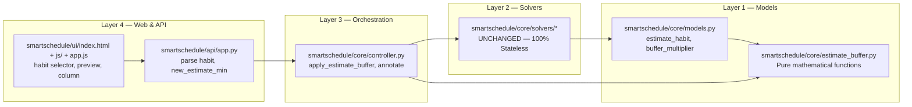

# Feature 001 — Estimate Buffer (Planning-Fallacy Correction)

**Course:** CS252 — Computational Thinking · FIT-HCMUS  
**Team:** Group 03 (*The Seven Dwarfs*)  
**Feature Lead / Author:** Nguyễn Trọng Tiến (Thinker 3 — Abstraction & Algorithmic Design)  
**Status:** Implemented and Verified (included cleanly inside `tests/clean_runner.py --pass`)  
**Source Origin:** `Improve_Plan/improve_plan.md` §6.2 (TaskSheet "planned 75 min"), §7.3 (`profile.estimate_habit`), Feature F04 & F06  
**Target Module:** [`smartschedule/core/estimate_buffer.py`](../../smartschedule/core/estimate_buffer.py)  

---

## 1. Problem Formulation & Behavioral Psychology

Under the **Planning Fallacy** (Kahneman & Tversky), individuals routinely underestimate the time required to complete future tasks by $20\text{--}35\%$, even when aware that similar tasks in the past have overrun. 

In the Baseline (V0) engine, scheduling strictly honored the raw user estimate:
$$T_{\text{planned}} = \text{round\_up\_to\_15}(T_{\text{estimate}})$$
Consequently, when a student experiences an overrun, downstream tasks suffer cascading schedule collisions, triggering frustration and plan abandonment.

Feature 001 introduces an adaptive **Behavioral Planning Buffer** driven by a single profile attribute: `estimate_habit`.

---

## 2. Mathematical Specification & Rounding Formulation

### 2.1. Multiplier Mapping
The student's declared estimation habit maps to a deterministic scaling multiplier $m$:

$$\text{multiplier}(H) = \begin{cases} 
1.00 & \text{if } H = \text{"RARELY"} \lor H = \emptyset \text{ (V0 default)} \\
1.10 & \text{if } H = \text{"SOMETIMES"} \\
1.25 & \text{if } H = \text{"OFTEN"}
\end{cases}$$

Case-insensitive strings (`often`, `Sometimes`, `rarely`) are strictly normalized.

### 2.2. Integer-Safe Nearest-Slot Rounding Rule
To prevent double-dilation and eliminate non-deterministic floating-point errors, the buffered duration is computed using integer arithmetic:

```python
pct = round(multiplier * 100)                      # 100, 110, 125
nearest = ((estimate * pct + 750) // 1500) * 15    # nearest 15-min slot, half rounds up
floor = round_up_to_15(estimate)
planned = max(floor, nearest)
```

$$\text{Planned}(T_{\text{est}}, m) = \max\left( \text{round\_up\_to\_15}(T_{\text{est}}), \; 15 \times \left\lfloor \frac{T_{\text{est}} \cdot (100 \cdot m) + 750}{1500} \right\rfloor \right)$$

#### Sample Evaluation Table for `OFTEN` ($m = 1.25$):

| Raw Estimate ($T_{\text{est}}$) | $T_{\text{est}} \times 1.25$ | Naive Round-Up | **Feature 001 Rule** | Baseline V0 | Buffer Added |
| :---: | :---: | :---: | :---: | :---: | :---: |
| **5 min** | 6.25 min | 15 min | **15 min** | 15 min | 0 min (absorbed by grid) |
| **10 min** | 12.50 min | 15 min | **15 min** | 15 min | 0 min (absorbed by grid) |
| **15 min** | 18.75 min | 30 min | **15 min** | 15 min | 0 min (nearest keeps 15 min) |
| **25 min** | 31.25 min | 45 min | **30 min** | 30 min | 0 min (absorbed by grid) |
| **45 min** | 56.25 min | 60 min | **60 min** | 45 min | +15 min (1 slot) |
| **60 min** | 75.00 min | 75 min | **75 min** | 60 min | +15 min (1 slot) |
| **90 min** | 112.50 min | 120 min | **120 min** | 90 min | +30 min (2 slots) |

*Key Design Insight (C3/C4):* Naive round-up doubles a 15-minute task into 30 minutes. The nearest-slot rule with floor guarantees that tasks $\le 15$ min do not waste excessive grid capacity.

---

## 3. Architecture & Implementation Across Layers



### Layer 1: Models (`smartschedule/core/estimate_buffer.py` & `models.py`)
- **`smartschedule/core/estimate_buffer.py`:** Pure mathematical library containing:
  - `normalize_habit(raw)`: Validates and sanitizes input.
  - `multiplier_for_habit(habit)`: Returns float multiplier ($1.0, 1.1, 1.25$).
  - `planned_duration_min(estimate_min, multiplier)`: Deterministic integer calculation.
  - `buffer_reason(estimate_min, planned_min, multiplier)`: Formats structured explanation dict.
- **`smartschedule/core/models.py`:**
  - `CommitmentsProfile`: Added optional field `estimate_habit: Optional[str] = None`.
  - `Task`: Added `buffer_multiplier: float = 1.0`. Method `get_planned_duration_min()` calls `planned_duration_min(self.duration_min, self.buffer_multiplier)`.

### Layer 3: Controller (`smartschedule/core/controller.py`)
- `apply_estimate_buffer(profile, tasks)`: Creates clean, non-mutating copies of task models with scaled `buffer_multiplier`.
- `solve_schedule(...)`: Invokes `apply_estimate_buffer`, executes solver, and annotates blocks whose duration increased with the structured reason code `ESTIMATE_BUFFER`.
- `handle_task_overrun(...)`: Adds overrun duration to the **raw estimate** rather than the planned duration, then re-buffers. Returns `new_estimate_min` to prevent compounding buffer inflation.

### Layer 4: Web API & Frontend (`smartschedule/api/`, `smartschedule/ui/`)
- `smartschedule/api/app.py`: Reads `estimate_habit` from payload across 3 valid schema shapes (`commitments.estimate_habit`, `profile.estimate_habit`, or top-level `estimate_habit`). Returns `new_estimate_min` on progress updates.
- `smartschedule/ui/app.js` (+ `js/` & `api/chat/handlers.py`): Shows remaining-time habit buffering breakdowns directly in chat responses (`⏳ Tính lại thời gian theo thói quen`) and renders buffered planned durations in `Danh Sách Việc` (`Estimate → Planned`).

### Layer 2: Solvers (`smartschedule/core/solvers/*`) — Strict Invariance Preserved
- **Zero changes made to solver files.** Solvers remain completely stateless and unaware of the buffer mechanism, querying duration via the standard `get_planned_duration_min()` interface.

---

## 4. Acceptance Criteria & Test Evidence

Tested and verified via [`test_estimate_buffer.py`](../../tests/logical/test_estimate_buffer.py) (34 unit tests) and the acceptance test:

| AC | Scenario | Expected Outcome | Status |
| :---: | :--- | :--- | :---: |
| **AC1** | `estimate_habit=OFTEN`, estimate 60 min | Scheduled block has `duration_min == 75` | ✅ PASS |
| **AC2** | Empty `estimate_habit` | Scenarios T01–T10 yield 100% identical results to V0 baseline | ✅ PASS |
| **AC3** | `OFTEN`, estimates 5, 10, 15 min | Block planned at 15 min; no `ESTIMATE_BUFFER` reason added | ✅ PASS |
| **AC4** | `OFTEN`, estimate 60 min | Block reasons contain `ESTIMATE_BUFFER` with `estimate_min=60, planned_min=75` | ✅ PASS |
| **AC5** | Determinism test: 3 consecutive runs | 3x SHA-256 schedule hashes are strictly identical | ✅ PASS |
| **AC6** | Overrun simulation: 60m estimate + 30m overrun | Returns `new_estimate_min=90`, `new_duration_min=120` | ✅ PASS |
| **AC7** | Case-insensitive input (`often`) | Correctly recognized as `OFTEN` ($\times 1.25$) | ✅ PASS |

*Verification Impact:* Turned the development gap test `test_improve_plan_gaps.py::test_fail_planning_fallacy_buffer_multiplier` GREEN!
