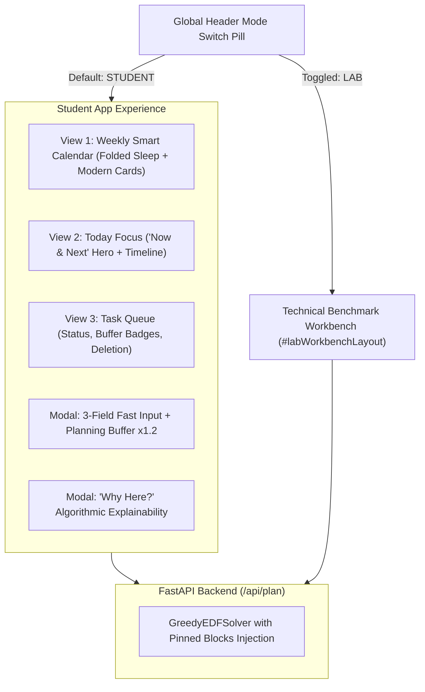

# Student-Facing Minimalist UI & Dual-Mode Architecture

**Course:** CS252 — Computational Thinking · FIT-HCMUS  
**Team:** Group 03 (*The Seven Dwarfs*)  
**Feature Lead / Author:** Duc Minh  
**Milestone:** Week 4 — Student Mode Feature Development & UI/UX Enhancement  
**Target Repository:** `group03-smartschedule-baseline`  
**Files Modified:** `web/index.html`, `web/app.js`  

---

## 1. Motivation & Context

In the Baseline (V0) release, the system interface was strictly an academic **Technical Benchmark Workbench**:
- It exposed low-level algorithmic internals: 672-slot matrix rows, SHA-256 cryptographic hashes, slot indices ($0\dots671$), and raw fragmentation metrics.
- Scrolling through 96 slot rows per day induced heavy cognitive fatigue for students.
- Task input friction was high (up to 8 technical parameters required).

**Design Goal:** "Hide the machinery" for daily student life, presenting a calm, modern personal planner by default while preserving the comprehensive Lab Benchmark Mode for course evaluation and grading.

---

## 2. Dual-Mode Architecture (Student ⟷ Lab)

### Shared State & Zero-Interference Contract
Both modes share the identical frontend state object (`state.commitments`, `state.tasks`, `state.pinnedBlocks`, `state.currentSchedule`) and communicate with the exact same FastAPI endpoints (`/api/plan`, `/api/presets`, `/api/export/ics`).

* **Cross-mode coherence:** A task added in **Student Mode** immediately reflects on the 672-slot matrix and KPI cards when switching to **Lab Mode**.
* **Benchmark visualization:** Loading a benchmark scenario (`T01`–`T10`) in Lab Mode and switching to Student Mode renders the scenario seamlessly in human-friendly cards.

---

## 3. The 3 Student-Centric Calendar Views

### View 1: Weekly Smart Calendar (`#stViewWeek`)
- **7-Day Responsive Layout:** Monday to Sunday columns styled with soft rounded borders.
- **Sleep Folding:** Replaces 28 nocturnal slot rows per day (00:00–06:30 and 23:30–24:00) with a single elegant folded bar:  
  `🌙 23:30 – 06:30 (Ngủ) · Bảo vệ`
- **Card-Based Event Aggregation:** Consecutive 15-minute slots are merged into distinct card blocks:
  - *Academic Classes:* Slate card with locked icon and room/subject details.
  - *Meals:* Warm amber card highlighting lunch/dinner recovery.
  - *Scheduled Study Blocks:* Soft indigo card (`bg-indigo-50/90 border border-indigo-200`) detailing duration, priority tag (`P5`), and deadline badge.

### View 2: Today Focus ("Now & Next" View — `#stViewToday`)
- Solves the primary daily student question: *"What should I focus on right now and next?"*
- **Hero Focus Banner:** Automatically detects the next pending study session of the selected day and presents it in a prominent banner with large typography, remaining duration, and direct action triggers.
- **Interactive Daily Timeline:** Chronologically displays all commitments and tasks for the day, allowing students to check off completed work.

### View 3: Task Queue Manager (`#stViewTasks`)
- High-level overview table of all enrolled assignments.
- Displays computed duration, safety buffer badges (`🛡️ +20%`), deadline, priority, placement status (`✓ ĐÃ XẾP LỊCH` vs. `⚠️ CHƯA XẾP ĐƯỢC`), and deletion controls.

---

## 4. Interactive Block Controls

### 4.1. Block Pinning (📌)
- **Problem:** Students reject automated schedulers if a minor edit completely rearranges their entire week.
- **Solution:** Clicking **📌 Ghim (Pin)** locks the scheduled block in `state.pinnedBlocks`.
- **Backend Contract:** The frontend passes `pinned_blocks: [...]` to `/api/plan`. The solver pre-locks these slots before sorting or placing any unpinned tasks, guaranteeing that pinned sessions never move.

### 4.2. Task Check-in (✔️)
- Clicking **✓ Hoàn thành** marks a block as complete in `state.doneBlocks`.
- Card opacity drops to 60%, the title receives a strikethrough, and the timeline reflects completion.

### 4.3. Algorithmic Explainability ("Why here? 💡")
- Clicking **💡 Tại sao?** opens `#stWhyHereModal`.
- Synthesizes reason codes returned by the engine (e.g. `ENERGY_MATCH`, `BEFORE_DEADLINE`, `ORDER`, `BREAK_AFTER`) into plain human language explaining why the algorithm selected that specific time window.

---

## 5. Minimalist 3-Field Task Modal
- Eliminates cognitive friction by requiring only 3 primary inputs:
  1. **Task Title:** E.g. *"DSA Assignment 2"*.
  2. **Estimated Duration:** Number input with fast chips (`[30p]`, `[45p]`, `[60p]`, `[90p]`, `[120p]`).
  3. **Deadline:** Day dropdown + HH:MM time picker.
- **Live Planning Fallacy Buffer Toggle:** Displays dynamic real-time preview of the buffered duration:
  $$T_{\text{buffered}} = \left\lceil \frac{\lceil T_{\text{raw}} \times 1.2 \rceil}{15} \right\rceil \times 15$$
- Advanced settings (priority 1–5, splittability bounds, prerequisites) are cleanly organized inside a collapsible drawer.
