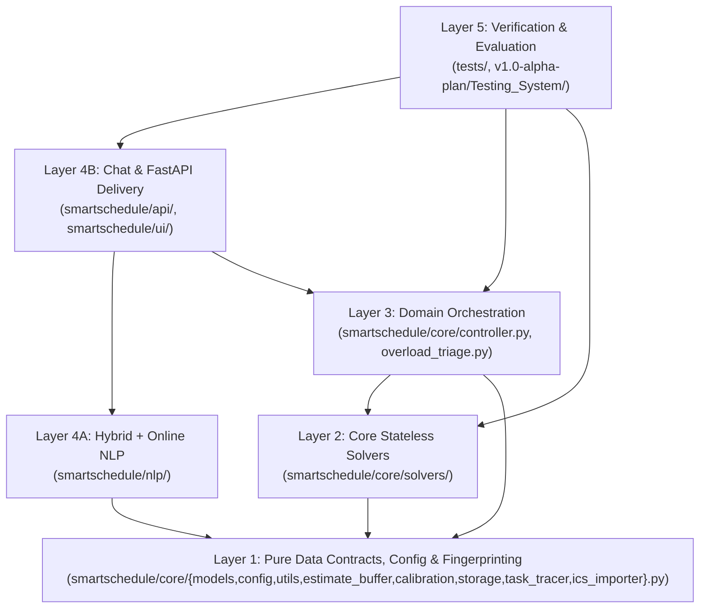

# System Architecture & Architectural Invariants (`agents/progress/system_architecture.md`)

**Project:** SmartSchedule — Automated Weekly Timetable & Task Scheduler (`v1.0-alpha`)  
**Scope:** [`smartschedule/`](../../smartschedule/), [`data/`](../../data/), [`tests/`](../../tests/), [`tools/`](../../tools/)  
**See Also:** [`agents/README.md`](../README.md) · [`v1.0-alpha-plan/README_agents.md`](../../v1.0-alpha-plan/README_agents.md)

---

## 1. Layered Dependency Architecture (Clean Modular Separation)

SmartSchedule enforces a **strict unidirectional 5-layer hierarchy** so UI/NLP changes never destabilize the mathematical scheduling core:

---

## 2. Module Responsibilities

### Layer 1: Pure Data Models & Helpers (`smartschedule/core/`)
- [`models.py`](../../smartschedule/core/models.py): Pydantic V2 contracts (`CommitmentsProfile`, `Task`, `FixedEvent`, `SleepSchedule`, `ScheduleOutput`, `ScheduledBlock`, `ScheduleSummary`). Zero business/web coupling (`INV-2`).
- [`config.py`](../../smartschedule/core/config.py): Centralized workspace path constants (`REPO_ROOT`, `CORE_DIR`, `UI_DIR`, `PRESETS_DIR`, `SCENARIOS_DIR`, `CALIBRATION_DIR`, `DEFAULT_DB_PATH`) and open solver/ergonomic constants.
- [`utils.py`](../../smartschedule/core/utils.py): Discrete 15-min slot math (`672` slots/week, up to `1344` for 14 days).
- [`estimate_buffer.py`](../../smartschedule/core/estimate_buffer.py) & [`calibration.py`](../../smartschedule/core/calibration.py): Planning-Fallacy buffering (`RARELY`/`SOMETIMES`/`OFTEN`, `COGNITIVE_LOAD` $\alpha=1.20/1.35$) and M7 EWMA personal calibration.
- [`task_tracer.py`](../../smartschedule/core/task_tracer.py): Pure stdlib SHA-256 task keyword fingerprinting and hidden criteria extraction.
- [`storage.py`](../../smartschedule/core/storage.py) & [`ics_importer.py`](../../smartschedule/core/ics_importer.py): Local SQLite persistence (`data/runtime/local_state.db`) and RFC 5545 `.ics` timetable importer.

### Layer 2: Stateless Scheduling Core (`smartschedule/core/solvers/` & `grid_manager.py`)
- [`grid_manager.py`](../../smartschedule/core/grid_manager.py): Manages `FREE`, `OCCUPIED`, `SLEEP`, `REST`, and scheduled `TASK` masks.
- [`ergonomic_engine.py`](../../smartschedule/core/solvers/ergonomic_engine.py): Shared stateless domain kernel ($O(1)$ prefix sums, circular Smarr & Schirmer `SJL`, 10-level lexicographic evaluation, Kempe `1/2-eject`, First-Fit feasibility floor, `ALNS` ruin-and-recreate).
- **6 Registered Solvers (`registry.py`):** `EDF` (`greedy_edf.py`, untouched V0 anchor), `LST` (`greedy_lst.py`, energy-blind V3), `WSPT` (`greedy_wspt.py`, energy-blind V3), `SCORED_GREEDY` (`scored_greedy.py`, circadian portfolio default), `BACKTRACK` (`backtracking.py`, live-state Branch-and-Bound), and `HYBRID_ALNS` (`hybrid_alns.py`, 6th deep optimizer).
- [`local_repair.py`](../../smartschedule/core/solvers/local_repair.py): `LOCAL_INSERTION`, `FULL_REBUILD` (forwarding active algorithm), and `RIPPLE_SHIFT`.

### Layer 3: Domain Orchestration (`smartschedule/core/controller.py`, `overload_triage.py`)
- Single entrypoint `ScheduleController.solve_schedule(...)`, buffer application, determinacy hash verification, `compare_algorithms`, `compute_schedule_insights`, and overload resolution preview.

### Layer 4: NLP, FastAPI & Chat-First UI (`smartschedule/nlp/`, `smartschedule/api/`, `smartschedule/ui/`)
- **4A (`nlp/`):** [`parser_controller.py`](../../smartschedule/nlp/parser_controller.py) (M1 EN/VI + Gemini), [`hybrid_pipeline/`](../../smartschedule/nlp/hybrid_pipeline/) (7-module offline 6-stage NLP), [`context_router.py`](../../smartschedule/nlp/context_router.py) (`gemini-2.5-flash-lite` online context extractor), and [`clause_condenser.py`](../../smartschedule/nlp/clause_condenser.py) (clause-level Vietnamese subject title condenser).
- **4B (`api/` & `ui/`):** [`app.py`](../../smartschedule/api/app.py), [`chat/`](../../smartschedule/api/chat/) (`thinking_stage.py`, `edge_cases.py`, `handlers.py`), [`health_v21.py`](../../smartschedule/api/health_v21.py), [`v3_services.py`](../../smartschedule/api/v3_services.py), [`test_showcase.py`](../../smartschedule/api/test_showcase.py), [`auth.py`](../../smartschedule/api/auth.py); served over [`smartschedule/ui/`](../../smartschedule/ui/) (`index.html`, `app.js`, `js/*.js`, `css/{tokens,shell,dev-panel,calendar,chat}.css`).

### Layer 5: Verification & Benchmarks (`tests/`, `v1.0-alpha-plan/Testing_System/`)
- Organized under [`tests/`](../../tests/): `ui/`, `architecture/`, `logical/`, `benchmark/`, `gaps/`, and `fixtures/nl_cases/` — orchestrated via [`tests/clean_runner.py`](../../tests/clean_runner.py).

---

## 3. Strict Architectural Invariants (`INV-1` to `INV-6`)

| # | Invariant Rule | Why It Matters | Verification Test |
| :-: | :--- | :--- | :--- |
| **INV-1** | **AST Purity (No API/NLP in Core):** `smartschedule/core/solvers/`, `models.py`, `task_tracer.py`, `calibration.py`, and `ics_importer.py` must NEVER import `smartschedule.api`, `smartschedule.nlp`, `fastapi`, `starlette`, or HTTP clients. | Keeps core engine portable across CLI, FastAPI, and offline workers. | `tests/architecture/test_system_architecture.py` |
| **INV-2** | **Model Layer Independence:** `smartschedule/core/models.py` never imports `controller` or `solvers`. | Prevents circular imports. | `test_layer_boundary_models_is_pure_data_layer` |
| **INV-3** | **Solver Statelessness:** Successive `solve()` calls yield identical deterministic outputs and SHA-256 hashes. | Ensures reproducibility and benchmark integrity. | `test_determinism_and_statelessness_all_six_solvers` |
| **INV-4** | **Protected Mask Tamper Resistance:** `remove_block` can never free `SLEEP` or `OCCUPIED` masks. | Protects user sleep and fixed classes. | `test_grid_mask_tamper_resistance` |
| **INV-5** | **Strict Memory Stability:** 50 consecutive solves grow heap by `< 350 KB` (`peak < 10 MB`). Heavy/online NLP uses zero-RAM cloud calls or lazy Layer 4 loading. | Prevents server OOM & leaks. | `tests/architecture/test_memory_leaks.py` |
| **INV-6** | **Thread Safety & Isolation:** Concurrent solves never leak state across threads or user workspaces. | Safe multi-tenant serving. | `tests/architecture/test_production_failures.py` |
