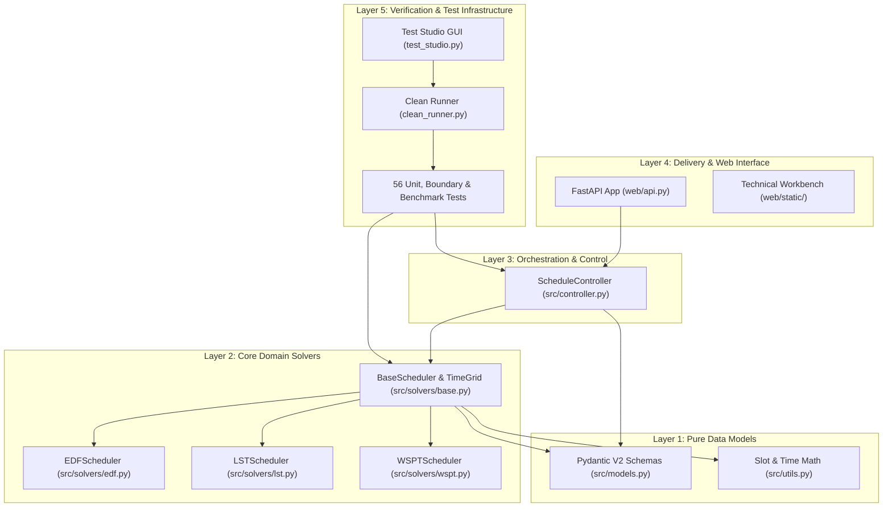

# SmartSchedule — System Architecture & Layered Invariants

**Project:** SmartSchedule — Personal Productivity Assistant for Automated Task & Timetable Scheduling  
**Course:** CS252 — Computational Thinking · FIT-HCMUS (Group 03 — *The Seven Dwarfs*)  
**Scope:** Core Domain Architecture, Data Flow, Layer Boundaries, and System Invariants  
**Target Audience:** AI Coding Assistants & System Architects  

---

## 1. High-Level Architectural Overview

SmartSchedule is architected as an **isolated, five-layer modular system** with strict one-directional dependency flows. It enforces strict separation of concerns to guarantee that the core mathematical solver remains completely decoupled from delivery mechanisms, web frameworks, and user interfaces.

---

## 2. Layer-by-Layer Specifications

### Layer 1: Pure Data Models (`src/models.py` & `src/utils.py`)
- **Pydantic V2 Schemas:** Defines strictly-typed domain objects with zero business logic dependencies:
  - `CommitmentsProfile`: Student profile containing `planning_week_start`, `sleep_schedule`, and `fixed_events` (classes, work shifts).
  - `Task`: Atomic units of work with `duration_min`, `deadline_day`, `deadline_time`, `priority` (1–5), `prerequisites[]`, and `category`.
  - `FixedEvent`: Locked calendar commitments (`start_time`, `end_time`, `day_of_week`).
  - `SleepSchedule`: Daily locked recovery windows (`daily_start_time`, `daily_end_time`).
  - `ScheduleOutput`: Solving response containing `blocks[]`, `unplaced_tasks[]`, and `summary` metrics.
  - `ScheduledBlock`: Scheduled task allocation with `day`, `start_time`, `end_time`, `start_slot`, `end_slot`, and `reasons[]`.
  - `ScheduleSummary`: Hard/soft constraint tallies, execution times, and capacity breakdown.
- **Time Conversion Utilities (`src/utils.py`):**
  - Discrete slot math ($15\text{ min} = 1\text{ slot}$, $96\text{ slots/day}$, $672\text{ slots/week}$).
  - `minutes_to_slots(m)`: Converts minutes to discrete slots with ceiling rounding.
  - `round_up_to_15(m)`: Normalizes irregular durations to 15-minute grid multiples.
  - `time_to_slot(day, time_str)` & `slot_to_time(slot_idx)`: Bidirectional mapping between string timestamps and array indices.

### Layer 2: Core Domain Solvers (`src/solvers/`)
- **`BaseScheduler` (`src/solvers/base.py`):**
  - Maintains the discrete 1D NumPy/list array of 672 integer slots.
  - Slot states:
    - `0` (`FREE`): Open for task scheduling.
    - `1` (`OCCUPIED`): Locked by fixed commitments (classes, work shifts).
    - `2` (`SLEEP`): Locked by daily circadian sleep windows.
    - `100+` (`TASK`): Occupied by a scheduled task block.
  - Implements slot occupancy queries (`is_range_free()`), lock protection (`lock_range()`), and DAG dependency sorting (`enforce_dependency_order()`).
- **Concrete Solvers:**
  - `EDFScheduler` (`src/solvers/edf.py`): Earliest Deadline First with priority-tie-breaking. First-fit placement in earliest free continuous gap.
  - `LSTScheduler` (`src/solvers/lst.py`): Least Slack Time heuristic ($Slack = Deadline - CurrentTime - Duration$).
  - `WSPTScheduler` (`src/solvers/wspt.py`): Weighted Shortest Processing Time ($Ratio = Priority / Duration$).

### Layer 3: Orchestration Controller (`src/controller.py`)
- Acts as the single entry point for scheduling execution: `ScheduleController.solve_schedule(...)`.
- Converts raw input dictionaries or Pydantic profiles into solver instances.
- Executes solver, aggregates `unplaced_tasks` with root-cause diagnostic tags (`CAPACITY_SHORTAGE`, `DEADLINE_PASSED`, `DEPENDENCY_UNMET`), and computes KPI metrics.
- Validates determinism by executing sequential runs and asserting hash invariance.

### Layer 4: Delivery & Web Interface (`web/`)
- **FastAPI Backend (`web/api.py`):**
  - Exposes REST endpoints: `/api/solve`, `/api/presets`, `/api/validate-move`, `/api/export/{fmt}` (JSON, CSV, iCalendar), `/api/tasks/natural-add`.
  - Handles HTTP status codes, validation error reporting, and CORS middleware.
- **Technical Workbench (`web/static/`):**
  - Native JavaScript/CSS interactive weekly grid displaying 672 slots.
  - Supports preset switching (Minh standard week, Lan high-pressure week).
  - Includes interactive manual block shifting with instant `/api/validate-move` constraint checks.

### Layer 5: Verification & Test Infrastructure (`verification_tests/`)
- Comprehensive pre-deployment test matrix with 56 automated tests.
- Standalone Native GUI Studio (`test_studio.py`) for visual test creation, editing, and execution.
- Interpretable Test Runner (`clean_runner.py`) outputting human-readable structured logs without pytest noise.

---

## 3. Strict Architectural Invariants (Must Be Preserved)

All AI agents modifying or extending this codebase must uphold these inviolable constraints:

| # | Invariant Rule | Why It Matters | Verification Test |
| :-: | :--- | :--- | :--- |
| **INV-1** | **AST Purity (No Web in Solvers):** `src/solvers/` and `src/models.py` must NEVER import `web`, `fastapi`, `starlette`, or HTTP clients. | Ensures core mathematical engine can run in headless CLI, embedded workers, or microservices. | `test_system_architecture.py::test_solvers_do_not_import_web` |
| **INV-2** | **Model Layer Independence:** `src/models.py` must never import from `src/solvers` or `src/controller.py`. | Prevents circular type references and enforces clear data-to-logic boundaries. | `test_system_architecture.py::test_models_layer_is_pure` |
| **INV-3** | **Solver Statelessness:** Successive calls to `solve()` on a solver instance must yield identical results without residual cached memory. | Guarantees multi-request determinism and concurrency safety. | `test_system_architecture.py::test_solver_statelessness_across_runs` |
| **INV-4** | **Protected Mask Tamper Resistance:** Dynamic block removal (`remove_block`) must never clear `SLEEP` (2) or `OCCUPIED` (1) slots. | Prevents scheduling algorithms or manual user edits from mutating biological sleep or hard class schedules. | `test_system_architecture.py::test_cannot_clear_sleep_or_occupied_masks` |
| **INV-5** | **Strict Memory Stability:** 50 consecutive full-schedule solving operations must not grow heap memory by more than $350\text{ KB}$, with single-solve peak memory bounded $< 10\text{ MB}$. | Protects against memory leaks in long-running production server deployments. | `test_memory_leaks.py::test_solver_memory_leak_over_50_iterations` |
| **INV-6** | **Thread Safety & Request Isolation:** Concurrent execution across separate threads (e.g. Student A and Student B) must not leak schedule blocks across solver instances. | Essential for multi-user web serving under FastAPI concurrency. | `test_production_failures.py::test_concurrent_solves_thread_safety` |

