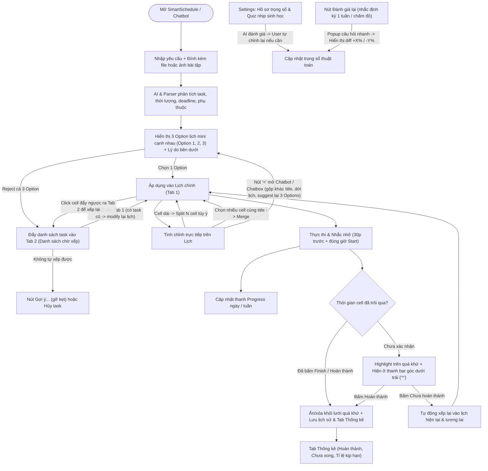

# SmartSchedule — Đặc Tả Luồng Ứng Dụng, Đề Xuất Thiết Kế & Bảng Chốt Phương Án

> **Dự án:** SmartSchedule (CS252 — Group 03 *The Seven Dwarfs*)  
> **Mục đích:** Tài liệu họp nhóm chốt UX, luồng nghiệp vụ & phương án kỹ thuật trước khi phân chia dev.  
> **Trạng thái:** `Draft — Chờ team chốt`

**Hướng dẫn nhanh cho thành viên nhóm:**
1. Đọc **Phần 1 & Phần 2** để thống nhất luồng trải nghiệm tổng thể của người dùng, và xem **Phần 3** để biết phần nào trong `smartschedule/` đã có sẵn.
2. Tại **Phần 4**, mỗi câu hỏi `Q1`–`Q8` đều có các Option kèm ưu/nhược điểm và **Hướng đề xuất (`Recommended`)** — thành viên chỉ cần tick `[x]` vào phương án chọn và điền vào bảng chốt ở **Phần 6**.

---

## Phần 1: Sơ đồ tổng quan luồng người dùng (End-to-End Flow)

---

## Phần 2: Mô tả chi tiết 7 Cụm Luồng Mong Muốn

### 2.1. Chatbot tiếp nhận File/Ảnh bài tập & Đề xuất đa phương án (Multi-Option Comparison)
- Người dùng nhập mô tả bài tập (VD: *"Hôm nay tôi có file/ảnh bài tập này, yêu cầu của thầy làm..."*) và đính kèm **file** (`.pdf`, `.md`, `.txt`) hoặc **ảnh** (`.png`, `.jpg`).
- AI trích xuất danh sách việc cần làm, thời lượng ước tính, hạn chót, độ nặng nhận thức và gợi ý chia nhỏ nếu cần.
- Thay vì ép 1 lịch duy nhất, app hiển thị **3 cửa sổ lịch mini đặt cạnh nhau** (`Option 1`, `Option 2`, `Option 3`) để so sánh trực quan:
  - Các cell **sắp được thêm mới** được **tô xanh nổi bật**.
  - Các cell **cũ đang có sẵn** được **làm nhạt** để làm nền đối chiếu.
- Bên dưới mỗi Option có **phần giải thích lý do** (ưu điểm, nhược điểm, mức độ khớp nhịp sinh học / kịp deadline) để người dùng chọn.

### 2.2. Xử lý khi Reject cả 3 Options & Không gian 2 Tab tương tác (Manual Staging + Split/Merge)
- Nếu người dùng **từ chối (Reject) cả 3 Options**:
  - Các task vừa tách được đưa thành danh sách chờ ở **Tab nhỏ bên cạnh** (**Tab 2: Task / Duration / Lịch chờ**).
  - Người dùng có thể **kéo cell từ Tab 2 thả qua Tab 1 (Lịch chính)** để tự sắp lịch:
    - Nếu ô đích trên Tab 1 **đã có task khác**, hệ thống tự **modify lại lịch** xung quanh cho hợp lệ.
  - Ngược lại, người dùng có thể **click vào một cell có task trên Lịch chính** để **chuyển ngược về Tab 2** sắp xếp lại.
  - Nếu người dùng **không tự xếp được**, có nút **Gợi ý...** (hỗ trợ gợi ý chỗ trống / gỡ kẹt) hoặc **Hủy task**.
- **Chatbot & Thao tác trên cell đang chọn (Split / Merge):**
  - **Chia nhỏ (Split):** Nếu một cell quá dài, bấm vào cell đó để chia thành `N` cell con với thời lượng tùy ý.
  - **Gộp (Merge) cùng title:** Chọn nhiều cell trên lịch **có cùng title** để gộp chung thành 1 task.
  - **Chatbox ra lệnh tự do:** Người dùng nhập yêu cầu trực tiếp vào chatbox (VD: *"gộp 2 cell khác title và tạo thành 1 task mới"*, đổi tên, dời giờ) và chatbot thực thi ngay trên lịch.

### 2.3. Thực hiện Task, Thanh Progress, Copilot `<` & Nhắc nhở
- **Thanh Progress ngày / tuần:** Hiển thị trực quan phần trăm và số lượng/thời lượng công việc đã hoàn thành trong ngày và trong tuần.
- **Finish task:** Khi người dùng xác nhận hoàn thành 1 task → cập nhật ngay các thanh Progress và **modify lại lịch** (tối ưu/giải phóng khoảng trống còn lại nếu cần).
- **Nút `<` trên khung lịch chính:** Bấm vào để trượt mở **Chatbot (Copilot)** ngay bên cạnh lịch, cho phép:
  - Hỏi đáp và tinh chỉnh thông tin của một cell bất kỳ.
  - Dời lịch sang khung giờ/ngày khác.
  - Yêu cầu *"suggest lại task này ở vị trí khác"* → hiển thị lại bảng so sánh Options để chọn.
- **Nhắc nhở đúng thời điểm (2 mốc):**
  1. **30 phút trước** khi một task bắt đầu (báo trước tên task & giờ bắt đầu).
  2. **Đúng thời điểm** task bắt đầu (nhắc vào phiên làm việc).

### 2.4. Định hình lại Lịch: Quá khứ vs. Hiện tại/Tương lai & Xác nhận Task quá khứ
- Lịch được phân tách rạch ròi giữa **Quá khứ** và **Hiện tại / Tương lai**:
  - **Mặc định ở phần Quá khứ:** Các task đã bấm **Hoàn thành (Finish)** đi qua sẽ được **xóa/ẩn khỏi lưới lịch quá khứ** để giao diện quá khứ sạch sẽ, không rối mắt.
  - **Task quá khứ chưa xác nhận:** Nếu đến/qua giờ mà user chưa bấm xác nhận hoàn thành hay chưa, cell đó vẫn hiển thị trong quá khứ với **màu highlight nổi bật**.
  - Khi bấm trực tiếp vào cell highlight trong quá khứ → hiện 2 nút:
    - **Hoàn thành:** Xóa/ẩn cell khỏi lịch quá khứ, cộng vào Progress & thống kê.
    - **Chưa hoàn thành:** Tự động **modify lại lịch hiện tại và tương lai** để bù phần việc đó.
- **Thanh bar ẩn ở góc dưới trái:**
  - Hiển thị tóm tắt **số lượng task trong quá khứ chưa xác nhận**.
  - Bấm nút **`^`** để bung danh sách các task quá khứ chưa xác nhận (tên task, thời lượng, thời điểm cũ) và bấm thẳng **Hoàn thành** hoặc **Chưa hoàn thành** cho từng task.

### 2.5. Settings — Hồ sơ Trọng số & Bài trắc nghiệm Nhịp sinh học
- Trong **Settings**, có nút mở mục đánh giá trọng số (tự đặt tên thân thiện cho user, VD: *"Hồ sơ nhịp sinh học & Trọng số cá nhân"*).
- Cho phép 2 cách thiết lập:
  1. **Xem & tự tinh chỉnh** trực tiếp các trọng số mặc định về nhịp sinh học của user.
  2. **Làm bài trắc nghiệm** đánh giá nhịp sinh học, thói quen làm việc, các khó khăn khi dùng lịch... để tối ưu trọng số cho thuật toán.
- Sau khi làm trắc nghiệm xong: AI hiển thị **bản đánh giá & bộ trọng số đề xuất**. Nếu user thấy AI đánh giá chưa đúng hoàn toàn với bản thân thì **cho phép tinh chỉnh tay lại ngay lập tức** trước khi lưu.

### 2.6. Đánh giá lại Kết quả định kỳ (Weekly Re-evaluation)
- Có nút **Đánh giá lại kết quả** (user có thể bấm bất cứ lúc nào; mặc định cứ **1 tuần** hệ thống sẽ **thông báo và báo chấm đỏ** trên nút này).
- Khi bấm vào → mở **cửa sổ popup nhỏ** hỏi một số câu nhanh về tuần qua (VD: *khối lượng bài buổi sáng như thế nào, buổi nào hay bị quá tải/mất tập trung, có hay trễ deadline không...*).
- Sau khi trả lời xong → hiển thị bảng kết quả cho thấy **trọng số nào thay đổi sẽ hiện `+X%` hoặc `-Y%`** rõ ràng để user nắm được thuật toán đang thích nghi ra sao.

### 2.7. Màn hình Thống kê & Theo dõi Task
- Có một tab/màn hình chuyên để xem **danh sách các task đã hoàn thành**, **chưa hoàn thành**, **tỉ lệ làm kịp hạn (on-time rate)** và tổng quan hiệu suất học tập/làm việc.

---

## Phần 3: Đối chiếu hiện trạng Codebase (Gap Analysis)

Bảng dưới đây đối chiếu 7 cụm luồng ở Phần 2 với mã nguồn hiện tại trong [`smartschedule/`](../smartschedule/):

| Cụm tính năng | Đã có sẵn trong codebase (`smartschedule/`) | Khoảng trống cần phát triển mới |
| :--- | :--- | :--- |
| **1. Chatbot + File/Ảnh + 3 Options** | • Parser `.pdf/.md/.txt`: [`doc_attachment_parser.py`](../smartschedule/nlp/doc_attachment_parser.py) • Chat turn + slot-filling: [`api/chat/`](../smartschedule/api/chat/), [`chat-assistant.js`](../smartschedule/ui/js/chat-assistant.js) | • Upload file & ảnh ngay trên khung chat UI • OCR / Gemini Vision cho ảnh bài tập • Endpoint & UI render **3 mini-calendar cạnh nhau** (tô xanh cell mới, làm nhạt cell cũ) + lý do bên dưới |
| **2. Reject → Tab 2 + Split/Merge** | • Kéo thả block trên lịch: [`render-calendar.js`](../smartschedule/ui/js/render-calendar.js) • Validate & Local Repair: `/api/validate-move`, `/api/repair` trong [`api/app.py`](../smartschedule/api/app.py) & [`local_repair.py`](../smartschedule/core/solvers/local_repair.py) | • **Tab 2 (Staging list)** khi reject 3 options & kéo thả 2 chiều Tab 1 ↔ Tab 2 • Nút **Gợi ý... / Hủy task** cho task chưa xếp • UI & API **Split** cell dài, **Merge** nhiều cell cùng title • Lệnh chatbox gộp cell khác title thành task mới |
| **3. Progress + Copilot `<` + Nhắc giờ** | • Check-in `/api/tasks/complete` trong [`modals.js`](../smartschedule/ui/js/modals.js) • Nút thu/mở Copilot ở [`index.html`](../smartschedule/ui/index.html) • Focus Timer & toggle nhắc giờ ở Dev Panel | • **Thanh Progress ngày / tuần** trên giao diện chính • Chế độ *"suggest lại vị trí khác"* từ Copilot `<` mở lại bảng so sánh • Hệ thống nhắc nhở tự động **trước 30 phút** & **đúng giờ Start** cho user thường |
| **4. Quá khứ vs Tương lai + Bar `^`** | • Có xác định `nowSlot`, phân biệt past/now/future khi render | • Ẩn/xóa khỏi lưới quá khứ đối với task đã Finish • **Highlight** cell quá khứ chưa xác nhận + popup 2 nút **Hoàn thành / Chưa hoàn thành** • **Thanh bar ẩn góc dưới trái (`^`)** đếm số task chưa xác nhận & cho xử lý nhanh |
| **5. Settings Trọng số & Trắc nghiệm** | • Xem trọng số ở Dev Mode: [`render-weights.js`](../smartschedule/ui/js/render-weights.js) • Tab Profile cơ bản trong [`input-drawer.js`](../smartschedule/ui/js/input-drawer.js) | • Nút & màn hình **Hồ sơ trọng số** trong Settings cho user thường • Bộ **câu hỏi trắc nghiệm** nhịp sinh học/thói quen • AI phân tích câu trả lời → đề xuất trọng số + cho user chỉnh tay lại |
| **6. Đánh giá lại định kỳ (1 tuần)** | • Backend EWMA & thích nghi tuần mới: [`calibration.py`](../smartschedule/core/calibration.py), [`cross_week_adapter.py`](../smartschedule/core/cross_week_adapter.py), `/api/workspace/adapt-next-week` | • Cơ chế đếm chu kỳ **7 ngày** + thông báo **chấm đỏ** trên nút • Popup khảo sát nhanh cuối tuần • Màn hình kết quả hiển thị biến động từng trọng số **`+X% / -Y%`** |
| **7. Tab Thống kê Task** | • Lưu `completion_logs` ở SQLite (`/api/tasks/completions`) • Danh sách theo ngày: [`render-list.js`](../smartschedule/ui/js/render-list.js) | • Tab/Dashboard Thống kê: danh sách đã hoàn thành, chưa hoàn thành, **tỉ lệ làm kịp hạn**, bộ lọc theo tuần/tháng |

---

## Phần 4: Các Điểm Cần Team Chốt (Decision Matrix — Options & Recommendation)

---

### Q1. Tiêu chí sinh 3 Options lịch (Option 1, 2, 3) & Giải thích lý do
**Bối cảnh:** Khi user gửi bài tập, app trả về 3 cửa sổ lịch mini cạnh nhau kèm lý do dưới mỗi lịch. Team cần chốt 3 Option này khác nhau theo tiêu chí gì để không bị na ná nhau.

- **Option A — 3 Chiến lược xếp lịch rõ ràng từ cùng engine (`⭐ Đề xuất / Recommended`)**
  - *Cách làm:* Dùng bộ giải chính (`SCORED_GREEDY` / `HYBRID_ALNS`) chạy với 3 cấu hình ưu tiên khác nhau:
    1. **Option 1 — Cân bằng & Nhịp sinh học:** Khớp giờ tỉnh táo nhất, rải đều các ngày, tránh quá tải.
    2. **Option 2 — Xong sớm trước Deadline:** Đẩy toàn bộ task lên các khe trống sớm nhất để dư thời gian dự phòng tối đa.
    3. **Option 3 — Gom khối tập trung:** Gom các phiên làm việc liền mạch, hạn chế chuyển ngữ cảnh, giữ tối/cuối tuần rảnh.
  - *Ưu điểm:* Lý do dưới mỗi lịch cực kỳ rõ ràng, bám sát thực tế sinh viên, dễ giải thích khi thuyết trình.
  - *Nhược điểm:* Cần định nghĩa 3 preset trọng số nhỏ cho solver. *(Effort: Trung bình)*
- **Option B — Chạy 3 thuật toán khác nhau trong hệ thống**
  - *Cách làm:* Chạy `SCORED_GREEDY`, `HYBRID_ALNS` và `GREEDY_EDF` rồi hiển thị 3 kết quả.
  - *Ưu điểm:* Tận dụng trực tiếp các solver đang có.
  - *Nhược điểm:* Người dùng cuối không quan tâm tên thuật toán; nhiều đề `SCORED_GREEDY` và `HYBRID_ALNS` cho kết quả rất giống nhau. *(Effort: Thấp)*
- **Option C — Sinh 3 biến thể theo ca thời gian (Ưu tiên Sáng / Chiều / Tối)**
  - *Ưu điểm:* Trực quan theo khung giờ trong ngày.
  - *Nhược điểm:* Nếu user bận học buổi sáng/chiều thì dễ bị trùng lịch cố định, làm 1–2 option kém khả thi. *(Effort: Thấp)*

> **⭐ Hướng đề xuất:** Chọn **Option A** — vừa giữ trải nghiệm dễ hiểu cho người dùng cuối, vừa tận dụng được sức mạnh tinh chỉnh trọng số của solver.

- [ ] Chọn Option A  |  - [ ] Chọn Option B  |  - [ ] Chọn Option C

---

### Q2. Xử lý File & Ảnh bài tập đính kèm trong Chatbot
**Bối cảnh:** Người dùng đưa file hoặc ảnh đề bài tập + yêu cầu của giảng viên vào chatbot.

- **Option A — Hybrid: Parser có sẵn cho File chữ + Gemini Vision cho Ảnh (`⭐ Đề xuất / Recommended`)**
  - *Cách làm:* File `.pdf`, `.md`, `.txt` đi qua [`doc_attachment_parser.py`](../smartschedule/nlp/doc_attachment_parser.py) (nhanh, offline, không tốn quota); file ảnh (`.png`, `.jpg`, `.webp`) gửi qua **Gemini Vision API** (`gemini-2.5-flash-lite` dùng `GEMINI_API_KEY` sẵn có trong `environments/.env`) để đọc đề và tách milestone. Nếu chưa cấu hình API key thì báo rõ để user dán text hoặc dùng file `.txt/.pdf`.
  - *Ưu điểm:* Tận dụng code sẵn có, kiểm soát được RAM (`INV-5`), xử lý tốt cả ảnh chụp màn hình/ảnh chụp bảng.
  - *Nhược điểm:* Xử lý ảnh cần có internet & `GEMINI_API_KEY`. *(Effort: Trung bình)*
- **Option B — Đẩy 100% file & ảnh lên Gemini Multimodal API**
  - *Ưu điểm:* Hiểu ngữ cảnh văn bản tự do rất tốt.
  - *Nhược điểm:* Phụ thuộc hoàn toàn vào mạng/API key, tốn token với PDF dài, bỏ phí parser đã viết. *(Effort: Thấp–Trung bình)*
- **Option C — Chỉ hỗ trợ `.pdf / .md / .txt` ở bản đầu, hoãn xử lý ảnh sang sau**
  - *Ưu điểm:* Không phụ thuộc Vision API.
  - *Nhược điểm:* Thiếu tính năng chụp/dán ảnh bài tập mà user đang kỳ vọng. *(Effort: Thấp)*

> **⭐ Hướng đề xuất:** Chọn **Option A** — cân bằng tốt nhất giữa chi phí, độ ổn định offline và khả năng đọc ảnh bài tập.

- [ ] Chọn Option A  |  - [ ] Chọn Option B  |  - [ ] Chọn Option C

---

### Q3. Kéo task từ Tab 2 đè vào cell đã có task trên Lịch chính
**Bối cảnh:** Khi reject 3 options, task nằm ở Tab 2. User kéo 1 task từ Tab 2 thả đè lên 1 khung giờ đã có task trên Tab 1 (Lịch chính).

- **Option A — Tự động đẩy task cũ bằng Local Repair + Nút Hoàn tác 5 giây (`⭐ Đề xuất / Recommended`)**
  - *Cách làm:* Gắn task mới từ Tab 2 vào đúng ô vừa thả (pin tạm), gọi `LocalRepairEngine` tự đẩy task bị đè sang khe trống hợp lệ gần nhất; hiện toast thông báo vị trí mới của task cũ kèm nút **Hoàn tác (Undo)**. Nếu lịch quá đặc không đẩy được thì hiện gợi ý gỡ kẹt / đưa task cũ về Tab 2.
  - *Ưu điểm:* Đúng tinh thần "kéo thả vào là tự modify lại lịch", thao tác mượt không bị popup ngắt quãng.
  - *Nhược điểm:* Cần xử lý kỹ case task cũ bị đè trùng giờ cố định (không được đẩy đè lớp học/giờ ngủ). *(Effort: Trung bình)*
- **Option B — Hỏi người dùng mỗi lần thả đè**
  - *Cách làm:* Hiện popup 3 lựa chọn: *Đẩy task cũ đi chỗ khác / Đổi chỗ 2 task / Đẩy task cũ về Tab 2*.
  - *Ưu điểm:* User kiểm soát tuyệt đối từng bước.
  - *Nhược điểm:* Kéo thả nhiều lần sẽ bị phiền vì popup liên tục. *(Effort: Trung bình)*
- **Option C — Tự đẩy task cũ ngược ra Tab 2**
  - *Ưu điểm:* Đơn giản, không cần chạy solver ngay khi thả.
  - *Nhược điểm:* Không tự động sắp xếp lại lịch như kỳ vọng ban đầu. *(Effort: Thấp)*

> **⭐ Hướng đề xuất:** Chọn **Option A** — trải nghiệm kéo-thả hiện đại (giống Motion/Reclaim) nhưng vẫn có nút **Hoàn tác** bảo hiểm.

- [ ] Chọn Option A  |  - [ ] Chọn Option B  |  - [ ] Chọn Option C

---

### Q4. Cơ chế Split (chia cell) & Merge (gộp cell)
**Bối cảnh:** User muốn bấm vào cell dài để chia thành nhiều cell với thời lượng tùy ý; chọn nhiều cell cùng title để gộp thành 1 task; hoặc dùng chatbox để gộp 2 cell khác title thành 1 task mới.

- **Option A — Split theo lưới 15 phút + Merge UI mọi block cùng title + Merge khác title qua Chatbox (`⭐ Đề xuất / Recommended`)**
  - *Cách làm:*
    - **Split:** User chọn số phần hoặc nhập thời lượng từng phần (làm tròn theo bội số **15 phút** để khớp chuẩn lưới `96 slot/ngày` của engine), giữ chung `task_id` gốc (các block con đặt tiếp nối hoặc cho user kéo/tự tìm khe trống).
    - **Merge trên UI:** Cho phép chọn từ 2 cell trở lên **có cùng title** (kể cả nằm ở các giờ/ngày khác nhau), gộp thành 1 block có tổng thời lượng (đặt ở vị trí cell đầu tiên nếu đủ chỗ, nếu vướng thì tìm khe trống gần nhất vừa đủ hoặc đẩy vào Tab 2).
    - **Merge khác title qua Chatbox:** Khi user nhắn *"gộp cell A và cell B thành task C"*, tạo 1 task mới với `title = C`, tổng thời lượng = `A + B`, xóa/archive 2 task cũ rồi xếp lại lịch (kèm nút Undo).
  - *Ưu điểm:* Phủ đầy đủ 100% kịch bản mô tả mà không phá vỡ ràng buộc slot 15p của hệ thống.
  - *Nhược điểm:* Cần đồng bộ tốt giữa danh sách `tasks` và `blocks` khi tách/gộp. *(Effort: Trung bình–Cao)*
- **Option B — Chỉ cho Merge trên UI khi các cell cùng title nằm liền kề nhau**
  - *Ưu điểm:* Dễ code, không phải tìm lại khe trống đủ dài cho block sau khi gộp.
  - *Nhược điểm:* Bị hạn chế nếu user chia 1 bài tập qua 2 ngày rồi muốn gộp lại. *(Effort: Thấp)*

> **⭐ Hướng đề xuất:** Chọn **Option A** — linh hoạt tối đa cho cả thao tác tay lẫn thao tác bằng chatbox.

- [ ] Chọn Option A  |  - [ ] Chọn Option B

---

### Q5. Xử lý Task quá khứ khi bấm "Hoàn thành" vs "Chưa hoàn thành"
**Bối cảnh:** Task quá khứ đã Finish sẽ biến mất khỏi lịch quá khứ cho gọn; task chưa xác nhận sẽ highlight và hiện ở thanh bar `^` góc dưới trái. Khi user bấm *Chưa hoàn thành*, lịch tương lai phải modify lại.

- **Option A — Hoàn thành = Ẩn khỏi lưới (lưu DB) | Chưa hoàn thành = Chọn nhanh "Xếp lại 100%" hoặc "Còn X phút" (`⭐ Đề xuất / Recommended`)**
  - *Cách làm:*
    - **Hoàn thành:** Đánh dấu `COMPLETED` trong `completion_logs` & ẩn khỏi lưới lịch quá khứ (soft-hide trên Calendar, vẫn hiện trong Tab Thống kê và thanh Progress).
    - **Chưa hoàn thành:** Mở popover gọn với 1 nút chính **"Xếp lại toàn bộ (100%)"** (1 click) và tùy chọn phụ kéo thanh **"Còn khoảng X phút"** (nếu đã làm được một nửa), sau đó gọi solver/local repair xếp bù vào lịch hiện tại & tương lai.
  - *Ưu điểm:* Vừa giữ lịch quá khứ sạch, không mất dữ liệu thống kê, vừa xử lý thực tế cho trường hợp làm dở dang.
  - *Nhược điểm:* Thêm 1 bước chọn nhẹ khi bấm *Chưa hoàn thành*. *(Effort: Trung bình)*
- **Option B — Bấm Chưa hoàn thành là lập tức xếp lại 100% thời lượng cũ**
  - *Ưu điểm:* Tối giản thao tác, đúng 1 click.
  - *Nhược điểm:* Nếu user đã làm xong 70% mà bị xếp lại 100% thời lượng thì dễ gây ngộp lịch tương lai. *(Effort: Thấp)*

> **⭐ Hướng đề xuất:** Chọn **Option A** — mặc định 1 click xếp lại toàn bộ nhưng vẫn cho phép chỉnh nhanh số phút còn lại nếu cần.

- [ ] Chọn Option A  |  - [ ] Chọn Option B

---

### Q6. Hệ thống Thông báo (30 phút trước & đúng giờ Start)
**Bối cảnh:** App cần nhắc người dùng 30 phút trước khi task bắt đầu và nhắc lại lần nữa đúng giờ task bắt đầu.

- **Option A — Browser Web Notification API + In-app Toast & Âm thanh nhẹ (`⭐ Đề xuất / Recommended`)**
  - *Cách làm:* Frontend chạy bộ kiểm tra mỗi 30 giây trên các block sắp tới: xin quyền **Web Notification** của trình duyệt (để pop thông báo ngay cả khi user đang chuyển qua tab khác) kết hợp **Toast nổi + chuông nhẹ** ngay trong app. Lưu flag đã nhắc cho từng `(block_id, mốc 30p / 0p)` để không bị báo lặp khi reload trang.
  - *Ưu điểm:* Không cần cài đặt server push phức tạp hay cấu hình SMTP/Telegram, chạy ngay trên web app local.
  - *Nhược điểm:* Cần mở trình duyệt/tab SmartSchedule (có thể thu nhỏ). *(Effort: Thấp)*
- **Option B — Chỉ hiện Toast Banner trong trang web**
  - *Ưu điểm:* Không cần xin quyền Notification từ trình duyệt.
  - *Nhược điểm:* User chuyển sang tab khác sẽ không thấy thông báo. *(Effort: Rất thấp)*
- **Option C — Tích hợp thêm Email / Telegram Bot**
  - *Ưu điểm:* Nhận thông báo trên điện thoại ngay cả khi tắt trình duyệt.
  - *Nhược điểm:* Phải cấu hình tài khoản, token, background worker — dễ vượt phạm vi đồ án môn học. *(Effort: Cao)*

> **⭐ Hướng đề xuất:** Chọn **Option A** — đủ tin cậy cho bài toán web app và dễ demo trực tiếp khi chấm đồ án.

- [ ] Chọn Option A  |  - [ ] Chọn Option B  |  - [ ] Chọn Option C

---

### Q7. Bộ Trọng số User chỉnh được & Cách AI đánh giá Quiz / Review tuần
**Bối cảnh:** Trong Settings có quiz đánh giá nhịp sinh học → AI đề xuất trọng số → user sửa lại được. Hàng tuần có nút báo đỏ mở popup hỏi → hiện thay đổi trọng số dạng `+X% / -Y%`.

- **Option A — Map 5 nhóm trọng số thật của Solver + Đánh giá Hybrid (`Công thức minh bạch + Lời giải thích AI`) (`⭐ Đề xuất / Recommended`)**
  - *Cách làm:*
    - **5 trọng số thực tế** (hiển thị bằng ngôn ngữ thân thiện thay vì biến kỹ thuật):
      1. *Mức năng lượng theo 4 khung giờ (Sáng / Chiều / Tối / Đêm)*
      2. *Hệ số dự phòng thời gian (`α_light`, `α_heavy`)*
      3. *Độ dài phiên tập trung lý tưởng (`min–max chunk`)*
      4. *Mức độ ưu tiên gom nhóm cùng môn vs rải đều*
      5. *Ngưỡng tải tối đa/ngày & khung giờ ngủ bảo vệ*
    - **Hybrid Scoring:** Câu trả lời từ Quiz & Popup Review tuần được quy đổi bằng hàm định lượng (nối với [`calibration.py`](../smartschedule/core/calibration.py) & [`cross_week_adapter.py`](../smartschedule/core/cross_week_adapter.py)) để tính ra chính xác mức **`+X% / -Y%`** nằm trong biên an toàn của thuật toán, rồi dùng Gemini viết nhận xét tự nhiên (tự fallback sang template tiếng Việt nếu offline). User kéo thanh trượt chỉnh tay lại trực tiếp trên các trọng số này.
  - *Ưu điểm:* Trọng số chỉnh xong **ăn thẳng vào thuật toán xếp lịch thật**, không bị "AI phán bừa" con số làm hỏng lịch.
  - *Nhược điểm:* Cần viết lớp mapping giữa câu hỏi trắc nghiệm và 5 nhóm trọng số. *(Effort: Trung bình–Cao)*
- **Option B — 100% Rule-based Offline (không gọi LLM)**
  - *Ưu điểm:* Chạy nhanh, không tốn API call.
  - *Nhược điểm:* Nhận xét của "AI đánh giá" hơi cứng, ít cá nhân hóa. *(Effort: Trung bình)*
- **Option C — Để LLM tự suy luận toàn bộ con số trọng số mới**
  - *Ưu điểm:* Linh hoạt theo văn bản tự do.
  - *Nhược điểm:* Khó đảm bảo tính nhất quán, dễ sinh số vượt ngưỡng an toàn (gây over-buffering hoặc vỡ lịch). *(Effort: Trung bình)*

> **⭐ Hướng đề xuất:** Chọn **Option A** — đảm bảo tính khoa học/tất định của môn Tư duy Tính toán mà vẫn có trải nghiệm AI thân thiện.

- [ ] Chọn Option A  |  - [ ] Chọn Option B  |  - [ ] Chọn Option C

---

### Q8. Phạm vi & Thứ tự triển khai (Phasing)
**Bối cảnh:** Khối lượng tính năng mới khá lớn trải dài cả Frontend lẫn Backend. Cần chốt thứ tự làm theo từng đợt để luôn có bản chạy ổn định để test/demo.

- **Option A — 3 Phase: Nền tảng thực thi → Tương tác lập lịch AI → Cá nhân hóa & Tự học (`⭐ Đề xuất / Recommended`)**
  - *Phase 1 (Core Execution & Tracking):* Định hình lịch Quá khứ (ẩn task đã Finish, highlight chưa xác nhận, thanh bar `^` góc dưới trái) + Thanh Progress ngày/tuần + Thông báo 30p/0p + Tab Thống kê.
  - *Phase 2 (AI Compare & Interactive Staging):* Chatbot nhận file/ảnh + So sánh 3 Options mini-calendar kèm lý do + Tab 2 Staging kéo thả qua lại + Split/Merge cell + Copilot nút `<`.
  - *Phase 3 (Personalization Loop):* Settings Hồ sơ trọng số & Quiz nhịp sinh học + Nút Đánh giá lại sau 1 tuần (chấm đỏ + popup + diff `+X% / -Y%`).
  - *Ưu điểm:* Phase 1 hoàn thiện xong vòng đời task cơ bản ngay; Phase 2 tập trung xử lý phần UI phức tạp nhất; Phase 3 nối trơn tru vào dữ liệu thực tế từ Phase 1.
- **Option B — Đảo Phase 2 lên làm trước (ưu tiên Chatbot + 3 Options để demo đầu vào trước)**
  - *Ưu điểm:* Ấn tượng ngay khi demo luồng nhập bài tập ban đầu.
  - *Nhược điểm:* Khối lượng UI của Phase 2 rất nặng (3 mini-calendars + drag/drop 2 tab + split/merge); nếu kẹt tiến độ sẽ chưa có phần tracking/progress/thống kê để chạy end-to-end.

> **⭐ Hướng đề xuất:** Chọn **Option A** (hoặc nếu team nhiều người làm song song: chia 2 nhóm làm **Phase 1** và **Phase 2** cùng lúc, rồi ghép **Phase 3**).

- [ ] Chọn Option A  |  - [ ] Chọn Option B

---

## Phần 5: Danh sách Feature Backlog dự kiến (Tóm tắt theo Phase)

| ID | Tính năng | Phạm vi (FE / BE) | Độ phức tạp | Phụ thuộc chốt |
| :--- | :--- | :--- | :--- | :--- |
| **F1** | Phân tách Quá khứ vs Tương lai: ẩn task đã Finish, highlight chưa xác nhận | FE (`render-calendar.js`, `state.js`) | Trung bình | `Q5` |
| **F2** | Thanh bar ẩn góc dưới trái (`^`) đếm & xác nhận nhanh task quá khứ | FE + BE (`/api/tasks/complete` & reschedule) | Trung bình | `Q5` |
| **F3** | Thanh Progress ngày / tuần cập nhật real-time khi Finish task | FE (`render-calendar.js`, `app.js`) | Thấp | `Q5` |
| **F4** | Bộ nhắc nhở 30 phút trước & đúng giờ Start (Web Notification + Toast) | FE (`app.js`) | Thấp | `Q6` |
| **F5** | Tab Thống kê (đã hoàn thành, chưa xong, tỉ lệ kịp hạn) | FE (new view) + BE (`/api/tasks/completions`) | Trung bình | — |
| **F6** | Chatbot upload File/Ảnh bài tập & trích xuất danh sách task | FE (`chat-assistant.js`) + BE (`doc_attachment_parser.py` + Vision) | Trung bình–Cao | `Q2` |
| **F7** | Cửa sổ so sánh 3 Options mini-calendar (highlight xanh/làm nhạt) + lý do | FE + BE (multi-option solver endpoint) | Cao | `Q1` |
| **F8** | Tab 2 (Danh sách chờ) khi Reject 3 Options + Kéo thả 2 chiều Tab 1 ↔ Tab 2 + Gợi ý/Hủy | FE + BE (`local_repair.py`) | Cao | `Q3` |
| **F9** | Split cell dài, Merge cell cùng title & Lệnh chatbox gộp cell khác title | FE + BE (`/api/tasks/*`, `api/chat/`) | Cao | `Q4` |
| **F10** | Nút `<` mở Copilot trên lịch chính + Suggest lại bảng 3 Options cho 1 task | FE (`index.html`, `chat-assistant.js`) | Trung bình | `Q1` |
| **F11** | Settings: Hồ sơ trọng số + Quiz nhịp sinh học + AI đánh giá & User chỉnh tay | FE + BE (profile weights & quiz API) | Trung bình–Cao | `Q7` |
| **F12** | Nút Đánh giá lại định kỳ (báo đỏ sau 7 ngày) + Popup + Bảng diff `+X% / -Y%` | FE + BE (`cross_week_adapter.py`, `calibration.py`) | Trung bình–Cao | `Q7` |

---

## Phần 6: Bảng Chốt Cuối Cùng (Sign-off Summary)

Sau khi họp team xong, điền kết quả chốt vào bảng dưới đây để bắt đầu lập kế hoạch code chi tiết:

| Câu hỏi | Chủ đề | Phương án team chốt (A / B / C) | Ghi chú / Thay đổi bổ sung (nếu có) |
| :--- | :--- | :--- | :--- |
| **Q1** | Tiêu chí sinh 3 Options lịch & lý do | | |
| **Q2** | Cách đọc File & Ảnh bài tập trong Chatbot | | |
| **Q3** | Hành vi kéo task từ Tab 2 đè vào cell có sẵn | | |
| **Q4** | Quy tắc Split & Merge (cùng title / khác title) | | |
| **Q5** | Xử lý task quá khứ (Hoàn thành vs Chưa hoàn thành) | | |
| **Q6** | Kênh thông báo nhắc trước 30p & đúng giờ Start | | |
| **Q7** | Trọng số user chỉnh & AI đánh giá Quiz / Review tuần | | |
| **Q8** | Thứ tự triển khai các Phase & phân công | | |
