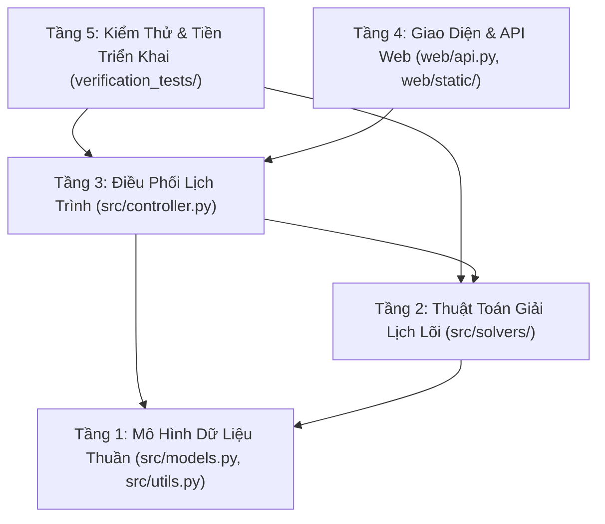

# SmartSchedule — Kiến Trúc Hệ Thống & Các Ràng Buộc Bất Biến

**Dự án:** SmartSchedule — Trợ Lý Tối Ưu Hóa & Tự Động Xếp Lịch Học Tập  
**Môn học:** CSC10014 — Tư Duy Tính Toán · FIT-HCMUS (Nhóm 03 — *The Seven Dwarfs*)  
**Mục tiêu tài liệu:** Bản tóm lược ngắn gọn, trực quan, dễ hiểu nhất về kiến trúc hệ thống để tất cả thành viên trong nhóm và các AI Agent nắm bắt ngay lập tức.  

---

## 1. Mô Hình Kiến Trúc 5 Tầng (Phân Tách Trách Nhiệm)

Để mã nguồn không bị chồng chéo, dễ bảo trì và cho phép nhiều thành viên "vibe code" cùng lúc mà không xung đột, hệ thống được phân chia thành **5 tầng độc lập**, dữ liệu chỉ đi một chiều từ dưới lên trên:

### Chi tiết 5 tầng:
1. **Tầng 1 — Mô Hình Dữ Liệu (`src/models.py` & `src/utils.py`):**
   - Chứa các cấu trúc dữ liệu Pydantic V2 được định kiểu chặt chẽ: `Task` (công việc cần làm), `FixedEvent` (lịch cố định như giờ học, ca làm), `SleepSchedule` (giờ ngủ cố định), `ScheduleOutput` (kết quả xếp lịch).
   - Hàm tiện ích toán rời rạc: đổi phút sang ô ($15\text{ phút} = 1\text{ slot}$), làm tròn thời gian lên bội số 15 phút.
2. **Tầng 2 — Thuật Toán Lõi (`src/solvers/`):**
   - Quản lý mảng lưới thời gian 672 ô (7 ngày $\times$ 96 ô/ngày).
   - Chứa các thuật toán xếp lịch tham lam cổ điển:
     - `EDFScheduler`: Xếp việc có hạn chót sớm nhất trước (Earliest Deadline First).
     - `LSTScheduler`: Xếp việc có thời gian đệm rảnh ít nhất trước (Least Slack Time).
     - `WSPTScheduler`: Xếp việc có tỷ lệ ưu tiên/thời lượng cao nhất trước.
3. **Tầng 3 — Điều Phối Viên (`src/controller.py`):**
   - Nhận yêu cầu từ người dùng hoặc API, gọi tầng thuật toán tương ứng, kiểm tra tính tất định (3 lần chạy phải cùng 1 kết quả băm SHA-256), và gom các việc không xếp được vào danh sách `unplaced_tasks`.
4. **Tầng 4 — Giao Diện & Web API (`web/`):**
   - Backend FastAPI cung cấp các API: `/api/solve`, `/api/presets`, `/api/validate-move`, `/api/export/{fmt}`.
   - Frontend HTML/CSS/JS (Technical Workbench) cho phép xem lưới tuần 672 ô trực quan, kéo thả thử nghiệm lịch.
5. **Tầng 5 — Hệ Thống Kiểm Thử (`verification_tests/`):**
   - Chứa 56 bài kiểm thử tự động, giao diện Test Studio đồ họa, và bộ chạy console sạch `clean_runner.py`.

---

## 2. 6 Quy Tắc Bất Biến Sống Còn (Không Được Vi Phạm)

Khi bất kỳ thành viên nào hoặc AI Agent nào viết mã mới, **BẮT BUỘC** phải tuân thủ 6 quy tắc bất biến sau:

| Mã | Tên Quy Tắc | Ý Nghĩa Thực Tế | Lý Do Cần Giữ |
| :-: | :--- | :--- | :--- |
| **INV-1** | **Solver Không Dính Web** | Thư mục `src/solvers/` và file `src/models.py` **tuyệt đối không được import** `web`, `fastapi`, `starlette` hay các thư viện HTTP. | Đảm bảo thuật toán lõi có thể chạy độc lập ở bất kỳ môi trường nào (CLI, server, test, app di động sau này). |
| **INV-2** | **Model Độc Lập Hoàn Toàn** | `src/models.py` không được import ngược lại từ `solvers` hay `controller`. | Tránh lỗi vòng lặp phụ thuộc (circular import). |
| **INV-3** | **Solver Không Giữ Rác (Stateless)** | Chạy thuật toán 10 lần liên tiếp trên cùng 1 instance phải cho ra kết quả giống hệt nhau, không được lưu biến tạm sót lại. | Bảo vệ an toàn khi nhiều sinh viên cùng gửi yêu cầu xếp lịch lên server. |
| **INV-4** | **Không Xóa Giờ Học & Giờ Ngủ** | Hàm dọn ô (`remove_block`) chỉ được dọn việc học (`TASK`), tuyệt đối không được phép xóa nhầm giờ ngủ (`SLEEP`) hoặc giờ học cố định (`OCCUPIED`). | Tránh tình trạng thuật toán hoặc người dùng vô tình ghi đè lên giờ nghỉ ngơi và lịch học bắt buộc. |
| **INV-5** | **Kiểm Soát Bộ Nhớ** | Chạy 50 lần xếp lịch liên tiếp bộ nhớ heap không được tăng quá $350\text{ KB}$, đỉnh RAM không vượt quá $10\text{ MB}$. | Tránh tình trạng server bị tràn bộ nhớ (Memory Leak) khi chạy lâu ngày. |
| **INV-6** | **An Toàn Đa Luồng (Thread Safety)** | Hai sinh viên gửi yêu cầu đồng thời thì lịch của bạn A tuyệt đối không được lọt sang lịch của bạn B. | Đảm bảo tính bảo mật và toàn vẹn dữ liệu cho từng người dùng. |

