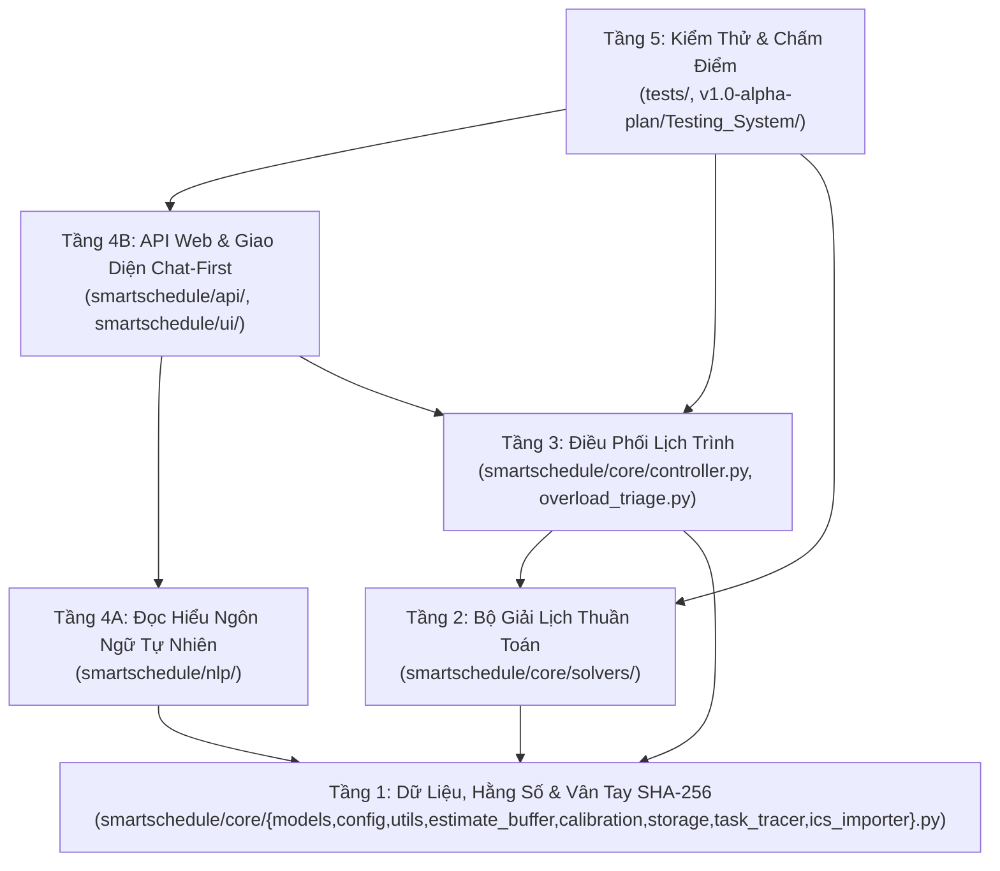

# SmartSchedule — Kiến Trúc Hệ Thống & Các Ràng Buộc Bất Biến (`docs/progress/kien_truc_he_thong.md`)

**Dự án:** SmartSchedule (`v1.0-alpha`) — Trợ Lý Xếp Lịch Học Tập Thông Minh  
**Môn học:** CS252 — Tư Duy Tính Toán · FIT-HCMUS (Nhóm 03 — *The Seven Dwarfs*)  
**Xem thêm:** [`docs/README.md`](../README.md) · [`v1.0-alpha-plan/README.md`](../../v1.0-alpha-plan/README.md)

---

## 1. Mô Hình Kiến Trúc 5 Tầng (Đã Tái Cấu Trúc Gọn Gàng)

Từ bản `v1.0-alpha`, mã nguồn đã được chia tách rõ theo từng trách nhiệm để nhiều thành viên và AI Agent cùng phát triển mà không xung đột:

### Vai trò từng tầng:
1. **Tầng 1 — Dữ liệu & Công cụ thuần (`smartschedule/core/`):**
   - `models.py` (dữ liệu `Task`, `CommitmentsProfile`, `ScheduleOutput`), `config.py` (đường dẫn trung tâm & hằng số mở), `utils.py` (toán lưới 15 phút/ô), `estimate_buffer.py` & `calibration.py` (đệm thói quen & EWMA), `task_tracer.py` (truy vết SHA-256 không cần thư viện ngoài), `storage.py` (SQLite `data/runtime/local_state.db`), `ics_importer.py` (nhập `.ics`).
2. **Tầng 2 — 6 Thuật Toán Giải Lịch (`smartschedule/core/solvers/`):**
   - Lưới 672 ô (hoặc 1344 ô cho 14 ngày) kết hợp hạt nhân chung `ergonomic_engine.py`.
   - 6 bộ giải: `EDF` (mốc V0 giữ nguyên), `LST` & `WSPT` (mù năng lượng V3), `SCORED_GREEDY` (mặc định nhanh theo nhịp sinh học), `BACKTRACK` (nhánh cận), `HYBRID_ALNS` (tối ưu sâu Ruin-and-Recreate).
3. **Tầng 3 — Điều phối viên (`controller.py`, `overload_triage.py`):**
   - Chạy solver, kiểm tra tính tất định SHA-256, sinh giải pháp gỡ quá tải và phân tích `insights`.
4. **Tầng 4 — NLP & Giao diện Chat-First (`smartschedule/nlp/`, `smartschedule/api/`, `smartschedule/ui/`):**
   - `nlp/`: Bộ đọc câu lệnh song ngữ 6 tầng (`hybrid_pipeline/`), M1 Gemini (`parser_controller.py`), bộ định tuyến mô hình online siêu nhẹ (`context_router.py`) và bộ rút gọn tiêu đề (`clause_condenser.py`).
   - `api/` & `ui/`: Máy chủ FastAPI (`app.py`, `chat/`), giao diện Trợ lý xếp lịch tối giản + Lịch Tuần + Developer Mode (`index.html`, `app.js`, `js/*.js`, `css/*.css`).
5. **Tầng 5 — Kiểm thử (`tests/`):**
   - Chia làm 5 thư mục gọn sạch: `ui/`, `architecture/`, `logical/`, `benchmark/`, `gaps/`, cùng `tests/clean_runner.py`.

---

## 2. 6 Quy Tắc Bất Biến Sống Còn (`INV-1` đến `INV-6`)

| Mã | Tên Quy Tắc | Ý Nghĩa Thực Tế | Lý Do Cần Giữ |
| :-: | :--- | :--- | :--- |
| **INV-1** | **Core Không Dính Web/AI** | Các file trong `smartschedule/core/solvers/`, `models.py`, `task_tracer.py`, `calibration.py`, `ics_importer.py` tuyệt đối không import `smartschedule.api`, `smartschedule.nlp`, `fastapi`, `google.genai` hay `httpx`. | Bảo đảm thuật toán chạy độc lập ở mọi môi trường. |
| **INV-2** | **Model Độc Lập** | `smartschedule/core/models.py` không import `controller` hoặc `solvers`. | Tránh vòng lặp phụ thuộc (circular import). |
| **INV-3** | **Solver Không Giữ Rác** | Chạy nhiều lần liên tiếp trên cùng dữ liệu phải ra kết quả và mã hash giống hệt nhau. | Đảm bảo tái lập thí nghiệm và công bằng benchmark. |
| **INV-4** | **Không Xóa Giờ Ngủ / Giờ Học** | Thao tác dọn ô không bao giờ được ghi đè lên `SLEEP` hoặc `OCCUPIED`. | Bảo vệ lịch cứng và sức khỏe người dùng. |
| **INV-5** | **Kiểm Soát Bộ Nhớ** | Chạy 50 lần giải liên tiếp mức tăng heap `< 350 KB` (đỉnh `< 10 MB`). Mô hình AI đọc ngữ cảnh dùng API đám mây (`0 MB` RAM máy) tại Tầng 4. | Tránh tràn RAM máy chủ / máy cá nhân. |
| **INV-6** | **An Toàn Đa Luồng** | Yêu cầu của nhiều người dùng song song hoàn toàn tách biệt, không lẫn dữ liệu lịch. | An toàn khi phục vụ nhiều người cùng lúc. |
