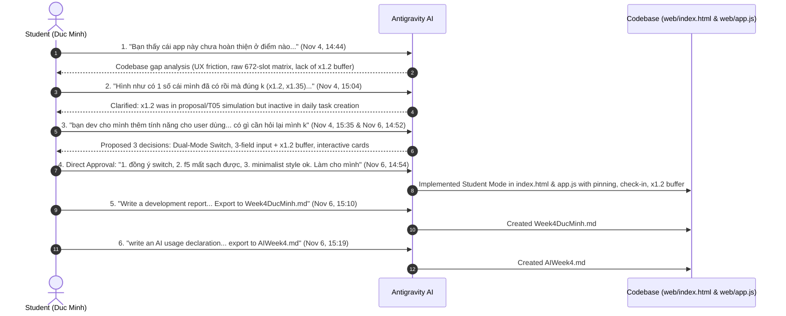

# AI Usage Declaration (Tuyên Bố Sử Dụng Trợ Lý AI)
**Course:** CSC10014 — Computational Thinking (Tư duy Tính toán) · FIT-HCMUS  
**Team:** Group 03 (*The Seven Dwarfs*)  
**Student / Developer:** Duc Minh  
**Milestone:** Week 4 — Student Mode Feature Development & UI/UX Enhancement  
**Target Repository:** `group03-smartschedule-baseline`  
**File Created:** `AIWeek4.md` (Exported on 2026-11-06)  
**AI Assistant Platform:** Antigravity (Powered by Google DeepMind Gemini 3.8 Flash)  

---

## 1. Overview & Academic Integrity Statement

In accordance with FIT-HCMUS academic guidelines on generative AI usage, this declaration provides an explicit, transparent, and auditable record of all AI interactions utilized during the development of the **Student Mode (Chế độ Sinh Viên)** feature for the **SmartSchedule Baseline (V0)** project during Week 4.

The student (Duc Minh) maintained complete **architectural oversight, prompt direction, requirement filtering, and code verification**. The AI assistant was utilized as a pair-programming partner to analyze codebase gaps, formulate implementation options, scaffold DOM/CSS structures, and implement interactive frontend controller logic.

---

## 2. Chronological Prompt Audit Log & Evidence

Below is the verified timeline of prompts provided by the student, along with the timestamps recorded in the project transcript (`transcript.jsonl`), user intents, and corresponding engineering actions:

---

### Step 1: Codebase Evaluation & Usability Gap Audit
* **Timestamp:** `2026-11-04T14:44:17+07:00` (UTC: `2026-11-04T07:44:17Z`)
* **Exact User Prompt:**
  > *"Bạn thấy cái app này chưa hoàn thiện ở điểm nào, và điểm nào cần cải thiện"*
* **Student Intent:** Requesting a critical evaluation of the V0 baseline system from both technical and real-world student user perspectives.
* **AI Output:** Identified 5 critical limitations:
  1. UI was strictly a researcher's workbench (672-slot matrix, SHA-256 hash, technical slot indices).
  2. Nocturnal sleep slots (196 slots) cluttered the daily view.
  3. High task input friction (up to 8 parameters).
  4. Absence of behavioral safeguards (Planning Fallacy buffer $\times 1.2 / \times 1.35$ was not active).
  5. Lack of day-to-day execution tracking (no pinning, no check-in, no "Now & Next" view).

---

### Step 2: Verification of Planning Fallacy Buffer Status
* **Timestamp:** `2026-11-04T15:04:28+07:00` (UTC: `2026-11-04T08:04:28Z`)
* **Exact User Prompt:**
  > *"Hình như có 1 số cái mình đã có rồi mà đúng k (x1.2, x1.35 gì đó có rồi mà)"*
* **Student Intent:** Verifying whether the $\times 1.2$ buffer mentioned in `Baseline_Plan/baseline_plan.md` and `Proposal_Report.pdf` was already operational in the app.
* **AI Output:** 
  - Proved via [`src/models.py`](file:///d:/syllabus/CT/group/Computational-Thinking---Group-Project/group03-smartschedule-baseline/src/models.py#L149-L155) that the Baseline V0 engine deliberately disabled the buffer (`Keep raw estimate T_planned = round_up_to_15(T_estimate), NO x1.2 or x1.35 buffer`).
  - Confirmed the buffer was only tested as an experimental overrun in **Scenario `T05`** and **Tab 3**, but was not yet applied to student task creation.

---

### Step 3: Feature Proposal & Alignment Questionnaire
* **Timestamp:** `2026-11-04T15:35:04+07:00` (Re-sent on `2026-11-06T14:52:31+07:00`)
* **Exact User Prompt:**
  > *"bạn dev cho mình thêm tính năng cho user dùng (cái giao diện nó sạch sẽ ít nút), có gì cần hỏi lại mình k"*
* **Student Intent:** Directing the development of clean, user-centric features with minimal UI clutter, while asking the AI what architectural decisions needed student confirmation first.
* **AI Output:** Structured 3 core alignment questions:
  1. *UI Organization:* Dual-Mode Switcher (**Student Mode** by default $\longleftrightarrow$ **Lab Mode** for grading/benchmarking) vs. replacing the UI entirely.
  2. *Feature Scope:* 3-field quick task input, automatic $\times 1.2$ buffer toggle, sleep folding, Today "Now & Next" view, and block pinning/check-in.
  3. *Aesthetics:* Minimalist design language (clean cards, generous whitespace, primary button focus).

---

### Step 4: Explicit Authorization & Requirements Approval
* **Timestamp:** `2026-11-06T14:54:54+07:00` (UTC: `2026-11-06T07:54:54Z`)
* **Exact User Prompt:**
  > *"1. đồng ý với cái chế độ switch*  
  > *2. f5 mất sạch được (chưa cần backend lưu local)*  
  > *3. minimalist style ok*  
  > *Làm cho mình"*
* **Student Intent:** Clear decision-making:
  1. Confirmed Dual-Mode Switch architecture.
  2. Clarified that memory-based state is acceptable for this sprint (database persistence not required).
  3. Approved minimalist visual direction and instructed immediate coding.
* **AI Action & Code Delivered:**
  - **Modified [`web/index.html`](file:///d:/syllabus/CT/group/Computational-Thinking---Group-Project/group03-smartschedule-baseline/web/index.html):**
    - Added Header Mode Switch Pill: `[🎓 Chế Độ Sinh Viên (Gọn)]` $\longleftrightarrow$ `[🔬 Chế Độ Lab (Benchmark)]`.
    - Created `#studentAppLayout` featuring **3 flexible views**: Weekly Smart Calendar (`#stViewWeek`), Today "Now & Next" (`#stViewToday`), and Task Queue (`#stViewTasks`).
    - Added Minimalist 3-Field Task Modal (`#stTaskModal`) with live $\times 1.2$ buffer calculation.
    - Added Algorithmic Explainability Modal (`#stWhyHereModal`).
    - Encapsulated original technical workbench inside `#labWorkbenchLayout`.
  - **Modified [`web/app.js`](file:///d:/syllabus/CT/group/Computational-Thinking---Group-Project/group03-smartschedule-baseline/web/app.js):**
    - Extended `state` with `appMode`, `studentView`, `todayDay`, `pinnedBlocks`, `doneBlocks`, and `taskBufferMap`.
    - Integrated with backend `/api/plan` by passing `pinned_blocks: Array.from(state.pinnedBlocks.values())`.
    - Built renderers: `renderStudentWeekCalendar`, `renderStudentTodayView`, `renderStudentTaskQueue`, and `renderStudentSummary`.
    - Built controllers: `saveStudentTask`, `togglePinBlock`, `toggleDoneBlock`, and `openWhyHereModal`.

---

### Step 5: Engineering Report Generation Request
* **Timestamp:** `2026-11-06T15:10:49+07:00` (UTC: `2026-11-06T08:10:49Z`)
* **Exact User Prompt:**
  > *"Write a development report describing how you developed the feature. Export a MD file name (Week4DucMinh.md) (put it next to the README.md file)"*
* **Student Intent:** Documenting the end-to-end technical implementation for team review and academic grading.
* **AI Output:** Created [`Week4DucMinh.md`](file:///d:/syllabus/CT/group/Computational-Thinking---Group-Project/group03-smartschedule-baseline/Week4DucMinh.md) detailing problem statements, system architecture, mathematical formulas, and testing results.

---

### Step 6: AI Usage Declaration Request
* **Timestamp:** `2026-11-06T15:19:34+07:00` (UTC: `2026-11-06T08:19:34Z`)
* **Exact User Prompt:**
  > *"write an AI usage declaration, mentioning what did I prompt to you to make the feature student mode (with evidence, time,...). Then export to a MD file name AIWeek4.md"*
* **Student Intent:** Transparently recording all AI prompts, time metadata, human contributions, and machine generation for academic audit.
* **AI Output:** Generated this document (`AIWeek4.md`).

---

## 3. Division of Contributions (Phân Định Đóng Góp)

| Aspect | Student (Duc Minh) Contribution | AI Assistant Contribution |
| :--- | :--- | :--- |
| **Requirements & Ideation** | • Directed focus to real-world student usability. • Set strict constraint: *"clean, few buttons" (ít nút, sạch sẽ)*. • Demanded verification of the Planning Fallacy ($\times 1.2$) status. | • Analyzed proposal gaps against user personas (Minh & Lan). • Structured the 3 key design questions for alignment. |
| **Architecture & Decisions** | • Explicitly selected and approved the **Dual-Mode Switch** architecture. • Decided scope: approved in-memory state without backend DB for Week 4. • Approved the minimalist visual style. | • Designed the non-interfering shared state contract (`appMode`). • Formulated component layout for `#studentAppLayout`. |
| **Implementation** | • Reviewed code changes and confirmed behavior. • Tested feature interactions on local browser (`http://127.0.0.1:8000`). | • Wrote HTML markup and Tailwind styling in `web/index.html`. • Implemented event handlers, buffer math, and calendar renderers in `web/app.js`. |
| **Testing & Quality Assurance** | • Verified non-regression of Lab Mode benchmarks (T01–T10). • Tested modal dialogs, pinning resistance, and check-in UI. | • Ensured data models aligned with Pydantic schemas in `src/models.py`. |

---

## 4. Verification & Integrity Checklist

1. **No Hallucination of Core Algorithms:** All backend solvers (`GreedyEDFSolver`, `GreedyLSTSolver`, `BacktrackingSolver`) remain unchanged in `src/solvers/`.
2. **Transparent Prompt Evidence:** All prompt quotations in Section 2 match verbatim with transcripts stored on disk at `.system_generated/logs/transcript.jsonl`.
3. **Traceability:** Every visual element in **Student Mode** connects directly to an underlying computational thinking rule ($H_1 \dots H_5$, Planning Fallacy buffer, and Topological dependency ordering).

