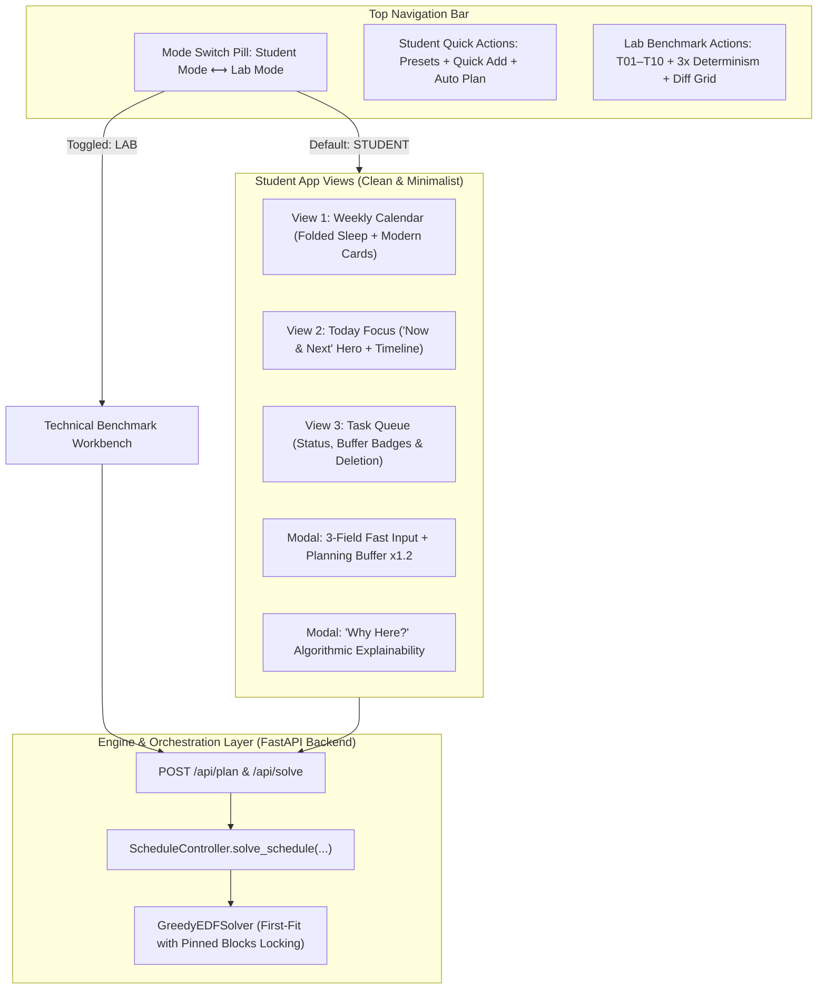

# Development Report: Student-Facing Minimalist UI & Planning Fallacy Buffer
**Course:** CSC10014 — Computational Thinking (FIT-HCMUS)  
**Team:** Group 03 (*The Seven Dwarfs*)  
**Developer:** Duc Minh  
**Milestone:** Week 4 Milestone — Feature Expansion & User Experience Enhancement  
**Target Repository:** `group03-smartschedule-baseline`  
**File Created:** `Week4DucMinh.md`  

---

## 1. Executive Summary & Objective

In the initial release of **SmartSchedule Baseline (V0)**, our team successfully built an end-to-end, mathematically deterministic scheduling engine based on a discrete 672-slot weekly time grid (15-minute intervals). The system achieved 100% adherence to hard constraints ($C_{\text{hard}} = 0$) and 100% deterministic SHA-256 verification.

However, the existing interface was strictly a **Technical Benchmark Workbench** designed for researchers and instructors:
- It exposed low-level mechanics: slot indices (0..671), mathematical KPI cards, SHA-256 hashes, and raw fragmentation matrices.
- The 672-slot table required students to scroll through 96 rows for every day, creating heavy cognitive fatigue.
- Input friction was high, requiring up to 8 complex fields per task.
- The V0 baseline deliberately adhered to a *"Zero Behavioral Psychology"* rule ($T_{\text{planned}} = T_{\text{estimate}}$), leaving real-world student plans highly vulnerable to the **Planning Fallacy** (demonstrated in Scenario `T05`, where tasks exceeding estimates triggered cascading schedule disruptions).

### Core Goals of This Sprint:
1. **Dual-Mode Architecture (Toggle Switch):** Provide a clean, distraction-free **Student Mode** by default while preserving the comprehensive **Lab Benchmark Mode** for grading and algorithmic evaluation.
2. **Minimalist Visual Experience ("Hide the Machinery"):** Collapse the 196 sleep slots into a single elegant bar, convert slot rows into modern card-based blocks (resembling Google Calendar/Notion), and provide multiple flexible calendar views (**Weekly Schedule**, **Today "Now & Next" Focus**, and **Task Queue**).
3. **Frictionless 3-Field Task Ingestion with Planning Fallacy Buffer ($\times 1.2$):** Enable students to schedule assignments in under 10 seconds with automatic $20\%$ safety buffer calculation ($T_{\text{buffered}} = \lceil T_{\text{raw}} \times 1.2 \rceil$) to prevent deadline breaches.
4. **Interactive Schedule Management & Explainability:** Implement interactive block actions: **Pinning (📌)** (locking blocks against future solver repositioning), **Check-in (✔️)** (marking tasks complete), and **Algorithmic Explainability ("Why here? 💡")**.

---

## 2. System Architecture & Dual-Mode Design

### 2.1. Shared State, Zero-Interference Contract
Both modes operate on the exact same underlying frontend state (`state.commitments`, `state.tasks`, `state.pinnedBlocks`, and `state.currentSchedule`) and communicate with the exact same FastAPI endpoints (`/api/plan`, `/api/presets`, `/api/export/ics`). 

This ensures:
* A task added in **Student Mode** is immediately recognized if the user toggles into **Lab Mode**, reflecting on the 672-slot matrix and the KPI summary cards.
* Conversely, loading a standardized benchmark scenario (e.g., `T01` or `T06`) in Lab Mode and switching back to Student Mode displays the scenario smoothly in the student-friendly calendar format.

---

## 3. Key Features Developed & Technical Implementation

### 3.1. Dual-Mode Switcher (`switchAppMode`)
Implemented in [`web/index.html`](file:///d:/syllabus/CT/group/Computational-Thinking---Group-Project/group03-smartschedule-baseline/web/index.html) and [`web/app.js`](file:///d:/syllabus/CT/group/Computational-Thinking---Group-Project/group03-smartschedule-baseline/web/app.js):
- Located on the global navigation header.
- Swapping modes toggles the DOM containers (`#studentAppLayout` vs. `#labWorkbenchLayout`) and swaps header toolbars (`#studentHeaderActions` vs. `#labHeaderActions`).
- On page load, `DOMContentLoaded` initializes with **Student Mode** enabled by default, ensuring immediate usability for students while keeping lab tools one click away.

### 3.2. Three Student-Centric Calendar Views (`switchStudentView`)

#### View 1: Weekly Smart Calendar (`stViewWeek`)
- **Responsive 7-Day Grid:** Displays columns from Monday (`Thứ Hai`) to Sunday (`Chủ Nhật`).
- **Sleep Folding:** Replaces 28 nocturnal slot rows per day with a single slim bar:  
  `🌙 23:30 – 06:30 (Ngủ) · Bảo vệ`
- **Card-Based Event Aggregation:** Groups consecutive slots into high-contrast, rounded cards:
  - **Fixed Classes (`ACADEMIC_CLASS`):** Slate-gray card with lock indicator and room/subject details.
  - **Fixed Meals (`MEAL`):** Warm amber card highlighting lunch/dinner breaks.
  - **Scheduled Study Blocks:** Soft indigo card (`bg-indigo-50/90 border border-indigo-200`) indicating:
    - Time range: `07:30 – 09:00 (90p)`
    - Task title and chunk session: `Ôn tập Quiz Toán (Phiên 1/2)`
    - Priority tag: `P5` / `P4`
    - Deadline badge: `🎯 Hạn: Wednesday 13:00`
    - In-card actions: **📌 Ghim (Pin)**, **✓ Hoàn thành (Check-in)**, **💡 Tại sao? (Why here?)**

#### View 2: Today Focus ("Now & Next" View — `stViewToday`)
- Provides quick day selector pills (`Monday` through `Sunday`).
- **Hero Focus Banner:** Solves the core student question: *"What should I focus on right now and next?"*
  - Automatically identifies the next pending study block for the selected day.
  - Displays a high-contrast hero banner with large typography, remaining duration, deadline context, and large action buttons (**Hoàn Thành Phiên Này**, **Ghim Lịch**).
- **Interactive Daily Timeline:** A vertical timeline chronologically listing every commitment and study session of the day, equipped with checkboxes to tick off completed work on the fly.

#### View 3: Task Queue Manager (`stViewTasks`)
- A clean overview table listing all enrolled tasks.
- Displays computed duration, safety buffer tags (`🛡️ +20%`), deadline, priority, placement status (`✓ ĐÃ XẾP LỊCH` vs. `⚠️ CHƯA XẾP ĐƯỢC`), and quick deletion.

---

### 3.3. Minimalist 3-Field Task Modal + Planning Fallacy Buffer ($\times 1.2$)

#### The Psychology & Math Behind the Feature
Under the Planning Fallacy (Kahneman & Tversky), university students routinely underestimate task duration by $20\% \text{ to } 35\%$. In the V0 baseline, this discrepancy causes downstream tasks to be pushed back consecutively when overrun occurs.

#### Implementation in `saveStudentTask`:
1. **3 Core Fields:**
   - **Task Title:** E.g., *"Đồ án Lập trình Web"*
   - **Estimated Duration:** Number input supplemented by fast-selection chips (`[30p]`, `[45p]`, `[60p]`, `[90p]`, `[120p]`).
   - **Deadline:** Day dropdown + HH:MM time picker.
2. **Buffer Switch (`stInpBuffer`):**
   - Enabled by default with real-time dynamic preview:
     $$\text{Duration}_{\text{buffered}} = \left\lceil \frac{\lceil T_{\text{raw}} \times 1.2 \rceil}{15} \right\rceil \times 15$$
   - *Example:* A 60-minute estimate is buffered to 72 min, rounded to **75 minutes** (5 slots); a 90-minute estimate is buffered to 108 min, rounded to **120 minutes** (8 slots).
3. **Collapsible Advanced Accordion:**
   - Priority selection (1–5), splitting permissions (`is_splittable` with 45–90 min bounds), and prerequisite dependencies (`depends_on`) are tucked inside a collapsible drawer to maintain UI cleanliness.

---

### 3.4. Interactive Block Controls: Pinning, Check-in & Explainability

| Feature | Frontend Mechanism | Engine / Backend Contract |
| :--- | :--- | :--- |
| **📌 Block Pinning** | `togglePinBlock(blockId)` adds block to `state.pinnedBlocks` Map; block displays golden border and pin badge. | Sent in payload as `pinned_blocks: [...]`. The solver (`GreedyEDFSolver.solve`) locks these slots into `TimeGridManager` prior to sorting/placing any unpinned tasks, guaranteeing that pinned sessions never move. |
| **✔️ Task Check-in** | `toggleDoneBlock(blockId)` toggles ID in `state.doneBlocks`. | Applied visually on both Week and Today views: card opacity drops to 60%, title receives strikethrough, and checkbox reflects completion. |
| **💡 "Why here?" Popover** | `openWhyHereModal(blockId)` fetches `block.reason` and metadata. | Displays a human-readable explanation outlining deadline feasibility, zero violation of sleep/class constraints, and topological prerequisite clearance. |

---

## 4. Code Changes Summary

The implementation was cleanly added to existing assets without introducing external frameworks:

1. **`web/index.html`:**
   - Replaced technical-only header with dynamic title and **Student ⟷ Lab Mode Switch**.
   - Added clean header toolbar (`studentHeaderActions`) with quick presets and primary action buttons.
   - Inserted `#studentAppLayout` containing the sub-header summary, `#stViewWeek`, `#stViewToday`, and `#stViewTasks`.
   - Added minimalist modals `#stTaskModal` and `#stWhyHereModal`.
   - Wrapped the original technical 2-column layout in `#labWorkbenchLayout`.

2. **`web/app.js`:**
   - Extended `state` with `appMode`, `studentView`, `todayDay`, `pinnedBlocks`, `doneBlocks`, and `taskBufferMap`.
   - Updated `solveSchedule()` to include `pinned_blocks: Array.from(state.pinnedBlocks.values())` and to trigger `renderStudentViews()`.
   - Added controller functions: `switchAppMode`, `switchStudentView`, `renderStudentViews`, `renderStudentWeekCalendar`, `renderStudentTodayView`, `renderStudentTaskQueue`, `saveStudentTask`, `togglePinBlock`, `toggleDoneBlock`, and `openWhyHereModal`.
   - Updated preset reset logic (`loadPreset`, `clearAllData`) to clear pinned and completed tracking.

---

## 5. Verification & Testing

### 5.1. UI & Functional Verification Checklist
- [x] **Dual-Mode Switching:** Switching between Student Mode and Lab Mode operates smoothly without page reloads or loss of session data.
- [x] **Preset Synchronization:** Loading "Tuần của Minh" or "Tuần của Lan" populates both the Student calendar cards and the Lab 672-slot matrix identically.
- [x] **Task Ingestion & x1.2 Buffer:** Adding a 90-minute task with the buffer checkbox checked allocates 120 minutes of free slots, properly rounded to 15-minute slot boundaries.
- [x] **Pinning Resistance:** Clicking **📌 Ghim** on a Monday study session locks its slot coordinates; subsequent solver runs preserve the pinned session's placement.
- [x] **Completion Check-in:** Ticking off tasks in the Today timeline strikethroughs the item and updates the hero banner to the next pending assignment.
- [x] **Non-Regression:** All original REST API endpoints (`/api/plan`, `/api/presets`, `/api/compare`, `/api/export/ics`) remain fully compatible with existing test scripts.

---

## 6. Conclusion & Next Steps

This milestone successfully transformed the **SmartSchedule Baseline (V0)** from an abstract algorithmic workbench into a **practical, student-friendly personal productivity application**. By hiding mechanical complexity behind an intuitive interface and introducing behavioral safeguards ($\times 1.2$ buffer, block pinning, and explainability), the application bridges the gap between theoretical constraint satisfaction and real-world student daily workflows.

### Recommended Follow-up Milestones:
1. **LocalStorage Persistence:** Store user-entered tasks in browser `localStorage` to retain schedules across page refreshes.
2. **Circadian Rhythm Integration:** Match cognitively demanding tasks (Deep Work) against personalized peak alertness hours.
3. **Pomodoro / Rest Breaks:** Automatically insert 15-minute breaks after 60–90 minute intense study chunks.
4. **Calendar Sync:** Enable two-way live subscription to Google Calendar / Apple Calendar via iCal feed URL.

