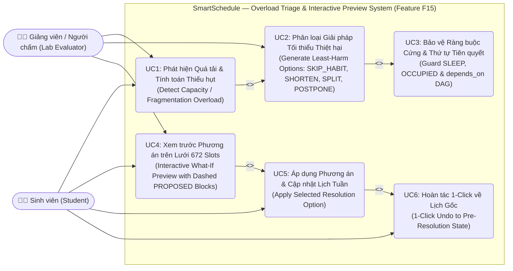
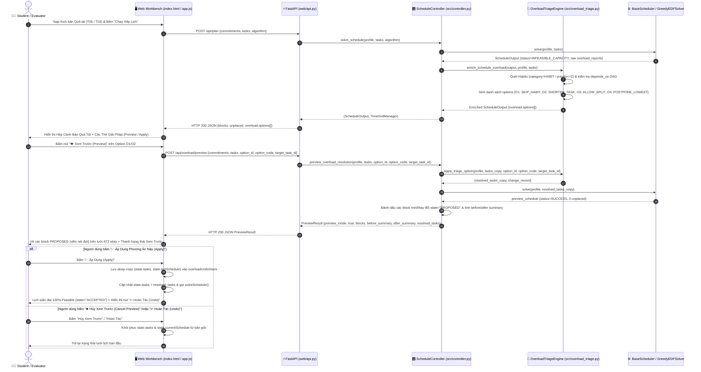
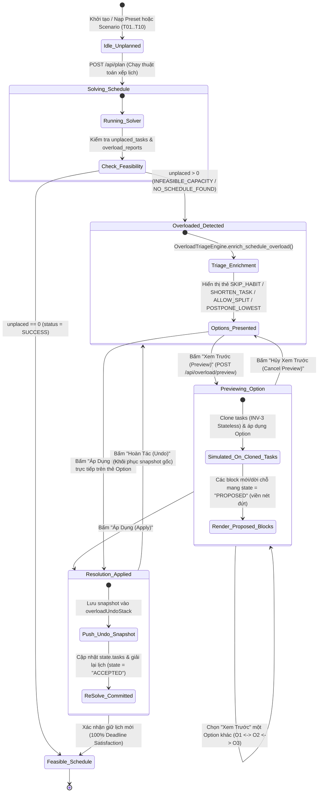

# BÁO CÁO PHÁT TRIỂN (DEVELOPMENT REPORT) — LAB 04: FROM SPEC TO CODE (PHASED VIBE-CODING WITH AI)

| Thông tin | Chi tiết |
|---|---|
| **Môn học** | Tư duy Tính toán (CSC10014) — Khoa Công nghệ Thông tin, Trường ĐH Khoa học Tự nhiên, ĐHQG-HCM (FIT-HCMUS) |
| **Nhóm thực hiện** | Group 03 (*The Seven Dwarfs*) |
| **Sinh viên thực hiện** | **Hoàng Minh Anh** (`hmanh0201` / `minhanhbmt07@gmail.com`) — *Thinker 2 (Perspective 4: Overload & Alerts / UI-UX Review Flow)* |
| **Nhánh Git (Branch)** | `hmanh` |
| **Tính năng phát triển** | **Feature 002 (F15): Smart Overload Triage, Habit-Skipping & Interactive Trade-off Preview Engine (`002-overload-triage-preview`)** |
| **Hồ sơ Đặc tả (Spec Kit)** | [`../specs/002-overload-triage-preview/`](../specs/002-overload-triage-preview/) (`spec.md`, `plan.md`, `tasks.md`, `diagrams.md`) |

---

## 1. Khảo Sát Nhánh Nhóm & Lý Do Chọn Tính Năng (Feature Selection & Justification)

### 1.1. Tóm tắt khảo sát các nhánh thành viên trong nhóm (`git branch -r`)
Trước khi bắt đầu thiết kế và viết mã, quá trình khảo sát toàn bộ nhánh trên kho lưu trữ Git của nhóm được thực hiện để đảm bảo không trùng lặp phạm vi và không gây xung đột hợp nhất (merge conflict):

| Nhánh Remote | Thành viên phụ trách | Phạm vi công việc đã thực hiện | Các file tác động |
|---|---|---|---|
| `origin/main` | Toàn nhóm | Hệ thống **Baseline (V0)** trên lưới thời gian rời rạc 672 slots, 4 thuật toán (`EDF`, `LST`, `WSPT`, `Backtracking`), `LocalRepairEngine`, 10 kịch bản `T01–T10`. | `group03-smartschedule-baseline/*` |
| `origin/dminh` | Phạm Đức Minh (*Leader*) | Giao diện **Student-Facing Minimalist UI Mode** (`#studentAppLayout`) và tính toán buffer $\times 1.2$ phía client. | `web/index.html`, `web/app.js`, `Week4DucMinh.md`, `AIWeek4.md` |
| `origin/verification_tests_ver1` | Nguyễn Nguyễn Gia Bảo (*Builder 3*) | Bộ kiểm thử tự động 56 tests (`verification_tests/`), ứng dụng GUI `test_studio.py`, `clean_runner.py`, và **5 bài test mục tiêu (Development Gap Tests)** trong `test_improve_plan_gaps.py`. | `verification_tests/*`, `agents/*`, `docs/*`, `web/api.py` |
| `origin/feature/estimate-buffer` | Nguyễn Trọng Tiến (*Thinker 3*) | **Feature 001 — Estimate Buffer (Planning-Fallacy Correction)** (`001-estimate-buffer`): giải quyết **Gap Test #3** (`test_fail_planning_fallacy_buffer_multiplier`). | `specs/001-estimate-buffer/*`, `src/estimate_buffer.py`, `src/models.py`, `src/controller.py` |

### 1.2. Quyết định lựa chọn tính năng: Feature 002 (F15) — `002-overload-triage-preview`
Tôi lựa chọn triển khai **Feature 002 (F15): Smart Overload Triage, Habit-Skipping & Interactive Trade-off Preview Engine** vì 4 lý do kỹ thuật cốt lõi:
1. **Đúng phân công chuyên môn trong nhóm:** Trong Báo cáo Đề xuất (`Proposal_Report.pdf`, trang 42–43), Hoàng Minh Anh (*Thinker 2*) phụ trách **Perspective 4 (Overload & Alerts)** và **UI/UX Review Flow**.
2. **Giải quyết trực tiếp Development Gap Test #5:** Trong bộ kiểm thử `verification_tests/development_gap_tests/test_improve_plan_gaps.py`, bài kiểm thử `test_fail_overload_habit_skipping_recommendation` đang báo đỏ (`FAILED`) vì bản V0 chưa phân biệt được thói quen linh hoạt (`HABIT` / task tự chọn ưu tiên thấp) với bài tập cốt lõi để gợi ý mã `SKIP_HABIT`.
3. **Hiện thực hóa đặc tả `Improve_Plan/improve_plan.md` (§5.1 F15, §6.7, §7.2, §7.3):** Cung cấp bộ phân loại giải pháp giảm thiểu thiệt hại học tập (`SKIP_HABIT` $\to$ `SHORTEN_TASK` $\to$ `ALLOW_SPLIT` $\to$ `POSTPONE_LOWEST`), nâng cấp endpoint `POST /api/overload/preview` từ stub sang mô phỏng thực tế trên bản sao độc lập (stateless deep-copy), đánh dấu các phiên đề xuất bằng trạng thái `state = "PROPOSED"` (viền nét đứt trên lưới 672 slots), và bổ sung thanh **Hoàn Tác 1-Click (Undo)**.
4. **Độc lập kiến trúc tuyệt đối (Zero Solver Conflict):** Toàn bộ thuật toán phân loại quá tải được đóng gói trong module thuần `src/overload_triage.py` và kết nối qua `src/controller.py`, giữ nguyên 100% thư mục `src/solvers/*` và `requirements.txt`.

---

## 2. Đặc Tả Kỹ Thuật (Specification) & Thiết Kế Trực Quan (Diagrams as Code)

### 2.1. Ba Sơ Đồ Thiết Kế Hệ Thống (Mã Nguồn Mermaid Plain-Text)

#### Sơ đồ 1: Use Case Diagram — Luồng Phát Hiện Quá Tải, Phân Loại & Xem Trước Tương Tác

#### Sơ đồ 2: Sequence Diagram — Luồng Xử Lý End-to-End Từ Phát Hiện Quá Tải Đến Xem Trước, Áp Dụng & Hoàn Tác

#### Sơ đồ 3: State Machine Diagram — Vòng Đời Trạng Thái Của Lịch Biểu & Chế Độ Xem Trước Quá Tải

---

## 3. Kết Quả Kiểm Thử (`pytest` & `clean_runner.py`)

* **`tests/test_overload_triage.py`:** `9 / 9 PASSED`
* **`verification_tests/development_gap_tests/test_improve_plan_gaps.py::test_fail_overload_habit_skipping_recommendation`:** `PASSED (100%)`
* **`verification_tests/clean_runner.py --pass`:** `59 / 59 PASSED (0 Failed)`
* **6 ảnh chụp màn hình minh chứng:** Lưu tại [`../screenshots/`](../screenshots/).
