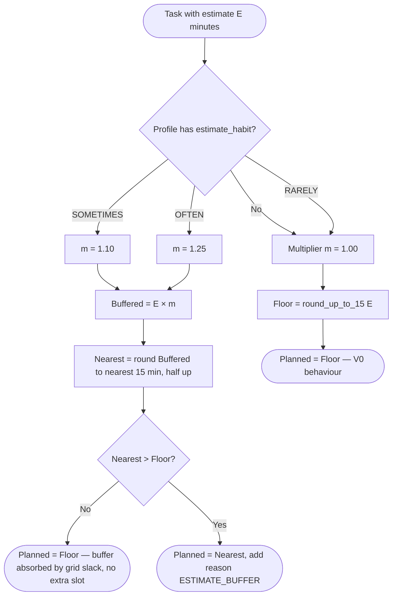
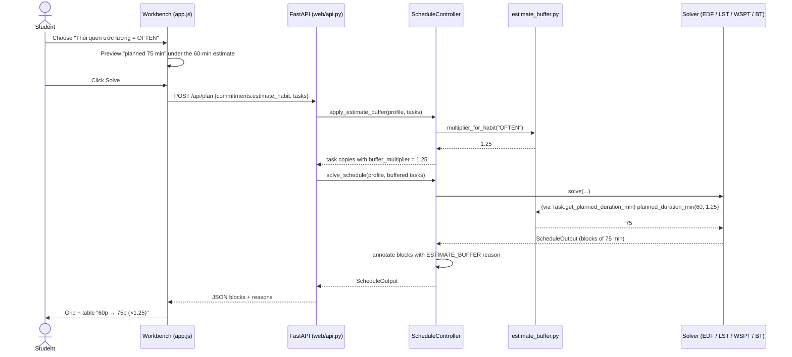
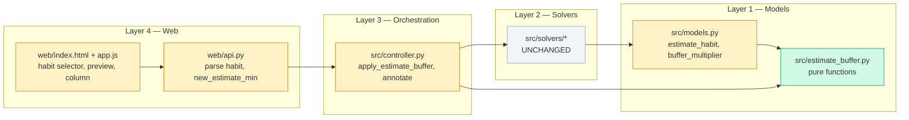

# Feature 001 — Design Diagrams (Mermaid)

## 1. Activity diagram — computing the planned duration

Worked values for OFTEN (×1.25):

| Estimate | ×1.25 | Naive round-up | **This rule** | V0 |
|---:|---:|---:|---:|---:|
| 5 | 6.25 | 15 | **15** | 15 |
| 10 | 12.5 | 15 | **15** | 15 |
| 15 | 18.75 | 30 | **15** | 15 |
| 25 | 31.25 | 45 | **30** | 30 |
| 45 | 56.25 | 60 | **60** | 45 |
| 60 | 75 | 75 | **75** | 60 |
| 90 | 112.5 | 120 | **120** | 90 |

## 2. Sequence diagram — planning a week with the buffer

## 3. Component diagram — what changed (and what did not)

