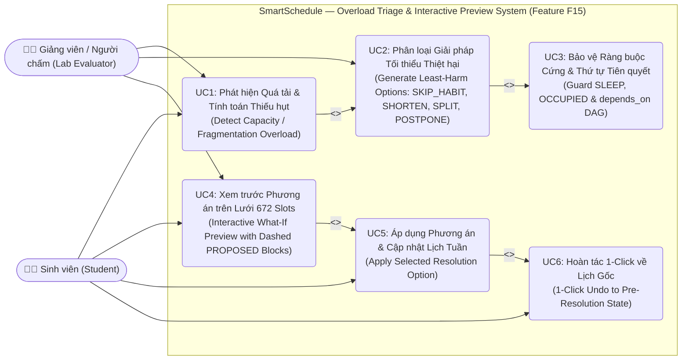
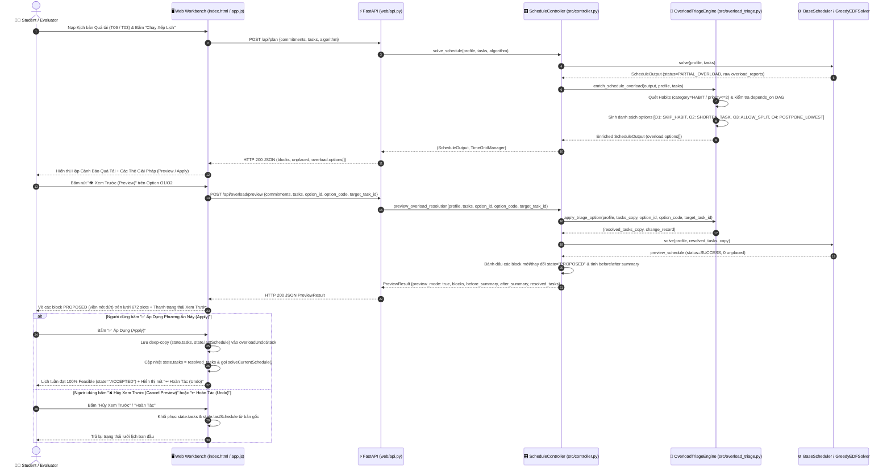
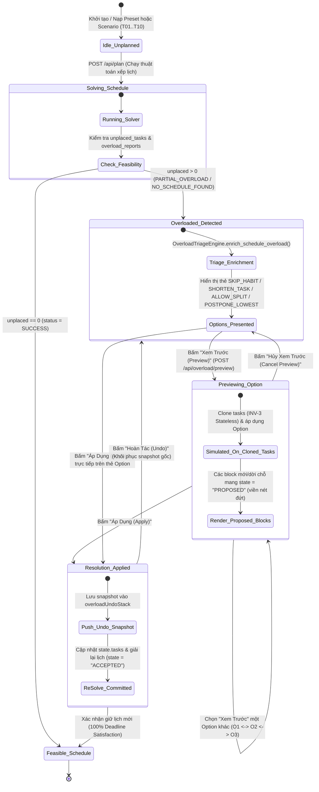

# Feature 002 — Visual Design Diagrams (Diagrams as Code — Mermaid)

This document contains the plain-text **Mermaid** source code for the 3 visual design diagrams of **Feature 002 (F15): Smart Overload Triage, Habit-Skipping & Interactive Trade-off Preview Engine (`002-overload-triage-preview`)**.

---

## 1. Use Case Diagram — Overload Detection, Triage & Interactive Resolution Flow

---

## 2. Sequence Diagram — End-to-End Overload Triage, What-If Preview, Apply & Undo

---

## 3. State Machine Diagram — Schedule & Overload Resolution Lifecycle

