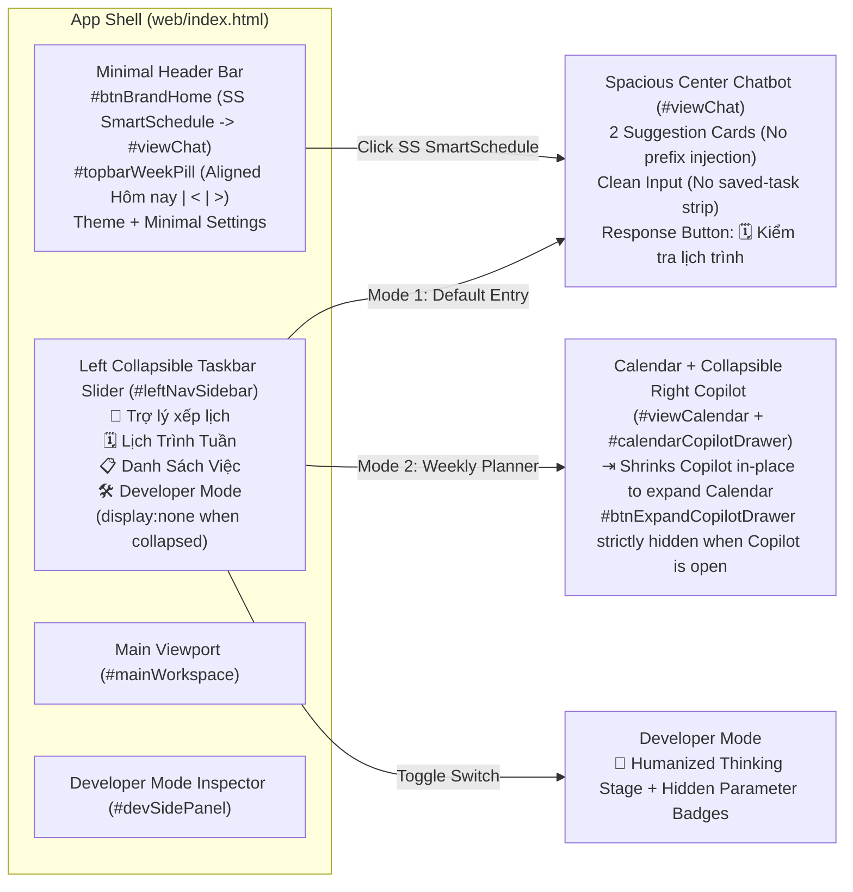
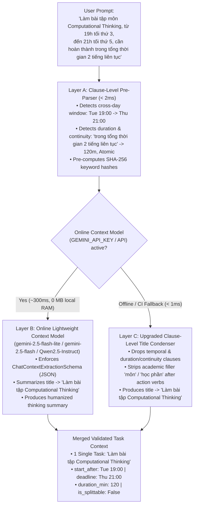

# SmartSchedule UI/UX Chat-First Rebuild — Complete Agent Execution Pipeline (Merged Master Plan)

**Branch:** `v1.0-alpha/ui-ux-chat`  
**Target Directory:** `group03-smartschedule-baseline/`  
**Document Purpose:** Complete, end-to-end engineering blueprint for AI coding agents merging the foundational Chat-First UI/UX architecture (Spacious Empty Chat Entry, Collapsible Left Taskbar, Synchronized Right Calendar Copilot, SHA-256 Task Traceability, Multi-Turn Clarification, Remaining-Time Habit Buffering, and Deadlock/Dense-Schedule Edge Cases) with all Revision 2–4 refinements (Ultra-Minimal UI rules, Calendar `"Hôm nay"` & `"💬 Mở trợ lý"` fixes, the **Merged Hybrid Clause Parser + Efficient Online Context-Parsing Model Upgrade**, and the Antigravity-style **Developer Mode Thinking Stage**).

---

## 1. Architectural Guardrails & Non-Negotiable Constraints

Before modifying any file, the executing agent **MUST** enforce these project-wide constraints from `agents/commit_changes.md` and `agents/progress/system_architecture.md`:

1. **Strict Layer Isolation (`INV-1` to `INV-6`) & Memory Budget (`< 350 KB`):**
   - **Layer 1 (`src/models.py`, `src/utils.py`, `src/estimate_buffer.py`, `src/calibration.py`, `src/storage.py`, `src/task_tracer.py`):** Pure data models, mathematical helpers, stdlib SQLite storage, and deterministic SHA-256 keyword fingerprinting. Never import `web`, `fastapi`, `src/solvers`, or `src/controller`.
   - **Layer 2 (`src/solvers/*`):** Stateless scheduling solvers (`EDF`, `LST`, `WSPT`, `SCORED_GREEDY`, `BACKTRACK`, `HYBRID_ALNS`, `local_repair.py`). **Zero modifications to solver algorithms.**
   - **Layer 3 (`src/controller.py`, `src/overload_triage.py`):** Pure domain orchestration.
   - **Layer 4 (`web/api.py`, `web/chat_service.py`, `src/nl_parser.py`, `web/index.html`, `web/app.js`, `web/js/*.js`, `web/css/*.css`):** All conversational state management, online/hybrid context-parsing model calls, intent routing, and UI layout changes live in Layer 4.
   - **Memory Guardrail (`test_memory_leaks.py`):** Any context-parsing model client or NLP library MUST execute via zero-RAM online API (`google-genai` / `httpx`) or lazy-loaded in Layer 4 so solver loop heap growth remains strictly `< 350 KB`.
   - **Dependency Sync Rule (`agents/commit_changes.md` Rule #5):** Whenever any dependency is added or updated in `group03-smartschedule-baseline/requirements.txt`, simultaneously update both `agents/requirements.md` and `docs/requirements.md`.
2. **Performance SLA (`< 10 Seconds` End-to-End, `< 1 Second` Solver Execution):**
   - Every conversational schedule creation, task adjustment, or deadline re-estimation **must complete and render in `< 10,000 ms` end-to-end** (`~220–550 ms` with online lightweight flash/instruct model; `< 50 ms` local hybrid + solver execution).
   - Prioritize **nearest-deadline tasks (`deadline_slot` ascending)** and **tasks completable within the active week (`horizon_days = 7`)**.
3. **Existing Test Contract Preservation:**
   - Never delete contracted DOM IDs (`#viewCalendar`, `#viewList`, `#viewWeights`, `#viewBenchmark`, `#viewShowcase`, `#inputModal`, `#devSidePanel`, `#stFocusTimerPanel`, `#stHealthV21Panel`, `#chkSettingEnergy`, `#btnOpenDisruption`). Hide deprecated user controls with `class="sr-only" hidden` so all `194/194` tests in `clean_runner.py --pass` and `39/39` in `v1.0-alpha-plan/Testing_System/tests` remain 100% green.

---

## 2. Target Ultra-Minimal UI/UX Topology & Layout Refinements



### 2.1. Topbar Brand Home Link & Minimal Settings Menu
- **Clickable Brand Logo (`#btnBrandHome`):** Clicking **`SS SmartSchedule`** in the top-left header always transitions back to **`Trợ lý xếp lịch`** (`#viewChat`).
- **Settings Menu (`#settingsPopover`) Cleanup:**
  - Remove `"Nền năng lượng sinh học"` (since circadian energy is a hidden criterion managed automatically by the solver) and remove `"Tiện ích nhanh"` (`"Báo sự cố đột xuất & Sửa lịch"`, since urgent adjustments are handled in the chat).
  - Keep `#chkSettingEnergy` and `#btnOpenDisruption` as `class="sr-only" hidden` for test backward-compatibility.

### 2.2. Default Entry Point: Spacious Empty Chat Workspace (`#viewChat`)
- On application launch (`/`), the user lands directly on `#viewChat` — an Antigravity-inspired spacious conversational workspace with zero developer clutter.
- **Proactive AI Suggestion Cards (No Forced Prefix Injection):**
  - Presents two primary intent cards:
    1. **🔁 Thêm / Đổi lịch lặp hằng ngày** (*Classes, meals, sleep, daily/weekly routines*).
    2. **📌 Thêm / Chỉnh 1 công việc riêng biệt** (*Assignments, exam prep, projects with start–end times or deadlines*).
  - Clicking either card sets `state.chatModeHint` (shown in the mode badge above the composer) and updates the textarea `placeholder`, **without** inserting any text prefix (`"Thêm công việc: "`) into the textarea.
- **Ultra-Clean Composer & Single Schedule Action Button:**
  - Omit the `"Chỉnh nhanh việc đã lưu:"` pill strip above the input box.
  - Every assistant response renders a single primary post-action button: **`🗓️ Kiểm tra lịch trình`** (switching to `#viewCalendar`), omitting cluttered secondary buttons (`"Chỉnh độ nặng / nhẹ công việc"`, etc.).

### 2.3. Left Vertical Collapsible Taskbar Slider (`#leftNavSidebar`)
- **Navigation Items:**
  1. **💬 Trợ lý xếp lịch** (`#navBtnChat`, default active): Switches to `#viewChat`.
  2. **🗓️ Lịch Trình Tuần** (`#navBtnCalendar`): Switches to `#viewCalendar`.
  3. **📋 Danh Sách Việc** (`#navBtnList`): Switches to `#viewList`.
  4. **🛠️ Developer Mode Toggle** (`#chkDeveloperMode`) in the sidebar footer.
- **Complete Collapse Behavior & Removal of `"Chuyển nhanh tuần"`:**
  - Remove the `"Chuyển nhanh tuần"` section from `#leftNavSidebar` (week navigation lives in `#topbarWeekPill` inside Calendar view).
  - When `#leftNavSidebar` is closed via `#btnToggleLeftSidebar`, apply `.left-nav-sidebar.collapsed { display: none !important; }` so the entire left taskbar and the bottom Developer Mode box disappear completely without any misaligned elements remaining visible.

### 2.4. Calendar View Fixes: `"Hôm nay"` Alignment & Collapsible Right Copilot (`"Trợ lý tinh chỉnh trực tiếp"`)
1. **Fix 1 — `"Hôm nay"` Box Alignment in Calendar Grid & Topbar:**
   - **7-Day Grid Header (`.cal-day-head` in `web/js/render-calendar.js`):** Today is already visually marked by the filled green date circle (`.cal-day-head.is-today .cal-date-circle`) and accented weekday label (`T2`). In multi-day views (`visibleCount >= 5`), omit the redundant `<span class="badge badge-info">Hôm nay</span>` and `<span class="cal-day-sub">Đã qua</span>` boxes from `.cal-day-title-row` so all 7 day headers align on a single clean row without wrapping.
   - **Topbar Week Pill (`#topbarWeekPill`):** Enforce `display: inline-flex; align-items: center; gap: 4px; height: 36px;` on `.week-pill` and uniform `height: 28px; display: inline-flex; align-items: center; white-space: nowrap; line-height: 1;` on `#btnWeekToday`, `#btnWeekPrev`, `#btnWeekNext`, and `#txtWeekRange`.
2. **Fix 2 — Collapsible Right Copilot & `"💬 Mở trợ lý"` (`#btnExpandCopilotDrawer`) Visibility:**
   - Clicking the arrow button (`#btnToggleCopilotDrawer`, `⇥`) in the header of `"Trợ lý tinh chỉnh trực tiếp"` collapses `#calendarCopilotDrawer` in-place (`.calendar-with-copilot-layout.copilot-collapsed { grid-template-columns: minmax(0, 1fr); }`) so the weekly schedule expands to 100% width instead of jumping back to `#viewChat`.
   - Because `.btn` in `web/css/tokens.css` sets `display: inline-flex`, explicitly enforce:
     ```css
     .copilot-expand-fab[hidden],
     .calendar-with-copilot-layout:not(.copilot-collapsed) .copilot-expand-fab {
       display: none !important;
     }
     .calendar-with-copilot-layout.copilot-collapsed .copilot-expand-fab {
       display: inline-flex !important;
     }
     ```
     so `"💬 Mở trợ lý"` is **strictly hidden** whenever the right AI copilot is already open, and only appears when the copilot drawer is collapsed.

---

## 3. Merged Hybrid Context-Parsing Architecture (Two-Layer Clause Parser + Efficient Online Context-Parsing Model Upgrade)

### 3.1. Merging Our Two-Layer Context Parser with Efficient Online / Importable Context Models
To guarantee both **human-grade task title summarization** (e.g., distilling `"Làm bài tập môn Computational Thinking, từ 19h tối thứ 3, đến 21h tối thứ 5, cần hoàn thành trong tổng thời gian 2 tiếng liên tục"` into **`"Làm bài tập Computational Thinking"`**) and **instant, zero-failure reliability**, we merge our previous **Two-Layer Clause & Regex Decomposer** with an **Efficient Online / Lightweight Context-Parsing Model Layer**:

| Pipeline Layer | Engine / Model | Latency (Performance) | Local RAM (Memory) | Cost Profile | Role in Merged Architecture |
| :--- | :--- | :---: | :---: | :--- | :--- |
| **Layer A: Pre-Parser & Clause Decomposer** *(Previous Work Upgraded)* | **Deterministic Clause & Cross-Day Window Decomposer** (`web/chat_service.py`) | **`< 2 ms`** | **`~0 MB`** | **`$0.00`** | Splits sentence clauses on commas, pre-extracts cross-day windows (`Tue 19:00 -> Thu 21:00`), duration (`120m`), continuity (`liên tục` $\to$ `is_splittable=False`), and SHA-256 keyword hashes. |
| **Layer B1: Primary Online Context Model** *(New Upgrade)* | **`gemini-2.5-flash-lite`** / **`gemini-2.5-flash`** via `google-genai` (`GEMINI_API_KEY`, `thinking_budget=0`, `response_schema`) | **`220 – 550 ms`** | **`0 MB`** (Cloud HTTPS, already in `requirements.txt`) | **Free Tier** (`1,500 req/day`) or `$0.075 / 1M tokens` | Refines the decomposed clauses into a crisp 3–7 word task title (`"Làm bài tập Computational Thinking"`), verifies single-task intent, and generates the Developer Mode thinking summary. |
| **Layer B2: Alternative Online / Importable Lightweight NLP** *(Optional Drop-In)* | **Online Open-Weights** (`Qwen2.5-7B-Instruct` / `Llama-3.1-8B-Instant` via `httpx`) OR **Local Lightweight Vietnamese Chunker** (`underthesea` / quantized `gliner-onnx` `< 60 MB`) | **`120 – 350 ms`** (Online) / **`< 15 ms`** (Local) | **`0 MB`** (Online) / **`< 60 MB`** (Lazy Layer 4) | **Free Tier / `$0.00` Local** | Plug-and-play provider when `CONTEXT_MODEL_URL` / `GROQ_API_KEY` or local lightweight NLP package is enabled. |
| **Layer C: Vietnamese Subject Title Condenser** *(Offline Safety Net)* | **Syntactic Clause Condenser** (`_clean_conversational_title`) | **`< 1 ms`** | **`0 MB`** | **`$0.00`** | Strips temporal/duration clauses (`"cần hoàn thành trong tổng thời gian 2 tiếng liên tục"`) and filler classifiers (`"môn"`, `"học phần"`) so offline runs produce the exact same **`"Làm bài tập Computational Thinking"`** title. |



### 3.2. Structured Output Schema for Online Model & Hybrid Condenser (`ChatContextExtractionSchema`)
```python
class ChatContextExtractionSchema(BaseModel):
    intent: Literal["ADD_TASK", "ADD_RECURRING", "MODIFY_HIDDEN", "ADJUST_DEADLINE"] = "ADD_TASK"
    is_single_task: bool = Field(
        default=True,
        description="True when the prompt describes 1 task with a start bound, deadline bound, and duration.",
    )
    concise_title: str = Field(
        description=(
            "Concise 3-7 word Vietnamese/English task title stripped of all time bounds, durations, "
            "and filler classifiers like 'môn', 'học phần', 'cần hoàn thành trong tổng thời gian'. "
            "Example: 'Làm bài tập Computational Thinking'."
        )
    )
    start_after_day: Optional[str] = None
    start_after_time: Optional[str] = None
    deadline_day: Optional[str] = None
    deadline_time: Optional[str] = None
    duration_min: Optional[int] = None
    is_splittable: Optional[bool] = None
    cognitive_load: Optional[int] = Field(default=None, ge=1, le=3)
    preferred_window: Optional[Literal["MORNING", "AFTERNOON", "EVENING", "ANYTIME"]] = None
    human_thinking_summary_vi: str = ""
```

### 3.3. Multi-Turn Missing-Information Clarification State Machine
Every schedule item or task requires:
1. **Content / Title** (what needs to be done)
2. **Time Bounds** (Start Time & End Time for recurring schedules, OR Start Window / Deadline + Estimated Duration for tasks)

When a user prompt omits any required field (e.g., *"Mình cần ôn thi Đại số tuyến tính"* or *"Thêm lịch tập gym hằng ngày"*):
1. The service stores `pending_draft` in `state.pendingChatDraft`.
2. It returns `status = "NEEDS_CLARIFICATION"`, `missing_fields`, a natural Vietnamese follow-up question asking **only** for the missing field(s), and 1-click `quick_chips` (`[⏱ 60 phút]`, `[⏱ 90 phút]`, `[⏱ 120 phút]`, `[📅 Thứ Sáu 21:00]`, `[🕕 18:00 - 19:00]`).
3. On the next message or chip click, the slots merge into `pending_draft` and immediately solve the schedule.

---

## 4. SHA-256 Keyword Embedding & Hidden Parameter Tuning

### 4.1. Deterministic SHA-256 Task Traceability (`src/task_tracer.py` — Layer 1 Pure Stdlib)
When a user asks to adjust an existing task's hidden behavior (e.g., *"Bài tập Giải tích nặng quá, chia nhỏ ra nhiều buổi và xếp vào buổi sáng giúp mình"*):
1. **Canonical Keyword Extraction:** Normalize text (lowercase, strip accents, strip stop-words, temporal markers, and modifier cues).
2. **SHA-256 Task Fingerprint & Keyword Index:**
   - Every task stores `trace_hash = SHA256(canonical_keywords(title) + "|" + category)` and `keyword_hashes` (8-char SHA-256 digests of each root keyword and bigram).
3. **Prompt-to-Task Resolution (`resolve_target_task_from_prompt`):**
   - Computes SHA-256 keyword overlap against `state.tasks` (with a strict `>= 0.45` confidence floor so new task prompts never false-match preset tasks).
   - Also Avoids false-matching Vietnamese `"tới 21h"` (`"toi"`) as `"buổi tối"` (`EVENING`) by requiring explicit time-of-day context (`"buổi tối"`, `"ban đêm"`, `"lúc tối"`).

### 4.2. Natural Language to Hidden Criteria Mapping Matrix
| User Natural Language Intent / Keywords | Hidden Parameter(s) Mutated | Effect on Solver (`SCORED_GREEDY` / `HYBRID_ALNS`) |
| :--- | :--- | :--- |
| **Heavy / Hard / Deep Focus** (*"nặng quá"*, *"khó"*, *"tập trung sâu"*) | `cognitive_load = 3`<br>`buffer_multiplier = 1.35`<br>`preferred_window = profile.focus_preference` | Allocates $+35\%$ fallacy buffer, enforces rest break, aligns with Peak Circadian slots (`E3`), caps daily heavy sessions. |
| **Light / Easy / Chill** (*"nhẹ nhàng"*, *"đơn giản"*) | `cognitive_load = 1`<br>`buffer_multiplier = 1.20`<br>`preferred_window = "ANYTIME"` | Places into lower-energy slots (`E1/E2`), saving peak windows for heavy tasks. |
| **Splittable / Multi-Session** (*"chia nhỏ ra"*, *"làm nhiều buổi"*) | `is_splittable = True`<br>`work_rhythm = "LIGHT"` (`30–45m`) or `"BALANCED"` (`45–90m`) | Splits task across manageable sessions with lower fatigue penalty. |
| **Continuous / Atomic Single Block** (*"liên tục"*, *"liền 1 mạch"*, *"không thể chia nhỏ"*) | `is_splittable = False`<br>`min_chunk_min = duration_min`<br>`work_rhythm = "FLOW"` | Forces atomic contiguous slot placement (`1` unbroken block). |
| **Circadian Window Preference** (*"buổi sáng"*, *"buổi chiều"*, *"buổi tối"*) | `preferred_window = "MORNING" \| "AFTERNOON" \| "EVENING"` | Shifts block placement affinity to the requested circadian window. |

---

## 5. Deadline Adjustment & Remaining-Time / Habit Buffer Engine (Requirement 3)

When a user shifts a deadline and states (or asks to estimate) the remaining time needed (e.g., *"Đổi deadline Đồ án Mạng máy tính sang Chủ nhật lúc 20:00, mình ước lượng cần làm tiếp 90 phút"*):
1. **Remaining Raw Work ($T_{\text{rem\_raw}}$):** Uses the user's stated remaining minutes (or subtracts completed M7 check-in minutes from the task's original duration).
2. **Habit & Efficiency Buffer Multiplier ($\alpha_{\text{eff}}$):**
   $$\alpha_{\text{eff}} = \text{clip}\Big(\max\big(\alpha_{\text{load}}, \; \text{multiplier}(H_{\text{habit}}), \; \text{EWMA}_{\text{M7}} \times \text{pace\_factor}\big), \; 1.00, \; 1.60\Big)$$
3. **Buffered Remaining Duration ($T_{\text{rem\_planned}}$):**
   $$T_{\text{rem\_planned}} = \text{round\_up\_to\_15}\big(T_{\text{rem\_raw}} \times \alpha_{\text{eff}}\big)$$
4. The assistant updates the task's deadline and buffered remaining duration, re-solves the schedule in `< 1s`, and shows a clear breakdown box (`⏳ Tính lại thời gian theo thói quen`) in the chat bubble.

---

## 6. Calendar View & Docked Right AI Copilot Synchronization + Edge Cases (Requirement 2)

### 6.1. Live Calendar Transitions & Finalization Notification
- `#viewCalendar` pairs the clean weekly schedule (`#calendarMainStage`) with the collapsible right-hand copilot (`#calendarCopilotDrawer`, `"Trợ lý tinh chỉnh trực tiếp"`), sharing the exact same conversation transcript (`state.chatMessages`).
- When a prompt is sent in the right copilot:
  1. `computeScheduleDiff(prevBlocks, nextBlocks)` identifies newly added blocks (`.cal-block-enter` emerald pulse animation) and moved blocks (`.cal-block-moved` smooth slide animation).
  2. Both the calendar banner (`#calendarFinalizedBanner`) and the copilot chat bubble display the explicit finalization status: **`✅ Đã hoàn tất và chốt lịch trình mới!`**.

### 6.2. Edge Cases Handling
1. **Edge Case A — Deadlocked Schedule / Overlapping Deadlines (`DEADLOCK`):**
   - Triggered when `unplaced_tasks` remain due to overlapping deadlines or insufficient free slots before the deadline.
   - Displays a soft red alert card (`🚨 Lịch bị kẹt / Trùng hạn chót`) in the chatbot and calendar banner with 1-click relief buttons powered by `OverloadTriageEngine` (`O1–O4`: skip non-urgent habit this week, trim buffer on light tasks, or postpone lowest-priority task).
2. **Edge Case B — Overly Dense Schedule (`DENSE_WARNING` — Yellow Warning):**
   - Triggered when all tasks are placed (`unplaced_tasks == 0`), but any day reaches $\ge 420\text{ min}$ (`7 hours`) of combined classes + study or uses crunch tiers.
   - Displays a **yellow warning card (`⚠️ Cảnh báo lịch trình dày đặc`)** in the chatbot and an amber indicator on the dense day column, offering 1-click suggestions to spread sessions across lighter days or split long blocks into 45-minute chunks.

---

## 7. Developer Mode: Antigravity-Style Summarized & Humanized "Thinking Stage"

When **Developer Mode** (`#chkDeveloperMode`) is toggled **ON**:
Every assistant response renders a collapsible, humanized **Thinking Stage (`💭 Quá trình suy nghĩ & chọn thuật toán`)** card at the top of the message bubble, alongside the per-task hidden-parameter badge:

1. **🧠 Bước 1 — Đọc ngữ cảnh & tiêu chí ẩn (Context Model & Title Synthesis):**
   - Summarizes how the Merged Hybrid + Online Context Model distilled the prompt into a clean task title (`"Làm bài tập Computational Thinking"`), time window (`19:00 Thứ Ba → 21:00 Thứ Năm`), raw vs. fallacy-buffered duration (`120p → 150p`), and atomic/splittable mode (`Giữ liền 1 khối liên tục`).
2. **⚡ Bước 2 — Sàng lọc tập thuật toán tối ưu (Dominant Algorithm Subset Selection):**
   - Explains in natural Vietnamese why the bot prunes inferior algorithms and selects from the dominant subset:
     - **Pruned Subset (`EDF`, `WSPT`, `LST`):** Pruned because they are strictly energy-blind — benchmark evaluation proves their best-case circadian/ergonomic alignment is worse than the worst case of circadian-aware solvers.
     - **Active Dominant Subset (`SCORED_GREEDY`, `HYBRID_ALNS`):** Defaults to `SCORED_GREEDY` for instant circadian + hyperbolic deadline placement (`~10–35 ms`), and automatically escalates to `HYBRID_ALNS` (adaptive large neighborhood ruin-and-recreate) when high density or tight cross-day windows require deeper packing.
3. **🎯 Bước 3 — Kết quả thực thi & thông số ẩn (Execution Outcome & Hidden Badge):**
   - Shows placed slot summary, solver execution time (`ms`), and the task's `SHA-256` trace hash, `Circadian Window`, `Cognitive Load`, `Fallacy Buffer`, and `Atomic/Split` status.

---

## 8. File Modification Manifest (To Execute Upon User Approval)

1. **`group03-smartschedule-baseline/web/chat_service.py` & `src/nl_parser.py`:**
   - Merge Layer A (`_extract_cross_day_window`, `_extract_duration_and_continuity`), Layer B (`_parse_context_with_online_model` via `google-genai` `gemini-2.5-flash-lite` / `gemini-2.5-flash` + optional OpenAI-compatible `httpx` endpoint), and Layer C (clause-based `_clean_conversational_title` stripping duration clauses and filler classifiers like `"môn"`).
   - Ensure `"Làm bài tập môn Computational Thinking, từ 19h tối thứ 3, đến 21h tối thứ 5, cần hoàn thành trong tổng thời gian 2 tiếng liên tục"` deterministically yields `title="Làm bài tập Computational Thinking"`, `start_after="2026-11-03T19:00:00+07:00"`, `deadline_day="Thursday"`, `deadline_time="21:00"`, `duration_min=120`, `is_splittable=False`.
   - Enrich `_build_thinking_summary` with context model attribution, title condensation summary, and dominant algorithm subset pruning explanation.
2. **`group03-smartschedule-baseline/web/js/render-calendar.js` & `web/css/app.css`:**
   - Fix `"Hôm nay"` misalignment in `.cal-day-head` (omit redundant text badge in 7-day view where the green circle already marks Today, and align `#topbarWeekPill`).
   - Fix `#btnExpandCopilotDrawer` (`"💬 Mở trợ lý"`) visibility by enforcing `.copilot-expand-fab[hidden], .calendar-with-copilot-layout:not(.copilot-collapsed) .copilot-expand-fab { display: none !important; }`.
3. **`group03-smartschedule-baseline/verification_tests/logical_tests/test_chat_first_ui_and_task_tracer.py`:**
   - Add regression tests for the exact prompt `"Làm bài tập môn Computational Thinking, từ 19h tối thứ 3, đến 21h tối thứ 5, cần hoàn thành trong tổng thời gian 2 tiếng liên tục"` (`title == "Làm bài tập Computational Thinking"`, `duration_min == 120`, `is_splittable is False`) and UI alignment/visibility rules.
