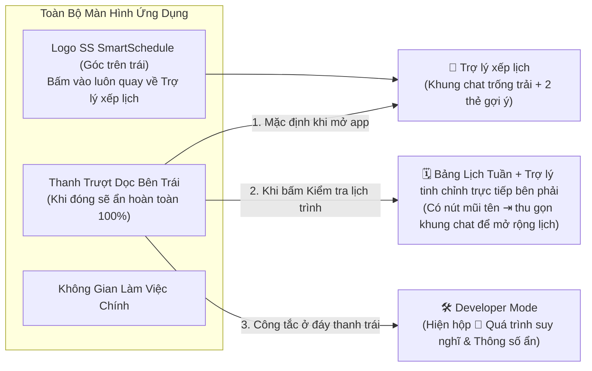

# Kế Hoạch Tổng Thể Thiết Kế Lại Giao Diện & Trí Tuệ Trợ Lý SmartSchedule (Bản Đầy Đủ Hợp Nhất — Ngắn Gọn, Dễ Hiểu)

**Nhánh phát triển (Branch):** `v1.0-alpha/ui-ux-chat`  
**Mục tiêu cốt lõi:** Xóa bỏ hoàn toàn cảm giác "phần mềm kỹ thuật rối rắm", biến ứng dụng thành một **người trợ lý xếp lịch thông minh, tối giản tuyệt đối và thân thiện với mọi người dùng** — đồng thời kết hợp **bộ phân tích 2 lớp sẵn có với mô hình AI đọc ngữ cảnh online siêu nhẹ (nhanh, tiết kiệm chi phí, không tốn RAM)** và chế độ **Developer Mode có Hộp Suy Nghĩ (Thinking Stage)** cô đọng như Antigravity.

---

## 1. Bức Tranh Tổng Thể: Giao Diện Tối Giản Nhìn Sẽ Như Thế Nào?

Khi vừa mở ứng dụng lên, bạn sẽ thấy **một không gian trò chuyện thoáng đãng, sạch sẽ và dịu mắt** (giống giao diện của Antigravity), đi kèm **thanh điều hướng dọc bên trái** có thể bật/tắt gọn gàng.

### Các Tinh Chỉnh Giúp Giao Diện Tối Giản Tuyệt Đối
1. **Logo `SS SmartSchedule` là nút quay về trang chủ:** Bất cứ lúc nào đang xem lịch mà muốn quay lại khung chat lớn, bạn chỉ cần bấm vào chữ **`SS SmartSchedule`** ở góc trên bên trái.
2. **Thanh trượt dọc bên trái (`Trợ lý xếp lịch` / `Lịch Trình Tuần` / `Danh Sách Việc`):**
   - Đổi tên *"Khung Chatbot"* thành **`"Trợ lý xếp lịch"`** thân thiện hơn.
   - Đã xóa bỏ mục *"Chuyển nhanh tuần"* ở thanh bên trái để không làm rối mắt.
   - Khi bạn bấm đóng thanh trượt trái, **toàn bộ thanh trượt và cả hộp Developer Mode ở dưới đáy sẽ biến mất hoàn toàn**, không còn bất kỳ khung viền nào bị lệch.
3. **Nút Cài đặt (⚙️ góc trên bên phải) gọn nhẹ:**
   - Đã lược bỏ dòng *"Nền năng lượng sinh học"* (vì đây là tiêu chí ngầm trợ lý tự lo cho bạn) và bỏ mục *"Tiện ích nhanh"* (vì mọi việc gấp đều nhắn trực tiếp qua chat được).

---

## 2. Trải Nghiệm Ở Màn Hình 1: "Trợ Lý Xếp Lịch" & Nâng Cấp Mô Hình Đọc Ngữ Cảnh Online

### 2.1. Khung nhập chat sạch sẽ, không tự chèn chữ thừa
- Ngay giữa màn hình là lời chào ngắn gọn cùng **2 thẻ gợi ý lớn**:
  1. **🔁 Thêm / Đổi lịch lặp hằng ngày** (lớp học, bữa ăn, giờ ngủ, tập thể dục lặp lại theo tuần).
  2. **📌 Thêm / Chỉnh 1 công việc riêng biệt** (bài tập, ôn thi, đồ án có thời gian bắt đầu – kết thúc hoặc hạn chót).
- **Không còn hàng nút *"Chỉnh nhanh việc đã lưu"* và không tự chèn chữ vào ô gõ:** Khi bạn bấm vào 1 trong 2 thẻ gợi ý, hệ thống chỉ bật nhãn chế độ nhỏ phía trên và giữ cho ô nhập chữ hoàn toàn trống trải để bạn tự nhiên gõ câu của mình.
- **Nhập thiếu thông tin? Trợ lý sẽ hỏi lại nhẹ nhàng:** Nếu bạn quên nhập thời gian bắt đầu/kết thúc hoặc nội dung việc cần làm, trợ lý sẽ hỏi lại đúng phần còn thiếu kèm các nút chọn nhanh (`[⏱ 60 phút]`, `[⏱ 2 tiếng]`, `[📅 Thứ Năm 21:00]`).
- **Một nút bấm duy nhất sau mỗi câu trả lời:** Dưới mỗi phản hồi của trợ lý luôn có nút **`🗓️ Kiểm tra lịch trình`** để bạn bấm mở xem bảng lịch ngay lập tức (đã xóa bỏ các nút phụ rườm rà như *"Chỉnh độ nặng / nhẹ công việc"*).

### 2.2. Hợp Nhất Bộ Phân Tích 2 Lớp Với Mô Hình AI Đọc Ngữ Cảnh Online Siêu Nhẹ
Để khắc phục triệt để tình trạng tên công việc bị dài dòng khi bạn nhập câu phức hợp như:
> *"Làm bài tập môn Computational Thinking, từ 19h tối thứ 3, đến 21h tối thứ 5, cần hoàn thành trong tổng thời gian 2 tiếng liên tục"*

Chúng ta **kết hợp (merge) bộ phân tích 2 lớp trước đó với tầng Mô hình AI Đọc Ngữ Cảnh Online Siêu Nhẹ**:

| Tầng xử lý trong hệ thống hợp nhất | Cách hoạt động | Ưu điểm về Tốc độ – Chi phí – Bộ nhớ |
| :--- | :--- | :--- |
| **Bước 1: Bộ tách vế câu & khung giờ nhanh** *(Kế thừa & nâng cấp)* | Tách câu của bạn theo dấu phẩy để nhận diện ngay khung giờ跨ngày (*"từ 19h tối thứ 3 đến 21h tối thứ 5"*), thời lượng (*"trong tổng thời gian 2 tiếng"*) và yêu cầu làm *"liên tục"*. | Chạy trong **`0.002 giây`**, tốn **`0 MB` RAM**, hoàn toàn miễn phí. |
| **Bước 2: Mô hình AI Đọc Ngữ Cảnh Online Siêu Nhẹ** *(Nâng cấp mới)* | Gọi mô hình ngôn ngữ gọn nhẹ trên đám mây (**`Gemini 2.5 Flash-Lite` / `Gemini Flash`** qua API Key của bạn, hoặc mô hình mở **`Qwen 2.5 Instruct`**) để đọc hiểu ngữ cảnh sâu và **tóm tắt tên công việc thật chuẩn xác, tự nhiên**. | • **Bộ nhớ:** **`0 MB` RAM trên máy** (không phải tải mô hình nặng về máy). • **Tốc độ:** **`0.2 – 0.5 giây`**. • **Chi phí:** **Miễn phí (Free Tier)** hoặc gần như bằng 0. |
| **Bước 3: Bộ cô đọng tiêu đề tiếng Việt dự phòng** *(An toàn tuyệt đối khi mất mạng)* | Kể cả khi không có mạng, bộ lọc mệnh đề nâng cấp vẫn tự động cắt sạch vế *"cần hoàn thành trong tổng thời gian 2 tiếng liên tục"* và bỏ từ đệm *"môn"* để cho ra cùng một tên công việc sạch sẽ. | Đảm bảo ứng dụng hoạt động mượt 100% trong mọi hoàn cảnh. |

👉 **Kết quả thu được cho câu lệnh của bạn:**
- **Tên công việc trên lịch:** **`Làm bài tập Computational Thinking`** (ngắn gọn, súc tích, không còn dính chữ *"môn"* hay *"cần hoàn thành trong tổng thời gian..."*).
- **Số lượng công việc:** **1 công việc duy nhất** (không bao giờ nhận nhầm thành 3 việc).
- **Khung giờ & Cách xếp:** Làm trong **2 tiếng liên tục (1 khối liền mạch)** nằm trong khoảng từ **19:00 tối Thứ Ba** đến **21:00 tối Thứ Năm**.

### 2.3. Tự động hiểu và chỉnh "tiêu chí ngầm" của công việc đã lưu (Truy vết bằng mã SHA-256)
- Khi bạn nhắn muốn sửa một việc đã có trong lịch (ví dụ: *"Bài tập Giải tích nặng quá, chia nhỏ ra nhiều buổi ngắn và xếp vào buổi sáng lúc mình tỉnh táo nhé"*), hệ thống dùng mã vân tay từ khóa (`SHA-256`) để tìm đúng công việc đó trong bộ nhớ và âm thầm chỉnh các thông số ngầm (tăng thời gian trừ hao, tách thành các phiên ngắn có nghỉ giải lao, đưa vào khung giờ vàng buổi sáng).

---

## 3. Trải Nghiệm Ở Màn Hình 2: Bảng Lịch Tuần + "Trợ Lý Tinh Chỉnh Trực Tiếp" Bên Phải

Khi bạn bấm **`🗓️ Kiểm tra lịch trình`** (hoặc chọn **`Lịch Trình Tuần`** ở thanh bên trái):
1. **Bảng Lịch Tuần Sạch Sẽ (Bên trái) & Sửa lỗi lệch hộp chữ "Hôm nay":**
   - Trên bảng lịch 7 ngày, ngày hôm nay đã được đánh dấu nổi bật bằng **vòng tròn số ngày tô màu xanh** (chuẩn phong cách Google Calendar). Hệ thống bỏ hộp chữ *"Hôm nay"* thừa ở đầu cột ngày để cả 7 cột ngày luôn thẳng hàng tuyệt đối, đồng thời căn thẳng hàng nút *"Hôm nay"* trên thanh chuyển tuần ở góc trên.
2. **Khung "Trợ lý tinh chỉnh trực tiếp" (Bên phải) & Sửa lỗi nút "💬 Mở trợ lý":**
   - Bạn vừa nhìn lịch vừa có thể nhắn chỉnh lịch trực tiếp ở khung chat bên phải; ô lịch bên trái sẽ **chuyển động mượt mà sang vị trí mới** và báo rõ: **`✅ Đã hoàn tất và chốt lịch trình mới!`**.
   - **Thu gọn / Mở rộng đúng ý bạn:**
     - Khi khung chat bên phải đang mở: Nút nổi *"💬 Mở trợ lý"* ở góc dưới sẽ **tắt hoàn toàn (ẩn 100%)**.
     - Khi bạn bấm nút mũi tên **`⇥`** ở góc khung chat bên phải: Khung chat sẽ **thu gọn vào trong** để bảng lịch tuần mở rộng ra toàn màn hình, và lúc này nút **`💬 Mở trợ lý`** mới hiện lên ở góc dưới để bạn bấm mở lại bất cứ lúc nào.

---

## 4. Xử Lý Tinh Tế 3 Tình Huống Đặc Biệt (Edge Cases)

1. **Lịch bị kẹt hoặc trùng hạn chót (Không đủ giờ trống):**
   - Báo thẻ cảnh báo đỏ dịu trong khung chat và trên đầu lịch, giải thích rõ đang thiếu bao nhiêu phút trước hạn chót và đưa ra các nút gợi ý gỡ kẹt bằng 1 cú bấm (tạm nghỉ 1 thói quen không gấp trong tuần, rút gọn thời gian trừ hao của việc nhẹ, hoặc dời 1 việc ít gấp sang cuối tuần).
2. **Lịch vẫn xếp được nhưng quá dày đặc (Cảnh báo màu vàng):**
   - Khi tất cả công việc đều xếp kịp hạn nhưng có ngày phải học/làm việc quá dày (trên 7 tiếng/ngày), hệ thống hiện **cảnh báo màu vàng (Warning vàng)** và gợi ý giãn bớt buổi học sang ngày còn trống hoặc chia thành các chặng ngắn 45 phút.
3. **Đổi hạn chót (Deadline) & Tính lại thời gian cần làm tiếp theo thói quen:**
   - Khi bạn dời hạn chót và báo phần thời gian ước tính cần làm tiếp (ví dụ: *"Dời hạn Đồ án sang Chủ nhật 20h, mình cần làm tiếp khoảng 90 phút"*), trợ lý sẽ lấy thời gian còn lại đó cộng thêm một khoảng dự phòng dựa trên **hiệu năng và thói quen làm việc thường ngày của bạn** rồi xếp lại lịch ngay lập tức (luôn dưới 10 giây).

---

## 5. Chế Độ Nhà Phát Triển (Developer Mode) & Hộp "💭 Quá Trình Suy Nghĩ"

Khi bạn gạt công tắc **Developer Mode = BẬT** ở thanh bên trái, trợ lý sẽ hiển thị thêm hộp **`💭 Quá trình suy nghĩ & chọn thuật toán`** (giống bước *Thinking* của Antigravity nhưng được tóm tắt ngắn gọn, gần gũi như lời người thật):

1. **🧠 Bước 1 — Tóm tắt ngữ cảnh & tiêu chí ẩn:**
   - Cho biết mô hình đọc ngữ cảnh đã rút gọn câu lệnh thành **`"Làm bài tập Computational Thinking"`** (1 việc duy nhất), khung giờ **19:00 Thứ Ba → 21:00 Thứ Năm**, thời lượng **120 phút liên tục (cộng đệm trừ hao → 150 phút, giữ liền 1 khối)**.
2. **⚡ Bước 2 — Sàng lọc tập thuật toán tối ưu:**
   - Giải thích vì sao trợ lý chỉ chọn một tập con thuật toán vượt trội:
     > *"Loại bỏ 3 thuật toán cơ bản (EDF, WSPT, LST) vì hoàn toàn không tính đến nhịp độ sinh học — kết quả kiểm định cho thấy trường hợp tốt nhất của nhóm này vẫn tệ hơn trường hợp xấu nhất của nhóm có nhịp sinh học. Giữa nhóm thuật toán vượt trội (SCORED_GREEDY, HYBRID_ALNS), trợ lý chọn **SCORED_GREEDY** (hoặc tự động nâng lên **HYBRID_ALNS** khi lịch quá dày) để đặt bài tập vào đúng khung giờ bạn tập trung tốt nhất trước hạn chót gần nhất."*
3. **🎯 Bước 3 — Kết quả & Thẻ thông số ẩn:**
   - Hiển thị khung giờ đã chốt, tốc độ giải (chỉ vài phần nghìn giây), cùng thẻ thông số ẩn (`Mã SHA-256`, `Nhịp sinh học`, `Cường độ công việc`, `Fallacy Buffer`, `Tách task hay giữ liền khối`).
