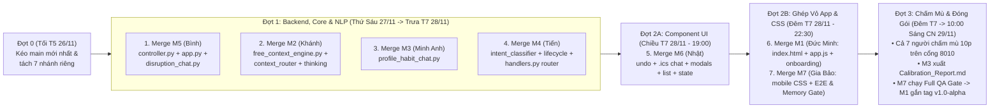

# SmartSchedule `v1.0-alpha` — Kế Hoạch Nước Rút Hoàn Thiện Sản Phẩm (7 Thành Viên)

> [!IMPORTANT]
> **MỤC TIÊU & HẠN CHÓT TOÀN NHÓM (GROUP 03 — *THE SEVEN DWARFS*):**
> - **Thời điểm bắt đầu:** Tối Thứ Năm, **26/11/2026**
> - **Hạn chót đóng băng tính năng (Code Freeze):** **22:30 – 23:59 Đêm Thứ Bảy, 28/11/2026**
> - **Hạn chót kiểm định cuối, Chấm mù 7 người & Đóng gói `v1.0-alpha`:** **09:00 – 10:00 Sáng Chủ Nhật, 29/11/2026**
> - **Cách làm việc không đụng độ (0% Merge Conflict):** Mỗi thành viên và AI Agent **chỉ mở và làm đúng file nhiệm vụ riêng của mình trong thư mục [`Sprint_Tasks/`](Sprint_Tasks/)**. Trong suốt Thứ Sáu & Thứ Bảy, chỉ tích `[x]` vào file `Sprint_Tasks/M<k>_...md` của riêng bạn (không sửa chung `README.md` hay `commit_changes.md` trên nhánh lẻ)!
> - **Dành cho AI Agent:** Bắt buộc đọc [`README_agents.md`](README_agents.md) trước khi viết code.

---

## 1. Đánh Giá Thực Trạng: Chúng Ta Đã Có Gì & Còn Thiếu Gì Để Người Dùng Xài Mượt 100%?

### ✅ Nền tảng đã hoàn thành trên `main` (`[x]`)
- **Cấu trúc dự án sạch sẽ:** Đã chia gọn thành [`smartschedule/`](../smartschedule/) (`core/`, `nlp/`, `api/`, `ui/`), [`data/`](../data/), [`tests/`](../tests/) (`194+` tests), [`tools/`](../tools/), [`environments/`](../environments/) và [`Project_Drafts/`](../Project_Drafts/). (Các bản thiết kế giai đoạn đầu đã cất gọn vào [`Completed_Blueprints/`](Completed_Blueprints/)).
- **Động cơ 6 Thuật toán & Máy chấm `v2.1`:** `SCORED_GREEDY` (tự nâng lên `HYBRID_ALNS` khi lịch căng), `BACKTRACK`, `EDF`, `LST`, `WSPT`, bảo toàn tuyệt đối giờ ngủ $\ge 6\text{h}$ và 5 ràng buộc cứng $H_1$–$H_5$ (`39/39` test máy chấm đạt chuẩn).
- **Khung Giao diện Chat-First cơ bản:** Màn hình *"Trợ lý xếp lịch"*, thanh trái thu gọn, *"Trợ lý tinh chỉnh trực tiếp"* bên phải lịch tuần, chế độ `Developer Mode` có hộp *💭 Quá trình suy nghĩ*, truy vết từ khóa `SHA-256`, đặt lại tổng thời lượng và tự dọn việc khi bấm hoàn thành.

### 🚨 7 Mảnh Ghép Còn Thiếu Cần Bổ Sung Ngay Cho `v1.0-alpha` (Để Người Dùng Cuối Dùng Mượt, Không Vấp Lỗi)
Qua rà soát thực tế mã nguồn trên `main`, một sinh viên bình thường khi mở app lên dùng hằng ngày sẽ gặp **7 điểm nghẽn thực tế sau** — đây chính là 7 hạng mục vừa khít cho 7 thành viên hoàn thành trước đêm Thứ Bảy:

1. **Mở app lần đầu bị nạp sẵn lịch mẫu của "Minh" (`02/11/2026`) & thiếu chỗ chỉnh Giờ ngủ:** Người dùng mới cần màn hình chào mừng 30 giây để chọn **"Bắt đầu lịch trống tuần hiện tại"** (hoặc xem lịch mẫu) và đổi được Giờ ngủ / Khung giờ tỉnh táo ngay trong Cài đặt mà không phải bật `Developer Mode`.
2. **Khung Chat chưa biết Xóa việc, Báo xong việc, Hỏi lịch ngày & Nhận danh sách nhiều việc:** Hiện gõ *"Xóa bài tập Giải tích"* hay *"Mình làm xong bài Lý rồi"*, bot lại... tạo thêm một bài tập mới tên là *"Xóa bài tập Giải tích"*!
3. **Thiếu bộ đọc ngữ cảnh Miễn phí – Nhẹ máy & Hiểu câu phủ định:** Cần bổ sung mô hình NLP miễn phí (`spaCy` MIT / Hugging Face `DeBERTa`/`RoBERTa` nạp lười) và luật bắt phủ định tiếng Việt (*"không làm buổi tối"*, *"tránh sáng thứ 4"*) để không cần khóa API trả phí vẫn hiểu chuẩn.
4. **Nhắn báo bận đột xuất vào Chat chưa gọi `LocalRepairEngine` (Sửa cục bộ ít xáo trộn):** Khi báo *"Chiều mai 14h–16h họp đột xuất"*, hệ thống cần dùng `LOCAL_INSERTION` để giữ nguyên $\ge 90\%$ các buổi học không liên quan, đồng thời cần API xóa/sửa lẻ từng mục.
5. **Chưa có nút đính kèm Thời khóa biểu `.ics` / PDF ở ô Chat, bấm `F5` mất lịch sử chat & thiếu nút `"↩ Hoàn tác"`:** Bộ đọc `.ics` đã có sẵn ở backend nhưng chưa nối ra khung chat; người dùng cũng rất cần nút **Hoàn tác 1 chạm** và nút **Xóa lẻ việc / lớp học** ngay trên Lịch.
6. **Chưa chỉnh được Giờ ngủ / Thói quen tuần qua Chat & chưa chốt Báo cáo Chấm mù 7 thành viên:** Cần hiểu câu tự nhiên như *"Tập thể dục 3 buổi/tuần chiều"* và hoàn tất đợt chấm mù thực tế trên cổng `8010` (`Calibration_Report.md`).
7. **Trải nghiệm Gõ phím (`Enter` gửi / `Shift+Enter` xuống dòng), Màn hình nhỏ/Mobile & Kiểm thử Hành trình Đầu-Cuối:** Đảm bảo không vỡ khung trên điện thoại/nửa màn hình laptop và giữ mức tăng RAM `< 350 KB`.

---

## 2. Phân Công Cá Nhân Cho 7 Thành Viên (Khớp Chuẩn `work_division.pdf` & Độc Lập File 100%)

Mỗi thành viên có **1 file hướng dẫn chi tiết riêng** trong [`Sprint_Tasks/`](Sprint_Tasks/) ghi rõ file được tạo, file được sửa, và lệnh kiểm tra:

| Mã | Thành Viên & MSSV | Vai Trò (`work_division.pdf`) | Nhiệm Vụ Cụ Thể Trong `v1.0-alpha` | File Sở Hữu Độc Quyền (0% Đụng Hàng) | Đợt & Hạn Chót PR |
| :-: | :--- | :--- | :--- | :--- | :---: |
| **[`M1`](Sprint_Tasks/M1_Pham_Duc_Minh.md)** | **Phạm Đức Minh**<br>`25125028` | **Leader**<br>*(Lead §9, Sup §11)* | **Onboarding Người Mới, Tuần Thực Tế, Cài Đặt Hồ Sơ & Ghép Nhánh Tổng:** Hộp chọn *Lịch trống tuần này* vs *Lịch mẫu*, chỉnh Giờ ngủ/Năng lượng ở User Mode, nối phím `Enter`/`Shift+Enter` & gộp PR toàn nhóm | **Tạo:** `ui/js/onboarding.js`, `ui/css/onboarding.css`<br>**Sửa độc quyền:** `ui/index.html`, `ui/app.js` | **Wave 2B & 3**<br>Code: **22:00 T7 (28/11)**<br>Release: **10:00 CN (29/11)** |
| **[`M2`](Sprint_Tasks/M2_Tran_Nguyen_Khanh.md)** | **Trần Nguyên Khánh**<br>`25125019` | **Thinker 1**<br>*(Lead §6, Sup §8, §10)* | **Mô Hình Đọc Ngữ Cảnh Miễn Phí (`spaCy`/HF) & Bắt Phủ Định + Thinking Stage:** Nạp lười mô hình nhẹ, xử lý câu *"không/tránh buổi..."*, *"tuần sau"*, và làm rõ hộp `💭` giải thích lọc thuật toán (§6) | **Tạo:** `nlp/free_context_engine.py`, `environments/requirements-nlp-extra.txt`<br>**Sửa độc quyền:** `nlp/context_router.py`, `api/chat/thinking_stage.py` | **Wave 1**<br>PR: **23:00 T6 (27/11)**<br>*(Trễ nhất 12:00 T7)* |
| **[`M3`](Sprint_Tasks/M3_Hoang_Minh_Anh.md)** | **Hoàng Minh Anh**<br>`25125001` | **Thinker 2**<br>*(Lead §11, `member_eval`)* | **Chat Chỉnh Giờ Ngủ / Nhịp Sinh Học / Thói Quen & Chấm Mù 7 Thành Viên:** Xử lý câu đổi giờ ngủ ($\ge 6\text{h}$), chronotype, `PersonalHabit` qua chat; tổ chức chấm mù cổng `8010` xuất `Calibration_Report.md` | **Tạo:** `api/chat/profile_habit_chat.py`, `tools/member_eval/Calibration_Report.md`<br>**Sửa độc quyền:** `tools/member_eval/*` | **Wave 1 & 3**<br>Chat: **12:00 T7 (28/11)**<br>Eval: **09:00 CN (29/11)** |
| **[`M4`](Sprint_Tasks/M4_Nguyen_Trong_Tien.md)** | **Nguyễn Trọng Tiến**<br>`25125037` | **Thinker 3**<br>*(Lead §5, Sup §9)* | **Ý Định Vòng Đời Chat (`DELETE`, `COMPLETE`, `BATCH_ADD`, `QUERY`):** Xóa việc/lớp học, đánh dấu xong việc, dán danh sách nhiều việc 1 lượt, hỏi lịch ngày X, và cắm bộ điều phối vào `handlers.py` | **Tạo:** `nlp/intent_classifier.py`, `api/chat/lifecycle_intents.py`<br>**Sửa độc quyền:** `api/chat/handlers.py` | **Wave 1**<br>PR: **23:30 T6 (27/11)**<br>*(Trễ nhất 12:30 T7)* |
| **[`M5`](Sprint_Tasks/M5_Le_Tien_Binh.md)** | **Lê Tiến Bình**<br>`25125007` | **Builder 1**<br>*(Lead §7, Sup §6)* | **Chat Báo Sự Cố Đột Xuất $\to$ `LocalRepairEngine` & API Xóa/Sửa Mục Lẻ:** Gọi `LOCAL_INSERTION` giữ ổn định $\ge 90\%$ lịch khi họp đột xuất, hàm neo Thứ Hai thực tế, và API xóa/sửa lẻ Task & Fixed Event | **Tạo:** `api/chat/disruption_chat.py`<br>**Sửa độc quyền:** `core/controller.py`, `api/app.py` | **Wave 1 (Merge #1)**<br>PR: **22:00 T6 (27/11)** |
| **[`M6`](Sprint_Tasks/M6_Le_Minh_Nhat.md)** | **Lê Minh Nhật**<br>`25125032` | **Builder 2**<br>*(Lead §10, Sup §5)* | **Đính Kèm `.ics` / Đề Bài Ở Chat, Lưu Chat Qua `F5`, Nút `"↩ Hoàn Tác"` & Xóa Lẻ UI:** Nút `📎` nạp TKB `.ics` / file bài tập (`Docling`), giữ 30 tin nhắn qua `F5`, Undo 1 chạm trên Toast, nút Xóa ở `modals.js`/`render-list.js` | **Tạo:** `ui/js/undo-history.js`, `nlp/doc_attachment_parser.py`<br>**Sửa độc quyền:** `ui/js/{chat-assistant,modals,render-list,state,api}.js` | **Wave 2A**<br>PR: **19:00 T7 (28/11)** |
| **[`M7`](Sprint_Tasks/M7_Nguyen_Nguyen_Gia_Bao.md)** | **Nguyễn Nguyễn Gia Bảo**<br>`25125006` | **Builder 3**<br>*(Lead §8, Sup §7)* | **Responsive Mobile/Tablet, Chốt Chặn Bộ Nhớ `<350KB` & Bộ Test Hành Trình E2E:** Ngăn kéo trượt mượt trên màn hình hẹp, kiểm tra AST/RAM cho NLP nạp lười, test E2E người dùng thật & duyệt cổng Release cuối | **Tạo:** `tests/ui/test_v1_alpha_user_journeys.py`<br>**Sửa độc quyền:** `ui/css/{shell,calendar,chat}.css`, `tests/architecture/*` | **Wave 2B & 3**<br>Code: **22:30 T7 (28/11)**<br>Gate: **09:30 CN (29/11)** |

---

## 3. Lộ Trình Phối Hợp 4 Đợt (Pipeline) & Thứ Tự Merge Để 0% Xung Đột Git



### 5 Nguyên Tắc Vàng Giúp Tránh Xung Đột Tuyệt Đối & Đạt Hiệu Năng Cao Nhất
1. **Mỗi file chỉ có ĐÚNG 1 người chạm vào:** Trước khi sửa bất kỳ file nào, hãy kiểm tra mục *Exclusive File Ownership* trong file `Sprint_Tasks/M<k>_...md` của bạn. Tuyệt đối không sửa file của bạn khác.
2. **Không sửa chung file Nhật ký / README trên nhánh tính năng:** Trong Thứ Sáu & Thứ Bảy, mỗi bạn chỉ đánh dấu `[x]` vào chính file `Sprint_Tasks/M<k>_...md` của mình. Sáng Chủ Nhật, Leader (`M1`) sẽ gom 1 bản tổng kết duy nhất vào `commit_changes.md`.
3. **Không đụng vào 6 thuật toán giải lịch (`smartschedule/core/solvers/*`):** Giữ tốc độ giải `< 1 giây`, tính tất định SHA-256 và điểm `Testing_System v2.1` (`39/39`) ổn định tuyệt đối.
4. **Thư viện NLP/PDF mở rộng phải nạp lười (Lazy-Load):** Mọi gói nặng tùy chọn (`spacy`, `transformers`, `docling`) ghi vào `environments/requirements-nlp-extra.txt` và bọc `try / except ImportError` để cài đặt mặc định luôn nhẹ, nhanh và không vượt trần RAM `< 350 KB`.
5. **Rebase nhẹ trước khi mở PR ở Đợt 2B:** Đức Minh (`M1`) và Gia Bảo (`M7`) kéo `main` sau khi Đợt 1 + Đợt 2A (`M6`) đã merge lúc `19:00` tối Thứ Bảy, ghép nối trong 2–3 tiếng là hoàn tất êm ru!

---

## 4. Cấu Trúc Thư Mục `v1.0-alpha-plan/` Hiện Tại

- [`README.md`](README.md) — Kế hoạch tổng thể & lộ trình phối hợp tiếng Việt cho 7 thành viên *(file này)*.
- [`README_agents.md`](README_agents.md) — Đặc tả kỹ thuật, hợp đồng JSON dùng chung & quy tắc an toàn dành cho AI Coding Agents.
- [`Sprint_Tasks/`](Sprint_Tasks/) — **7 phiếu giao việc cá nhân (`M1` $\to$ `M7`)**, mỗi thành viên & Agent làm việc độc lập trên phiếu của mình.
- [`Testing_Plan/`](Testing_Plan/) & [`Testing_System/`](Testing_System/) — Đặc tả học thuật, báo cáo Benchmark, kịch bản đánh giá người thật & máy chấm tự động `v2.1` (`39/39` tests).
- [`Completed_Blueprints/`](Completed_Blueprints/) — Lưu trữ các bản thiết kế đã triển khai xong ở đợt trước (`folder_division_plan.md`, `UI_Rebuild_Plan/`).

---

## 5. Lệnh Kiểm Tra Nhanh Trước Khi Gửi Pull Request

```powershell
# Chạy tại thư mục gốc D:\Projects\Computational-Thinking---Group-Project
python -B tests/clean_runner.py --pass
python -B -m pytest -c environments/pyproject.toml v1.0-alpha-plan/Testing_System/tests -q
node --check smartschedule/ui/app.js
```
