# SmartSchedule `v1.0-alpha` — Kế Hoạch Nước Rút Hoàn Thiện Sản Phẩm (7 Thành Viên)

> [!IMPORTANT]
> **MỤC TIÊU & HẠN CHÓT TOÀN NHÓM (GROUP 03 — *THE SEVEN DWARFS*):**
> - **Thời điểm bắt đầu:** Tối Thứ Năm, **26/11/2026**
> - **Hạn chót đóng băng tính năng (Code Freeze):** **22:30 – 23:59 Đêm Thứ Bảy, 28/11/2026**
> - **Hạn chót kiểm định cuối, Chấm mù 7 người & Đóng gói `v1.0-alpha`:** **09:00 – 10:00 Sáng Chủ Nhật, 29/11/2026**
> - **Cách làm việc không đụng độ (0% Merge Conflict):** Mỗi thành viên và AI Agent **chỉ mở và làm đúng file nhiệm vụ riêng của mình trong thư mục [`Sprint_Tasks/`](Sprint_Tasks/)**. Trong suốt Thứ Sáu & Thứ Bảy, chỉ tích `[x]` vào file `Sprint_Tasks/M<k>_...md` của riêng bạn (không sửa chung `README.md` hay `commit_changes.md` trên nhánh lẻ)!
> - **Dành cho AI Agent:** Bắt buộc đọc [`README_agents.md`](README_agents.md) trước khi viết code.

---

## 1. Đánh Giá Thực Trạng: Chúng Ta Đã Có Gì & Còn Thiếu Gì Để Người Dùng Xài Mượt 100%?

### ✅ Nền tảng đã hoàn thành trên `main` (`[x]`)
- **Cấu trúc dự án sạch sẽ:** Đã chia gọn thành [`smartschedule/`](../smartschedule/) (`core/`, `nlp/`, `api/`, `ui/`), [`data/`](../data/), [`tests/`](../tests/) (`194+` tests), [`tools/`](../tools/), [`environments/`](../environments/) và [`Project_Drafts/`](../Project_Drafts/). (Các bản thiết kế giai đoạn đầu đã cất gọn vào [`Completed_Blueprints/`](Completed_Blueprints/)).
- **Động cơ 6 Thuật toán & Máy chấm `v2.1`:** `SCORED_GREEDY` (tự nâng lên `HYBRID_ALNS` khi lịch căng), `BACKTRACK`, `EDF`, `LST`, `WSPT`, bảo toàn tuyệt đối giờ ngủ $\ge 6\text{h}$ và 5 ràng buộc cứng $H_1$–$H_5$ (`39/39` test máy chấm đạt chuẩn).
- **Khung Giao diện Chat-First cơ bản:** Màn hình *"Trợ lý xếp lịch"*, thanh trái thu gọn, *"Trợ lý tinh chỉnh trực tiếp"* bên phải lịch tuần, chế độ `Developer Mode` có hộp *💭 Quá trình suy nghĩ*, truy vết từ khóa `SHA-256`, đặt lại tổng thời lượng và tự dọn việc khi bấm hoàn thành.

### 🎓 Tích Hợp Phản Hồi Giảng Viên & Tái Cân Bằng Trọng Tâm Kỹ Thuật (`M7` + `M5` + `M4` Gánh Lõi Khó)
Từ nhận xét của giảng viên (*bổ sung tính năng có độ khó tư duy cao hơn, làm rõ cầu nối Pattern $\to$ Deterministic Logic Rule, thêm Formal Spec & Sample I/O*), kế hoạch được nâng cấp theo nguyên tắc **nhóm 3 nòng cốt kỹ thuật (`M7` Gia Bảo + `M5` Tiến Bình + `M4` Trọng Tiến) đảm nhận toàn bộ phần thuật toán/kiểm định mới**, giữ phần việc của **`M1`, `M2`, `M3`, `M6` gọn nhẹ, đúng luồng UX cơ bản và `0%` xung đột Git**:

1. **Học Thích Nghi Xuyên Tuần (`CrossWeekPreferenceAdapter` — Pattern `P13`, do `M5` Tiến Bình code):**
   - Giải quyết bài toán **cập nhật Fallacy Buffer & Sở thích cho tuần kế tiếp dựa trên lịch sử thực thi của các tuần trước** (`Proposal §7.8.3–7.8.4`): học hệ số đệm co rút Bayes–EWMA theo từng nhóm môn ($\hat{\alpha}^{(t+1)}_{c,\ell} \in [1.00, 1.60]$), tự động phát hiện lệch giữa *khung giờ tự khai* và *khung giờ bám lịch thực tế* (*Stated vs. Revealed Chronotype*), hạ nhịp `FLOW -> BALANCED` sau tuần quá tải và khoanh vùng giờ hay bị họp đột xuất lặp lại.
2. **Mô Phỏng Hành Vi Tâm Lý Đa Tuần (`InSilicoStudentSimulator` — Pattern `P14b`, do `M7` Gia Bảo code) + Đọc Logic Tài Liệu (`DocumentConstraintDigest` — `P14a`):**
   - Khắc phục triệt để hạn chế thời gian môn học không thể khảo sát người thật suốt 6–8 tuần: đối chiếu các nghiên cứu mô phỏng hành vi người độ chính xác cao (`Park et al., 2024 StanfordHCI/genagents`; `Binz et al., 2025 Nature Centaur`) và cài đặt tác tử tâm lý học 5 phương trình tất định (`MCTQ` + `Buehler LogNormal` + `Steel 2007 TMT` + `McFadden 1974 RUM` + `Albulescu 2022`) chạy vòng lặp khép kín `Tuần 1 -> Tuần 4` trong `< 500 ms`!
   - Đồng thời `M7` xây bộ biên dịch đề cương đính kèm `.pdf/.md/.txt` (`doc_attachment_parser.py` — chuyển ra khỏi `M6` để giảm tải cho Nhật!) thành các mốc con có trọng số, cạnh phụ thuộc `depends_on` và cảnh báo khi sinh viên ước lượng quá thấp so với đề bài.
3. **Điều Phối Ngữ Cảnh Có Neo Dữ Liệu (`Grounded Context + DAG`) & Kiểm Định Độc Lập Bằng Claude Plan (do `M4` Trọng Tiến phụ trách):**
   - `M4` nối ngữ cảnh danh sách việc hiện có + kết quả đọc file đính kèm + cạnh phụ thuộc `depends_on` (*"xong A mới làm B"*) + lệnh chuyển tuần thích nghi vào `handlers.py`, đồng thời thực hiện **vòng kiểm định độc lập bằng Claude Plan** lên toàn bộ công thức của `M5` & `M7` và chuẩn bị 4 slide ***"Abstraction of Problem Definition into Formal Specification"*** + **14 Patterns (`P1–P14`)** tại **[`Testing_Plan/Formal_Spec_And_Patterns.md`](Testing_Plan/Formal_Spec_And_Patterns.md)**.

---

## 2. Phân Công Cá Nhân Cho 7 Thành Viên (`M7`, `M5`, `M4` Nòng Cốt Kỹ Thuật · `M1`, `M2`, `M3`, `M6` Gọn Nhẹ · `0%` Đụng File)

Mỗi thành viên có **1 file hướng dẫn chi tiết riêng** trong [`Sprint_Tasks/`](Sprint_Tasks/) ghi rõ file được tạo, file được sửa, và lệnh kiểm tra:

| Mã | Thành Viên & MSSV | Vai Trò & Tải Kỹ Thuật | Nhiệm Vụ Cụ Thể Trong `v1.0-alpha` | File Sở Hữu Độc Quyền (0% Đụng Hàng) | Đợt & Hạn Chót PR |
| :-: | :--- | :--- | :--- | :--- | :---: |
| **[`M5`](Sprint_Tasks/M5_Le_Tien_Binh.md)** | **Lê Tiến Bình**<br>`25125007` | **Builder 1 · Core Lead**<br>*(Đề xuất ý tưởng & Code chính)* | **Học Thích Nghi Xuyên Tuần (`CrossWeekPreferenceAdapter` `P13`), Sửa Đột Xuất `LOCAL_INSERTION` (`P8`) & API:** Học lại Fallacy Buffer theo môn + sở thích khung giờ/nhịp làm việc cho tuần kế tiếp từ lịch sử tuần trước; nối API mô phỏng 4 tuần, sửa lịch cục bộ $\ge 90\%$ & xóa/sửa lẻ | **Tạo:** `core/cross_week_adapter.py`, `api/chat/disruption_chat.py`<br>**Sửa độc quyền:** `core/controller.py`, `api/app.py` | **Wave 1A (Merge #1)**<br>PR: **22:00 T6 (27/11)** |
| **[`M7`](Sprint_Tasks/M7_Nguyen_Nguyen_Gia_Bao.md)** | **Nguyễn Nguyễn Gia Bảo**<br>`25125006` | **Builder 3 · Core Lead**<br>*(Đề xuất ý tưởng & Code chính)* | **Mô Phỏng Tâm Lý `InSilicoStudentSimulator` (`P14b`), Bộ Đọc Logic Đề Bài (`doc_attachment_parser` `P14a`), Mobile CSS & E2E Gate:** Cài 5 luật tâm lý chạy kiểm chứng thích nghi 4 tuần, bóc tách đề bài `.pdf/.md` thành subtask DAG + kiểm tra lố giờ, chốt RAM `<350KB` & E2E cuối | **Tạo:** `core/student_simulator.py`, `nlp/doc_attachment_parser.py`, `tests/ui/test_v1_alpha_user_journeys.py`<br>**Sửa độc quyền:** `ui/css/{shell,calendar,chat}.css`, `tests/architecture/*` | **Wave 1A & 2B/3**<br>Core: **23:00 T6**<br>CSS/Gate: **T7–CN** |
| **[`M4`](Sprint_Tasks/M4_Nguyen_Trong_Tien.md)** | **Nguyễn Trọng Tiến**<br>`25125037` | **Thinker 3 · Verify Lead**<br>*(Code điều phối & Kiểm định Claude Plan)* | **Điều Phối Chat Có Neo Ngữ Cảnh (`DELETE`, `COMPLETE`, `DAG`, `ADAPT_NEXT_WEEK`, Đối Chiếu Đề Bài) & Kiểm Định Claude Plan:** Cắm module của `M5`/`M7`/`M3` vào `handlers.py`, bắt mâu thuẫn giờ ước lượng vs đề bài, nối `depends_on`, và dùng Claude Plan kiểm toán độc lập toán học của `M5` & `M7` | **Tạo:** `nlp/intent_classifier.py`, `api/chat/lifecycle_intents.py`<br>**Sửa độc quyền:** `api/chat/handlers.py` | **Wave 1B & Verify**<br>PR: **12:00 T7 (28/11)** |
| **[`M2`](Sprint_Tasks/M2_Tran_Nguyen_Khanh.md)** | **Trần Nguyên Khánh**<br>`25125019` | **Thinker 1**<br>*(Gọn nhẹ — NLP cơ bản & Thinking)* | **Bắt Phủ Định Tiếng Việt (`avoid_windows`) & Hộp `💭` Hiển Thị `14 Patterns -> Rule`:** Mô hình nhẹ nạp lười tùy chọn, bắt câu *"không/tránh buổi..."*, và format danh sách `pattern_rules` rõ đẹp trong `thinking_stage.py` | **Tạo:** `nlp/free_context_engine.py`, `environments/requirements-nlp-extra.txt`<br>**Sửa độc quyền:** `nlp/context_router.py`, `api/chat/thinking_stage.py` | **Wave 1B**<br>PR: **12:00 T7 (28/11)** |
| **[`M3`](Sprint_Tasks/M3_Hoang_Minh_Anh.md)** | **Hoàng Minh Anh**<br>`25125001` | **Thinker 2**<br>*(Gọn nhẹ — Hồ sơ Chat & Chấm mù)* | **Chat Chỉnh Giờ Ngủ (`P6`) / Nhịp Sinh Học / Thói Quen & Chấm Mù 7 Thành Viên:** Xử lý câu đổi giờ ngủ ($\ge 6\text{h}$), chronotype, `PersonalHabit`; mở cổng `8010` thu phiếu chấm mù xuất `Calibration_Report.md` | **Tạo:** `api/chat/profile_habit_chat.py`, `tools/member_eval/Calibration_Report.md`<br>**Sửa độc quyền:** `tools/member_eval/*` | **Wave 1B & 3**<br>Chat: **12:00 T7**<br>Eval: **09:00 CN** |
| **[`M6`](Sprint_Tasks/M6_Le_Minh_Nhat.md)** | **Lê Minh Nhật**<br>`25125032` | **Builder 2**<br>*(Gọn nhẹ — Thuần UI JS)* | **Nút `📎` Gửi File Lên API, Lưu Chat Qua `F5`, `"↩ Hoàn Tác"` & Nút Xóa Lẻ UI:** *(Đã chuyển phần đọc logic PDF sang `M7`)* Chỉ làm UI: giữ 30 tin nhắn qua `F5`, Undo 1 chạm trên Toast, nút Xóa lẻ, và hiển thị huy hiệu `pattern_rules` trong `chat-assistant.js` | **Tạo:** `ui/js/undo-history.js`<br>**Sửa độc quyền:** `ui/js/{chat-assistant,modals,render-list,state,api}.js` | **Wave 2A**<br>PR: **19:00 T7 (28/11)** |
| **[`M1`](Sprint_Tasks/M1_Pham_Duc_Minh.md)** | **Phạm Đức Minh**<br>`25125028` | **Leader**<br>*(Gọn nhẹ — Vỏ UI & Ghép PR)* | **Màn Hình Chào Mừng 30s, Cài Đặt Giờ Ngủ User Mode & Ghép Nhánh Tổng:** Hộp chọn *Lịch trống tuần này* vs *Lịch mẫu chuẩn*, chỉnh Giờ ngủ ở Cài đặt, phím `Enter`/`Shift+Enter`, và gộp PR toàn nhóm | **Tạo:** `ui/js/onboarding.js`, `ui/css/onboarding.css`<br>**Sửa độc quyền:** `ui/index.html`, `ui/app.js` | **Wave 2B & 3**<br>Code: **22:00 T7**<br>Release: **10:00 CN** |

---

## 3. Lộ Trình Phối Hợp 4 Đợt (Pipeline) & Thứ Tự Merge Để 0% Xung Đột Git

```mermaid
flowchart LR
    W0["Đợt 0\nKéo main &\ntách nhánh riêng"] --> W1A
    subgraph W1A["Đợt 1A: Lõi Toán Học, Mô Phỏng & Đọc Đề (T6 27/11)"]
        M5["1. Merge M5 (Tiến Bình)\ncross_week_adapter + disruption +\ncontroller.py + app.py"]
        M7A["2. Merge M7-Core (Gia Bảo)\nstudent_simulator.py +\ndoc_attachment_parser.py"]
    end
    W1A --> W1B
    subgraph W1B["Đợt 1B: NLP, Điều Phối & Kiểm Định Claude Plan (Sáng/Trưa T7 28/11)"]
        M2["3. Merge M2 (Khánh)\nfree_context + thinking_stage"]
        M3["4. Merge M3 (Minh Anh)\nprofile_habit_chat.py"]
        M4["5. Merge M4 (Trọng Tiến)\nhandlers.py router + DAG +\nClaude-Plan Audit M5 & M7"]
    end
    W1B --> W2A["Đợt 2A: Thuần UI JS (Chiều T7 28/11 - 19:00)\n6. Merge M6 (Nhật: undo + F5 chat + modals + list)"]
    W2A --> W2B["Đợt 2B: Ghép Vỏ App, CSS & E2E (Đêm T7 28/11 - 22:30)\n7. Merge M1 (Đức Minh: index.html + app.js + onboarding)\n8. Merge M7-UI (Gia Bảo: mobile CSS + E2E 4-Week Sim & Gate)"]
    W2B --> W3["Đợt 3: Chấm Mù & Đóng Gói (Sáng CN 29/11 - 10:00)\n• Chấm mù cổng 8010 -> M3 xuất Calibration_Report.md\n• M4 + M7 duyệt cổng kiểm định cuối -> M1 tag v1.0-alpha"]
```



### 5 Nguyên Tắc Vàng Giúp Tránh Xung Đột Tuyệt Đối & Đạt Hiệu Năng Cao Nhất
1. **Mỗi file chỉ có ĐÚNG 1 người chạm vào:** Trước khi sửa bất kỳ file nào, hãy kiểm tra mục *Exclusive File Ownership* trong file `Sprint_Tasks/M<k>_...md` của bạn. Tuyệt đối không sửa file của bạn khác.
2. **Không sửa chung file Nhật ký / README trên nhánh tính năng:** Trong Thứ Sáu & Thứ Bảy, mỗi bạn chỉ đánh dấu `[x]` vào chính file `Sprint_Tasks/M<k>_...md` của mình. Sáng Chủ Nhật, Leader (`M1`) sẽ gom 1 bản tổng kết duy nhất vào `commit_changes.md`.
3. **Không đụng vào 6 thuật toán giải lịch (`smartschedule/core/solvers/*`):** Giữ tốc độ giải `< 1 giây`, tính tất định SHA-256 và điểm `Testing_System v2.1` (`39/39`) ổn định tuyệt đối.
4. **Thư viện NLP/PDF mở rộng phải nạp lười (Lazy-Load):** Mọi gói nặng tùy chọn (`spacy`, `transformers`, `docling`) ghi vào `environments/requirements-nlp-extra.txt` và bọc `try / except ImportError` để cài đặt mặc định luôn nhẹ, nhanh và không vượt trần RAM `< 350 KB`.
5. **Rebase nhẹ trước khi mở PR ở Đợt 2B:** Đức Minh (`M1`) và Gia Bảo (`M7`) kéo `main` sau khi Đợt 1 + Đợt 2A (`M6`) đã merge lúc `19:00` tối Thứ Bảy, ghép nối trong 2–3 tiếng là hoàn tất êm ru!

---

## 4. Cấu Trúc Thư Mục `v1.0-alpha-plan/` Hiện Tại

- [`README.md`](README.md) — Kế hoạch tổng thể & lộ trình phối hợp tiếng Việt cho 7 thành viên *(file này)*.
- [`README_agents.md`](README_agents.md) — Đặc tả kỹ thuật, hợp đồng JSON dùng chung & quy tắc an toàn dành cho AI Coding Agents.
- [`Sprint_Tasks/`](Sprint_Tasks/) — **7 phiếu giao việc cá nhân (`M1` $\to$ `M7`)**, mỗi thành viên & Agent làm việc độc lập trên phiếu của mình.
- [`Testing_Plan/`](Testing_Plan/) & [`Testing_System/`](Testing_System/) — Đặc tả học thuật, **[`Formal_Spec_And_Patterns.md`](Testing_Plan/Formal_Spec_And_Patterns.md)** *(bản thiết kế chuẩn cho 4 slide Formal Spec, Sample I/O, lập luận Abstraction & bảng 12 Patterns $\to$ Deterministic Logic Rule theo đúng feedback giảng viên)*, báo cáo Benchmark, kịch bản đánh giá người thật & máy chấm tự động `v2.1` (`39/39` tests).
- [`Completed_Blueprints/`](Completed_Blueprints/) — Lưu trữ các bản thiết kế đã triển khai xong ở đợt trước (`folder_division_plan.md`, `UI_Rebuild_Plan/`).

---

## 5. Lệnh Kiểm Tra Nhanh Trước Khi Gửi Pull Request

```powershell
# Chạy tại thư mục gốc D:\Projects\Computational-Thinking---Group-Project
python -B tests/clean_runner.py --pass
python -B -m pytest -c environments/pyproject.toml v1.0-alpha-plan/Testing_System/tests -q
node --check smartschedule/ui/app.js
```
