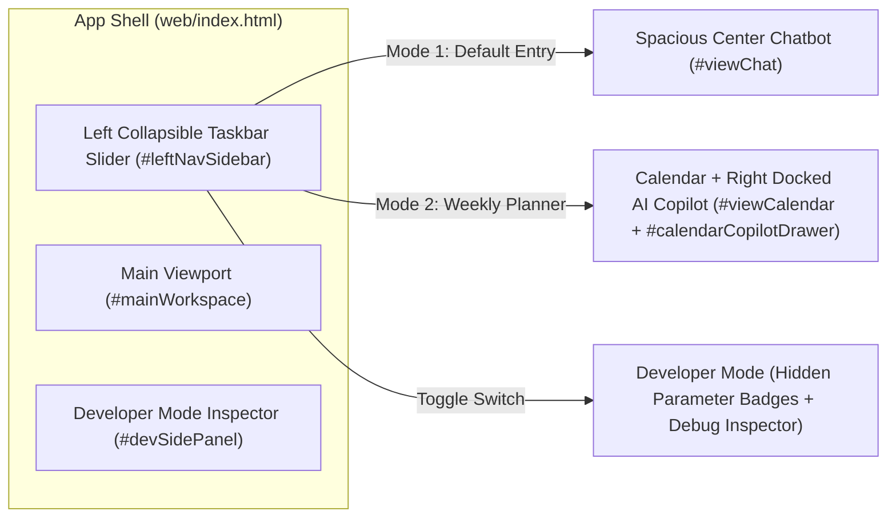

# SmartSchedule UI/UX Chat-First Rebuild — Agent Execution Pipeline

**Branch:** `v1.0-alpha/ui-ux-chat`  
**Target Directory:** `group03-smartschedule-baseline/`  
**Document Purpose:** Actionable, end-to-end engineering blueprint for AI coding agents to execute the Chat-First UI/UX overhaul while preserving all 5-layer architectural invariants (`INV-1` to `INV-6`) and keeping the verification suite (`193/193` tests in `clean_runner.py --all` + `39/39` in `Testing_System/tests`) 100% green.

---

## 1. Architectural Guardrails & Non-Negotiable Constraints

Before modifying any file, the executing agent **MUST** enforce these project-wide constraints from `agents/commit_changes.md` and `agents/progress/system_architecture.md`:

1. **Strict Layer Isolation (`INV-1` to `INV-6`):**
   - **Layer 1 (`src/models.py`, `src/utils.py`, `src/estimate_buffer.py`, `src/calibration.py`, `src/storage.py`):** Pure data models, mathematical helpers, and stdlib SQLite storage. Never import `web`, `fastapi`, `src/solvers`, or `src/controller`.
   - **Layer 2 (`src/solvers/*`):** Stateless scheduling solvers (`EDF`, `LST`, `WSPT`, `SCORED_GREEDY`, `BACKTRACK`, `HYBRID_ALNS`, `local_repair.py`). **Zero modifications required to solver algorithms.**
   - **Layer 3 (`src/controller.py`, `src/overload_triage.py`):** Pure domain orchestration.
   - **Layer 4 (`web/api.py`, `src/nl_parser.py`, `web/index.html`, `web/app.js`, `web/js/*.js`, `web/css/*.css`):** All conversational state management, intent routing, SHA-256 task keyword traceability, and UI layout changes live in Layer 4 (with optional pure schema/storage helpers in Layer 1).
2. **Performance SLA (`< 10 Seconds` End-to-End, `< 1 Second` Solver Execution):**
   - Every conversational schedule creation, task adjustment, or deadline re-estimation **must complete and render in `< 10,000 ms` end-to-end** (and `< 1,000 ms` local solver time).
   - Default user-mode solver remains `SCORED_GREEDY` (`~5–35 ms` execution time), with automatic priority ordering favoring **nearest-deadline tasks (`deadline_slot` ascending)** and **tasks completable within the active week (`horizon_days = 7`)**.
   - If the optional cloud LLM (`AI_GEMINI`) is used for natural language parsing, enforce a hard **3.5-second timeout** before seamlessly falling back to the `< 10 ms` deterministic local hybrid parser (`OfflineNLParser` + `NL_Parser_Package`).
3. **Existing Test Contract Preservation:**
   - Existing automated tests (`test_hybrid_nl_integration.py`, `test_milestone2_production_readiness.py`, `test_p1_v21_ui_and_api.py`, `test_p3_3_focus_timer_ui.py`, `test_week_navigation_past_due.py`, `test_ui_endpoints.py`) assert the presence of specific DOM IDs and JS symbols in `web/index.html`, `web/app.js`, and `web/js/*.js`.
   - **Rule:** Never delete required DOM IDs (`#viewCalendar`, `#viewList`, `#viewWeights`, `#viewBenchmark`, `#viewShowcase`, `#inputModal`, `#devSidePanel`, `#stFocusTimerPanel`, `#stHealthV21Panel`, etc.). Instead, encapsulate legacy/dev containers inside the **Developer Mode** drawer or hidden-by-default panels so 100% of existing tests pass without regression.

---

## 2. Target UI/UX Topology

### 2.1. Default Entry Point: Spacious Empty Chat Workspace (`#viewChat`)
- On application launch (`/`), the user lands directly on `#viewChat` — a minimalist, distraction-free conversational frame inspired by Antigravity.
- All developer toolbars, solver dropdowns, raw telemetry numbers, and multi-tab forms are hidden from the default view.
- **Greeting & Proactive AI Suggestion Chips:**
  - The AI immediately greets the user and presents two primary intent pathways as interactive suggestion cards/chips:
    1. **🔁 Thêm / Chỉnh lịch cố định lặp lại hằng ngày/tuần** (*Add or modify recurring daily/weekly schedules: classes, sleep, meals, personal habits*).
    2. **📌 Thêm / Điều chỉnh 1 công việc riêng biệt** (*Add or modify a specific one-off task/deadline*).

### 2.2. Left Vertical Collapsible Taskbar Slider (`#leftNavSidebar`)
- A sleek, collapsible vertical navigation rail on the left edge of the screen (`260px` expanded, `56px` collapsed icon rail, smooth CSS `cubic-bezier(0.22, 1, 0.36, 1)` transition).
- **Navigation Items:**
  1. **💬 Khung Chat Chính (Main Assistant):** Switches to `#viewChat` to continue prompting in the full-screen conversational workspace.
  2. **🗓️ Lịch Trình Các Tuần (Weekly Schedule):** Switches to `#viewCalendar` with the **Right Docked AI Copilot** active alongside the weekly calendar grid, plus quick week selector pills (`Tuần trước`, `Tuần này`, `Tuần sau`).
  3. **🛠️ Developer Mode Toggle (`#btnToggleDevMode`):**
     - A dedicated switch in the footer of the left taskbar.
     - When **OFF (Default User Mode)**: The UI is 100% abstract, calm, and beginner-friendly. Zero technical jargon (`L1–L3`, `α=1.35`, `SHA-256`, `ICEE`, `SCORED_GREEDY`, `chunk_min`) is shown.
     - When **ON (Developer / Debug Mode)**:
       - Activates `.app-developer-mode` on `document.body`.
       - Displays an inspectable **Hidden Parameter Debug Badge** on every task card, chat draft card, and calendar block showing:
         - `task_hash` (`SHA-256` trace ID)
         - `cognitive_load` (`L1 Light` / `L2 Medium` / `L3 Heavy`)
         - `circadian_alignment` (`preferred_window`, slot energy level `E1..E3`, `focus_preference`)
         - `fallacy_buffer` (`raw_duration_min -> planned_duration_min`, `buffer_mode`, `buffer_multiplier` / EWMA `α`)
         - `splittability` (`is_splittable`, `work_rhythm`, `min_chunk_min..max_chunk_min`, `part/parts`)
         - `reasons` (`ENERGY_MATCH`, `ESTIMATE_BUFFER`, `BEFORE_DEADLINE`, etc.)
       - Unlocks the collapsible Developer Side Panel (`#devSidePanel`) and analytical tabs (`Weights`, `Benchmark`, `Showcase`) for full engineering inspection.

---

## 3. Conversational Engine & Multi-Turn Slot-Filling Pipeline

### 3.1. Required Fields Contract for Every Schedule Item / Task
Users rarely provide all details in a single sentence. The conversational controller (`web/js/chat-assistant.js` backed by `POST /api/chat/turn` or enhanced `/api/tasks/natural-add`) enforces a **Multi-Turn Slot-Filling State Machine**:

| Intent Type | Mandatory User Inputs | Default / Inferred Hidden Parameters |
| :--- | :--- | :--- |
| **1. Recurring Schedule (`FIXED_EVENT` / `HABIT`)** | • **Content / Title** (what to do) • **Start Time & End Time** (e.g., `08:00 – 10:00`) • **Days of Week** (e.g., `Thứ 2, Thứ 4` or `Hằng ngày`) | `category` (`ACADEMIC_CLASS`, `MEAL`, `WORK`, `HABIT`), `is_hard_lock`, `preferred_window` |
| **2. Specific Task (`TASK`)** | • **Content / Title** (what to do) • **Time Bounds:** Either explicit **Start Time & End Time** (pinned window) OR **Estimated Duration + Deadline (Day/Time)** | `cognitive_load` (`1..3`), `priority` (`1..5`), `buffer_mode` (`COGNITIVE_LOAD`), `buffer_multiplier` (`1.20 / 1.35` or EWMA `α`), `is_splittable`, `work_rhythm`, `preferred_window` |

### 3.2. Missing-Information Clarification Loop
When a prompt is incomplete (e.g., *"Mình cần làm bài tập Lý"* or *"Thêm lịch học Tiếng Anh sáng thứ 3"*):
1. The parser stores a `pendingDraft` in `state.chat.pendingDraft` with the extracted fields.
2. It identifies the missing required slots (`missing_fields`: `["title"]`, `["start_time", "end_time"]`, or `["duration_min", "deadline_day"]`).
3. The chatbot replies in natural Vietnamese asking **only** for the missing piece(s) and renders 1-click quick-reply chips (e.g., `[⏱ 45 phút]`, `[⏱ 90 phút]`, `[📅 Trước 23:59 Thứ Sáu]`, `[🕗 08:00 – 10:00]`).
4. On the user's next message (or chip click), the state machine merges the new slots into `pendingDraft` until all mandatory fields are satisfied.

### 3.3. Post-Mutation Confirmation Loop
Whenever a task or recurring schedule is added or modified:
1. The solver immediately re-optimizes the schedule in the background (`solveActiveSolver(true)`).
2. The chatbot confirms the placement in plain language (e.g., *"Đã xếp **Bài tập Lý** vào 08:30 – 10:00 Thứ Tư (khung giờ bạn tỉnh táo nhất)."*).
3. The chatbot always asks: **"Bạn có muốn thêm hay chỉnh sửa công việc / lịch trình nào tiếp không?"** and provides interactive action buttons:
   - `[➕ Thêm công việc khác]`
   - `[🔁 Thêm lịch lặp hằng ngày]`
   - `[⚙️ Điều chỉnh độ nặng / cách chia việc vừa thêm]`
   - `[🗓️ Mở lịch trình mới ngay]` (transitions smoothly to `#viewCalendar` and highlights the newly updated blocks).

---

## 4. SHA-256 Keyword Embedding & Hidden Parameter Tuning

### 4.1. Deterministic SHA-256 Task Traceability Architecture
When a user wants to modify an existing task via natural language (e.g., *"Bài tập Toán nặng quá, chia nhỏ ra giúp mình và dời sang buổi sáng lúc tỉnh táo nhé"*), the system must reliably trace which persisted task in SQLite (`workspace_state`) is being referenced without requiring the user to know internal IDs.

**Implementation Design (`src/task_tracer.py` — Pure Layer 1 Helper):**
1. **Canonical Keyword Extraction:**
   - Normalize Vietnamese/English text (lowercase, strip diacritics via `_strip_accents`, strip stop-words and temporal/modifier tokens like *"nặng quá"*, *"chia nhỏ"*, *"dời sang"*).
   - Extract the ordered set of core content keywords $K = [k_1, k_2, \dots, k_m]$ (e.g., `["bai", "tap", "toan"]`) plus optional n-gram shingles.
2. **SHA-256 Task Fingerprint & Keyword Index:**
   - Every `Task` stores:
     - `task_id`: Deterministic `TASK_NL_<SHA256[:6]>` or canonical ID.
     - `trace_hash`: Full SHA-256 hex digest of `normalize_title(task.title) + "|" + task.category`:
       $$\text{trace\_hash} = \text{SHA256}\big(\text{canonical\_keywords}(\text{title}) \parallel \text{"|"} \parallel \text{category}\big)$$
     - `keyword_hashes`: List of 8-char SHA-256 token digests for each normalized root keyword and bigram in `task.title`.
3. **Prompt-to-Task Resolution Algorithm (`resolve_target_task_from_prompt`):**
   - Extract candidate content keywords from the user's modification prompt and hash each token/bigram with SHA-256.
   - Score every task in `state.tasks` (persisted in SQLite `workspace_state`) by exact `trace_hash` match, `keyword_hashes` Jaccard/containment overlap, and recency tie-breaking (`last_modified_task_id` if the user says *"việc vừa rồi"* / *"task đó"*).
   - If a unique match exceeds confidence threshold ($\ge 0.60$), select that task automatically.
   - If multiple tasks match ambiguously (e.g., two different math tasks), the chatbot presents clickable disambiguation chips showing the candidate titles.

### 4.2. Natural Language to Hidden Criteria Mapping Matrix
Once the target task is traced via its SHA-256 keyword fingerprint, the hidden criteria adjuster (`apply_hidden_criteria_adjustments(task, prompt, profile)`) mutates the hidden fields:

| User Natural Language Intent / Keywords | Hidden Parameter(s) Mutated | Effect on Solver (`SCORED_GREEDY` / `HYBRID_ALNS`) |
| :--- | :--- | :--- |
| **Heavy / Hard / Exhausting** (*"nặng quá"*, *"khó"*, *"cần tập trung sâu"*, *"tốn chất xám"*) | `cognitive_load = 3` `alpha_heavy = 1.35` `preferred_window = profile.focus_preference` | Allocates $+35\%$ safety buffer, enforces 15-min rest break after block, prioritizes Peak Circadian slots (`E3`), caps daily heavy sessions (`ERGONOMIC_DAILY_HEAVY_CAP = 2`). |
| **Light / Chill / Easy** (*"nhẹ nhàng"*, *"đơn giản"*, *"làm lúc nào cũng được"*) | `cognitive_load = 1` `alpha_light = 1.20` `preferred_window = "ANYTIME"` | Places into lower-energy slots (`E1/E2`), preserving peak energy windows for heavy work. |
| **Splittable / Break into small sessions** (*"chia nhỏ ra"*, *"làm nhiều buổi"*, *"mỗi lần một ít"*) | `is_splittable = True` `work_rhythm = "LIGHT"` (`30–45m`) or `"BALANCED"` (`45–90m`) | Splits task across multiple manageable sessions with lower fatigue penalty. |
| **Unsplittable / Continuous single block** (*"không thể chia nhỏ"*, *"làm liền 1 mạch"*, *"dứt điểm 1 lần"*) | `is_splittable = False` `min_chunk_min = duration_min` `work_rhythm = "FLOW"` | Forces atomic contiguous slot placement (`G1`-legal single block). |
| **Circadian / Time-of-day preference** (*"làm buổi sáng"*, *"tối mình mới tỉnh"*, *"né buổi trưa"*) | `preferred_window = "MORNING" \| "AFTERNOON" \| "EVENING"` (or updates `profile.focus_preference`) | Shifts block affinity toward the requested circadian window. |
| **Extra safety buffer / Worried about overrun** (*"sợ làm không kịp"*, *"thêm thời gian trừ hao"*, *"hay bị lố giờ"*) | `buffer_mode = "COGNITIVE_LOAD"` `buffer_multiplier = max(1.35, calibrated_alpha)` | Expands planned slot reservation on the 672-slot grid to prevent cascading deadline collisions. |

---

## 5. Deadline Adjustment & Remaining-Time / Habit Buffer Engine (Requirement 3)

When a user requests a **deadline change** OR asks/updates **how much time is needed to finish remaining work** (e.g., *"Dời hạn bài Đồ án sang thứ 6 lúc 18h, mình mới làm được một ít, chắc cần khoảng 2 tiếng nữa"* or *"Đổi deadline báo cáo sang Chủ nhật, tính giúp mình thời gian cần làm tiếp"*):

### 5.1. Mathematical Formulation (`src/controller.py` & `src/calibration.py`)
1. **Remaining Raw Work Calculation ($T_{\text{rem\_raw}}$):**
   - If the user states a new remaining estimate $T_{\text{user\_rem}}$, use $T_{\text{rem\_raw}} = T_{\text{user\_rem}}$.
   - Otherwise, compute from completed M7 check-in logs / completed blocks for that `task_id`:
     $$T_{\text{rem\_raw}} = \max\left(15, \; T_{\text{original\_raw}} - \sum_{b \in \text{Done}(task)} T_{\text{actual}}(b)\right)$$
2. **Habit & Work Efficiency Buffer Multiplier ($\alpha_{\text{eff}}$):**
   - Query the user's empirical M7 EWMA completion ratio ($\text{EWMA}_{\text{ratio}}$ from `compute_ewma_calibration`), combined with their `estimate_habit` (`RARELY=1.00`, `SOMETIMES=1.10`, `OFTEN=1.25`) and task `cognitive_load` ($\alpha_{\text{load}} \in \{1.20, 1.35\}$):
     $$\alpha_{\text{eff}} = \text{clip}\Big(\max\big(\alpha_{\text{load}}, \; \text{multiplier}(H), \; \text{EWMA}_{\text{ratio}} \times \text{pace\_factor}\big), \; 1.00, \; 1.60\Big)$$
   - Where $\text{pace\_factor}$ accounts for recent progress velocity (if previous blocks of the same task or category overran their estimate, $\text{pace\_factor} > 1.0$).
3. **Buffered Remaining Duration ($T_{\text{rem\_planned}}$):**
   $$T_{\text{rem\_planned}} = \text{round\_up\_to\_15}\big(T_{\text{rem\_raw}} \times \alpha_{\text{eff}}\big)$$
4. **Chatbot Explanation:**
   - The chatbot explains the calculation simply to the user:
     > *"Mình đã cập nhật hạn chót mới sang **18:00 Thứ Sáu**. Dựa trên phần việc còn lại (**120 phút**) và tốc độ làm việc thường ngày của bạn, mình đã cộng thêm **30 phút dự phòng thoải mái** (tổng **150 phút**) để bạn không bị áp lực sát giờ."*

---

## 6. Calendar View & Docked Right AI Copilot Synchronization (Requirement 2)

### 6.1. Clean User Calendar + Right Copilot Split Layout
- When the user switches to **Lịch Trình Các Tuần (Weekly Schedule)**:
  - **Left/Center Pane (`70%` width):** Clean weekly calendar (`1 / 3 / 5 / 7` days, week navigation `<` `Hôm nay` `>`, drag-and-drop pinning, M7 check-in, export). All technical badges (`L1–L3`, `Peak E3`, `540p load ceiling`, `O1–O4` technical codes) are hidden unless **Developer Mode** is toggled ON.
  - **Right Docked Pane (`30%` width, `340px–400px`):** **Trợ Lý Lịch Trình (AI Schedule Copilot)** — a persistent chat sidebar right next to the calendar (like the Gemini/Copilot sidebar in Google Docs).
  - Shared conversation history: messages sent in the main `#viewChat` appear seamlessly in the right copilot sidebar and vice versa.

### 6.2. Live Calendar Transitions & Finalization Notification
When the user asks the right-hand copilot to add, move, or modify a task/schedule:
1. **Snapshot Before State:** Capture `prevBlocksMap = new Map(oldBlocks.map(b => [b.block_id, b]))`.
2. **Fast Re-Solve (`< 10s` SLA, typically `< 50ms`):** Run `solveActiveSolver(true)` prioritizing nearest-deadline and current-week tasks.
3. **Diff & Animate Calendar Blocks:**
   - Compare `newBlocks` against `prevBlocksMap`:
     - **Added blocks:** Apply `.cal-block-enter` CSS keyframe animation (smooth scale + emerald glow pulse).
     - **Moved / Resized blocks:** Apply `.cal-block-transition` (smooth `top`/`height` interpolation + indigo highlight ring + floating `"Mới dời"` pill for `3.5s`).
   - Automatically scroll the calendar viewport smoothly to the affected day/hour so the user watches the transition happen live.
4. **Explicit Finalization Banner & Chat Confirmation:**
   - Emit a clear confirmation card in the chatbot:
     - **Status Pill:** `✅ Đã chốt lịch trình mới` (*Schedule Finalized*)
     - Summary of exact block movements (e.g., *"Đã dời 1 phiên Ôn Toán sang Thứ Năm 08:00–10:00, giữ nguyên 92% lịch tuần của bạn"*).

### 6.3. Edge Cases Handling in Calendar & Copilot

#### Edge Case A: Deadlocked Schedule / Overlapping Deadlines (`status != "SUCCESS"` or `unplaced_tasks.length > 0`)
- **Visual Indicator:** Soft red alert banner at the top of the calendar + highlighted conflict card inside the chatbot.
- **Chatbot Response:**
  - Explains clearly *why* the schedule is stuck without technical jargon (e.g., *"Thứ Năm và Thứ Sáu của bạn đang bị trùng 2 hạn chót lớn (Đồ án + Ôn thi), tổng cộng thiếu khoảng **90 phút** thời gian trống trước giờ nộp."*).
  - Presents **1-Click Actionable Relief Suggestions** (powered by `OverloadTriageEngine` `O1–O4`, translated into friendly everyday language):
    1. `[🌱 Tạm nghỉ thói quen tuần này]` (*Skip a non-urgent personal habit like Gym/Reading this week to free up 90 minutes*).
    2. `[✂️ Rút gọn thời gian trừ hao]` (*Trim the extra safety buffer on lighter tasks so everything fits before the deadline*).
    3. `[📅 Dời bớt 1 việc ít gấp sang cuối tuần / tuần sau]` (*Postpone the lowest-priority task with 1 click*).
    4. `[👁️ Xem thử trên lịch trước khi chốt]` (*Preview dashed proposed blocks on the calendar before confirming*).

#### Edge Case B: Overly Dense Schedule (Feasible, `unplaced_tasks == 0`, but High Daily Load / Crunch)
- **Trigger Condition:** All tasks are placed (`tasks_unplaced == 0`), but any day exceeds `420 minutes` (`7 hours`) of combined classes + study, `crunch_tier_used > 0`, or `experience_rating >= 2.2` / `health_v21` reports a `WARN` density critique.
- **Visual Indicator:** **Amber / Yellow Warning Banner (`.alert-banner.warn`)** on the affected day headers and at the top of the calendar (*"⚠️ Lịch trình khả thi nhưng khá dày đặc vào Thứ Tư & Thứ Năm"*).
- **Chatbot Advisory & Proactive Suggestions:**
  - The chatbot posts a yellow warning card:
    > *"⚠️ Mình đã xếp đủ tất cả công việc trước hạn cho bạn, nhưng lịch **Thứ Năm đang khá căng (hơn 7.5 tiếng học liên tục)**. Để đỡ mệt hơn, bạn có muốn mình:"*
  - Interactive suggestion chips:
    - `[🌬️ Giãn bớt 1 phiên học sang ngày Thứ Bảy còn trống]`
    - `[☕ Chia nhỏ bài học dài thành các chặng 45 phút có nghỉ giải lao]`
    - `[👍 Giữ nguyên lịch này, mình làm được]`

---

## 7. Phased Implementation Plan & File Modification Manifest

### Phase 1: Layer 1 & Layer 4 Conversational Backend + SHA-256 Task Tracer
- **Create `group03-smartschedule-baseline/src/task_tracer.py` (Layer 1 Pure Leaf Module):**
  - `canonicalize_keywords(text: str) -> List[str]`
  - `compute_task_trace_hash(title: str, category: str) -> str` (SHA-256 hex digest)
  - `compute_keyword_hashes(title: str) -> List[str]` (SHA-256 8-char token/bigram digests)
  - `match_task_by_prompt_keywords(prompt: str, tasks: List[Dict], last_task_id: Optional[str]) -> Dict[str, Any]`
- **Extend `group03-smartschedule-baseline/src/nl_parser.py` & `web/api.py`:**
  - Add conversational intent classification (`ADD_TASK`, `ADD_RECURRING`, `MODIFY_TASK_HIDDEN`, `ADJUST_DEADLINE_AND_REMAINING`, `CLARIFY_SLOT`).
  - Add `POST /api/chat/turn` endpoint in `web/api.py` that accepts `{ prompt, pending_draft, commitments, tasks, pinned_blocks, last_task_id, workspace_id }` and returns:
    - `intent`: detected action
    - `needs_clarification`: boolean + `missing_fields` + `follow_up_question_vi` + `quick_chips`
    - `traced_task`: `{ task_id, title, trace_hash, matched_keywords, hidden_changes }` (when modifying an existing task)
    - `remaining_estimation`: `{ old_duration_min, remaining_raw_min, applied_alpha, buffered_duration_min, explanation_vi }` (when adjusting deadline/progress)
    - `updated_tasks` / `updated_commitments`
    - `schedule`: freshly solved `ScheduleOutput` (under `< 1s` solver SLA)
    - `density_warning`: `{ is_dense: bool, dense_days: [...], message_vi: str, suggestions: [...] }`
    - `deadlock_report`: `{ is_deadlocked: bool, shortage_min: int, message_vi: str, relief_options: [...] }`

### Phase 2: Frontend Shell, Left Collapsible Taskbar & Developer Mode (`web/index.html`, `web/css/app.css`)
- **Update `web/index.html`:**
  - Add `#leftNavSidebar` (collapsible vertical taskbar on the left) with:
    - Toggle button (`#btnToggleLeftSidebar`)
    - Nav item 1: `Khung Chat` (`data-nav-target="chat"`, default active on startup)
    - Nav item 2: `Lịch Trình Tuần` (`data-nav-target="calendar"`)
    - Week quick-switcher inside sidebar
    - Footer toggle: `Developer Mode` (`#chkDeveloperMode` / `#btnToggleDevPanel`)
  - Add `#viewChat` as the default `.view-panel.active` inside `#mainWorkspace`.
  - Add `#calendarCopilotDrawer` inside the Calendar view container so `#viewCalendar` renders as a side-by-side Calendar + Right AI Copilot layout.
  - Keep all existing DOM IDs (`#viewCalendar`, `#viewList`, `#viewWeights`, `#viewBenchmark`, `#viewShowcase`, `#devSidePanel`, `#inputModal`, `#stFocusTimerPanel`, `#stHealthV21Panel`, etc.) intact in the DOM so all 193 existing pytest tests pass.
- **Update `web/css/app.css` & `web/css/tokens.css`:**
  - Style `#leftNavSidebar` (expanded/collapsed states), Antigravity-style centered `#viewChat` (empty-state welcome hero, suggestion cards, message bubbles, slot-filling chips, post-action `"Mở lịch mới"` CTA).
  - Style side-by-side `#viewCalendar` + `#calendarCopilotDrawer`.
  - Add block transition animations (`.cal-block-enter`, `.cal-block-moved`, `.cal-block-highlight`) and `.alert-banner.warn` / `.alert-banner.danger`.
  - Add `.app-developer-mode` rules: hide all `.dev-only-badge` and `#devSidePanel` triggers when OFF; reveal per-task hidden parameter inspector pills (`SHA-256`, `Load`, `Circadian`, `Buffer α`, `Split`) when ON.

### Phase 3: Frontend Chat Controller & Live Calendar Sync (`web/js/chat-assistant.js`, `web/app.js`, `web/js/render-calendar.js`, `web/js/state.js`)
- **Create `web/js/chat-assistant.js`:**
  - Manages shared chat transcript (`state.chatMessages`), `state.pendingChatDraft`, and `state.lastMutatedTaskId`.
  - Renders both the full-screen `#viewChat` and the docked `#calendarCopilotDrawer` from the same reactive state.
  - Handles multi-turn missing-field questions, 1-click suggestion chips, overload relief previews, yellow density warnings, and `"Mở lịch trình mới"` navigation.
- **Update `web/js/render-calendar.js`:**
  - Compute block position/duration diffs between consecutive schedules to trigger smooth CSS transitions and auto-scroll to changed blocks.
  - Render clean user cards by default; when `state.developerMode === true`, render the **Hidden Parameter Inspector Pill** on every block (`SHA-256`, `L1..L3`, `E1..E3`, `Buffer ×1.20/1.35`, `Split/Atomic`).

### Phase 4: Verification & Regression Testing
1. Add unit & integration tests in `group03-smartschedule-baseline/verification_tests/logical_tests/test_chat_first_ui_and_task_tracer.py` verifying:
   - `INV-1` to `INV-6` AST purity on `src/task_tracer.py`.
   - SHA-256 keyword embedding and deterministic task lookup + hidden parameter mutation (`cognitive_load`, `is_splittable`, `preferred_window`, `buffer_multiplier`).
   - Multi-turn missing field detection (missing time or missing content triggers clarification response).
   - Deadline adjustment + remaining duration calculation with EWMA/habit buffer application.
   - Edge cases: Deadlock error + relief suggestions vs. Yellow high-density warning.
   - End-to-end `/api/chat/turn` latency strictly `< 10,000 ms` (and `< 1,000 ms` offline/local).
   - Left taskbar (`#leftNavSidebar`), default chat entry (`#viewChat`), right calendar copilot (`#calendarCopilotDrawer`), and Developer Mode toggle (`#chkDeveloperMode`).
2. Run full verification suites:
   - `python -B group03-smartschedule-baseline/verification_tests/clean_runner.py --all`
   - `python -B -m pytest Testing_System/tests -q`
   - `node --check group03-smartschedule-baseline/web/app.js`
3. Sync documentation in `agents/commit_changes.md` and `docs/commit_changes.md` upon owner approval.
