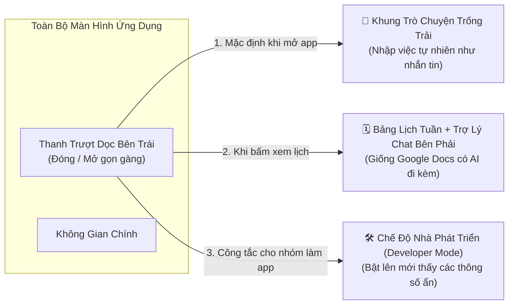

# Kế Hoạch Thiết Kế Lại Giao Diện SmartSchedule — Tối Giản, Tinh Tế & Thân Thiện Cho Mọi Người Dùng

**Nhánh phát triển (Branch):** `v1.0-alpha/ui-ux-chat`  
**Mục tiêu cốt lõi:** Xóa bỏ hoàn toàn cảm giác "phần mềm kỹ thuật phức tạp", biến ứng dụng thành một **người trợ lý trò chuyện thông minh, nhẹ nhàng và trực quan** — nơi bất kỳ ai (kể cả người không rành công nghệ) cũng có thể lên lịch học tập, làm việc chỉ bằng vài câu nhắn tự nhiên.

---

## 1. Bức Tranh Tổng Thể: Giao Diện Nhìn Sẽ Như Thế Nào?

Hãy tưởng tượng khi bạn vừa mở ứng dụng lên, thay vì thấy hàng chục bảng biểu, nút bấm hay con số rối mắt, bạn chỉ thấy **một không gian trò chuyện thoáng đãng, sạch sẽ và dịu mắt** (giống như giao diện chat của Antigravity hay ChatGPT), đi kèm một **thanh trượt mảnh nằm dọc bên trái**.

### Thanh Trượt Dọc Bên Trái & Nút Trang Chủ SmartSchedule
- Bấm vào logo **`SS SmartSchedule`** ở góc trên bên trái sẽ luôn đưa bạn quay thẳng về **`Trợ lý xếp lịch`**.
- Khi bấm đóng thanh trượt bên trái, toàn bộ thanh trượt (kể cả hộp Developer Mode ở dưới cùng) sẽ **ẩn đi hoàn toàn**, trả lại 100% không gian thoáng đãng cho màn hình chính.
- Đã lược bỏ mục *"Chuyển nhanh tuần"* ở thanh bên trái và bỏ mục *"Nền năng lượng sinh học"* / *"Tiện ích nhanh"* trong nút Cài đặt góc phải trên để giao diện tinh gọn tối đa.
- Chỉ giữ lại các lựa chọn cốt lõi:
  1. **💬 Trợ lý xếp lịch (Mặc định):** Quay về màn hình trò chuyện chính.
  2. **🗓️ Lịch Trình Tuần:** Mở bảng lịch tuần trực quan đi kèm khung **`Trợ lý tinh chỉnh trực tiếp`** ở bên phải (bấm nút mũi tên `⇥` sẽ thu gọn khung chat phải vào trong để bảng lịch mở rộng toàn màn hình).
  3. **🛠️ Developer Mode:** Khi bật lên, trợ lý sẽ hiển thị thêm hộp **💭 Quá trình suy nghĩ (Thinking Stage)** tóm tắt dễ hiểu cách AI hiểu câu lệnh (kể cả các câu phức hợp như *"từ 19h thứ 3 tới 21h thứ 5, làm trong 2 tiếng"* là 1 việc duy nhất) và lý do AI loại bỏ các thuật toán cơ bản để chọn thuật toán tối ưu theo nhịp sinh học, kèm nút **`🗓️ Kiểm tra lịch trình`** ngay dưới mỗi câu trả lời.

---

## 2. Trải Nghiệm Ở Màn Hình 1: Khung Trò Chuyện Chính (Khi Mới Mở App)

### 2.1. Luôn có gợi ý mở lời thông minh
Ngay giữa khung chat trống trải, trợ lý AI sẽ chào bạn bằng một câu ngắn gọn kèm **2 nút gợi ý lớn, dễ bấm**:
- **🔁 "Thêm hoặc đổi lịch lặp lại hằng ngày / hằng tuần"** (ví dụ: lịch đi học trên trường, giờ đi làm thêm, giờ tập thể dục, giờ nghỉ ngơi).
- **📌 "Thêm hoặc chỉnh sửa một công việc riêng lẻ"** (ví dụ: làm bài tập, viết báo cáo, ôn thi, chuẩn bị thuyết trình).

### 2.2. Nhập thiếu thông tin? Trợ lý sẽ hỏi lại nhẹ nhàng
Một lịch trình hay công việc chỉ cần 2 thông tin cơ bản:
1. **Làm việc gì** (nội dung công việc).
2. **Thời gian** (bắt đầu – kết thúc lúc nào, hoặc cần làm trong bao lâu trước hạn chót nào).

Vì hầu hết mọi người chỉ quen gõ ngắn gọn kiểu *"Chiều thứ 5 mình phải nộp bài thuyết trình"* (thiếu mất thời gian cần ngồi làm), trợ lý sẽ **không bắt bạn điền biểu mẫu dài dòng**, mà hỏi lại ngay trong khung chat kèm các nút chọn nhanh:
> *"Bạn dự kiến cần ngồi chuẩn bị bài thuyết trình này trong khoảng bao lâu?"*  
> `[⏱ 45 phút]` `[⏱ 1 tiếng]` `[⏱ 2 tiếng]` `[✍️ Tự nhập...]`

### 2.3. Hiểu tâm lý người dùng để tự động tinh chỉnh "thông số ngầm"
Người dùng bình thường sẽ không bao giờ phải tự chỉnh các thanh trượt phức tạp. Bạn chỉ cần nói bằng ngôn ngữ đời thường khi muốn sửa một việc đã tạo:
- Nếu bạn nhắn: *"Bài tập Toán này nặng đô lắm, đừng xếp liền một mạch mà chia nhỏ ra giúp mình, ưu tiên xếp vào buổi sáng lúc mình tỉnh táo nhất nhé."*
- **Phía sau hậu trường:** Trợ lý sẽ tự động tìm đúng "Bài tập Toán" bạn đã lưu và âm thầm điều chỉnh các tiêu chí ngầm cho bạn:
  - Đánh dấu đây là **việc nặng** và cộng thêm **thời gian dự phòng (trừ hao)** rộng rãi hơn để bạn không bị cuống.
  - Tự động **chia nhỏ** thành các buổi ngắn vừa sức, có giờ nghỉ giải lao ở giữa.
  - Đưa công việc đó vào đúng **khung giờ vàng trong ngày** mà đầu óc bạn minh mẫn nhất.

### 2.4. Xong một việc, luôn dẫn lối bước tiếp theo
Ngay sau khi thêm hoặc chỉnh xong một việc, trợ lý sẽ báo kết quả ngắn gọn rồi hỏi bạn:
> *"Mình đã cập nhật xong! Bạn có muốn thêm hay chỉnh sửa công việc nào nữa không?"*  
> Đi kèm 2 nút bấm nổi bật: **`[💬 Tiếp tục thêm/sửa việc]`** hoặc **`[🗓️ Mở xem lịch trình mới ngay]`**.

---

## 3. Trải Nghiệm Ở Màn Hình 2: Bảng Lịch Tuần + Trợ Lý Chat Bên Phải

Khi bạn bấm mở **Lịch Trình Các Tuần**, màn hình sẽ chia làm 2 phần cực kỳ cân đối (tương tự như khi bạn mở một file văn bản trên Google Docs và có khung trợ lý AI nằm dọc bên tay phải):

1. **Bên Trái (70% màn hình) — Bảng Lịch Tuần Sạch Sẽ & Dịu Mắt:**
   - Giữ lại đầy đủ các thao tác tiện lợi nhất: xem theo ngày hoặc cả tuần, kéo-thả ô lịch để dời giờ, bấm ghim cố định giờ học yêu thích, hoặc đánh dấu hoàn thành.
   - **Loại bỏ toàn bộ các con số và ký hiệu kỹ thuật rối mắt:** Trên mỗi ô lịch chỉ hiển thị thanh thoát **Tên công việc**, **Khung giờ (Bắt đầu – Kết thúc)** và màu sắc nhẹ nhàng phân biệt giữa lịch cố định và việc cần làm.
2. **Bên Phải (30% màn hình) — Khung Chat Trợ Lý Đi Kèm:**
   - Bạn vừa nhìn lịch, vừa có thể gõ yêu cầu ngay tại khung chat bên phải (ví dụ: *"Dời buổi ôn Tiếng Anh sang tối thứ 6 giúp mình"*).
   - **Hiệu ứng chuyển động trực tiếp trên lịch:** Ngay khi bạn nhắn xong (chỉ mất chưa tới vài giây), bạn sẽ thấy ô lịch bên trái **tự động lướt mượt mà sang vị trí mới** và sáng nhẹ lên để bạn nhận ra ngay sự thay đổi.
   - Sau khi lịch đổi xong, trợ lý bên phải sẽ báo rõ ràng: **"✅ Đã hoàn tất và chốt lịch trình mới cho bạn!"**

---

## 4. Xử Lý Tinh Tế Các Tình Huống Thực Tế (Edge Cases)

### Tình huống 1: Lịch bị kẹt hoặc trùng hạn chót (Không đủ thời gian)
- **Cách hiển thị:** Trợ lý không báo lỗi máy móc, mà nhắn rõ ràng trong khung chat với tông màu đỏ dịu:
  > *"🚨 Thứ Sáu này bạn có 2 bài tập lớn cùng hết hạn nhưng quỹ thời gian trống đang thiếu mất khoảng **1 tiếng**."*
- **Gợi ý giải quyết bằng 1 cú bấm:** Trợ lý đưa ra ngay các hướng gỡ rối nhẹ nhàng để bạn chọn:
  - `[🌱 Tạm nghỉ 1 buổi thói quen cá nhân (như đọc sách/tập gym) trong tuần này để nhường chỗ]`
  - `[✂️ Rút gọn bớt thời gian trừ hao của các việc nhẹ hơn]`
  - `[📅 Dời 1 việc ít quan trọng hơn sang cuối tuần]`

### Tình huống 2: Lịch vẫn xếp vừa hết nhưng quá dày đặc (Dễ gây kiệt sức)
- **Cách hiển thị:** Bảng lịch vẫn xếp đủ việc cho bạn, nhưng hiện một **thanh cảnh báo màu vàng ấm (Warning vàng)** ở ngày bị nặng kèm lời nhắc ân cần trong khung chat:
  > *"⚠️ Mình đã xếp kịp toàn bộ bài tập trước hạn cho bạn, nhưng **Thứ Năm đang khá dày (hơn 7 tiếng học và làm việc)**. Để đỡ mệt hơn, bạn có muốn mình san sẻ bớt 1 buổi học sang ngày Thứ Bảy đang rảnh không?"*
- Bạn có thể bấm **`[🌬️ Giãn lịch giúp mình cho thoáng]`** hoặc **`[👍 Giữ nguyên lịch này]`**.

### Tình huống 3: Đổi hạn chót (Deadline) & Tự động tính thời gian còn lại theo thói quen
- Khi bạn nhắn: *"Đổi hạn nộp bài Báo cáo sang Chủ nhật giúp mình, mình mới làm được một nửa, ước chừng cần làm tiếp khoảng 2 tiếng nữa."*
- Trợ lý sẽ dựa trên **phần thời gian còn lại** bạn vừa báo, kết hợp với **thói quen và nhịp độ làm việc thường ngày của riêng bạn** (ví dụ bạn thường cần thêm một chút thời gian trau chuốt ở cuối bài) để tự động cộng thêm một khoảng thời gian dự phòng hợp lý, rồi xếp lại vào lịch ngay lập tức.

---

## 5. Tốc Độ & Chế Độ Dành Riêng Cho Nhóm Phát Triển (Developer Mode)

1. **Tốc độ phản hồi tức thì (Luôn nhanh dưới 10 giây):**
   - Mọi thao tác thêm việc, đổi hạn chót hay sắp xếp lại lịch đều diễn ra gần như tức thì (thường dưới 1–2 giây, và cam kết luôn nhanh hơn 10 giây).
   - Hệ thống luôn ưu tiên giải quyết **những việc có hạn chót gần nhất** và **những việc có thể hoàn thành gọn trong tuần**.
2. **Công tắc Developer Mode ở thanh trượt trái (Phục vụ giai đoạn phát triển):**
   - Khi người dùng bình thường sử dụng: Công tắc này **TẮT** — giao diện hoàn toàn tối giản, trừu tượng và đẹp mắt.
   - Khi thành viên nhóm phát triển bật **Developer Mode = BẬT**:
     - Ngay trên từng công việc trong khung chat và từng ô trên bảng lịch sẽ hiện thêm **nhãn kiểm tra kỹ thuật (Debug Badge)** cho thấy toàn bộ các thông số ngầm đã được AI gán vào công việc đó: *Mã định danh truy vết (SHA-256), Nhịp độ sinh học (Sáng/Chiều/Tối), Độ nặng công việc, Thời gian gốc vs. Thời gian đã cộng đệm trừ hao, Chế độ tách nhỏ hay giữ nguyên khối*, cùng bảng công cụ chấm điểm thuật toán chi tiết.
